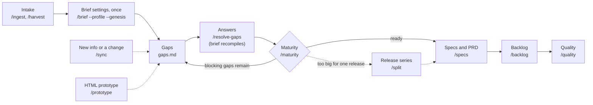

# Ignite Sentinel

[](LICENSE)
[](https://www.python.org/)
[](#why-it-is-different)

Ignite Sentinel turns a raw client request (a note, an email, a prototype, a pile of meeting minutes) into a project brief, a PRD, specs, a backlog and test cases, step by step, on your own machine. It never invents scope: every statement cites its evidence, and everything still unknown stays visible as a question, called a **gap**, until someone answers it.

You drive it from chat in Claude Code, Codex or Kilo Code, or from a plain terminal. Version 0.12.1.

New words (gap, brief, PRD, profile, genesis, lens, spec unit, slice plan...) are defined in the [glossary](user_guide/00-user-guide.md#glossary).

## Why it is different

- **It matures requirements, it does not write them up.** Discovery is the core: Sentinel finds what is missing, asks for it, and only moves on when the answers are in.
- **Nothing is invented.** A claim without evidence becomes a gap or a visible pending mark (`⏳ PENDING (GAP-X)` in the brief), never a guess.
- **Gates protect every handoff.** Specs refuse to run on an immature requirement; the backlog refuses to run on an unhealthy project. A refusal says why and prints the `next step:`.
- **Agents help, the runtime decides.** An agent can propose gaps, assumptions, PRD prose or backlog refinements, but each proposal must quote local evidence word for word or it is rejected.
- **Traceable end to end.** Every test case traces back through story, spec, brief and gap to the source file it came from.
- **Local-first.** Python standard library only. No cloud service, no external vector database, no remote embedding of client content. It runs on a locked-down virtual desktop.

## Who it is for

| You are a... | You get |
|---|---|
| **Business analyst** | A gaps document you can send to the client, a brief that cites every answer, and a clear "what is still missing and from whom". |
| **Product manager** | A readiness verdict (`READY`, `READY_WITH_WARNINGS`, `NOT_READY`), a PRD and a backlog you can defend line by line, and release planning when the scope is too big. |
| **Developer** | Bounded spec units, stories with acceptance criteria and a retrieval plan, a slice plan, and a feedback channel when implementation finds a hole. |

## How it works



1. **Intake.** `/ingest` reads the request and writes `gaps.md`: one question per missing or ambiguous point, with why it matters.
2. **Brief settings (once).** Right after the first `/ingest`, you confirm what kind of system it is: `/brief ACME_PORTAL --profile UI --genesis greenfield` ([profile and genesis](user_guide/00-user-guide.md#glossary)). `/next` asks for this step until you do it, with suggested values; see [what happens if you skip it](user_guide/00-user-guide.md#if-you-skip-the-brief-settings).
3. **Answers.** The client or a domain owner answers in that document; `/resolve-gaps` closes only what is confirmed, and the project brief recompiles with each answer.
4. **Maturity.** `/maturity` says `READY_FOR_SPECS` when no blocking gap is left; otherwise you plan another question round.
5. **Downstream.** `/specs`, `/backlog` and `/quality` derive the [PRD](user_guide/00-user-guide.md#glossary) (product requirements document), stories and test cases, all traced.

Changes keep flowing in: `/sync` turns a meeting note or an email into a traced change instead of silent scope creep.

## Choose your path

| You use | Install | Then type |
|---|---|---|
| Claude Code, least setup | Plugin from the marketplace `jmatzkin1980/ignite-sentinel` | `sentinel /init ACME_PORTAL` |
| Claude Code, every command as `/command` | Clone the repository | `/init ACME_PORTAL` |
| Codex | Clone the repository | `sentinel /init ACME_PORTAL` |
| Kilo Code | Clone the repository | `/init ACME_PORTAL` |
| A terminal only | Clone, or install the wheel | `python -m sentinel /init ACME_PORTAL` |

Step-by-step instructions for every path, including offline and locked-down machines: **[Install: choose your path](user_guide/06-installation-vscode.md)**.

You need Python 3.10 or newer and nothing else. Optional extras: `.[memory]` (local LanceDB retrieval), `.[memory-semantic]` (local embeddings), `.[mcp]` (MCP server).

## Quick start: your first gaps document

First create a folder `input/` in the folder you run Sentinel from (the repository root in a clone, your project folder with the plugin or the wheel; `workspaces/` will appear next to it). Save this synthetic request as `input/acme-request.md`:

```markdown
# ACME customer portal

ACME wants a web portal where account holders see their open invoices.
They log in with their customer number and download each invoice as a PDF.
Overdue invoices should stand out. Payments stay out of this first version.
The billing team owns the invoice data; it comes from the current billing system.
Go-live is wanted before the end of the quarter.
```

**In chat** (Claude Code clone, Kilo Code; add the `sentinel ` prefix in Codex or with the plugin):

```text
/doctor
/init ACME_PORTAL
/ingest ACME_PORTAL --source input/acme-request.md
/brief ACME_PORTAL --profile UI --genesis greenfield
/next ACME_PORTAL
```

> [!NOTE]
> In a Claude Code clone, `/init` can start Claude Code's own built-in project setup (it writes a `CLAUDE.md`) instead of Sentinel's. If that happens, send `/sentinel /init ACME_PORTAL`.

**In a terminal:**

```powershell
python -m sentinel /doctor
python -m sentinel /init ACME_PORTAL
python -m sentinel /ingest ACME_PORTAL --source input/acme-request.md
python -m sentinel /brief ACME_PORTAL --profile UI --genesis greenfield
python -m sentinel /next ACME_PORTAL
```

What happens:

1. `/doctor` checks Python and the repository files. `PASS` means go; a `WARN` about LanceDB is healthy. (With the plugin, the wheel or a `.pyz` it runs in runtime mode: it checks the interpreter, the folder and the optional extras, and skips the clone's files. With the Claude Code plugin, type `sentinel /doctor`: a bare `/doctor` is Claude Code's own diagnostic.)
2. `/init` creates `workspaces/ACME_PORTAL/`. The project starts with health `DIRTY` and stage `DISCOVERY_RAW`. That is normal: nothing is known yet.
3. `/ingest` copies a redacted version of the request (secrets masked) into the workspace and writes **`workspaces/ACME_PORTAL/01_discovery/gaps.md`**. Open it: each gap has a question, why it matters, what answering it unblocks, and an answer template. If the command stops with exit 3 and `--source file not found`, check the path: it is read relative to the folder you run Sentinel from.
4. `/brief --profile --genesis` confirms, once, what kind of system this is (here a user interface on a new build), and compiles the project brief with a pending mark wherever an answer is missing. Do it right after the first `/ingest`; until then `/next` asks for it.
5. `/next` prints the one next step. Right now it says *Waiting for client answers*: share `gaps.md` with the client.

Plain words work too: *"Create a Sentinel project ACME_PORTAL from input/acme-request.md and tell me what is missing."*

> [!TIP]
> When answers come back, the client fills, under each `### GAP-...` heading, the fields `Answer`, `Owner / source`, `Evidence or reference` and `Decision status` (`confirmed`, `pending` or `not applicable`); then run `/resolve-gaps ACME_PORTAL --source input/acme-answers.md`. The [user guide](user_guide/00-user-guide.md#first-run-end-to-end) walks the whole run from here to test cases.

## Next steps by role

- **Business analyst:** [concepts and first run](user_guide/00-user-guide.md), then [workflows](user_guide/03-workflows.md) (client answers, thin intake, changes) and [scenarios](user_guide/12-scenarios.md).
- **Product manager:** [concepts](user_guide/00-user-guide.md), [artifact views](user_guide/15-artifact-views.md), the [dashboard](user_guide/14-dashboard.md), and [release split](user_guide/03-workflows.md#release-split).
- **Developer:** [command reference](user_guide/01-command-reference.md), [artifact reference](user_guide/02-artifact-reference.md), [backlog workflow](user_guide/03-workflows.md#backlog-refinement-and-story-status), [traceability and memory](user_guide/05-traceability-and-memory.md), and the MCP server in [chat and MCP](user_guide/11-chat-commands.md).

## All commands

Every command takes the project id first (except `/doctor` and `/dashboard`). Flags, outputs and refusals are in the [command reference](user_guide/01-command-reference.md).

**Setup**

| Command | Purpose |
|---|---|
| `/doctor` | Check Python, repository files, skills, adapters and optional extras. |
| `/init` | Create a project workspace (brief v2 by default; `--brief-version 1` keeps v1). |
| `/dashboard` | Write a read-only HTML portfolio of all workspaces (`--theme` to restyle). |

**Discover**

| Command | Purpose |
|---|---|
| `/ingest` | Load a source (`.md`, `.txt`, `.html`, `.docx`), redact secrets, register it, open gaps. |
| `/sync` | Turn new or changed information into traced change; `--digest` for raw mail or chat threads. |
| `/harvest` | Load a tagged harvest of an existing codebase as evidence of what is already built. |
| `/sources` | List the source registry (F-NN rows); say which version governs, settle precedence, write the closing report. |
| `/gaps` | Regenerate `gaps.md`; `--top N` plans the next question round; `--id --disposition` records your call on an agent gap. |
| `/annotate` | Merge agent-found semantic gaps, each with a verbatim quote. |
| `/challenge` | Merge stress-test findings (pre-mortem, role-play, assumption inversion). |
| `/scrutinize` | Merge lens-by-lens scrutiny against raw input and domain context. |
| `/assume` | Register a BA-owned assumption with risk, uncertainty and cited basis. |
| `/stakeholders` | Register who owns which topic, so each gap routes to a person. |
| `/resolve-gaps` | Process answered gaps; close only confirmed answers; recompile the v2 brief. |
| `/context-request` | Ask Technology, Design, Quality, Frontend or Backend for context; track each request. |
| `/retrieve` | Pull a focused slice of context for an agent instead of the whole workspace. |
| `/reindex` | Rebuild local retrieval memory from the workspace files. |

**Define**

| Command | Purpose |
|---|---|
| `/maturity` | Decide whether discovery is ready for specs; rewrite the readiness matrix and the brief. |
| `/brief` | Compile the project brief; on a new project, confirm `--profile` and `--genesis` first. |
| `/self-review` | Register a skeptical review; `--sufficiency` asks "is the brief enough to build?". |
| `/split` | Plan a release series: `--assess`, `--propose`, `--confirm`, `--move`, `--close`. |
| `/prototype` | Inventory an HTML prototype, trace each screen, write its user manual. |

**Specify**

| Command | Purpose |
|---|---|
| `/specs` | Generate the PRD, the spec index and bounded spec units. |
| `/compose` | Merge agent-written PRD prose, each paragraph cited. |
| `/export` | Export gaps, brief, PRD or a context request; drafts are stamped, `--final` refuses while marks remain. |

**Backlog**

| Command | Purpose |
|---|---|
| `/backlog` | Derive epics, stories, acceptance criteria and the slice plan from the spec units. |
| `/backlog-status` | Refresh the BA board `04_backlog/BACKLOG.md`. |
| `/story-status` | Move a story through its lifecycle with Definition of Ready and Done checks. |
| `/refine-backlog` | Merge cited agent refinement proposals for BA review. |
| `/implementation-feedback` | Bring findings from implementation back as traced gaps and Done checks. |
| `/quality` | Score stories and write test cases and the readiness audit. |

**Verify**

| Command | Purpose |
|---|---|
| `/trace` | Rewrite the traceability matrix and graph. |
| `/health` | Audit blockers, staleness and hand edits of governed files. |
| `/validate` | Check structure; quality findings are warnings. Exit 5 when not `VALID`. |
| `/status` | The readiness verdict, gap counts and next step; `--full` for the detail. |
| `/next` | The next step alone. |
| `/view` | Write a read-only HTML view of one of 11 artifacts (gaps, brief, PRD, readiness, ...). |

Release-aware commands take `--release rN` once a series is confirmed: `/specs`, `/backlog`, `/quality`, `/story-status`, `/trace`, `/validate`, `/status`, `/next`, `/view`.

## When a command refuses

Every failure prints the reason, and a `next step:` line when the runtime knows it. The exit code tells you the kind of problem:

| Code | Meaning | Typical fix |
|---|---|---|
| 0 | Success | Go on. |
| 2 | Wrong usage | Fix the syntax (missing `--source`, unknown option). |
| 3 | Invalid input | Fix the payload or the value the message names. A `--source` file that does not exist ends here too: check the path, it is read relative to the folder you run Sentinel from. |
| 4 | Gate refusal | A missing prerequisite or the project's state stops the command: run the step the message names, or `/next`. |
| 5 | Unfavourable verdict | `/validate` is not `VALID` or `/doctor` is not `PASS`: read the findings. |
| 6 | Workspace busy | Another command holds the workspace; wait and retry. |
| 1 | Unexpected error, with a traceback | A genuine bug; report it with the traceback. |

The full troubleshooting flow is in [workflows](user_guide/03-workflows.md#a-gate-refused).

## Documentation

| Page | For |
|---|---|
| [00 Start here](user_guide/00-user-guide.md) | Concepts, glossary, first run end to end |
| [01 Command reference](user_guide/01-command-reference.md) | Every command: syntax, options, outputs, refusals |
| [02 Artifact reference](user_guide/02-artifact-reference.md) | Every generated file and who may change it |
| [03 Workflows](user_guide/03-workflows.md) | What to do in each situation |
| [04 Skills catalog](user_guide/04-codex-skills-guide.md) | The 27 agent skills |
| [05 Traceability and memory](user_guide/05-traceability-and-memory.md) | Graph, matrix, retrieval, context packs |
| [06 Install](user_guide/06-installation-vscode.md) | Choose your path |
| [07 Kilo Code](user_guide/07-kilo-code-adapter.md) · [08 Codex](user_guide/08-codex-adapter.md) · [13 Claude Code](user_guide/13-claude-adapter.md) | Using Sentinel on that surface |
| [09 Secure environments](user_guide/09-secure-environments.md) | Offline, VDI, approved installs |
| [10 Versioning workspaces](user_guide/10-repo-and-branching-strategy.md) | Keeping your projects in git |
| [11 Chat and MCP](user_guide/11-chat-commands.md) | Driving Sentinel from chat; intent to command |
| [12 Scenarios](user_guide/12-scenarios.md) | Worked examples |
| [14 Dashboard](user_guide/14-dashboard.md) · [15 Artifact views](user_guide/15-artifact-views.md) · [17 Themes](user_guide/17-themes.md) | HTML views and their look |
| [16 Portability](user_guide/16-portability.md) | No-install mode, `.pyz`, environment matrix |
| [18 Claude Code plugin](user_guide/18-claude-plugin.md) | Plugin install, channels, archive |
| [19 Threat model](user_guide/19-threat-model.md) · [20 Admin guide](user_guide/20-admin-guide.md) | Security review and managed settings |

## Security

- [Security policy](SECURITY.md): how to report a vulnerability and supported versions.
- [Threat model](user_guide/19-threat-model.md): assets, threats, controls and how to verify each.
- [Admin guide](user_guide/20-admin-guide.md): managed settings, pinning, retention, audit trail.
- [IT portability note](PORTABILITY.md): a short note for an IT or security review.

Contributing to the framework itself? See [MAINTAINERS.md](MAINTAINERS.md). Release history: [CHANGELOG.md](CHANGELOG.md).

## License

[MIT](LICENSE) © 2026 jmatzkin1980
