# Start here

This page is for you if you have never used Ignite Sentinel. It explains the ideas first, then walks one made-up project from an empty folder to a backlog with test cases. You do not need to know any programming. If Sentinel is not installed yet, start with [Install: choose your path](06-installation-vscode.md).

**How to type the commands.** This page shows each command in chat form, for example `/init ACME_PORTAL`. In Codex and with the Claude Code plugin, put `sentinel ` in front (`sentinel /init ACME_PORTAL`). In a plain terminal, put `python -m sentinel ` in front (`python -m sentinel /init ACME_PORTAL`). You can also ask in plain words; see [Driving Sentinel from chat](11-chat-commands.md). `ACME_PORTAL` is the example project: replace it with yours.

## The idea in one picture

A client rarely brings a complete requirement. Sentinel treats what they bring as **evidence**. It finds what is missing, asks for it, and only builds the next documents on what someone has confirmed.

<!-- Diagram source: user_guide/images/guide-idea.mmd (re-render with tools/render_doc_diagrams.py) -->


Sentinel does not replace your judgment, or that of product, design, technology and quality. It makes sure that judgment is written down, linked to its source, and visible before someone builds on it.

## Concepts

### Workspace

A **workspace** is the folder of one project: `workspaces/ACME_PORTAL/`. Everything Sentinel knows about the project is a plain file in that folder: the evidence, the open questions, the brief, the specs, the backlog. Those files are the truth. Sentinel also keeps a search index so an AI assistant can find context quickly; if the index and a file ever disagree, the file wins.

### Organizing folders: one per client, one workspace per project

The folder you open in your assistant (or run Sentinel from) is the root. Every `/init` adds one project under its `workspaces/` folder. A good habit is **one root folder per client** and **one workspace per project** of that client:

```text
C:\clients\acme\               the folder you open: client ACME
├── input\                     the client's files before you load them (optional)
├── dashboard.html             /dashboard: every ACME project side by side
└── workspaces\
    ├── portal\                /init portal
    ├── mobile-app\            /init mobile-app
    └── reports\               /init reports
```

- **The project id names the project, not the client.** The folder already says who the client is, so keep the id short (`portal`, not `acme-portal-2026`).
- **`/dashboard` shows that client's projects.** It covers every workspace under the folder you run it from, so one client's projects stay together and apart from other clients'.
- **Each project is independent.** It has its own questions, brief, backlog and links. Material that serves two projects is loaded into each.
- **This works best with the Claude Code plugin or an installed package**, which run in any folder. In a copy (clone) of the Sentinel repository, the clone itself is the root, so every client would share one `workspaces/` folder and one dashboard. If you work from a clone, keep one clone per client.
- **One private repository per client folder** is the natural unit if you keep your work in git: see [Versioning your workspaces](10-repo-and-branching-strategy.md#option-3-one-private-repository-per-client-folder).

### The lifecycle

A project moves through the same stages, in this order. Sentinel tells you where you are and what comes next.

1. **Discovery.** You load the client's request. Sentinel lists what is missing as questions, called gaps.
2. **Answers.** The client and the domain teams answer. Each confirmed answer closes a question and updates the brief.
3. **Maturity check.** When no blocking question is left, the requirement is mature enough to specify.
4. **Specs.** Sentinel writes the PRD (product requirements document) and small, bounded spec units.
5. **Backlog.** Sentinel derives epics, user stories with acceptance criteria, and a build order.
6. **Quality.** Sentinel scores each story and writes test cases.
7. **Handoff and follow-up.** You audit, hand off, track each story, and bring back what the developers find.

Changes can arrive at any stage: a meeting note, an email, a new version of a document. `/sync` turns each one into a recorded change and shows which documents it affects.

`/status` names the current stage with one of these values (the [dashboard](14-dashboard.md) shows the plain words):

| Stage | What it means |
|---|---|
| `DISCOVERY_RAW` | The project exists; the request is not loaded yet, or nothing is known. |
| `CLIENT_RESPONSE_NEEDED` | Blocking questions are waiting for the client. |
| `DOMAIN_RESPONSE_NEEDED` | No blocking question is left; other questions still wait for a domain team (technology, design, quality). |
| `READY_FOR_PROJECT_BRIEF` | Discovery is complete enough to compile the brief. |
| `BRIEF_BELOW_THRESHOLD` | The brief is too thin to go on: too many places are still pending. |
| `SELF_CORRECTION_FAILED` | The brief does not reflect a criterion someone confirmed. |
| `UNITS_NOT_IMPLEMENTABLE` | Some requirement units are too vague to build. |
| `READY_FOR_SPECS` | Ready for the PRD and specs. |
| `SPECS_BELOW_THRESHOLD` | The specs are too thin to derive a backlog from. |
| `READY_FOR_BACKLOG` | Ready to generate stories. |

### Evidence and sources

Every file you load becomes a numbered **source**: `F-01`, `F-02`, and so on. Sentinel keeps a copy in the workspace and replaces anything that looks like a secret (a password, a key, a token) with a placeholder such as `<SECRETO:credential>`; it lists what it replaced so you can check. It also flags passages that look like instructions to an AI and leaves them out of the analysis. When two sources contradict each other, Sentinel opens a blocking question instead of picking one. `/sources` lists the sources and lets you say which version governs.

### Gaps

A **gap** is something missing, ambiguous, risky or unverifiable, written as a question for a person. A gap is not a failure: it is how Sentinel avoids inventing. Each gap has:

- an id, such as `GAP-SCOPE`, which you keep next to the answer so Sentinel can match them;
- a **lens**, the point of view it belongs to: business, product, technical, design, quality, compliance or delivery;
- a **severity**: critical, high, medium or low. Critical and high gaps **block** by default: specs wait until they are closed. (You can change which severities block in the project's `sentinel.config.yaml`.)
- a **status**:

| Status | What it means |
|---|---|
| `OPEN` | Nobody has answered yet. |
| `ANSWERED` | An answer arrived, but the decision is not confirmed yet. A blocking gap here still blocks. |
| `PARTIALLY_CLOSED` | Some information arrived, not enough (for example "TBD"). |
| `CLOSED` | A confirmed, real answer closed it. |

You do not send the client the working list of gaps. You send an **interview script**: the same open questions, blocking ones first, grouped by topic (or by person once you register who owns which topic), with a short form under each one. The client fills the form; `/resolve-gaps` reads the answers back. A gap closes only when its answer says `Decision status: confirmed` (or `not applicable`, which records something as out of scope).

### The brief

The **project brief** is the main document of discovery: what the project is for, who uses it, the scope, the design, technical and governance views, and what is still unknown. Sentinel writes it; you never type into it. Every statement in it cites the source or answer it came from. Where nothing confirms a point yet, the brief says so with a **pending mark** such as `⏳ PENDING (GAP-SCOPE)`, which names the question that will fill it. Each confirmed answer rewrites only the places it fills.

Before the first brief, you confirm two **brief settings**, once:

- the **profile**, what kind of system it is: `UI` (screens and a backend), `API`, `BAT` (batch), `INT` (integration with a third party), `MIG` (legacy migration), `REG` (regulatory), `MT` (multi-tenant platform); you can combine them;
- the **genesis**, where the project starts: `greenfield` (new), `brownfield-integration` (uses an existing system), `brownfield-extension` (extends one) or `brownfield-replacement` (replaces one).

These decide which parts of the brief are required. Sentinel proposes values from the request; you confirm them.

### Gates

A **gate** is a check that stops a command when what it needs is not ready. It never decides for you: it says what is missing and which command to run next. For example, `/specs` waits while blocking gaps are open, and `/quality` waits until there are stories.

### Maturity, health and verdict

**Maturity** answers "is discovery ready for specs?". `/maturity` says `READY_FOR_SPECS` when no blocking gap is left, or `BLOCKED` with the list of blocking gaps. It also gives a **maturity score** from 0 to 1 that shows progress; the score is not a gate.

**Health** answers "is anything in the way?". It is `CLEAN` or `DIRTY`. `DIRTY` means something needs attention first: blocking questions are still open, a protected file was edited by hand, or a document is out of date after a change. A new project starts `DIRTY`, which is normal. While health is `DIRTY`, `/backlog`, `/quality` and `/refine-backlog` wait, and they say which commands to run, in order. `/health` lists every finding.

**Verdict** answers "can the team build from this?". `/status` says `READY`, `READY_WITH_WARNINGS` or `NOT_READY`, with the reasons. A project can be mature enough for specs and still be `NOT_READY` to build, for example while the brief has pending marks that block.

### Governed artifacts

Some files may only change through a Sentinel command, because other files are built from them. They are called **governed artifacts**:

| File | Written by |
|---|---|
| The gaps list (`01_discovery/gaps.md`) | `/ingest`, `/gaps`, `/resolve-gaps` and others |
| The requirements (`02_requirements/requirements.md`) | `/ingest`, `/resolve-gaps` |
| The brief (`02_requirements/project-brief.md`) | `/brief`, `/resolve-gaps`, `/maturity` |
| The PRD and specs (`03_specs/`, top level) | `/specs` |
| The backlog (`04_backlog/`, top level) | `/backlog`, `/story-status` |

In Claude Code, an AI assistant that tries to edit one of these files by hand is stopped and told which command owns it (Codex and Kilo Code carry their own guards). If someone edits one another way, `/health` reports it.

> [!IMPORTANT]
> Never hand-edit a governed artifact. If something in it is wrong, fix the cause (the evidence or the answer) and run the command that owns the file again.

### What you may edit

| You may | You may not |
|---|---|
| The project settings in `sentinel.config.yaml` (domains, gate thresholds, language, privacy scan) | Any governed artifact (see the table above) |
| Your own files in `input/` before you load them | `state.json`, the `.sentinel/` folder, the traceability files |
| Bring in the first request with `/ingest`, and every later file (context, prototypes, notes) with `/sync --source` | Drop files into `00_raw/` by hand and leave them: until `/sync` picks them up, they skip secret masking, the source list and the contradiction checks |

### Traceability

Every item Sentinel writes has an id and a link to what it came from: a source (`F-01`), a gap (`GAP-...`), a requirement (`REQ-...`), the PRD (`PRD-...`), a spec unit (`SPEC-U-...`), an epic (`EPIC-...`), a story (`US-...`), an acceptance criterion (`AC-...`), a test case (`TC-...`), a change (`CHG-...`). Together these links answer "where did this story come from?" and "what does this change affect?". `/trace` rewrites the table of links. More in [Traceability and memory](05-traceability-and-memory.md).

## First run end to end

This walkthrough uses a made-up project, **ACME_PORTAL**: a web portal where a company's customers check their open invoices. Every output below comes from a real run of these exact commands, shortened. Your numbers may differ slightly with another request.

<!-- Diagram source: user_guide/images/guide-first-run.mmd (re-render with tools/render_doc_diagrams.py) -->


**Before you start.** In the folder you run Sentinel from, create a folder `input/` and save this request as `input/acme-request.md`:

```markdown
# ACME customer portal

ACME wants a web portal where account holders see their open invoices.
They log in with their customer number and download each invoice as a PDF.
Overdue invoices should stand out. Payments stay out of this first version.
The billing team owns the invoice data; it comes from the current billing system.
Go-live is wanted before the end of the quarter.
```

Optionally, check the setup first with `/doctor` (in a Claude Code clone, send `/sentinel /doctor`, because Claude Code has its own `/doctor`; with the plugin, `sentinel /doctor`). It ends with `"verdict": "PASS"`.

### 1. Create the project

**Why:** every project needs its own workspace.

```text
/init ACME_PORTAL
```

In a Claude Code clone, `/init` can start Claude Code's own project setup (it writes a `CLAUDE.md`) instead of Sentinel's. If that happens, send `/sentinel /init ACME_PORTAL`.

**What you see:** the path of the new folder, `workspaces/ACME_PORTAL/`. If you run `/status` now, it shows health `DIRTY`, stage `DISCOVERY_RAW` and the next step *Load the initial requirement*.

**What it means:** the project exists and nothing is known yet. `DIRTY` is expected at this point.

### 2. Load the request

**Why:** Sentinel needs the client's words as evidence before it can ask anything.

```text
/ingest ACME_PORTAL --source input/acme-request.md
```

**What you see:** a short summary: the request became source `F-01`, no secrets were masked, and the list of gaps was written to `01_discovery/gaps.md`. Open that file: each gap has a question, why it matters, what answering it unblocks, and an answer form.

**What it means:** discovery has run. Sentinel reads `.md`, `.txt`, `.html` and `.docx` files; it refuses a PDF or another binary file. If it answers *--source file not found*, check the path: it is read from the folder you run Sentinel from.

### 3. Confirm the brief settings

**Why:** the brief needs to know what kind of system it describes (its [profile and genesis](#glossary)). You do this once, right after the first `/ingest`.

Ask for the next step, and Sentinel proposes the values:

```text
/next ACME_PORTAL
```

> *Confirm the brief settings.* This project compiles the brief v2. Confirm its profile and genesis once with /brief; the suggested values come from the raw input, so check them first.
> Command: `/brief ACME_PORTAL --profile UI --genesis greenfield`

A portal with screens on a new build is `UI` and `greenfield`, so confirm:

```text
/brief ACME_PORTAL --profile UI --genesis greenfield
```

**What you see:** the path of the brief, `02_requirements/project-brief.md`, and a summary of its sections, all still pending at this point.

**What it means:** the brief exists. Open it: where nothing is confirmed yet it shows a pending mark such as `⏳ PENDING (GAP-BRIEF-S1)`, and near the top a line *Ready to build: no.* From now on, every answer you process rewrites the brief in place.

If you are not sure which values fit, run `/brief ACME_PORTAL` without the settings first to see Sentinel's proposal. That run writes a provisional brief in the older layout and opens the critical gap `GAP-BRIEF-PROFILE`; both go away when you confirm. Combine profiles with commas (`--profile UI,REG`). `MIG` only goes with `--genesis brownfield-replacement`.

#### If you skip the brief settings

> [!WARNING]
> Until you confirm the settings, `/next` and `/status` keep asking for them, and `/maturity` opens the critical gap `GAP-BRIEF-PROFILE` and answers `BLOCKED`. So `/specs` and `/backlog` refuse, and no brief carries the answers you process in the meantime (they are kept). Confirming with `/brief ACME_PORTAL --profile ... --genesis ...` closes the gap and compiles the brief from everything answered so far.

### 4. Ask for the next step

**Why:** `/next` always tells you the one thing to do now.

```text
/next ACME_PORTAL
```

> *Waiting for client answers.* Send the client the interview script (/export --artifact gaps --format interview) and run /resolve-gaps when answers return.

**What it means:** Sentinel has done what it can until the client replies. `/status ACME_PORTAL` gives the same step plus the bigger picture. In this run it showed 35 gaps, 4 of them blocking (`GAP-ACCEPTANCE`, `GAP-OBJECTIVE`, `GAP-SCOPE`, `GAP-USERS`), stage `CLIENT_RESPONSE_NEEDED` and verdict `NOT_READY`.

### 5. Plan a question round and share it

**Why:** the client needs the questions in a form they can answer, and you need to know which ones to raise first.

```text
/gaps ACME_PORTAL --top 5
/export ACME_PORTAL --artifact gaps --format interview
```

**What you see:**

- `/gaps --top 5` writes `01_discovery/gap_round.md`: the five questions most worth asking now, for your own meeting plan. In this run: `GAP-SCOPE`, `GAP-OBJECTIVE`, `GAP-USERS`, `GAP-BACKLOG-SLICING-READINESS` and `GAP-BRIEF-S1`.
- `/export` writes the interview script, `08_context_packs/exports/gaps-interview.md`. It holds **every** question that is not closed yet, not only the five: first the *Blocking questions*, then the *Follow-up questions*, grouped by topic (*Business goals and rules*, *Product scope*, *Quality and testing*, ...). Each question keeps its gap id and has an empty form: *Answer*, *Owner / source*, *Evidence or reference*, *Decision status*.

**What it means:** send the client the interview script, not `gaps.md`. The gaps file is your working list, with technical details and closed gaps; the script leaves out the brief settings question, which only you answer. Some questions come from keyword checks, so read the script and delete any question that does not fit before you send it.

To route questions to people, register who owns which topic, for example `/stakeholders ACME_PORTAL --add --name "Head of Billing" --domain business`. The next export then groups the questions by person.

Optional: let an AI assistant look for more gaps before you ask (`/annotate`, `/challenge`, `/scrutinize`). See [Workflows](03-workflows.md).

### 6. Process the answers

**Why:** confirmed answers are what close gaps and fill the brief.

The client writes each answer in the form under its question, keeping the `### GAP-...` heading. For example:

```text
### GAP-SCOPE

- Answer: In scope: log in, list open invoices, download an invoice as PDF, highlight overdue invoices. Out of scope: payments, disputes.
- Owner / source: Product owner
- Evidence or reference: Kick-off meeting, minutes item 3
- Decision status: confirmed
```

In this run, the answered file confirmed the four blocking gaps, and gave one more answer with `Decision status: pending`. Save the answered copy as `input/acme-answers.md` and process it:

```text
/resolve-gaps ACME_PORTAL --source input/acme-answers.md
```

**What you see:** which gaps closed (here `GAP-OBJECTIVE`, `GAP-USERS`, `GAP-SCOPE`, `GAP-ACCEPTANCE`), which are answered but not closed (here the `pending` one), and which are still open. A report is written to `07_changes/00_client_responses/acme-answers_gap_resolution_report.md`, and the brief is rewritten in the places the answers fill.

**What it means:**

- Only `confirmed` (or `not applicable`) closes a gap. `pending` leaves it `ANSWERED`; a vague answer or a missing status leaves it `PARTIALLY_CLOSED`.
- Always fill *Evidence or reference*. Without it the gap still closes, but the report flags it as closed without a source.
- An answer written as a testable sentence, such as "When an account holder opens the portal, the system shall list every open invoice with its number, amount and due date.", becomes a testable requirement (an [EARS](#glossary) requirement).
- In this run `/status` now showed health `CLEAN` (no blocking gap is open) and stage `DOMAIN_RESPONSE_NEEDED` (other questions still wait for the domain teams).

### 7. Check maturity

**Why:** specs should only be written on a mature requirement.

```text
/maturity ACME_PORTAL
```

**What you see:** `READY_FOR_SPECS` (or `BLOCKED` with the list of blocking gaps). It also writes `01_discovery/requirement_maturity_report.md` and the readiness matrix, which shows, per lens, what is confirmed, assumed or open. `/next` then says:

> *Resolve pending gaps.* No blocking gap is open. Close the remaining ones if you can, or move on: run /brief, then /specs.

**What it means:** you may go on to specs. The other open questions are not lost: they stay visible as pending marks in the brief and the PRD. If `/maturity` says `BLOCKED`, go back to step 5 for another round. If the scope is too big for one delivery, see [release split](03-workflows.md#release-split) before specs.

Optional: ask a fresh AI reader whether the brief is enough to start building, with `/self-review ACME_PORTAL --sufficiency --source sufficiency.json` (the `sentinel-self-review` skill writes that file).

### 8. Generate the PRD and specs

**Why:** the PRD is the readable product document; the spec units are small pieces an implementation team can take one at a time.

```text
/specs ACME_PORTAL
```

**What you see:** the PRD at `03_specs/prd.md`, an index at `03_specs/specs.md`, and one spec unit per confirmed requirement under `03_specs/units/` (here `SPEC-U-001.md`). The summary shows which of the PRD's 13 sections are filled and which still wait for an answer; in this run 5 were filled.

**What it means:** `/status` now shows stage `READY_FOR_BACKLOG` and the next step *Prepare the backlog*. Domain teams can ask for more context with `/context-request ACME_PORTAL --domain technology`.

### 9. Generate the backlog

**Why:** the team builds from stories, not from a PRD.

```text
/backlog ACME_PORTAL
/backlog-status ACME_PORTAL
```

**What you see:** `/backlog` writes the epics and stories under `04_backlog/`, a build order (`SLICE-PLAN.md`, the [slice plan](#glossary)) and the board `04_backlog/BACKLOG.md`. In this run: one value story, `US-001` (list the open invoices), and one [enabler](#glossary) story, `US-002` (shared audit and observability evidence), in a separate epic. `/backlog-status` refreshes the board: both stories are `Draft`, with warnings such as *Assign a human owner with /story-status --owner before treating the story as Ready.*

**What it means:** the stories exist, but they are not ready to start until they pass the Definition of Ready. Whatever is missing stays visible in the story as `[PENDING INPUT]` or `[PENDING DOMAIN CONTEXT]`, never invented.

### 10. Check quality

**Why:** each story should be small, valuable and testable before a team takes it.

```text
/quality ACME_PORTAL
```

**What you see:** test cases (here `05_quality/TC-001.md` and `TC-002.md`) and the audit `05_quality/backlog_readiness_audit.md`, which scores each story ([INVEST, SPIDR](#glossary), vertical slicing). In this run the overall result was `PARTIAL`: `US-001` scored 0.83 with the warning *Story must be small but still independently meaningful, testable and useful.*

**What it means:** read each warning and decide; the audit feeds the Definition of Ready checks.

### 11. Audit and hand off

**Why:** before you hand off, check that everything is linked, healthy and consistent.

```text
/trace ACME_PORTAL
/health ACME_PORTAL
/validate ACME_PORTAL
/status ACME_PORTAL
```

**What you see:** in this run, `/health` answered `CLEAN` with no findings, `/validate` answered `VALID`, and `/next` said *Validate and hand off*. `/status` still answered `NOT_READY`, with the reason:

> The project brief says: Ready to build: no. 16 pending marks block (§7). Close the gaps its pending marks name.

**What it means:** the structure is sound and the first story is traced from the request to its test case, but the brief still has open questions that block a full build. You can hand off what is confirmed and keep closing the rest: each new answer goes through `/resolve-gaps`, and the brief, specs and backlog follow. The verdict turns `READY` (or `READY_WITH_WARNINGS`) when the blocking pending marks are closed.

**Next:** move stories with `/story-status`, export what you hand off with `/export`, and bring implementation findings back with `/implementation-feedback`. See [handoff and export](03-workflows.md#handoff-and-export).

## Reading results

Each command prints a summary. In chat, the assistant reads it for you and tells you what it means; in a terminal, you see it as structured text. The parts that matter most are the **next step** and, for `/status`, the **verdict** and its reasons.

When a command refuses, it says why, and often adds a line that starts with `next step:` naming the command to run. Do that, or run `/next`. What to do for each kind of refusal is in [Workflows](03-workflows.md#a-gate-refused) and [When something went wrong](21-recovery.md).

<details><summary>For the technical reader: output fields and exit codes</summary>

Every command prints JSON on standard output. The fields to look at:

| Command | Look at |
|---|---|
| `/status` | `verdict.verdict` and `verdict.blockers` (`verdict` is an object), `gap_counts`, `readiness_stage`, `next_step` (text) and `next_action` (the same step as an object) |
| `/next` | `title`, `text`, `command` |
| `/maturity` | `readiness`, `blocking_gaps` |
| `/brief` | `brief_settings.confirmed`, `brief_settings.proposal`, `warnings` |
| `/validate` | `verdict` |

`/status` always exits 0, even for `NOT_READY`; read the verdict. A failing command prints `sentinel error: ...` and often `next step: ...` on standard error, and exits with:

| Code | Meaning |
|---|---|
| 0 | Success |
| 1 | Unexpected error, a traceback follows. It is a genuine bug; report it. |
| 2 | Wrong usage: a missing required option or an unknown value |
| 3 | Invalid input: a bad value, a `--source` file that does not exist, an unsupported file, a refused payload |
| 4 | Gate refusal: a missing prerequisite or the project's state (health, phase) stops the command |
| 5 | Unfavourable verdict: `/validate` not `VALID`, `/doctor` not `PASS` |
| 6 | Workspace busy: another command holds the workspace lock (it waits 10 seconds first) |

The durable project state is `state.json`. Values that can be recomputed live in `.sentinel/derived/state.json`. Every project command (all except `/init`, `/doctor` and `/dashboard`) appends one line to `.sentinel/command_log.jsonl`. The full list is in the [command reference](01-command-reference.md#exit-codes).

</details>

## Workspace shape

Where the files of one project live, with what each folder holds:

```text
workspaces/ACME_PORTAL/
  00_raw/              the evidence: the request and every file you load (secrets masked)
  01_discovery/        the gaps, seeds, decisions, multi-lens review, maturity report
  02_requirements/     the requirements and the project brief (and releases, prototypes)
  03_specs/            the PRD, the spec index and the spec units
  04_backlog/          epics, stories, the board BACKLOG.md and the build order SLICE-PLAN.md
  05_quality/          test cases and the story quality audit
  06_traceability/     the links between items, the health report, the command history
  07_changes/          changes, client answers and their reports, implementation feedback
  08_context_packs/    focused bundles for AI assistants, exports, readable HTML views
  memory.lancedb/      the search index (rebuilt from the files when needed)
  .sentinel/           working files: the lock, recomputed state, the command log
  state.json  sentinel.config.yaml  .gitignore
```

Every file is described in the [artifact reference](02-artifact-reference.md).

### A project split into releases

When one brief is too big for one delivery, `/split` divides it into releases inside the same workspace. Nothing moves to another folder: each release gets a sub-folder next to the project-wide files.

```text
workspaces/portal/
  02_requirements/
    project-brief.md       the whole project's brief
    series/                proposal, confirmed partition, index, release guide, scope changes
    r1/project-brief.md    release 1's brief
    r2/project-brief.md    release 2's brief
  03_specs/r1/  03_specs/r2/            /specs portal --release r1
  04_backlog/r1/  04_backlog/r2/        /backlog portal --release r1
  05_quality/r1/  06_traceability/r1/  08_context_packs/r1/
```

1. `/split portal --assess` says whether a split is worth it; `--propose` stores a proposal; `--confirm` (with the names of the BA and the technical lead) compiles one brief per release.
2. Downstream commands take `--release rN`: `/specs`, `/backlog`, `/quality`, `/story-status`, `/view`, `/validate`, `/trace`, `/status` and `/next`. Their output goes to that release's sub-folder.
3. Without `--release`, a command works on the whole project.
4. `/split portal --close r1` closes a release once all its stories are Done, and unblocks the releases that wait for it.

The full flow is in [Workflows](03-workflows.md#release-split).

## Privacy

- **Sentinel itself makes no network calls.** Everything it writes stays in your project folder: the workspaces, the exports (`08_context_packs/exports/`), the HTML views and `dashboard.html` (written in the folder you run `/dashboard` from). Its search index is local too.
- **Your AI assistant does read the content.** When you drive Sentinel from Claude Code, Codex or Kilo Code, the assistant reads the client's documents and the files Sentinel writes in order to help you, so that content goes to the assistant's model provider, under your organization's agreement with that provider. If a client does not allow that, run Sentinel from a plain terminal: then nothing leaves your machine.
- **Secrets are masked, names are not.** Sentinel replaces passwords, keys and tokens in the copies it keeps, but it does not hide names, amounts or other business content. Your original files in `input/` are not changed.
- **Comments typed in an HTML view stay in your browser** until you clear them; see [Artifact views](15-artifact-views.md).
- When you share an example or report a problem, use made-up data, never real client names, systems or data.

For an IT or security review, see [Secure environments](09-secure-environments.md), the [threat model](19-threat-model.md) and the [admin guide](20-admin-guide.md).

## Glossary

| Term | Meaning |
|---|---|
| **Acceptance criterion (`AC-`)** | A testable condition a story must meet, written by `/backlog` and checked by its test cases. |
| **Assumption (`ASM-`)** | Something you decide to proceed with without confirmation, registered with `/assume` with its owner, risk and basis, and kept visible downstream. |
| **Blocking gap** | A gap whose severity blocks (critical and high by default) and that is not closed yet; specs wait until none is left. |
| **Brief (project brief)** | The main discovery document, `02_requirements/project-brief.md`, compiled by Sentinel from cited evidence and answers, with pending marks where nothing is confirmed. |
| **Brief settings** | The [profile](#glossary) and [genesis](#glossary) you confirm once with `/brief --profile ... --genesis ...`, which decide which parts of the brief are required. |
| **Brief v1 / v2** | The two brief layouts: v2 (the default for new projects) has sections §0 to §9 and two annexes and is rewritten in place as answers arrive, while v1 is the older layout with 11 sections, kept for older projects or with `/init --brief-version 1`. |
| **Change (`CHG-`)** | A recorded change to the project, created by `/sync` or by processing answers, with the list of what it affects. |
| **Context pack** | A small bundle of focused context under `08_context_packs/`, so an AI assistant reads only what one task needs. |
| **Context request (`CTX-`)** | A request for context to a domain team (technology, design, quality, frontend, backend), made with `/context-request` and tracked as `active`, `answered`, `closed` or `obsolete`. |
| **Dashboard** | A read-only HTML page, written by `/dashboard`, that shows every project under the current folder side by side. |
| **Decision (`DEC-`)** | A decision taken from the request or from a confirmed answer, listed in `01_discovery/decisions.md`. |
| **Definition of Ready / Done (DoR / DoD)** | The checks a story must pass before it may start (Ready) and before it may close (Done), applied by `/story-status`; a failed check warns by default and blocks in strict mode. |
| **EARS** | A sentence pattern for requirements, such as "When <trigger>, the system shall <response>.", that turns a confirmed answer into a testable requirement (`REQ-EARS-`). |
| **Enabler** | A story for technical work that must exist before value stories can work (for example an integration), which names the capability it supports and the evidence that closes it. |
| **Epic (`EPIC-`)** | A group of related stories; `/backlog` writes `EPIC-001` for value stories and, when needed, a second epic for enablers. |
| **Evidence / source (`F-NN`)** | A file loaded into the workspace, numbered `F-01`, `F-02` and so on in the source list, that statements cite. |
| **Gap (`GAP-`)** | A missing, ambiguous or risky point written as a question for a person; see [Gaps](#gaps). |
| **Gap status** | Where a gap stands: `OPEN` (no answer), `ANSWERED` (answer not confirmed), `PARTIALLY_CLOSED` (not enough information) or `CLOSED` (confirmed). |
| **Gate** | A check that stops a command when what it needs is not ready, and names what to do instead. |
| **Genesis** | Where the project starts: `greenfield` (new), `brownfield-integration` (uses an existing system), `brownfield-extension` (extends one) or `brownfield-replacement` (replaces one). |
| **Governed artifact** | A file only a Sentinel command may change; see [Governed artifacts](#governed-artifacts). |
| **Harvest** | A tagged summary of an existing codebase, loaded with `/harvest` as evidence of what is already built. |
| **Health** | Whether anything is in the way: `CLEAN`, or `DIRTY` when blocking gaps, hand edits or out-of-date documents need attention first. |
| **Interview script** | The client-facing list of every open question with an answer form under each, written by `/export --artifact gaps --format interview`. |
| **INVEST / SPIDR** | Story checks used by `/quality`: INVEST asks whether a story is Independent, Negotiable, Valuable, Estimable, Small and Testable, and SPIDR names ways to split a story that is too big (Spike, Paths, Interfaces, Data, Rules). |
| **LanceDB** | An optional local database that improves search in the workspace (the `memory` extra); without it Sentinel uses a built-in local index. |
| **Lens** | A point of view used to review the evidence and classify gaps: business, product, technical, design, quality, compliance or delivery. |
| **Maturity** | Whether discovery is ready for specs: `/maturity` answers `READY_FOR_SPECS` when no blocking gap is left, or `BLOCKED`. |
| **Maturity score** | A number from 0 to 1, shown by `/maturity` and `/status`, that tracks progress (the share of closed gaps, averaged with an evidence score when there is one) and is not a gate. |
| **MCP** | Model Context Protocol, an optional local server (the `mcp` extra) that offers Sentinel's commands as tools to an AI assistant. |
| **Pending mark** | A place in the brief that waits for an answer: `⏳ PENDING (GAP-X)` waits for the client, `⏳ PENDING DOMAIN (GAP-X)` for a domain team, and `[PENDING INPUT]` plays the same role in v1 briefs and backlog stories. |
| **PRD** | The product requirements document, `03_specs/prd.md`, written by `/specs`. |
| **Pre-mortem** | A stress test that imagines the project has failed and asks why; one of the techniques of `/challenge`. |
| **Profile** | What kind of system the brief describes, one or more of `UI` (screens and backend), `API` (backend or API), `BAT` (batch or pipeline), `INT` (third-party integration), `MIG` (legacy migration), `REG` (regulatory), `MT` (multi-tenant platform). |
| **Readiness matrix** | The table written by `/maturity` that shows, for each lens and area, what is confirmed, assumed or still open. |
| **Redaction** | The masking of passwords, keys and tokens with a placeholder such as `<SECRETO:credential>` in every copy Sentinel keeps of a file or an assistant's contribution. |
| **Release series** | A project split with `/split` into releases `r1`, `r2`, ..., each with its own brief, specs and backlog under the same workspace. |
| **Seed** | A short statement of confirmed or pending truth, such as "Payments are out of scope.", that keeps assistants from reinterpreting the request each time. |
| **Severity** | How much a gap matters: critical, high, medium or low; critical and high block by default. |
| **Slice plan** | `04_backlog/SLICE-PLAN.md`, written by `/backlog`: the order in which stories can be built as thin end-to-end slices. |
| **Spec unit (`SPEC-U-`)** | A small, bounded piece of the spec with links to its sources, written by `/specs`; `/backlog` derives one value story from each. |
| **Stage** | Where the project is in the lifecycle, shown by `/status`, from `DISCOVERY_RAW` to `READY_FOR_BACKLOG`; see [The lifecycle](#the-lifecycle). |
| **Stakeholder** | A person registered with `/stakeholders` as the owner of a topic, so the interview script routes questions to them. |
| **Story (`US-`)** | A user story with acceptance criteria, written by `/backlog` and moved with `/story-status` through `Draft`, `Ready`, `In Progress`, `In Review`, `Done`, `Blocked` or `Stale`. |
| **Test case (`TC-`)** | A test written by `/quality` for a story's acceptance criteria. |
| **Trace** | A link between two items (for example from a story to the answer it came from); `/trace` rewrites the table of links. |
| **Umbrella gap** | A brief gap such as `GAP-BRIEF-S3` that covers the places of one brief section no other gap fills, answered one line per place (`3.1: ... 3.3: ...`). |
| **Validation direction** | Whether the brief describes what will be built (`to-build`, the default) or documents something that already exists (`built`), set with `/brief --validation-direction`. |
| **Verdict** | The `/status` answer to "can the team build from this?": `READY`, `READY_WITH_WARNINGS` or `NOT_READY`, with its reasons. |
| **View** | A read-only HTML page of one document (gaps, brief, PRD, backlog, ...), written by `/view` for review with a client or a team. |
| **Workspace** | The folder of one project, `workspaces/<PROJECT_ID>/`, where every file about it lives. |

## Where to go next

**Everyone:** [workflows by situation](03-workflows.md), [scenarios](12-scenarios.md) (a change on something that already exists is [scenario 11](12-scenarios.md#scenario-11-a-change-on-something-that-already-exists)), [chat commands](11-chat-commands.md), [when something went wrong](21-recovery.md).

**Business analyst:** [artifact reference](02-artifact-reference.md), [skills catalog](04-codex-skills-guide.md).

**Product manager:** [artifact views](15-artifact-views.md), [dashboard](14-dashboard.md), [themes](17-themes.md).

**Developer:** [command reference](01-command-reference.md), [traceability and memory](05-traceability-and-memory.md).

**Setup and IT:** [install](06-installation-vscode.md), [Kilo Code](07-kilo-code-adapter.md), [Codex](08-codex-adapter.md), [Claude Code](13-claude-adapter.md), [Claude Code plugin](18-claude-plugin.md), [secure environments](09-secure-environments.md), [portability](16-portability.md), [versioning workspaces](10-repo-and-branching-strategy.md), [threat model](19-threat-model.md), [admin guide](20-admin-guide.md).
