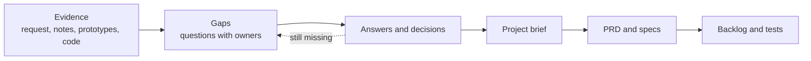
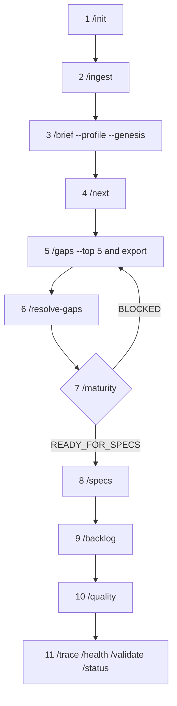

# Start here

This page explains the ideas behind Ignite Sentinel and then walks one synthetic project from an empty folder to tested backlog stories. Read it first if you are a business analyst, a product manager or a developer who has never used Sentinel. It assumes Sentinel is installed; if not, see [Install: choose your path](06-installation-vscode.md).

## The idea in one picture

A client rarely brings a complete requirement. Sentinel treats what they bring as **evidence**, finds what is missing, asks for it, and only builds downstream documents on what has been confirmed.



Sentinel does not replace product, design, technology or quality judgment. It makes sure that judgment is written down, cited and traceable before someone builds on it.

## Concepts

### Workspace

Each project lives in its own folder, `workspaces/<PROJECT_ID>/` (for example `workspaces/ACME_PORTAL/`). Everything about the project is a file in that folder: the evidence, the gaps, the brief, the specs, the backlog, the traceability graph. Those files are the **source of truth**. The local retrieval index (`memory.lancedb/` or its JSON fallback) only helps agents find context; if it disagrees with a file, the file wins.

Artifacts cite paths relative to the repository (`workspaces/ACME_PORTAL/...`), and the graph and memory store paths relative to the workspace, so you can move or clone a workspace.

### Organizing folders: one per client, one workspace per project

The folder you open in your agent (or run Sentinel from) is the root, and every `/init` adds one project under its `workspaces/`. A good habit is **one root folder per client** and **one workspace per project** of that client:

```text
C:\clients\acme\               the folder you open: client ACME
├── input\                     raw client material before /ingest (optional)
├── dashboard.html             /dashboard: every ACME project side by side
└── workspaces\
    ├── portal\                /init portal
    ├── mobile-app\            /init mobile-app
    └── reports\               /init reports
```

- **The project id names the project, not the client**: the folder already says who the client is. Keep it short (`portal`, not `acme-portal-2026`).
- **`/dashboard` shows the client's portfolio**: it covers every workspace under the root you run it from, so one client's projects stay together and apart from other clients'.
- **Each project is independent**: its own gaps, brief, PRD, backlog and traceability. Material that serves two projects is ingested in each.
- **This works best with the plugin, the wheel or a `.pyz`**, which run in any folder. In a clone of the framework the clone is the root, so every client's workspaces would share one folder and one dashboard; there, keep one clone per client or move to the plugin.
- **One private repository per client folder** is the natural unit for git: see [Versioning your workspaces](10-repo-and-branching-strategy.md#option-3-one-private-repository-per-client-folder).

### Governed artifacts

Some files may only change through a Sentinel command, because other files are derived from them:

| File | Main writer (other commands update it too) |
|---|---|
| `01_discovery/gaps.md` | `/ingest`, `/gaps`, `/resolve-gaps` |
| `02_requirements/requirements.md` | `/ingest`, `/resolve-gaps` |
| `02_requirements/project-brief.md` | `/brief` |
| `03_specs/*.md` | `/specs` |
| `04_backlog/*.md` | `/backlog`, `/story-status` |

In Claude Code a hook denies an agent's hand edit of the brief, specs and backlog files (Codex and Kilo Code carry their own guards). `/health` flags a hand edit of any file in the table. Client answers go through `/resolve-gaps` or `/sync`; new evidence goes through `/ingest`, `/sync`, `/harvest` or `/sources`.

> [!IMPORTANT]
> Never hand-edit a governed artifact. If something in it is wrong, fix the evidence or the answer and rerun the command that owns the file.

### Evidence and sources

Every file you load becomes a row in the source registry, numbered `F-01`, `F-02`, and so on. `/ingest` stores a redacted copy (secrets become `<SECRETO:type>` and are listed in `01_discovery/secret_alerts.md`) and flags passages that look like instructions to an AI (`01_discovery/injection_signals.md`); those passages are left out of the analysis. When two sources contradict each other, Sentinel opens a blocking gap instead of picking one. `/sources` lists the rows and lets you say which version governs.

### Gaps

A **gap** is something missing, ambiguous, risky or unverifiable. A gap is not a failure; it is how Sentinel avoids inventing. Each gap has an id (`GAP-...`), a [lens](#glossary) (business, product, technical, design, quality, compliance, delivery), a severity, a status and, when it came from an agent, an origin.

| Status | Meaning |
|---|---|
| `OPEN` | Nobody has answered yet. |
| `ANSWERED` | An answer exists but the decision is not confirmed. A severe gap here still blocks. |
| `PARTIALLY_CLOSED` | Some information arrived, not enough (for example "TBD"). The report explains why. |
| `CLOSED` | A confirmed, substantive answer closed it. |

Which severities block is set in `sentinel.config.yaml`; critical and high block by default.

### Gates

A **gate** is a check that stops a command when its foundation is not ready. Examples: `/specs` refuses while blocking gaps remain; `/backlog`, `/quality` and `/refine-backlog` refuse while health is `DIRTY`; `/quality` refuses without stories. A refusal exits with code 4 and, when the runtime knows it, prints a `next step:` line. Gates never decide for you; they show you what is missing.

### Traceability

Every artifact carries an id and links to what it came from: source (`F-NN`), gap (`GAP-`), requirement (`REQ-`, `REQ-EARS-`), brief, PRD (`PRD-`), spec unit (`SPEC-U-`), epic (`EPIC-`), story (`US-`), acceptance criterion (`AC-`), test case (`TC-`), change (`CHG-`). The graph lives in `06_traceability/`, and `/trace` rewrites its matrix. It answers "where did this story come from?" and "what does this change affect?".

### State, health, stage and verdict

| Signal | Where | Values |
|---|---|---|
| Health | `/status`, `/health` | `CLEAN` (no structural finding) or `DIRTY`. A new project starts `DIRTY`. |
| Readiness stage | `/status` | `DISCOVERY_RAW`, `CLIENT_RESPONSE_NEEDED`, `DOMAIN_RESPONSE_NEEDED`, `READY_FOR_PROJECT_BRIEF`, `BRIEF_BELOW_THRESHOLD`, `SELF_CORRECTION_FAILED`, `UNITS_NOT_IMPLEMENTABLE`, `READY_FOR_SPECS`, `SPECS_BELOW_THRESHOLD`, `READY_FOR_BACKLOG` |
| Maturity | `/maturity` | `READY_FOR_SPECS` or `BLOCKED` |
| Verdict | `/status` | `READY`, `READY_WITH_WARNINGS`, `NOT_READY` |

The project state is `state.json` (durable). Counts and metrics that can be recomputed live in `.sentinel/derived/state.json`, and every command is appended to `.sentinel/command_log.jsonl`.

## Glossary

| Term | Meaning |
|---|---|
| **Assumption (`ASM-`)** | A statement the BA decides to proceed with without confirmation, registered with `/assume`: owner, risk, uncertainty, cited basis. Stays visible downstream. |
| **Brief v1 / v2** | The project brief format. v2 (the default for new projects) has sections §0–§9 and two annexes, fills each place with a cited fact, a pending mark or an N/A, and is rewritten in place as answers arrive. v1 has six narrative sections and is kept for older projects or with `--brief-version 1`. |
| **Context pack** | A focused JSON bundle of context for one workflow or story, under `08_context_packs/`, so an agent reads only what it needs. |
| **Decision (`DEC-`)** | A decision derived from the request or from a confirmed answer, listed in `01_discovery/decisions.md` with its status. |
| **Context request (`CTX-`)** | A cited request for a domain team (technology, design, quality, frontend, backend), made with `/context-request`. Moves `active` → `answered` → `closed`, or `obsolete`. |
| **DoR / DoD** | Definition of Ready (a story may start) and Definition of Done (a story may close). `/story-status` checks both; by default a failed check warns, in strict mode it blocks. |
| **EARS** | Easy Approach to Requirements Syntax, a sentence pattern such as "When <trigger>, the system shall <response>." A confirmed answer in EARS becomes a testable `REQ-EARS-*` requirement. |
| **Enabler** | A story for technical work that must exist before value stories can work (for example an integration). Must name the capability it supports and the evidence that closes it. |
| **Evidence / source (`F-NN`)** | A file loaded into the workspace, with its row in the source registry. Brief v2 citations look like `[[sources § ... # F-NN]]`. |
| **Gap** | A missing, ambiguous or risky point, written as a question. See [Gaps](#gaps). |
| **Gate** | A check that refuses a command whose foundation is not ready. Exit code 4. |
| **Genesis** | Where the project starts: `greenfield` (new), `brownfield-integration` (consumes an existing system), `brownfield-extension` (extends one), `brownfield-replacement` (replaces one). Confirmed with `/brief --genesis`. |
| **Governed artifact** | A file only a command may change. See [Governed artifacts](#governed-artifacts). |
| **Harvest** | A tagged extract of an existing codebase, loaded with `/harvest` as evidence of what is already built (brownfield projects). |
| **INVEST / SPIDR** | Story checks used by `/quality`. INVEST: Independent, Negotiable, Valuable, Estimable, Small, Testable. SPIDR: ways to split a story that is too big (Spike, Paths, Interfaces, Data, Rules). |
| **LanceDB / MCP** | LanceDB: an optional local database for retrieval (`.[memory]` extra); without it a JSON fallback is used. MCP (Model Context Protocol): an optional local server (`.[mcp]` extra) that exposes Sentinel commands as tools to an agent. |
| **Lens** | A point of view used to review the evidence and to classify gaps: business, product, technical, design, quality, compliance, delivery. The **multi-lens review** `/ingest` writes (`01_discovery/lens_review.md`) reads the request through each lens. |
| **Maturity** | Whether discovery is ready for specs: no blocking gap left and requirements exist. `/maturity` answers `READY_FOR_SPECS` or `BLOCKED`. |
| **Maturity score** | A number from 0 to 1 that `/maturity` and `/status` report: the gap closure rate, averaged with an evidence score when there is one. It shows progress and its trend; it is not a gate. |
| **Pending mark** | `⏳ PENDING (GAP-X)` in a v2 brief: a place that waits for a client answer; `⏳ PENDING DOMAIN (GAP-X)` waits for domain context. `[PENDING INPUT]` plays the same role in v1 briefs and backlog stubs. |
| **PRD** | Product requirements document: `03_specs/prd.md`, the human-readable spec written by `/specs`. |
| **Pre-mortem** | A stress test that imagines the project has failed and asks why; one of the `/challenge` techniques. |
| **Profile** | What kind of system the brief describes, one or more of `UI` (UI + backend), `API` (backend/API), `BAT` (batch/pipeline), `INT` (third-party integration), `MIG` (legacy migration), `REG` (regulatory), `MT` (multi-tenant/platform). Decides which brief sections are required. Confirmed with `/brief --profile`. |
| **Readiness matrix** | The development readiness matrix in `01_discovery/development_readiness.json`, written by `/maturity`: for each lens and area, what is confirmed, assumed or open. Its state can be `READY_WITH_GOVERNED_ASSUMPTIONS`: ready, but some cells rest on registered assumptions rather than confirmations. |
| **Redaction** | `/ingest`, `/sync`, `/resolve-gaps` and `/harvest` replace secrets in a loaded file with `<SECRETO:type>` before storing it. For `password=...` or `api_key: ...` only the value is replaced (`<SECRETO:credential>`), so the line still says what was there. |
| **Release series** | A project split into releases `r1`, `r2`, ... with contracts between them, planned with `/split`. Each release gets its own brief under `02_requirements/r<N>/`. A proposed partition is **green** when it has no finding left that `/split --confirm` would refuse. |
| **Seed** | An atomic statement of known truth, for example "Monthly exports are out of scope." Seeds keep agents from reinterpreting the raw input each time. |
| **Slice plan** | `04_backlog/SLICE-PLAN.md`, written by `/backlog`: the order in which stories can be built as thin end-to-end (vertical) slices. |
| **Spec unit (`SPEC-U-`)** | A bounded piece of the spec with its source anchors, written by `/specs` under `03_specs/units/`. `/backlog` derives one value story per spec unit. |
| **Trace** | A link in the traceability graph between two artifacts. `/trace` rewrites the matrix. |
| **Umbrella gap** | A brief v2 gap such as `GAP-BRIEF-S3` that covers several places of one section; answer it one line per place (`3.1: ... 3.2: ...`). |
| **Validation direction** | `to-build` (the brief describes what will be built, the default) or `built` (it documents something that exists; divergences get `⚠`). Set with `/brief --validation-direction`. |
| **Verdict** | The `/status` answer to "can we build?": `READY`, `READY_WITH_WARNINGS` or `NOT_READY`. |

## First run end to end

The project is synthetic: **ACME_PORTAL**, a customer portal where account holders check open invoices. Create a folder `input/` in the folder you run Sentinel from (the repository root in a clone; `workspaces/` will appear next to it), save a short description as `input/acme-request.md` (the [README](../README.md#quick-start-your-first-gaps-document) has a ready sample) and follow the steps. Each step shows the chat form; in a terminal, put `python -m sentinel` in front (`python -m sentinel /init ACME_PORTAL`). In Codex and with the Claude Code plugin, prefix chat commands with `sentinel ` (see [chat commands](11-chat-commands.md)).



### 1. Create the project

```text
/init ACME_PORTAL
```

In a Claude Code clone, `/init` can start Claude Code's own built-in project setup (it writes a `CLAUDE.md`) instead of Sentinel's; if that happens, send `/sentinel /init ACME_PORTAL`.

**What you get:** `workspaces/ACME_PORTAL/` with its folders, `state.json`, `sentinel.config.yaml`, an empty traceability graph, an empty source registry and a per-workspace `.gitignore`. The brief format is v2. Health is `DIRTY` and the stage `DISCOVERY_RAW`: expected, nothing is known yet.

**Next step:** load the request.

### 2. Load the request

```text
/ingest ACME_PORTAL --source input/acme-request.md
```

**What you get:** a redacted copy under `00_raw/`, source row `F-01`, `02_requirements/requirements.md`, seeds and decisions, a multi-lens review, and **`01_discovery/gaps.md`**. If a secret or an injected instruction was found, `secret_alerts.md` or `injection_signals.md` appears in `01_discovery/`. Formats: `.md`, `.txt`, `.html` and `.docx`; other UTF-8 text is stored as Markdown with a warning, and a binary file such as a PDF is refused. If the command stops with exit 3 and `--source file not found`, check the path: it is read relative to the folder you run Sentinel from.

**Next step:** confirm the brief settings, right away.

### 3. Confirm the brief settings

A new project's brief needs to know what kind of system it describes, its [profile and genesis](#glossary). Do this once, right after the first `/ingest`. `/next` and `/status` ask for it (*Confirm the brief settings*) until you do, with a suggested command whose values come from the request.

If you are not sure which values fit, run `/brief` without flags first to see Sentinel's proposal (in `brief_settings.proposal`). That run opens the critical gap `GAP-BRIEF-PROFILE` and writes a provisional brief in the older v1 layout; both go away when you confirm:

```text
/brief ACME_PORTAL
/brief ACME_PORTAL --profile UI --genesis greenfield
```

**What you get:** the confirmed settings in `state.json`, and the v2 brief compiled at `02_requirements/project-brief.md` with `02_requirements/brief_compile_report.json`. Places with no evidence carry `⏳ PENDING (GAP-X)`. From now on every `/resolve-gaps` recompiles the brief in place.

Combine profiles with commas (`--profile UI,REG`). `MIG` requires `--genesis brownfield-replacement` (a `MIG` + `greenfield` pair is stored as a contradiction and keeps `GAP-BRIEF-PROFILE` open). Add `--validation-direction built` only when the brief documents an existing system.

#### If you skip the brief settings

> [!WARNING]
> Until the settings are confirmed, `/next` and `/status` keep asking for them, and `/maturity` opens the critical gap `GAP-BRIEF-PROFILE` and reports `BLOCKED`. So `/specs` and `/backlog` refuse (exit 4), and no brief is compiled from `/maturity`. Answers you process in the meantime are kept, but no brief carries them yet. Confirming with `/brief ACME_PORTAL --profile ... --genesis ...` closes the gap and compiles the v2 brief from everything answered so far.

**Next step:** ask Sentinel what to do next.

### 4. Ask for the next step

```text
/next ACME_PORTAL
```

**What you get:** one step with a title, a sentence and the command to run. Until the brief settings are confirmed it says *Confirm the brief settings*; after that, right after intake, it says *Waiting for client answers* and suggests `/resolve-gaps`: there are always blocking gaps at this point. `/status ACME_PORTAL` gives the same step plus the verdict, gap counts and [maturity score](#glossary).

**Next step:** plan the first question round.

### 5. Plan a question round and share it

```text
/gaps ACME_PORTAL --top 5
/export ACME_PORTAL --artifact gaps --format interview
```

**What you get:** `01_discovery/gap_round.md` with the five most useful questions to ask now, and `08_context_packs/exports/gaps-interview.md`, a script grouped by owner for a meeting. You can also send `gaps.md` itself: it is written for clients. Register who owns which topic with `/stakeholders ACME_PORTAL --add --name "Head of Billing" --domain business` so gaps route to a person.

Optional: let an agent find more gaps before you ask (`/annotate`, `/challenge`, `/scrutinize`). See [deepen discovery](03-workflows.md#deepen-discovery-with-the-agent).

**Next step:** wait for the answers.

### 6. Process the answers

The client answers in a copy of `gaps.md`. Keep each `### GAP-...` heading and fill the template fields under it:

```text
- Answer: Customers log in with their customer number and a one-time code by email.
- Owner / source: Head of Billing
- Evidence or reference: Billing meeting, minutes item 3
- Decision status: confirmed
```

A gap closes only with `Decision status: confirmed` (or `not applicable`, which records a scope exclusion); `pending` leaves it answered but not closed, and a missing status leaves it partially closed. Always add the `Evidence or reference` line: without it the gap still closes, but the resolution report flags it as closed without a citation. The answer can be one line or indented bullets under `- Answer:`. Save the file as `input/acme-answers.md`:

```text
/resolve-gaps ACME_PORTAL --source input/acme-answers.md
```

**What you get:** confirmed answers close their gaps, become seeds and decisions, and (when written in EARS) `REQ-EARS-*` requirements. Vague or unconfirmed answers leave the gap `ANSWERED` or `PARTIALLY_CLOSED` with a note. The v2 brief recompiles right away: only the answered places change, listed in `brief_v2.rewritten_places`.

**Next step:** check maturity. If gaps remain, go back to step 5.

### 7. Check maturity

```text
/maturity ACME_PORTAL
```

**What you get:** `01_discovery/requirement_maturity_report.md`, `01_discovery/development_readiness.json` (certainty per lens and area: confirmed, assumed, open), a maturity score and its trend. The answer is `READY_FOR_SPECS` or `BLOCKED` with the blocking gaps listed. When ready, it also rewrites the brief.

Optional, before specs: ask a clean-context reader whether the brief is enough to start building with `/self-review ACME_PORTAL --sufficiency --source sufficiency.json` (the `sentinel-self-review` skill writes the JSON).

**Next step:** `BLOCKED` → step 5. `READY_FOR_SPECS` → specs. If the scope is too big for one release, see [release split](03-workflows.md#release-split) first.

### 8. Generate the PRD and specs

```text
/specs ACME_PORTAL
```

**What you get:** `03_specs/prd.md` (the human PRD), `03_specs/specs.md` (the compact index for agents), `03_specs/units/SPEC-U-NNN.md` (one bounded unit per confirmed requirement) and `08_context_packs/specs_generation.json`. Refuses while maturity is `BLOCKED`.

**Next step:** request domain context if teams need it (`/context-request ACME_PORTAL --domain technology`), then the backlog.

### 9. Generate the backlog

```text
/backlog ACME_PORTAL
/backlog-status ACME_PORTAL
```

**What you get:** `04_backlog/EPIC-001.md`, one `US-NNN.md` per spec unit, an `EPIC-002` for enablers when needed, `04_backlog/SLICE-PLAN.md` (the [slice plan](#glossary)), `08_context_packs/implementation_readiness.json`, and the BA board `04_backlog/BACKLOG.md`. A missing piece stays visible as `[PENDING INPUT]` or `[PENDING DOMAIN CONTEXT]`. Refuses while health is `DIRTY`.

**Next step:** check story quality.

### 10. Check quality

```text
/quality ACME_PORTAL
```

**What you get:** test cases `05_quality/TC-NNN.md` and `05_quality/backlog_readiness_audit.md`, which scores each story ([INVEST, SPIDR](#glossary), vertical slicing) and feeds Definition of Ready warnings. Refuses without stories.

**Next step:** audit before handoff.

### 11. Audit and hand off

```text
/trace ACME_PORTAL
/health ACME_PORTAL
/validate ACME_PORTAL
/status ACME_PORTAL
```

**What you get:** the traceability matrix in `06_traceability/traceability_matrix.md`, `06_traceability/health_report.md`, a validation verdict (`VALID` or exit 5) and the readiness verdict. Hand off when health is `CLEAN`, validation `VALID` and the verdict `READY` (or `READY_WITH_WARNINGS` with the warnings understood).

**Next step:** move stories with `/story-status`, and bring implementation findings back with `/implementation-feedback`. See [handoff and export](03-workflows.md#handoff-and-export).

## Reading results

Every command prints JSON. The fields to look at:

| Command | Look at |
|---|---|
| `/status` | `verdict.verdict` and `verdict.blockers` (`verdict` is an object), `gap_counts`, `readiness_stage`, `next_step` (text) and `next_action` (the same step as an object) |
| `/next` | `title`, `text`, `command` |
| `/maturity` | `readiness`, `blocking_gaps` |
| `/brief` | `brief_settings.confirmed`, `brief_settings.proposal`, `warnings` |
| `/validate` | `verdict` |

`/status` always exits 0, even for `NOT_READY`; read the verdict. A failing command prints `sentinel error: ...` and often `next step: ...` on stderr, and exits with:

| Code | Meaning |
|---|---|
| 0 | Success |
| 1 | Unexpected error, a traceback follows. It is a genuine bug; report it. |
| 2 | Wrong usage: a missing required option or an unknown value |
| 3 | Invalid input: a bad value, a `--source` file that does not exist, an unsupported file, a refused payload |
| 4 | Gate refusal: a missing prerequisite or the project's state (health, phase) stops the command |
| 5 | Unfavourable verdict: `/validate` not `VALID`, `/doctor` not `PASS` |
| 6 | Workspace busy: another command holds the workspace lock (it waits 10 seconds first) |

What to do for each code: [A gate refused](03-workflows.md#a-gate-refused).

## What you may edit

| You may | You may not |
|---|---|
| `sentinel.config.yaml` (domains, gate thresholds, language, privacy scan) | Any governed artifact (see the table above) |
| Your own files in `input/` before loading them | `state.json`, `.sentinel/`, the traceability graph |
| Add the first request with `/ingest`, and every later file (context, prototypes, notes) with `/sync --source` | Leave files copied into `00_raw/` unprocessed: until `/sync` picks them up they skip redaction, the source registry and contradiction checks |

## Workspace shape

```text
workspaces/ACME_PORTAL/
  00_raw/              evidence: client request, business, technology, design, quality, interactions
  01_discovery/        gaps, seeds, decisions, lens review, maturity report, knowledge state
  02_requirements/     requirements, project-brief.md, series/ and r<N>/ for releases, prototype/
  03_specs/            prd.md, specs.md, units/, self_review/
  04_backlog/          epics, stories, BACKLOG.md, SLICE-PLAN.md
  05_quality/          test cases, readiness audit
  06_traceability/     graph, matrix, health report, command protocol log
  07_changes/          changes, client responses, source_log.md, implementation feedback
  08_context_packs/    retrieval packs, exports, domain requests, views
  memory.lancedb/      rebuildable retrieval index
  .sentinel/           lock, derived state, command log, local themes (git-ignored)
  state.json  sentinel.config.yaml  .gitignore
```

Every file is described in the [artifact reference](02-artifact-reference.md).

### A project split into releases

When one brief is too big for one delivery, `/split` divides it into releases inside the same workspace. Nothing moves to another folder: each release gets a sub-folder next to the project-wide files.

```text
workspaces/portal/
  02_requirements/
    project-brief.md       the whole project's brief
    series/                proposal, confirmed partition, index, release guide, scope changes
    r1/project-brief.md    release 1's brief
    r2/project-brief.md    release 2's brief
  03_specs/r1/  03_specs/r2/            /specs portal --release r1
  04_backlog/r1/  04_backlog/r2/        /backlog portal --release r1
  05_quality/r1/  06_traceability/r1/  08_context_packs/r1/
```

1. `/split portal --assess` says whether a split is worth it; `--propose` stores a proposal; `--confirm` (with the BA's and the technical team's names) compiles `r<N>/project-brief.md` for each release.
2. Downstream commands take `--release rN`: `/specs`, `/backlog`, `/quality`, `/story-status`, `/view`, `/validate`, `/trace`, `/status` and `/next`. Their output goes to that release's sub-folder, and each release keeps its own lifecycle.
3. Without `--release` a command works on the whole project, as before.
4. `/split portal --close r1` closes a release once all its stories are Done, and unblocks the releases that wait for it. `/split --move` moves a unit between releases with a dated record.

The full flow is in [Workflows](03-workflows.md); every file of `series/` and `r<N>/` is in the "Release series" section of the [artifact reference](02-artifact-reference.md).

## Privacy

Client content stays in local files. Sentinel uses no remote MCP server, no external vector database and no external embedding service for project content. Retrieval runs locally (LanceDB when installed, a deterministic JSON fallback otherwise). Exports go only to `08_context_packs/exports/`. The one file written outside a workspace is `dashboard.html`, in the folder you run `/dashboard` from. Never put real client names, systems or data in examples or framework files.

## Where to go next

**Everyone:** [workflows by situation](03-workflows.md), [scenarios](12-scenarios.md), [chat commands](11-chat-commands.md), [when something went wrong](21-recovery.md).

**Business analyst:** [artifact reference](02-artifact-reference.md), [skills catalog](04-codex-skills-guide.md).

**Product manager:** [artifact views](15-artifact-views.md), [dashboard](14-dashboard.md), [themes](17-themes.md).

**Developer:** [command reference](01-command-reference.md), [traceability and memory](05-traceability-and-memory.md).

**Setup and IT:** [install](06-installation-vscode.md), [Kilo Code](07-kilo-code-adapter.md), [Codex](08-codex-adapter.md), [Claude Code](13-claude-adapter.md), [Claude Code plugin](18-claude-plugin.md), [secure environments](09-secure-environments.md), [portability](16-portability.md), [versioning workspaces](10-repo-and-branching-strategy.md), [threat model](19-threat-model.md), [admin guide](20-admin-guide.md).

## Next

- [Workflows: what to do in each situation](03-workflows.md)
- [Command reference](01-command-reference.md)
- [Driving Sentinel from chat](11-chat-commands.md)
