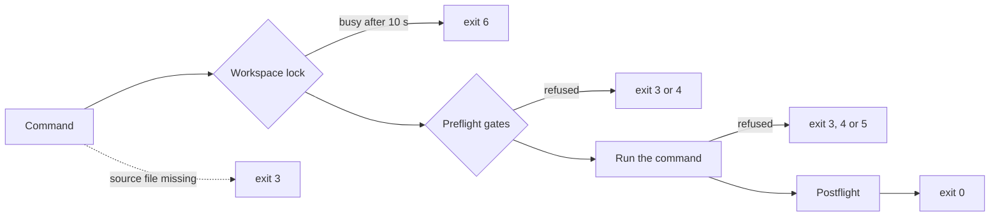

# Command reference

This page describes every Sentinel command: what it does, how to type it, every option it takes, what it reads and writes, when it refuses and what to run next. It is for business analysts, product managers and developers who already know the basic flow from the [user guide](00-user-guide.md) and need to look something up.

Use it as a lookup. Find your command in the [command index](#command-index), jump to its block, and read the fields you need. The first sections (conventions, exit codes, protocol and gate matrix) apply to every command, so read them once.

> [!TIP]
> If you only want to know what to do now, run `/next PROJECT_ID`. It prints one step and the command to run.

## Conventions

### Three ways to run a command

The same command can be typed in three places. They all run the same code and write the same files.

| Where | Form | Example |
|---|---|---|
| Chat (Claude Code, Kilo Code) | `/command PROJECT_ID [options]` | `/ingest ACME_PORTAL --source raw.md` |
| Chat (Codex, or any chat that swallows `/init`) | `sentinel /command PROJECT_ID [options]` | `sentinel /ingest ACME_PORTAL --source raw.md` |
| Terminal | `python -m sentinel /command PROJECT_ID [options]` | `python -m sentinel /ingest ACME_PORTAL --source raw.md` |
| MCP client | tool `sentinel_<command>` with `-` replaced by `_` | `sentinel_ingest(project_id="ACME_PORTAL", source="raw.md")` |

The leading `/` is optional in the terminal (`python -m sentinel ingest ...` also works). If `python` is missing or points to the Windows Store alias, use the launcher: `.\installers\sentinel.ps1 /command ...` on Windows or `sh installers/sentinel.sh /command ...` elsewhere. `python -m sentinel --help` lists the commands; `python -m sentinel /command --help` lists one command's options.

How each chat surface maps a message to a command is explained in [Driving Sentinel from chat](11-chat-commands.md).

**MCP parameter names.** An MCP tool takes the same options as the command, with `_` instead of `-` (`artifact_type`, `max_chars`). A few differ:

- `--open` is `open_browser`.
- `/split` takes `mode` (`assess`, `propose`, `confirm`, `move`, `close`) instead of the mode flags, and `release` for the release to close. The CLI requires a mode; the tool defaults to `assess`.
- `/prototype` takes `mode` (`inventory`, `trace`, `manual`). The CLI requires a mode; the tool defaults to `inventory`.
- `--id` is `id` on `/gaps`, `/context-request`, `/stakeholders` and `/sources`.
- `/doctor` and `/dashboard` have no `root`: the MCP server always runs at the repository root.
- The MCP server also offers one tool with no command, `sentinel_gap_elicitation`.

### `PROJECT_ID`

Every command except `/doctor` and `/dashboard` takes a project id as its first argument. The workspace lives in `workspaces/PROJECT_ID/`.

- Use 1 to 64 characters: letters, digits, `_` or `-`, starting with a letter or digit (for example `ACME_PORTAL`).
- Windows device names (`CON`, `NUL`, `COM1`...) are refused.
- Ids are case-sensitive, but an id that differs only in case from an existing workspace is refused.
- The workspace must sit directly inside `workspaces/` (not behind a link).

An invalid id stops the command with exit code 3 before anything touches the disk.

### `--release rN`

Nine commands take `--release`: `/specs`, `/backlog`, `/quality`, `/story-status`, `/view`, `/validate`, `/trace`, `/status` and `/next`. With it, the command runs for one release of a confirmed release series instead of the whole project.

- The value is `r<N>` or `r<N>.<M>` (for example `r1`, `r2.1`).
- The command reads the release brief, `02_requirements/rN/project-brief.md`, and writes under `03_specs/rN/`, `04_backlog/rN/`, `05_quality/rN/`, `06_traceability/rN/` and `08_context_packs/rN/`.
- Each release keeps its own phase, stories and gates in `.series_work/rN/`. The project's own `state.json` is not touched.
- Without a confirmed series (`/split --confirm`) the command exits with code 4. With a release that is not in the series, or a value that is not a release id, it exits with code 3.

Release series are explained in [Workflows](03-workflows.md).

### Paths on this page

Paths under **Reads** and **Writes** are relative to `workspaces/PROJECT_ID/` unless they say otherwise. Generated artifacts cite paths as `workspaces/PROJECT_ID/...`, relative to the repository root, so a workspace can be moved or cloned. See [Artifact reference](02-artifact-reference.md) for what each file is.

## Exit codes

Every command ends with one of these codes. A failure prints `sentinel error: ...` on stderr and, when Sentinel knows it, a second line `next step: ...` with what to do.

| Code | Meaning | Typical cause | What to do |
|---|---|---|---|
| 0 | Success | The command finished. | Read the JSON result. `/status` and `/health` also exit 0 when the verdict is not good: read their `verdict`. |
| 1 | Unexpected error | A traceback follows the message. It is a genuine bug. | Report the traceback. |
| 2 | Wrong usage | A missing required option (`--source`), an unknown option or a value outside its choices. Printed by the argument parser with the usage line, without `next step:`. | Fix the command line; `python -m sentinel /command --help` shows the options. |
| 3 | Invalid input | An invalid `PROJECT_ID`, a payload the runtime refused (each reason is listed), a `--source` file that does not exist (on every command; `/prototype --inventory` is the exception, it takes a source id `F-NN`), missing or conflicting options (`--ba`/`--tech` missing, `/split --move` without unit/from/to), an invalid release id, an unknown profile or genesis, a `state.json` with a newer schema, a missing or damaged `state.json`, a workspace JSON file that does not parse (the message names the file), a `/sync --analysis` with a quote or target that does not check out, `/stakeholders` fields without `--add`, `/sources --precedence --between` with another option, a file name that already has 998 numbered copies (`NAME-2` to `NAME-999`). | Fix the input named in the message and run again. For a missing file, check the path: it is read relative to the folder you run Sentinel from. Nothing was stored. |
| 4 | Gate refusal | A missing prerequisite or the project's state stops the command: no workspace, `/assume` before `/ingest`, `/specs` before `/ingest`, `/compose` before `/specs`, `/backlog` while health is `DIRTY`, `/split` without the brief, proposal or series it needs, `/view` of an artifact not generated yet, `/export --final` with blocking pending marks. | Run the command the `next step:` line names (often `/init`, `/ingest`, `/maturity` or `/resolve-gaps`). See the [gate matrix](#gate-matrix). |
| 5 | Unfavourable verdict | `/validate` is not `VALID`, or `/doctor` is not `PASS`. The full result is still printed. | Read the findings in the result and fix them, or record a cited override (`/validate --override`). |
| 6 | Workspace busy | Another command holds this workspace's lock, or a file changed on disk while the command ran. | Wait for the other command to finish and run again. |

**A missing or damaged `state.json`.** Sentinel does not rebuild it, because a new state would lose the phase, the settings and the story lifecycle. Every state update first copies the previous `state.json` to `.sentinel/state.json.bak`. To recover, copy `.sentinel/state.json.bak` to `state.json` in the workspace folder (or restore `state.json` from git) and run the command again; you lose at most the last update. Without a backup, restore it from git or your own backup. A workspace with no artifacts yet can be recreated with `/init`. `/doctor` lists workspaces whose `state.json` is missing or damaged. See [Recovery](21-recovery.md).

To print only the next step at any time, run `/next PROJECT_ID`.

Over MCP, a failed command comes back as an error result (`isError`) whose text is JSON with `code`, `kind`, `error`, `next_step` and the output.

## The command protocol

Every command that names a project goes through the same three steps. You do not call them; they explain why a command refuses, waits or writes files you did not name.



### 1. The workspace lock

Only one command runs at a time on a workspace, read-only commands included.

- A second command (another terminal, chat session or MCP client) waits up to 10 seconds, then exits with code 6 naming the command that holds the workspace and since when.
- `SENTINEL_LOCK_TIMEOUT` sets the wait in seconds.
- Commands on different workspaces never wait for each other.
- The lock belongs to the process: if it ends, even by a crash, the lock is released.

### 2. Preflight

Before running, Sentinel checks the workspace:

1. The workspace exists; otherwise exit 4 with `Run /init PROJECT_ID first`. Its `state.json` exists and parses; otherwise exit 3 naming the file and the fix (see [exit codes](#exit-codes)).
2. `/specs` and `/backlog` need discovery: in phase `initialized` (nothing ingested) they exit 4.
3. `/backlog`, `/quality` and `/refine-backlog` refuse while project health is `DIRTY` (exit 4). A new workspace starts `DIRTY`; `/maturity` sets health to `CLEAN` when readiness is `READY_FOR_SPECS`, and `/health` sets it from its own verdict. The gate re-runs the `/health` checks without writing and the message names the first finding and what to do next. One exception: when the only finding is that knowledge changed after the backlog was generated (the brief and specs are already regenerated, so only `04_backlog/BACKLOG.md` and `08_context_packs/implementation_readiness.json` are stale), `/backlog` runs, because regenerating them is the fix. `/quality` and `/refine-backlog` still refuse until `/backlog` has run. If the brief or specs are stale too, the message lists the commands to run in order, for example `Run /brief, then /specs, then /backlog.`
4. `/backlog`, `/backlog-status`, `/quality`, `/refine-backlog`, `/implementation-feedback` and `/story-status` run the backlog privacy scan. It warns by default; with `privacy_scan.mode: block` in `sentinel.config.yaml` a finding stops the command (exit 4).
5. `/quality` needs user stories in the traceability graph (exit 4).

Each command then applies its own checks, listed under **Refuses when** in its block.

### 3. Postflight

After a successful command:

- **Every project command** appends a line to `.sentinel/command_log.jsonl`, records `last_command` in `state.json`, and rewrites `06_traceability/command_protocol_log.md` with the last 25 commands.
- **Mutating commands** also:
  - refresh `06_traceability/traceability_matrix.md` and `traceability_graph.md`;
  - re-run an existing split assessment and recompile a confirmed release series if the brief changed (except `/split` itself);
  - snapshot the checksums of the governed artifacts (`01_discovery/gaps.md`, `02_requirements/requirements.md`, `02_requirements/project-brief.md`, `03_specs/*.md`, `04_backlog/*.md`) that the command wrote, so `/health` can flag a hand edit. A file the command did not write keeps its old checksum, so a hand edit stays flagged; a hand edit the command changed is kept under `.sentinel/hand_edits/` (see [`health`](#health));
  - if the command set health to `CLEAN` while the last `/health` report was `DIRTY`, re-run the `/health` checks and keep their verdict.
- `/validate` with `--override` also refreshes the traceability views.

A command that fails runs no postflight and is not logged. `/validate` is the exception: an `INVALID` verdict (exit 5) is logged before the command exits.

### Command types

| Type | Commands | What it means |
|---|---|---|
| Read-only | `/next`, `/health`, `/validate`, `/status`, `/view`, `/retrieve` | Changes no governed artifact. Still takes the lock and is logged. Some write a report or a view (`/health`, `/view`, `/retrieve --write-pack`, `/validate --override`), listed under **Writes**. |
| Mutating | the other 28 project commands, including `/trace` and `/maturity` | Writes workspace artifacts. Gets the full postflight. |
| Exempt | `/doctor`, `/dashboard`, `/init` | Outside the protocol: `/doctor` and `/dashboard` have no project, and `/init` creates the workspace the protocol needs. `/init` takes the workspace lock when the workspace folder already exists; a first `/init` runs without it. |

> [!IMPORTANT]
> Governed artifacts change only through commands. A hand Write or Edit of `01_discovery/gaps.md`, `02_requirements/requirements.md`, `02_requirements/project-brief.md`, `03_specs/*.md` or `04_backlog/*.md` is denied by the editor hook, and `/health` flags a hand edit of any of these checksummed files made another way. Client answers go through `/resolve-gaps` or `/sync`; new evidence through `/ingest` or `/sources`.

## Gate matrix

Which command refuses under which condition. "Before `/ingest`" means `01_discovery/gaps.md` (or `requirements.md`) does not exist yet.

| Command | Refuses when | Message gist | Exit | What to do |
|---|---|---|---|---|
| Every project command | The workspace does not exist | `Workspace not found ... Run /init` | 4 | `/init PROJECT_ID` |
| Every command with a project | `PROJECT_ID` is invalid | `invalid PROJECT_ID` | 3 | Fix the id |
| Every project command | Another command holds the workspace | `Workspace ... is busy` | 6 | Wait, run again |
| Every project command | `state.json` is missing or does not parse | `state.json ... is missing` / `... is not valid JSON` | 3 | Copy `.sentinel/state.json.bak` to `state.json`, or restore it from git ([Recovery](21-recovery.md)) |
| Any command | A workspace JSON file does not parse | `<file> in workspace ... is not valid JSON` | 3 | Restore or regenerate the file named |
| `/specs`, `/backlog` | Phase `initialized` | `Cannot generate downstream artifacts before /ingest` | 4 | `/ingest` |
| `/specs`, `/backlog` | Requirement maturity is `BLOCKED` (an open blocking gap, including `GAP-BRIEF-PROFILE`) | `Cannot generate specs/backlog while requirement maturity is BLOCKED` | 4 | `/resolve-gaps`, `/brief --profile --genesis`, then `/maturity` |
| `/specs`, `/backlog` | `drift_gate.strict` is on and the foundation changed since the last generation | `foundation is stale (drift_gate.strict)` | 4 | Regenerate upstream, or turn strict off |
| `/specs` | `specs_gate.strict` is on and PRD coverage is below the threshold | `PRD section readiness is below specs_gate threshold` | 4 | Answer the gaps feeding the poor sections |
| `/backlog`, `/quality`, `/refine-backlog` | Project health is `DIRTY` (for `/backlog`, unless the only finding is a stale backlog after a knowledge change) | `Cannot run /... while project health is DIRTY: <first finding>` | 4 | The step the message names; `/health` lists every finding |
| `/backlog` | `backlog_gate.strict` is on and a story fails its Definition of Ready | `Pre-handoff DoR gate blocks backlog handoff` | 4 | Complete the DoR items named |
| `/backlog`, `/backlog-status`, `/quality`, `/refine-backlog`, `/implementation-feedback`, `/story-status` | `privacy_scan.mode: block` and a backlog file holds a credential, private endpoint or private identifier | `Backlog privacy scan blocked handoff: path:line` | 4 | Remove the datum at its source and regenerate |
| `/quality` | No user stories | `Cannot generate quality artifacts without ... user stories` | 4 | `/backlog` |
| `/story-status` | The story file does not exist | `Story does not exist ... Run /backlog` | 4 | `/backlog` |
| `/story-status` | `backlog_gate.strict` and DoR (to `Ready`) or DoD (to `Done`) is incomplete | `DoR gate blocks Ready` / `DoD gate blocks Done` | 4 | Complete the items named; `--evidence` for DoD |
| `/story-status` | The transition is not legal | `Illegal story transition` | 3 | See the transition table in [`story-status`](#story-status) |
| `/ingest` | The project already has its primary requirement and `--replace` is not given | `already has its primary requirement` | 4 | `/sync PROJECT_ID --source PATH` to add the file, or `--replace` on purpose |
| Any command with `--source` | The path is a folder, or a `.md`/`.txt`/`.json`/`.html` file is not UTF-8 | `--source must be a file` / `--source is not UTF-8 text` | 3 | Pass the file (to `/sync`, one file per run; `/sync` without `--source` scans the input folders); save it as UTF-8. Nothing was written |
| `/sync --analysis` | No `--source`, a quote not found verbatim, a missing or wrong-state target, a note that declares itself not validated | every reason | 3 | Fix the analysis; nothing was written |
| `/stakeholders` | `--id`, `--name`, `--domain`, `--topic`, `--profile` or `--notes` without `--add` | `... go with --add` | 3 | Add `--add`, or drop the fields to list |
| `/sources` | `--precedence --between` with another option | `/sources --precedence --between takes no other option` | 3 | Run the precedence question on its own |
| `/gaps`, `/resolve-gaps`, `/annotate`, `/challenge`, `/scrutinize`, `/self-review`, `/brief` | Before `/ingest` | `Cannot ... before /ingest creates ...` | 4 | `/ingest` |
| `/annotate`, `/challenge`, `/scrutinize` | No raw input under `00_raw/` to check quotes against | `No raw input found under 00_raw/` | 4 | `/ingest` |
| `/self-review` (default mode) | No PRD or specs | `Cannot self-review before /specs` | 4 | `/specs` |
| `/assume` | Before `/ingest` | `Cannot register assumptions before /ingest` | 4 | `/ingest` |
| `/compose` | No `03_specs/prd.md` | `Cannot compose PRD before /specs` | 4 | `/specs` |
| `/refine-backlog` | No `04_backlog/EPIC-001.md` | `Cannot refine backlog before /backlog` | 4 | `/backlog` |
| `/implementation-feedback` | No epic in `04_backlog/` | `Cannot process implementation feedback before /backlog` | 4 | `/backlog` |
| `/export --final` | The brief, PRD or context request still has blocking pending marks (domain marks in a brief v2 do not block) | `/export --final refused: N pending marks remain` | 4 | Close the gaps, or export without `--final` |
| `/export --format faq` | `01_discovery/gaps.md` exists but neither `decisions.md` nor `identity_seeds.md` does (`/ingest` writes both, so only after they were removed) | `Cannot export a FAQ before gaps are resolved` | 4 | Restore them from git. A FAQ with no confirmed answer yet is not refused: it is written and says it is empty |
| `/export --format interview`, `--format faq` | Before `/ingest` (no `01_discovery/gaps.md`) | `Export source not found` | 3 | `/ingest` |
| `/split` (prerequisites) | No compiled brief, a v1 brief on `--confirm`, no stored proposal, brief changed since the proposal, no confirmed series, release already closed, no stories or stories not Done on `--close` | the reason | 4 | Fix what is named; nothing was stored |
| `/split` (refused input) | `--assess` or `--propose` on a v1 brief, refused proposal, partition not green, missing `--ba`/`--tech` or other bad options | the finding codes and reasons | 3 | Fix what is named; nothing was stored |
| Release commands with `--release` | No confirmed series | `--release needs a confirmed release series` | 4 | `/split --confirm` |
| `/prototype --trace` | No compiled brief v2, or no inventory (a refused payload stays exit 3) | `/prototype --trace needs the compiled brief v2` / `there is no prototype inventory yet` | 4 | `/brief`, or `/prototype --inventory` |
| `/prototype --manual` | No inventory (a refused payload stays exit 3) | `there is no prototype inventory yet` | 4 | `/prototype --inventory` |
| `/prototype --trace`, `--manual` | Payload refused | `the trace/manual was refused (N findings)` | 3 | Fix the findings |
| `/self-review --sufficiency`, `--crosses`; `/scrutinize --mode anchors` | No compiled brief v2 | `... reads a brief v2; compile one with /brief first` | 4 | `/brief` |
| `/validate`, `/backlog-status`, `/quality` with `--override` | Nothing fails or warns, so there is nothing to override | `has no failing or warning gate state to override` | 3 | Run without `--override` |
| `/validate` | Verdict is not `VALID` | (result printed) | 5 | Fix the findings or `--override` |
| `/doctor` | Verdict is `FAIL` | (result printed) | 5 | Fix the failing checks |

## Command index

All 37 commands, grouped by lifecycle stage. **Type** is from the command registry. **Release** means the command takes `--release rN`.

| Stage | Command | Type | Release | What it does |
|---|---|---|---|---|
| Setup | [`/doctor`](#doctor) | exempt | | Check that the repository is ready |
| Setup | [`/init`](#init) | exempt | | Create a project workspace |
| Setup | [`/dashboard`](#dashboard) | exempt | | Portfolio view of every workspace |
| Discover | [`/ingest`](#ingest) | mutating | | Bring in raw input, create discovery artifacts |
| Discover | [`/sync`](#sync) | mutating | | Bring in changes, meeting notes, feedback |
| Discover | [`/harvest`](#harvest) | mutating | | Bring in a tagged harvest of an existing codebase |
| Discover | [`/gaps`](#gaps) | mutating | | Regenerate gaps, plan a question round, dispose agent gaps |
| Discover | [`/annotate`](#annotate) | mutating | | Merge the agent's semantic reading as gaps |
| Discover | [`/challenge`](#challenge) | mutating | | Merge advanced elicitation findings as gaps |
| Discover | [`/scrutinize`](#scrutinize) | mutating | | Multi-lens scrutiny, implementability probe, anchor review |
| Discover | [`/assume`](#assume) | mutating | | Register governed assumptions |
| Discover | [`/resolve-gaps`](#resolve-gaps) | mutating | | Process answered gaps |
| Discover | [`/stakeholders`](#stakeholders) | mutating | | List or add owners for elicitation routing |
| Discover | [`/sources`](#sources) | mutating | | Manage the F-NN source registry |
| Discover | [`/context-request`](#context-request) | mutating | | Ask a domain for context; move a request along |
| Discover | [`/retrieve`](#retrieve) | read-only | | Focused retrieval from local memory |
| Discover | [`/reindex`](#reindex) | mutating | | Rebuild local memory |
| Define | [`/maturity`](#maturity) | mutating | | Evaluate readiness for specs |
| Define | [`/brief`](#brief) | mutating | | Confirm brief settings and compile the project brief |
| Define | [`/split`](#split) | mutating | | Assess, propose, confirm, move and close a release series |
| Define | [`/prototype`](#prototype) | mutating | | Inventory, trace and manual of an HTML prototype |
| Define | [`/self-review`](#self-review) | mutating | | Skeptical review, sufficiency check, semantic crosses |
| Specify | [`/specs`](#specs) | mutating | yes | Generate PRD, specs and spec units |
| Specify | [`/compose`](#compose) | mutating | | Merge cited agent narrative into the PRD |
| Specify | [`/export`](#export) | mutating | | Export a shareable artifact |
| Backlog | [`/backlog`](#backlog) | mutating | yes | Generate epics, stories, slice plan |
| Backlog | [`/backlog-status`](#backlog-status) | mutating | | Refresh the backlog board |
| Backlog | [`/story-status`](#story-status) | mutating | yes | Move a story through its lifecycle |
| Backlog | [`/refine-backlog`](#refine-backlog) | mutating | | Merge cited refinement proposals |
| Backlog | [`/implementation-feedback`](#implementation-feedback) | mutating | | Record findings from implementation |
| Backlog | [`/quality`](#quality) | mutating | yes | Generate test cases and the readiness audit |
| Verify | [`/trace`](#trace) | mutating | yes | Rewrite the traceability matrix and graph |
| Verify | [`/health`](#health) | read-only | | Deterministic health checks |
| Verify | [`/validate`](#validate) | read-only | yes | Structural and integrity validation |
| Verify | [`/status`](#status) | read-only | yes | Ready-to-build verdict and next step |
| Verify | [`/next`](#next) | read-only | yes | The next step alone |
| Verify | [`/view`](#view) | read-only | yes | Read-only HTML view of one artifact |

Each block below uses the same fields: What it does · Type · Use it when · Syntax · Options · Reads · Writes · Refuses when · You get · Next step · See also.

---

# Setup

## `doctor`

**What it does.** Checks that the repository is ready to run Sentinel on every surface: Python version, runtime, the canonical skills and their mirrors, the Kilo Code and Codex adapters, command parity with the manifest, installers, write access, optional memory dependencies and the hook and config files.

**Modes.** In a framework clone (a folder with `sentinel/__init__.py` or `.codex/skills`) every check runs (`"mode": "framework"`). Anywhere else (a project folder with the plugin, the wheel or a `.pyz`) it runs in `"mode": "runtime"`: interpreter, command parity, no network import, workspace ids and portability, write access and the optional memory/MCP extras, plus a `doctor mode` check that says the clone checks were skipped. To check a clone from elsewhere, use `--root`.

**Type.** Exempt (no project).

**Use it when.** After installing or updating Sentinel, after changing skills or adapters, or when a surface behaves oddly.

**Syntax.**

```text
/doctor
python -m sentinel /doctor
python -m sentinel /doctor --root path/to/repo
```

Claude Code has its own `/doctor`. In a Claude Code clone, if `/doctor` runs Claude Code's own diagnostics instead of Sentinel's, send `/sentinel /doctor`. With the Claude Code plugin, type `sentinel /doctor`.

**Options.**

| Flag | Values | Default | Meaning |
|---|---|---|---|
| `--root` | a folder | `.` | Repository root to check. CLI only; the MCP tool always checks the server's root. |

**Reads.** The repository files (skills, adapters, `AGENTS.md`, installers, config files). No workspace.

**Writes.** Nothing in `workspaces/`.

**Refuses when.** The verdict is `FAIL` (a check with status `FAIL`) → exit 5. `WARN` checks do not fail the command.

**You get.** `verdict` (`PASS` or `FAIL`) and `checks`, each with its status (`PASS`, `WARN`, `FAIL`) and detail.

**Next step.** Fix every `FAIL`; then `/init PROJECT_ID`.

**See also.** [Install: choose your path](06-installation-vscode.md) · [Admin guide](20-admin-guide.md).

## `init`

**What it does.** Creates the workspace `workspaces/PROJECT_ID/` with its folders, `state.json`, `sentinel.config.yaml`, an empty traceability graph and the memory metadata.

**Type.** Exempt (it creates the workspace the protocol needs). On an existing workspace it still takes the workspace lock; a first `/init` has no workspace to lock yet.

**Use it when.** Starting a new project.

**Syntax.**

```text
/init ACME_PORTAL
python -m sentinel /init ACME_PORTAL
python -m sentinel /init ACME_PORTAL --brief-version 1
```

In a Claude Code clone, if `/init` starts Claude Code's own built-in project setup (it writes a `CLAUDE.md`), send `/sentinel /init ACME_PORTAL`.

**Options.**

| Flag | Values | Default | Meaning |
|---|---|---|---|
| `PROJECT_ID` | see [`PROJECT_ID`](#project_id) | required | The workspace to create. |
| `--brief-version` | `1`, `2` | `2` | Which brief compiler the project uses. `1` keeps the v1 brief. |

**Reads.** Nothing.

**Writes.** `workspaces/PROJECT_ID/` with `state.json` (phase `initialized`, health `DIRTY`), `sentinel.config.yaml`, `00_raw/`, the empty graph and `memory.lancedb/` metadata. Running `/init` again on an existing workspace keeps its `state.json` and config, so `--brief-version` does nothing there; switch with `/brief PROJECT_ID --brief-version N`.

**Refuses when.**

- `PROJECT_ID` is invalid → exit 3.
- The workspace exists but its `state.json` is missing while there is a backup (`.sentinel/state.json.bak`) or the workspace already holds artifacts → exit 3. `/init` does not recreate it; restore it as described under [exit codes](#exit-codes).
- The workspace's `state.json` does not parse → exit 3.

**You get.** `{"workspace": "<path>"}`.

**Next step.** `/ingest PROJECT_ID --source <file>`. A brief v2 project also needs `/brief PROJECT_ID --profile ... --genesis ...` once, right after the first ingest; `/next` asks for it.

**See also.** [User guide: first run](00-user-guide.md) · [`brief`](#brief).

## `dashboard`

**What it does.** Writes one self-contained HTML page that shows every workspace under `workspaces/`: phase, health, verdict, gaps, documents, backlog rollup, gates and suggested commands. It never changes a workspace.

**Type.** Exempt (no single project).

**Use it when.** You want a portfolio overview, or to show the state of several projects offline.

**Syntax.**

```text
/dashboard
python -m sentinel /dashboard --open
python -m sentinel /dashboard --theme my-theme.json
```

**Options.**

| Flag | Values | Default | Meaning |
|---|---|---|---|
| `--root` | a folder | `.` | Repository root to scan; the page is written there. CLI only. |
| `--open` | flag | off | Open the page in the browser after writing it. MCP: `open_browser`. |
| `--theme` | a built-in theme name or a path to a local theme JSON | `neutral` | Visual theme of the page. |

**Reads.** Every `workspaces/*/state.json` (skips `_template`) and the workspace Markdown it embeds.

**Writes.** `dashboard.html` at `--root` (git-ignored in a clone; with the plugin or the wheel it lands in your project folder, where it is not): a rebuildable local snapshot that embeds workspace content, not a source of truth.

**Language.** Each workspace's card and panel use its `project_language` (`es*` is Spanish, anything else English). The page frame uses the language most workspaces use; a tie or no workspace gives English.

**Refuses when.** The theme is unknown or invalid → exit 3.

**You get.** The path of the page, the page `language` and a summary per workspace.

**Next step.** `/status PROJECT_ID` on the project you want to work on.

**See also.** [Dashboard](14-dashboard.md) · [Themes](17-themes.md).

---

# Discover

## `ingest`

**What it does.** Copies a raw input into the workspace, registers it as a source row (`F-NN`), and creates the discovery artifacts: requirement register, source synthesis, requirement units, gap report, decision log, digest, graph nodes and memory chunks.

**Type.** Mutating.

**Use it when.** You have the project's first client material (a request, notes, a document, an HTML prototype). It runs once per project: every later file (context, a prototype, meeting notes, a new version of a document) goes through `/sync PROJECT_ID --source PATH`, which adds it without resetting anything.

**Syntax.**

```text
/ingest ACME_PORTAL --source input/request.md
python -m sentinel /ingest ACME_PORTAL --source input/request.docx
/ingest ACME_PORTAL --source input/request-v2.md --replace
```

**Options.**

| Flag | Values | Default | Meaning |
|---|---|---|---|
| `PROJECT_ID` | id | required | The workspace. |
| `--source` | a file path | required | The input. `.md`, `.txt`, `.html`, `.htm` are read as UTF-8 text; `.docx` is read with its text, images and comments. |
| `--replace` | flag | off | Replace the project's primary requirement with this file on purpose. Gaps are rebuilt from the new file, so answered gaps open again; the result says how many and lists the saved answer files to re-apply with `/resolve-gaps`. |

**Reads.** The `--source` file.

**Writes.** A redacted copy under `00_raw/` (a `.docx` becomes `00_raw/NAME.md` plus `00_raw/NAME_media/`), `00_raw/source_manifest.json`, `01_discovery/` (gaps, source synthesis, requirement units, `decisions.md`, `raw_input_digest.md`, `identity_seeds.md`, `discovery_log.md`, `lens_review.md`, `knowledge_state.md` and `.json`, `statement_ledger.json` and `contradictions.md`, and with `--replace` the requirement-unit delta view), `02_requirements/requirements.md`, the discovery focus pack under `08_context_packs/`, graph nodes and memory chunks. It sets phase `discovery_completed`, and health `DIRTY` when gaps are open (`CLEAN` when none are). A `.md`, `.txt`, `.html` or `.htm` copy keeps its extension; a UTF-8 file with an unknown extension is stored as Markdown with a `source_format.warning`.

**Refuses when.**

- The workspace does not exist → exit 4.
- The project already has its primary requirement and `--replace` is not given → exit 4, and nothing changes. The next step names `/sync PROJECT_ID --source PATH` to add the file, and `--replace` to replace the primary requirement.
- The file is not UTF-8 text and not a readable `.docx` (a PDF, a damaged `.docx`) → exit 3, before any source row opens. Convert it to Markdown first.
- The file does not exist → exit 3 (`--source file not found`) with no traceback; check the path, it is read relative to the folder you run Sentinel from.

**You get.** The paths created and the source row. With `--replace`, a `replaced` block: the previous primary file, `answered_gaps_reopened`, the `saved_answers` files under `07_changes/00_client_responses/` and how to re-apply them.

**Next step.** On the first ingest of a brief v2 project, confirm its settings now with `/brief PROJECT_ID --profile ... --genesis ...` (`/next` asks for it with suggested values). Then read `01_discovery/gaps.md`, deepen it with `/annotate`, `/challenge` or `/scrutinize` if useful, and share it with the client.

**See also.** [Workflows: new project](03-workflows.md) · skill `sentinel-discovery`.

## `sync`

**What it does.** Brings a change into the project: a change request, meeting notes, stakeholder feedback, a new version of a document. It records a change (`CHG`), writes an impact report, applies any `### GAP-*` answer blocks with the same rules as `/resolve-gaps`, detects contradictions between sources, and flags downstream artifacts that may now be stale.

**Type.** Mutating.

**Use it when.** Something changed after the first ingest, or a meeting happened.

**Syntax.**

```text
/sync ACME_PORTAL
/sync ACME_PORTAL --source notes/2026-11-10-review.md --note "Steering review"
/sync ACME_PORTAL --source notes/meeting.md --digest
/sync ACME_PORTAL --digest
/sync ACME_PORTAL --source notes/board-note.md --analysis change-analysis.json
```

**Options.**

| Flag | Values | Default | Meaning |
|---|---|---|---|
| `PROJECT_ID` | id | required | The workspace. |
| `--source` | a file path | none | The change to bring in. Without it, `/sync` scans the input and context folders for new or modified files (by content hash, recorded in `00_raw/source_manifest.json`). |
| `--note` | text | empty | Why the change exists; kept in the change record. |
| `--digest` | flag | off | Also write a structured digest of an unstructured interaction (transcript, mail, chat): candidate answers, decision candidates, new gaps. It proposes, never applies. Works with or without `--source`. |
| `--analysis` | a JSON file | none | Needs `--source`. An agent's cited reading of the note: change candidates (`reopen_gap`, `invalidate_assumption`, `contradiction`), each with a verbatim quote from the note and one from the target. Each valid candidate opens one blocking `GAP-CHG-<hash>`. Shape: skill `sentinel-sync`, `references/change-analysis.md`. |

**Prose is stored, not interpreted.** `/sync` interprets `### GAP-*` answer blocks and short `Subject: value` statements. Any other line is stored and indexed but changes nothing: `prose_review` in the result (and the impact report) counts those lines and lists each decision line ("The board decided: ...", "El directorio decidió: ...") next to the closed gaps and live assumptions it shares words with. That list is a hint: it never claims a contradiction and never opens, closes or reopens anything. To act on it, pass `--analysis`.

**Reads.** The `--source` file or the scanned folders; the source registry; with `--analysis`, the analysis file, `gaps.md`, `assumptions.md` and the confirmed answers.

**Writes.** A redacted copy of the change and its `<name>_impact_report.md` in a `07_changes/` sub-folder chosen from the source path: `01_meetings/` when the path contains `meeting` or `minuta`, `02_mail_slack/` for `mail` or `slack`, `00_client_responses/` for `interaction`, `client` or `response`, and `03_domain_updates/` otherwise (also for a path under a technology, design or quality context folder). Also `07_changes/metabolism_log.md`, `01_discovery/gaps.md` when the change raises new gaps (`origin: sync`), seeds and decisions for any `### GAP-*` answer it closes, refreshed `01_discovery/knowledge_state.*` and `development_readiness.json` when knowledge moves, `01_discovery/statement_ledger.json` and `contradictions.md`, the focus pack `08_context_packs/sync_focus.json`, source rows, graph edges and memory chunks. With `--digest`, `<name>_interaction_digest.md` (section (f) lists the decision-line hints) and, when it finds candidate answers, a `<name>_gap_response_proposed.md` file with every entry `PROPOSED`, for the BA to review; both land in the same `07_changes/` sub-folder as the copy. With `--analysis`, the `GAP-CHG` rows in `gaps.md`, `01_discovery/change_candidates.json`, a copy of the analysis under `01_discovery/change_analyses/` and a line in `agent_sweep_log.md`. Nothing else moves: the target gap stays closed and the assumption keeps its status until the BA accepts.

**Refuses when.**

- The workspace does not exist → exit 4.
- `--source` is a folder → exit 3 (`--source must be a file`). `/sync` reads one file per run; to pick up a folder of new files, put them in the input folders and run `/sync` without `--source`.
- `--analysis` without `--source` → exit 3.
- `--analysis` with a quote not found verbatim in the note or the target, a target that does not exist or is in the wrong state (a gap that is not `CLOSED`/`PARTIALLY_CLOSED`, an assumption that is not `ASSUMED`/`VALIDATED`, an unregistered source), or a note that declares itself not validated → exit 3 listing every reason. The analysis is checked before the note is stored, so nothing is written.

**You get.** With `--source`: the change id, the copy `path`, reopened gaps (closed gaps the scan detected again; report only), answered context requests, the `context_pack` path, `prose_review`, `interaction_digest` (with `--digest`), and with `--analysis` the `change_analysis` block (`opened`, `skipped_existing`). Without `--source`: `{"mode": "autonomous", "detected", "processed", "duplicate_content", "changes": [...]}`, where each item of `changes` is the result above for one file and `duplicate_content` lists new paths whose content was already registered. There is no top-level change id in that mode, and the default note is `autonomous sync`.

**Next step.** Review the impact report. If a proposed gap response was written, confirm it and run `/resolve-gaps`. For each `GAP-CHG`, decide with `/gaps --id GAP-CHG-x --disposition accepted`, or `--disposition rejected --reason TEXT`. Then `/maturity`.

**See also.** [Workflows: requirement changes](03-workflows.md) · [`sources`](#sources) · skill `sentinel-sync`.

## `harvest`

**What it does.** Brings in a tagged harvest of an existing system's code (brownfield). Each claim carries a tag: `[HECHO repo:file]`, `[INFERIDO]`, `[NO ENCONTRADO where]`, `[FUERA DEL CÓDIGO topic]`, `[DIVERGENCIA repo:file]` (English tags also work). The harvest feeds §5 of the brief v2.

**Type.** Mutating.

**Use it when.** The project extends, integrates with or replaces an existing system and you want the code's facts in the brief.

**Syntax.**

```text
/harvest ACME_PORTAL --source harvest.md
python -m sentinel /harvest ACME_PORTAL --source harvest.md
```

**Options.**

| Flag | Values | Default | Meaning |
|---|---|---|---|
| `PROJECT_ID` | id | required | The workspace. |
| `--source` | a Markdown file | required | The harvest, written locally with the `sentinel-brownfield-harvest` skill (blocks `## B0 Inventory` to `## B5`). |

**Reads.** The harvest file.

**Writes.** A redacted copy as a source row of kind `built` under `00_raw/02_technology_context/harvest/`, and `01_discovery/harvest.json`, which the brief v2 reads. An "out of code" claim opens a non-blocking domain gap; a README/code divergence opens a high gap.

You can deliver the harvest one block at a time: each run adds its blocks to `harvest.json`. The first file needs B0; later files may name the repos listed in an earlier B0. A block delivered again replaces that block only.

**Refuses when.** The harvest is invalid (a fact naming a repo not in any B0 delivered so far, an unknown "out of code" topic...) → exit 3 with every reason.

**You get.** The source row, the tag coverage over all harvests, the blocks this file delivered and all blocks registered so far, and the gaps opened.

**Next step.** `/brief PROJECT_ID --genesis brownfield-...` to confirm the genesis, then `/maturity`.

**See also.** [Workflows: existing system](03-workflows.md) · skill `sentinel-brownfield-harvest`.

## `gaps`

**What it does.** Three jobs, chosen by the options: regenerate `gaps.md`, the gap ledger (the client gets the interview export, not this file); plan the next round of at most N questions; or record the BA's disposition on a gap an agent raised.

**Type.** Mutating.

**Use it when.** Before sharing gaps with a client or domain owner; before a meeting (`--top`); after reviewing agent-raised gaps (`--disposition`).

**Syntax.**

```text
/gaps ACME_PORTAL
/gaps ACME_PORTAL --top 5
/gaps ACME_PORTAL --id GAP-DATA-RETENTION --disposition accepted
/gaps ACME_PORTAL --id GAP-DATA-RETENTION --disposition rejected --reason "covered by the SLA clause"
/gaps ACME_PORTAL --id GAP-CHG-3F9A1C --disposition accepted
```

**Options.**

| Flag | Values | Default | Meaning |
|---|---|---|---|
| `PROJECT_ID` | id | required | The workspace. |
| `--id` | a `GAP-*` id | none | The gap to dispose. Goes with `--disposition`. |
| `--disposition` | `accepted`, `rejected`, `irrelevant` | none | The BA's verdict on a gap raised by an agentic channel, that is a gap whose origin is `agent`, `challenge`, `scrutiny`, `implementability-probe`, `self-review`, `sufficiency` (`GAP-SUF-*`), `anchor-review` (`GAP-ANC-*`) or `cross-review` (`GAP-XRV-*`). |
| `--reason` | text | empty | Why. Required for `rejected` and `irrelevant`. |
| `--top` | an integer | none | Plan a round of at most N open gaps, ordered scope, then security and privacy, then UX, then technical, then by severity. |

**On any other gap the disposition only records your call.** It goes to `01_discovery/agent_dispositions.json` and feeds the per-channel false-alarm metrics that `/maturity` reports. The gap row in `gaps.md` does not change: a critical or high gap marked `irrelevant` stays open and keeps `/maturity` `BLOCKED`. To take it out of the way, close it through `/resolve-gaps` (for example with `Decision status: not applicable` and the reason).

**On a `GAP-CHG` the disposition has an effect** (a late change opened by `/sync --analysis`):

- `accepted` applies the change: a `reopen_gap` candidate reopens the target gap and keeps its previous closure on record; an `invalidate_assumption` candidate marks the assumption `INVALIDATED` and reopens the gap it held. The `GAP-CHG` closes, and the knowledge metabolism marks the brief, PRD and backlog stale. A `contradiction` candidate closes with the next step to record which source governs (`/sources --precedence`).
- `rejected` or `irrelevant` closes the `GAP-CHG` as a false alarm and moves nothing else.

Both count in the per-channel disposition metrics (channel `agent`).

**Reads.** `01_discovery/gaps.md` and its side records.

**Writes.**

- Default: `01_discovery/gaps.md` with `Kind` and `Closure` columns, and `01_discovery/gap_elicitation.json`.
- `--top`: `01_discovery/gap_round.md`.
- `--disposition`: `01_discovery/agent_dispositions.json`. On a `GAP-CHG`, also `gaps.md`, `change_candidates.json`, and with `accepted` `assumptions.md` and the knowledge ledger.

**Refuses when.**

- Before `/ingest` → exit 4.
- `--disposition` without `--id`, or `--id` without `--disposition` → exit 3.
- A gap id that is not in `gaps.md`, or a gap whose origin is not an agentic channel (a `checklist` gap such as `GAP-TECH-NFR`, a `harvest` or `sync` gap) → exit 3.
- `rejected` or `irrelevant` without `--reason` → exit 3.
- A `GAP-CHG` that was already disposed → exit 3; a change applies once.
- `accepted` on a `GAP-CHG` whose target moved since (the gap was reopened, the assumption invalidated) → exit 4.

**You get.** The gap counts, `momtest_warnings` (questions phrased as hypotheticals instead of past events; non-blocking), the round, or the disposition recorded.

**Next step.** Send the client the interview script (`/export --artifact gaps --format interview`), not `gaps.md`. When the answered copy comes back, pass it to `/resolve-gaps` as it is.

**See also.** [Artifact reference](02-artifact-reference.md) · [Workflows: client answers arrive](03-workflows.md).

## `annotate`

**What it does.** Merges the agent's semantic reading of the raw input as gaps with `origin: agent`. It catches what the deterministic checklist misses: things named but not defined.

**Type.** Mutating.

**Use it when.** After `/ingest`, when you want the agent to read for meaning.

**Syntax.**

```text
/annotate ACME_PORTAL --source analysis.json
python -m sentinel /annotate ACME_PORTAL --source analysis.json
```

**Options.**

| Flag | Values | Default | Meaning |
|---|---|---|---|
| `PROJECT_ID` | id | required | The workspace. |
| `--source` | a JSON file | required | `gaps` (each with `id` `GAP-*`, `lens`, `severity`, `question`, verbatim `evidence`), optional `ambiguities` and `assumptions`. Written with the `sentinel-annotate` skill. |

**Reads.** The JSON and the raw input under `00_raw/` (every quote must be found there verbatim).

**Writes.** `01_discovery/gaps.md` (with an `Origin` column), `01_discovery/agent_annotation_log.md`, a copy under `01_discovery/annotations/`, a graph node, `gap_counts.agent_origin` in `state.json`, and a line in `01_discovery/agent_sweep_log.md`.

**Refuses when.**

- Before `/ingest`, or no raw input → exit 4.
- The payload is refused (bad id, undeclared lens, severity outside `critical`, `high`, `medium`, `low`, missing question, quote not verbatim, or a sweep-protocol violation) → exit 3, nothing stored.

**You get.** The accepted gaps and the counts.

**Next step.** `/gaps PROJECT_ID --id GAP-X --disposition ...` to record your call on each agent gap (it does not close the gap), answer or close the ones that matter with `/resolve-gaps`, then `/maturity`.

**See also.** [Workflows: deepen discovery](03-workflows.md) · skill `sentinel-annotate`.

## `challenge`

**What it does.** Merges advanced elicitation findings as gaps with `origin: challenge`: pre-mortem, role-play by lens, assumption inversion and JTBD four forces. With a declared `respondent_profile` in the domain context, it calibrates the wording of each prompt.

**Type.** Mutating.

**Use it when.** You want to surface what is not being said, before maturity.

**Syntax.**

```text
/challenge ACME_PORTAL --source findings.json
python -m sentinel /challenge ACME_PORTAL --source findings.json
```

**Options.**

| Flag | Values | Default | Meaning |
|---|---|---|---|
| `PROJECT_ID` | id | required | The workspace. |
| `--source` | a JSON file | required | Shaped like `/annotate` (`gaps` with an optional `technique`), plus optional `premortem` and `assumptions_inverted`. Written with the `sentinel-challenge` skill. |

**Reads.** The JSON, the raw input, the technique catalog `sentinel/techniques/*.json`.

**Writes.** `01_discovery/gaps.md`, `01_discovery/challenge_report.md`, a copy under `01_discovery/challenges/`, a graph node and `gap_counts.challenge_origin`.

**Refuses when.** Before `/ingest`, or no raw input → exit 4. Payload refused → exit 3.

**You get.** The findings by lens and technique.

**Next step.** Dispose the gaps with `/gaps --disposition`, then `/maturity`.

**See also.** skill `sentinel-challenge`.

## `scrutinize`

**What it does.** Deep, cited review in one of three modes:

- `scrutiny` (default): multi-lens findings that may cross the client's text with ingested domain context (`unstated-assumption`, `contradiction`, `mention-without-counterpart`, `domain-conflict`).
- `implementability-probe`: before building, a coding agent declares per requirement unit (`RU-NNN`) what it is missing.
- `anchors`: checks that each passage the brief v2 cites holds what the brief says it holds.

**Type.** Mutating.

**Use it when.** Before maturity on a complex project, before handing to developers (probe), or before sharing a brief v2 (anchors).

**Syntax.**

```text
/scrutinize ACME_PORTAL --source scrutiny.json
/scrutinize ACME_PORTAL --source scrutiny.json --lens technical
/scrutinize ACME_PORTAL --mode implementability-probe --source probe.json
/scrutinize ACME_PORTAL --mode anchors --source review.json
```

**Options.**

| Flag | Values | Default | Meaning |
|---|---|---|---|
| `PROJECT_ID` | id | required | The workspace. |
| `--source` | a JSON file | required | The findings, written with the `sentinel-scrutiny` skill. |
| `--lens` | a declared lens | none | Accept only findings of this lens; others are refused. Ignored in `anchors` mode. |
| `--mode` | `scrutiny`, `implementability-probe`, `anchors` | `scrutiny` | Which review. |

**Reads.** The JSON, the raw input and the domain context folders; for `anchors`, the brief v2 and the source registry.

**Writes.**

- `scrutiny`: `01_discovery/gaps.md`, `01_discovery/scrutiny_report.md`, a copy under `01_discovery/scrutiny/`, `knowledge_state.*`.
- `implementability-probe`: `01_discovery/implementability_probe_report.md` and a copy under `01_discovery/implementability_probe/`; gaps with `origin: implementability-probe`.
- `anchors`: `GAP-ANC-*` gaps and a line in `01_discovery/anchor_review_log.md`. The brief is never edited.

**Refuses when.** Before `/ingest`, or no evidence under `00_raw/` → exit 4. `anchors` without a brief v2 → exit 4. Payload refused → exit 3.

**You get.** The accepted findings and gaps.

**Next step.** `/gaps --disposition` on the new gaps, then `/maturity`.

**See also.** skill `sentinel-scrutiny`.

## `assume`

**What it does.** Registers assumptions the team chooses to proceed on, with an owner, a risk, an uncertainty and a cited justification. They stay visible as assumptions; they never become confirmed evidence.

**Type.** Mutating.

**Use it when.** A gap cannot be answered yet and the team accepts the risk explicitly.

**Syntax.**

```text
/assume ACME_PORTAL --source assumptions.json
python -m sentinel /assume ACME_PORTAL --source assumptions.json
```

**Options.**

| Flag | Values | Default | Meaning |
|---|---|---|---|
| `PROJECT_ID` | id | required | The workspace. |
| `--source` | a JSON file | required | `assumptions[]`: `id` (`ASM-*`), `lens`, `statement`, human `owner`, `risk` and `uncertainty` (`low`, `med`, `high`), verbatim `justification`, optional `closes_gap` and `risk_category` (`value`, `usability`, `viability`, `feasibility`). Written with the `sentinel-assume` skill. |

**Reads.** The JSON and the workspace evidence.

**Writes.** `01_discovery/assumptions.md`, a copy under `01_discovery/assumptions/`, `knowledge_state.*` with `ASSUMED` units, a graph node.

**Refuses when.** Before `/ingest` → exit 4. Payload refused, or `--source` file not found → exit 3.

**You get.** The registered assumptions. `risk=high` with `uncertainty=high` is flagged "test before advancing" (non-blocking).

An assumption never unblocks a blocking gap, even with `closes_gap`: `/maturity` stays `BLOCKED` and `/next` says so. To move on without the client, confirm the answer yourself with `/resolve-gaps` (`Decision status: confirmed`, `Owner / source`: your name and role); the assumption is then marked `VALIDATED`.

**Next step.** `/maturity`. Answer the assumption later through `/resolve-gaps` or `/sync` to validate or invalidate it.

**See also.** skill `sentinel-assume`.

## `resolve-gaps`

**What it does.** Reads an answered gap file (`### GAP-ID` blocks with answer, owner or source, evidence or reference, decision status and an optional closure reason) and closes, partially closes or reopens gaps by fixed rules. An answered copy of the interview export already has this shape.

**Type.** Mutating.

**Use it when.** The client or a domain owner has answered gaps.

**Syntax.**

```text
/resolve-gaps ACME_PORTAL --source input/client-gap-response.md
python -m sentinel /resolve-gaps ACME_PORTAL --source input/client-gap-response.md
```

**Options.**

| Flag | Values | Default | Meaning |
|---|---|---|---|
| `PROJECT_ID` | id | required | The workspace. |
| `--source` | a Markdown file | required | The answered gaps. Field labels in the project language are accepted. |

A gap closes when the answer is substantive and the decision status is confirmed or not applicable. A substantive answer marked pending becomes `ANSWERED` (awaiting confirmation, still blocking when severe); a vague answer or one with no recognizable status becomes `PARTIALLY_CLOSED`. The answer may be one line or indented bullets under `- Answer:`. A confirmed answer without `Evidence or reference` still closes, and the stored report lists it under `## Findings` ("closed without a citation"); an answer under an id that is not in `gaps.md` is not applied and is reported in `unknown_gap_ids`. Closure reasons, example-data rules and EARS normalization are explained in [Workflows: client answers arrive](03-workflows.md).

**Reads.** The response file and `01_discovery/gaps.md`.

**Writes.** `01_discovery/gaps.md`, a copy (secrets redacted, as in `/ingest`) and a resolution report under `07_changes/00_client_responses/`, `01_discovery/gap_resolution_log.md`, `knowledge_state.*`, `development_readiness.json`, seeds and decisions, EARS rows in `02_requirements/requirements.md`. In a v2 project it recompiles the brief.

**Refuses when.** Before `/ingest` → exit 4.

**You get.** The gap ids `closed`, `answered`, `partially_closed` and `open` (a gap reopened with the closure `reopened_false_premise` is listed under `open`), `gap_counts`, `knowledge_metabolism` (the validated assumptions are in it), `closure_findings`, `unknown_gap_ids` and, for v2, `brief_v2` with `rewritten_places`.

**Next step.** `/maturity`.

**See also.** skill `sentinel-gap-response`.

## `stakeholders`

**What it does.** Lists or adds owners in the stakeholder registry. With owners registered, the interview export groups open gaps by owner.

**Type.** Mutating (listing re-renders the registry too).

**Use it when.** You know who answers for which domain and want questions routed to them.

**Syntax.**

```text
/stakeholders ACME_PORTAL
/stakeholders ACME_PORTAL --add --name "Dana Ops" --domain operations --topic "SLA" --profile business
```

**Options.**

| Flag | Values | Default | Meaning |
|---|---|---|---|
| `PROJECT_ID` | id | required | The workspace. |
| `--add` | flag | off | Add an owner. Without it, the command lists the registry. |
| `--id` | `STK-NNN` | assigned | The owner's id. Assigned automatically when left out. |
| `--name` | text | none | The owner's name. Required with `--add`. |
| `--domain` | text | none | The domain or lens the owner answers for (free text, matched to a gap's lens). Required with `--add`. |
| `--topic` | text | empty | A narrower topic. |
| `--profile` | `business`, `technical` | none | Respondent profile; another value is dropped. |
| `--notes` | text | empty | Free notes. |

**Reads.** The registry.

**Writes.** `01_discovery/stakeholders.md`.

**Refuses when.** `--add` without `--name` or `--domain`, a duplicate `--id`, or an owner field (`--id`, `--name`, `--domain`, `--topic`, `--profile`, `--notes`) without `--add` → exit 3.

**You get.** The registry rows.

**Next step.** `/export PROJECT_ID --artifact gaps --format interview`.

**See also.** skill `sentinel-discovery`.

## `sources`

**What it does.** Lists and governs the source registry: every input gets one `F-NN` row with its kind, who delivered it, its hash and what it may impact. Here you confirm which version governs, retire or expire a source, set its authority, close impact cells, settle precedence between two sources and write the closing report.

**Type.** Mutating.

**Use it when.** `/status` warns about open rows, unconfirmed versions or pending impact cells, or two sources contradict each other.

**Syntax.**

```text
/sources ACME_PORTAL
/sources ACME_PORTAL --id F-03 --from "Client PM"
/sources ACME_PORTAL --id F-03 --superseded-by F-07
/sources ACME_PORTAL --id F-03 --retire --reason "withdrawn by the client" --replacement F-07
/sources ACME_PORTAL --id F-03 --expire 2026-12-31 --topic pricing
/sources ACME_PORTAL --id F-07 --current
/sources ACME_PORTAL --id F-07 --close --reason "cross finished"
/sources ACME_PORTAL --id F-07 --authority minutes
/sources ACME_PORTAL --id F-07 --cell brief/business --mark updated
/sources ACME_PORTAL --id F-07 --cell specs/contracts --mark reviewed --reason "no change"
/sources ACME_PORTAL --precedence scope --between F-03,F-07
/sources ACME_PORTAL --report
```

**Options.**

| Flag | Values | Default | Meaning |
|---|---|---|---|
| `PROJECT_ID` | id | required | The workspace. |
| `--id` | `F-NN` | none | The row to change. Required for every row change. |
| `--from` | text | none | Who delivered the source. |
| `--superseded-by` | `F-NN` | none | This row is corrected by another (cycles are refused). |
| `--retire` | flag | off | The source is dead. Needs `--reason`. Its files leave the local memory (see below). |
| `--replacement` | `F-NN` | none | With `--retire`: the row that replaces it (must exist). |
| `--expire` | `YYYY-MM-DD` | none | The source stops governing from this date. |
| `--topic` | text | none | With `--expire`: only for this topic. |
| `--current` | flag | off | Confirm a candidate version as the governing one, or bring a retired source back. |
| `--close` | flag | off | Close a row left open by a cross that never finished. |
| `--reason` | text | none | Why (retire, close, `--mark reviewed`). |
| `--authority` | an authority from `sentinel/templates/source_routing.json` (`client_document`, `minutes`, `prototype`, `example`...) | from the bucket | What kind of source it is when sources clash. |
| `--cell` | `DOCUMENT/SECTION` | none | An impact cell of the row. Goes with `--mark`. |
| `--mark` | `updated`, `reviewed`, `pending` | none | Close or reopen the cell. `reviewed` needs `--reason`. |
| `--precedence` | a scope: `business`, `scope`, `stack_to_be`, `behavior`, `api`, `compliance`, `legacy`, `design`, `rule` | none | Ask which row governs in this scope. Goes with `--between`. |
| `--between` | `F-NN,F-NN` | none | The rows to compare. |
| `--report` | flag | off | Write the closing report. Takes no other option. |

Pass one validity change at a time. The newest source never wins by default: an unsettled precedence answers `unresolved`.

`--retire` removes the source's files from the local memory: the original path, any other path with the same content, and Sentinel's copy under `00_raw/` or `07_changes/`. `/retrieve` and context packs stop returning them, and `/reindex` skips them. The files stay on disk, and so do their graph nodes and Sentinel's own reports about the source (the impact report, for example). After `--current` (or any other validity change), the source is indexed again on the next `/reindex`.

**Reads.** `00_raw/source_manifest.json`.

**Writes.** The registry rows in `00_raw/source_manifest.json`, `07_changes/source_log.md`, and with `--report` `07_changes/closing_report.md` (it never deletes a file). With `--retire`, also `memory.lancedb/`.

**Refuses when.**

- A row change without `--id` → exit 3.
- `--precedence` without `--between`, or the reverse, or `--precedence --between` with another option → exit 3.
- `--report` with another option → exit 3.
- `--cell` without `--mark`, or an invalid value (unknown row, cycle, missing reason) → exit 3.

**You get.** The rows, the precedence answer or the report path. With `--retire`, `memory_removed` lists the memory ids it took out.

**Next step.** `/status PROJECT_ID` to see the `sources` gate clear.

**See also.** [Traceability and memory](05-traceability-and-memory.md) · skill `sentinel-sync`.

## `context-request`

**What it does.** Writes a request for deeper context to a domain team (technology, design, quality, frontend, backend), as a `CTX-NNN` item with a lifecycle: `active`, `answered`, `closed` or `obsolete`.

**Type.** Mutating.

**Use it when.** Gaps need a domain owner's answer, or to move an existing request along.

**Syntax.**

```text
/context-request ACME_PORTAL --domain technology
/context-request ACME_PORTAL --id CTX-001 --status closed --reason "domain owner confirmed the SLA"
/context-request ACME_PORTAL --id CTX-001 --status active
```

**Options.**

| Flag | Values | Default | Meaning |
|---|---|---|---|
| `PROJECT_ID` | id | required | The workspace. |
| `--domain` | `technology`, `design`, `quality`, `frontend`, `backend` | none | Write (or regenerate) the request for this domain. |
| `--id` | `CTX-NNN` | none | The request to move. Goes with `--status`, without `--domain`. |
| `--status` | `active`, `answered`, `closed`, `obsolete` | none | The new state. |
| `--reason` | text | empty | Why. Required for `closed` and `obsolete`, which are final. |

`/sync` marks an active request `answered` when the synced file's text cites its id (the `--note` is not read for it). An `active` request moves only to `answered` or `obsolete`, so mark it `answered` before closing it. An answered request can go back to `active`; regenerating a domain's request reopens it.

**Reads.** Open gaps and the domain context.

**Writes.** `08_context_packs/requests/<domain>_context_request.md` and `08_context_packs/requests/ctx_lifecycle.json`.

**Refuses when.**

- No options, or `--id` without `--status`, or `--id` with `--domain` → exit 3.
- An unknown request, an illegal transition, or `closed`/`obsolete` without `--reason` → exit 3.

**You get.** The request path, or the transition recorded.

**Next step.** Send the request; bring the answer in with `/sync --source`.

**See also.** [Workflows: domain context](03-workflows.md) · skill `sentinel-domain-request`.

## `retrieve`

**What it does.** Returns focused excerpts from the local memory index for a question, so an agent reads what matters instead of whole artifacts. With `--timeline`, returns what changed and when.

**Type.** Read-only. `--write-pack` also writes a context pack.

**Use it when.** Before a task that needs project context, or to see recent changes.

**Syntax.**

```text
/retrieve ACME_PORTAL --query "scope and success criteria" --workflow maturity
/retrieve ACME_PORTAL --query "SLA risk" --workflow sync --artifact-type change --domain product --limit 10
/retrieve ACME_PORTAL --query "SLA risk" --workflow sync --write-pack
/retrieve ACME_PORTAL --timeline --artifact-type change --limit 10
```

**Options.**

| Flag | Values | Default | Meaning |
|---|---|---|---|
| `PROJECT_ID` | id | required | The workspace. |
| `--query` | text | none | What to look for. Required unless `--timeline`. |
| `--workflow` | free text (for example `maturity`, `sync`, `specs`) | none | The task the context is for; also names the pack. Required unless `--timeline`. |
| `--limit` | integer | `5` | Maximum results. |
| `--artifact-type` | text | none | Only this artifact type. |
| `--domain` | text | none | Only this domain. |
| `--trace-id` | an id | none | Only chunks linked to this id. |
| `--iteration-min` | integer | `1` | Only chunks from this iteration on. |
| `--status` | text | none | Only chunks with this status. |
| `--language` | text | none | Only this language. |
| `--sensitivity` | text | none | Only this sensitivity. |
| `--section` | text | none | Only this section. |
| `--max-chars` | integer | none | Trim each excerpt. |
| `--summary-only` | flag | off | Return summaries without the full excerpt. |
| `--write-pack` | flag | off | Also write the result as a reusable context pack. |
| `--order` | `relevance`, `recency` | `relevance` | Rank by relevance, or reorder the same shortlist newest first. |
| `--timeline` | flag | off | Return the change timeline instead (honours `--limit`, `--artifact-type`, `--trace-id`; ignores `--write-pack`). |

An excerpt from a retired source (`/sources --retire`) is never returned, in results, packs or the timeline.

**Reads.** `memory.lancedb/`, the indexed artifacts and the source rows in `00_raw/source_manifest.json`.

**Writes.** Nothing, except `08_context_packs/<workflow>.json` with `--write-pack`.

**Refuses when.** `--query` or `--workflow` missing without `--timeline` → exit 3.

**You get.** The results with their source path, trace ids and scores; the backend in use; with `--write-pack`, the pack `path`.

**Next step.** Use the excerpts or the pack in the task at hand.

**See also.** [Traceability and memory](05-traceability-and-memory.md) · skill `sentinel-sync`.

## `reindex`

**What it does.** Rebuilds local memory from the traceability graph, the workspace artifacts and the context folders.

**Type.** Mutating.

**Use it when.** After domain owners updated their context files, or when `/health` reports artifacts not indexed.

**Syntax.**

```text
/reindex ACME_PORTAL
/reindex ACME_PORTAL --full
```

**Options.**

| Flag | Values | Default | Meaning |
|---|---|---|---|
| `PROJECT_ID` | id | required | The workspace. |
| `--full` | flag | off | Re-chunk and re-embed everything. By default unchanged artifacts are skipped (same hash, embedder and chunking version); an artifact whose rows are missing from the LanceDB table is indexed again. |

Both modes skip the files of a retired source (`/sources --retire`) and remove any memory rows still left from them. A source brought back with `/sources --current` is indexed again.

**Reads.** The graph, the artifacts, the context folders and the source rows in `00_raw/source_manifest.json`.

**Writes.** `memory.lancedb/`.

**Refuses when.** Only the common gates.

**You get.** Counts of indexed and skipped artifacts; `retired_skipped` lists the memory ids not indexed because their source is retired, and `retired_removed` the ones it took out.

**Next step.** `/retrieve` for focused context.

**See also.** [Traceability and memory](05-traceability-and-memory.md).

---

# Define

## `maturity`

**What it does.** Evaluates whether the requirement is ready for specs. Readiness is `READY_FOR_SPECS` when no blocking gap is open and requirements exist, otherwise `BLOCKED`. When ready, it also compiles the project brief. It computes the maturity metrics and the development readiness matrix.

**Type.** Mutating.

**Use it when.** After each round of evidence (ingest, answers, sync), and before `/specs`.

**Syntax.**

```text
/maturity ACME_PORTAL
python -m sentinel /maturity ACME_PORTAL
```

**Options.**

| Flag | Values | Default | Meaning |
|---|---|---|---|
| `PROJECT_ID` | id | required | The workspace. |

**Reads.** `01_discovery/gaps.md`, `02_requirements/requirements.md`, the blocking severities in `sentinel.config.yaml`.

**Writes.** `01_discovery/requirement_maturity_report.md`, `01_discovery/development_readiness.json`, and `02_requirements/project-brief.md` when ready. Sets phase `maturity_evaluated` and health `CLEAN` (ready) or `DIRTY` (blocked).

**Refuses when.** Only the common gates. A `BLOCKED` readiness is a result, not a refusal: the command exits 0, and `/specs` and `/backlog` are the ones that refuse.

**You get.** `readiness`, `blocking_gaps`, `metrics` (gap closure, requirement quality, brief and PRD section readiness, maturation telemetry, development readiness, `maturity_score`, trend) and the brief path.

**Next step.** `BLOCKED`: answer the blocking gaps (`/resolve-gaps`, `/assume`). If `GAP-BRIEF-PROFILE` is open, confirm the settings with `/brief PROJECT_ID --profile ... --genesis ...` (`/maturity` opens that gap itself on a brief v2 project with unconfirmed settings). `READY_FOR_SPECS`: `/specs`.

**See also.** [User guide: maturity](00-user-guide.md) · skill `sentinel-maturity`.

## `brief`

**What it does.** Records the brief settings the BA confirms and compiles the project brief. The brief v2 decides which of its places are required, conditional or not applicable from three settings: profile, genesis and validation direction.

**Type.** Mutating.

**Use it when.** Once after the first ingest of a v2 project, to confirm profile and genesis; then whenever you want the brief refreshed.

**Syntax.**

```text
/brief ACME_PORTAL --profile UI,API --genesis greenfield
/brief ACME_PORTAL --profile UI,REG --genesis brownfield-extension --validation-direction built
/brief ACME_PORTAL
/brief ACME_PORTAL --brief-version 1
```

**Options.**

| Flag | Values | Default | Meaning |
|---|---|---|---|
| `PROJECT_ID` | id | required | The workspace. |
| `--profile` | comma list of `UI`, `API`, `BAT`, `INT`, `MIG`, `REG`, `MT` | previous confirmation | What the solution is. `MIG` requires `--genesis brownfield-replacement` (a `MIG` + `greenfield` pair is stored as a contradiction and keeps `GAP-BRIEF-PROFILE` open). |
| `--genesis` | `greenfield`, `brownfield-integration`, `brownfield-extension`, `brownfield-replacement` (comma list when mixed) | previous confirmation | Where it starts from. With two values, the most demanding one wins and the other is noted. |
| `--validation-direction` | `to-build`, `built` | `to-build` | Whether you validate something to build or something already built. Overrides `validation_direction:` in the config. |
| `--brief-version` | `1`, `2` | the project's | Switch the project's brief compiler. |

A flag you leave out keeps the previous confirmation. Run it with `--profile` and `--genesis` once, right after the first `/ingest`; `/next` and `/status` ask for it until then, with values proposed from the raw input. Until profile and genesis are confirmed on a v2 project, `/maturity` (and so `/specs` and `/backlog`) opens the critical gap `GAP-BRIEF-PROFILE` and reports `BLOCKED` without compiling a brief. A `/brief` without flags opens the same gap, returns a `proposal` (never applied) and writes a provisional brief in the older v1 layout until you confirm. See [what happens if you skip it](00-user-guide.md#if-you-skip-the-brief-settings).

Three checks can stop the brief phase from closing when no blocking gap is open. The command still exits 0, with `"blocked": true`, and `/next` gives *Fix what stopped the brief*: a confirmed answer the compiled brief does not carry (`self_correction`, always on); brief section readiness below `brief_gate.threshold` (default 0.5) with `brief_gate.strict: true` (stage `BRIEF_BELOW_THRESHOLD`); a requirement unit that is not implementable with `implementability_gate.strict: true`. Without `strict`, the last two only warn.

**Reads.** `02_requirements/requirements.md`, `01_discovery/gaps.md`, the source registry.

**Writes.** `02_requirements/project-brief.md`, `02_requirements/brief_compile_report.json` (v2), the settings in `state.json`.

**Refuses when.**

- Before `/ingest` → exit 4. Settings passed in that run are still saved.
- An unknown profile or genesis, or no profile while setting another flag → exit 3.

**You get.** The brief path, `brief_settings` (with `proposal` while unconfirmed), `brief_section_readiness`, warnings, `brief_gate`, `implementability_gate` and `self_correction`.

**Next step.** Send the client the interview script (`/export --artifact gaps --format interview`) and process answers with `/resolve-gaps`; then `/maturity` and `/specs`. On a large brief, `/split --assess`.

**See also.** [User guide: brief v1 and v2](00-user-guide.md) · [Artifact reference](02-artifact-reference.md) · skill `sentinel-project-brief`.

## `split`

**What it does.** Manages a release series for a brief v2, in five modes:

| Mode | What it does |
|---|---|
| `--assess` | Reads the brief's split and no-split signals and recommends `split`, `no_split` or `cannot_decide`. Never splits anything. |
| `--propose` | Validates a series proposal written with the `sentinel-release-split` skill and stores it. |
| `--confirm` | Validates the partition of the stored proposal; if green, confirms it, freezes the shared contracts and compiles one brief per release. |
| `--move` | Moves one unit between releases, or out to a sketch, as a governed change of the partition. |
| `--close RELEASE` | Closes a release when every story is Done and its closing check is evidenced. |

**Type.** Mutating.

**Use it when.** The brief is too large for one delivery. Start with `--assess`.

**Syntax.**

```text
/split ACME_PORTAL --assess
/split ACME_PORTAL --propose --source proposal.json
/split ACME_PORTAL --confirm --ba "Ana" --tech "Core team"
/split ACME_PORTAL --move --unit C-04 --from sketch:tracking --to r1 --reason "client asked for it in r1" --finding F-03 --ba "Ana" --tech "Core team"
/split ACME_PORTAL --close r1 --evidence closing-check-r1.md --ba "Ana" --tech "Core team"
```

**Options.**

| Flag | Values | Default | Meaning |
|---|---|---|---|
| `PROJECT_ID` | id | required | The workspace. |
| `--assess` | flag | | Mode: assess. Exactly one mode is required. |
| `--propose` | flag | | Mode: validate and store a proposal. Needs `--source`. |
| `--confirm` | flag | | Mode: confirm the partition. Needs `--ba` and `--tech`. |
| `--move` | flag | | Mode: move a unit. Needs `--unit`, `--from`, `--to`, `--reason`, `--ba`, `--tech`. |
| `--close` | a release id (`rN`) | | Mode: close this release. Needs `--evidence`, `--ba`, `--tech`. MCP: `mode="close"`, `release="rN"`. |
| `--evidence` | a file path | none | `--close`: a local file with the result of the release's closing check (fingerprinted). |
| `--source` | a JSON file | none | `--propose`: the proposal. |
| `--ba` | text | none | The BA who confirms (`--confirm`, `--move`, `--close`). |
| `--tech` | text | none | The technical team that confirms (`--confirm`, `--move`, `--close`). |
| `--unit` | `C-NN`, `P-N` or a quote of the brief | none | `--move`: the unit. |
| `--from` | `rN` or `sketch:<name>` | none | `--move`: where it leaves. |
| `--to` | `rN` or `sketch:<name>` | none | `--move`: where it goes. |
| `--reason` | text | none | `--move`: why. |
| `--finding` | `F-NN`, `GAP-...`, `DEC-...` | empty | `--move`: the finding that motivated it. |
| `--criterion` | `Cn` | empty | `--move`: a cut criterion written in the proposal; needed for a round trip (A to B to A). |

The modes are mutually exclusive; giving none or two is exit 2.

**Reads.** The compiled brief v2 and `sentinel/templates/release_split_model.json`; the stored proposal and partition.

**Writes.**

- `--assess`: `01_discovery/split_assessment.md` and `.json`.
- `--propose`: `02_requirements/series/proposal.json`.
- `--confirm`: `02_requirements/series/partition.json`, `index.md`, one `02_requirements/rN/project-brief.md` per release; opens `GAP-SPLIT-CLIENT` for the client's confirmation.
- `--move`: the partition, the recompiled series, `02_requirements/series/scope_changes.md` and its JSON.
- `--close`: the close in `partition.json` and `02_requirements/series/release-guide.md`.

**Refuses when.** Nothing is stored in either case.

- A missing prerequisite or the project's state → exit 4: `--assess` or `--propose` without a compiled brief, `--confirm` on a v1 brief, `--confirm` without a stored proposal or with a brief that changed since the proposal, `--move` without a confirmed series, `--close` on a release already closed, with no stories or with stories not Done, and `--release` on any command without a confirmed series.
- A refused payload or bad options → exit 3: `--assess` or `--propose` on a v1 brief (recompile it with `/brief PROJECT_ID --brief-version 2`), a refused proposal (every finding with its code), a partition that is not green, `--propose` without `--source`, missing `--ba`/`--tech`, `--move` without unit/from/to or with a round trip and no written criterion (opens `GAP-SPLIT-CRITERION`), `--close` without `--evidence`, an invalid release id, a `--source` file that does not exist.

**You get.** `--assess`: the recommendation, its reasons, the lit and undetermined signals. `--propose`: the `partition_preview`. `--confirm`: the waves, coverage and sync findings. `--move`: `releases_changed` and `stale_derivations`. `--close`: the releases it unblocks.

**Next step.** After `--confirm`: `/specs PROJECT_ID --release r1`, then `/backlog`, `/quality` and `/status` with the same `--release`. `/view PROJECT_ID --artifact release-guide` shows the series.

**See also.** [Workflows: release split](03-workflows.md) · skill `sentinel-release-split`.

## `prototype`

**What it does.** Works with an HTML prototype registered as a source (with `/ingest` when it was the first material, or `/sync --source`), in three modes:

- `--inventory`: lists every visible element per screen and the user-facing strings in its scripts, each with a stable id (`S1-E01`, `JS-01`).
- `--trace`: validates and stores the trace of one screen (element, data, contract, rule), written with the `sentinel-prototype-trace` skill.
- `--manual`: validates and merges a user manual that cites inventory elements, written with the `sentinel-prototype-manual` skill.

**Type.** Mutating.

**Use it when.** A prototype exists and you want its elements checked against the brief.

**Syntax.**

```text
/prototype ACME_PORTAL --inventory
/prototype ACME_PORTAL --inventory --source F-04
/prototype ACME_PORTAL --trace --source trace.json
/prototype ACME_PORTAL --manual --source manual.json
```

**Options.**

| Flag | Values | Default | Meaning |
|---|---|---|---|
| `PROJECT_ID` | id | required | The workspace. |
| `--inventory` | flag | | Mode: inventory. Exactly one mode is required. |
| `--trace` | flag | | Mode: store one screen's trace. Needs `--source`. |
| `--manual` | flag | | Mode: merge the user manual. Needs `--source`. |
| `--source` | `F-NN` (`--inventory`) or a JSON file (`--trace`, `--manual`) | none | `--inventory`: only this prototype. `--trace`/`--manual`: the payload. |

**Reads.** The redacted prototype copies under `00_raw/`; the inventory; for `--trace`, the brief v2.

**Writes.** `02_requirements/prototype/inventory.json` and `inventory.md`; `02_requirements/prototype/trace/F-NN-SN.json` and `trace.md`; `02_requirements/prototype/manual.md`.

**Refuses when.** No ingested HTML prototype for `--inventory`, `--manual` or `--trace` before an inventory, or `--trace` without a compiled brief → exit 4. `--trace`/`--manual` without `--source`, a `--source` file that does not exist, or a refused payload (every finding listed) → exit 3. With `--inventory`, `--source` is a source id (`F-NN`), not a path.

**You get.** Screens and elements; the screen verdict (`supported`, `has_gaps`, `not_executed`) and questions; the screens with and without a manual.

**Next step.** `/view PROJECT_ID --artifact prototype` (or `prototype-trace`, `prototype-manual`).

**See also.** [Workflows: prototype available](03-workflows.md) · skills `sentinel-prototype-trace`, `sentinel-prototype-manual`.

## `self-review`

**What it does.** A cited, skeptical review in one of three modes. It registers findings and never rewrites what it reviews.

- Default: reviews the generated PRD and specs for implicit decisions, costly reversibility and hidden assumptions; records gaps and `DEC-*` decisions.
- `--sufficiency`: a clean-context reader checks that the brief v2 alone is enough to start building; obstacles open `GAP-SUF-*` gaps.
- `--crosses`: reports where the lenses of the brief v2 disagree; crosses open `GAP-XRV-*` gaps.

**Type.** Mutating.

**Use it when.** After `/specs` (default), or on a brief v2 before specs (`--sufficiency`, `--crosses`).

**Syntax.**

```text
/self-review ACME_PORTAL --source self-review.json
/self-review ACME_PORTAL --sufficiency --source round1.json
/self-review ACME_PORTAL --crosses --source crosses.json
```

**Options.**

| Flag | Values | Default | Meaning |
|---|---|---|---|
| `PROJECT_ID` | id | required | The workspace. |
| `--source` | a JSON file | required | The findings, written with the `sentinel-self-review` skill. In the default mode it needs a non-empty `gaps` array; `decisions` are optional and go alongside the gaps, never alone. |
| `--sufficiency` | flag | off | Sufficiency mode (`{"round": N, "obstacles": [...]}`). |
| `--crosses` | flag | off | Semantic crosses mode. Wins if both flags are given. |

**Reads.** The JSON; the PRD and specs (default) or the brief v2 (other modes).

**Writes.** Default: `03_specs/self_review/` (copy, `self_review_report.md`, `decision_register.md`) and `01_discovery/gaps.md` when gaps are accepted. `--sufficiency`: gaps and `01_discovery/sufficiency_log.md`. `--crosses`: gaps and `01_discovery/cross_review_log.md`.

**Refuses when.** Default mode before `/specs` or before `/ingest` → exit 4. `--sufficiency` or `--crosses` without a compiled brief → exit 4. A refused payload → exit 3.

**You get.** The accepted gaps and decisions, or the obstacles with their reasons.

**Next step.** Record your call on the new gaps (`/gaps --disposition`), answer or close them with `/resolve-gaps`, then `/maturity` and regenerate.

**See also.** skill `sentinel-self-review`.

---

# Specify

## `specs`

**What it does.** Generates the PRD for human readers and the compact specs for agents, with bounded spec units (`SPEC-U-NNN`) where confirmed evidence supports them. Unsupported details stay `[PENDING INPUT]` with their gap.

**Type.** Mutating. Takes `--release`.

**Use it when.** `/maturity` reports `READY_FOR_SPECS`.

**Syntax.**

```text
/specs ACME_PORTAL
/specs ACME_PORTAL --release r1
```

**Options.**

| Flag | Values | Default | Meaning |
|---|---|---|---|
| `PROJECT_ID` | id | required | The workspace. |
| `--release` | `r<N>` or `r<N>.<M>` | none | Generate for one release of a confirmed series. |

**Re-runs `/maturity` first.** `/specs` evaluates maturity again before it generates anything, so the `BLOCKED` refusal reflects the gaps as they are now, not the last `/maturity` you ran. That run rewrites `01_discovery/requirement_maturity_report.md` and `development_readiness.json`, may recompile `02_requirements/project-brief.md` (or open `GAP-BRIEF-PROFILE` on a brief v2 with unconfirmed settings), and sets phase and health as `/maturity` does.

**Reads.** The brief, `02_requirements/requirements.md`, confirmed answers, decisions, local memory.

**Writes.** `03_specs/prd.md`, `03_specs/specs.md`, `03_specs/units/SPEC-U-NNN.md`, `08_context_packs/specs_generation.json`, plus what the `/maturity` run writes. With `--release`, under `03_specs/rN/`.

**Refuses when.** Phase `initialized` → exit 4. Maturity `BLOCKED` → exit 4. `drift_gate.strict` with a stale foundation → exit 4. `specs_gate.strict` below the threshold → exit 4.

**You get.** The paths, `prd_section_readiness`, `foundation_warnings` and `specs_gate`.

**Next step.** `/self-review` and `/compose` if needed, then `/backlog`.

**See also.** skill `sentinel-specs`.

## `compose`

**What it does.** Merges cited, agent-written narrative blocks into the generated PRD. Every paragraph must quote local evidence verbatim; blocks that target a pending section or narrate pending markers are refused.

**Type.** Mutating.

**Use it when.** After `/specs`, to enrich populated PRD sections with evidence-backed prose.

**Syntax.**

```text
/compose ACME_PORTAL --source composition.json
python -m sentinel /compose ACME_PORTAL --source composition.json
```

**Options.**

| Flag | Values | Default | Meaning |
|---|---|---|---|
| `PROJECT_ID` | id | required | The workspace. |
| `--source` | a JSON file | required | `blocks[]`, each with a PRD section and cited paragraphs. Written with the `sentinel-compose` skill. |

**Reads.** The JSON, `03_specs/prd.md` and the evidence in `00_raw/`, `01_discovery/`, `02_requirements/`, `07_changes/`.

**Writes.** `03_specs/prd.md` (an `Agent Composition` subsection), `03_specs/compositions/` (copy, `accepted_blocks.json`, `composition_report.md`). A later `/specs` reapplies still-valid blocks and writes `regeneration_report.md`.

**Refuses when.** No PRD yet (before `/specs`) → exit 4. The payload is not a JSON object with a `blocks` array, or no block is accepted → exit 3; the message lists why each block was refused and only `composition_report.md` is written: the PRD, the payload archive, state and the graph are untouched.

**You get.** The accepted and refused blocks.

**Next step.** `/backlog`, or `/export --artifact prd`.

**See also.** skill `sentinel-compose`.

## `export`

**What it does.** Writes a shareable copy of an artifact under `08_context_packs/exports/`. An export of the brief, PRD or a context request with pending marks is stamped as a draft; `--final` refuses until none remain.

**Type.** Mutating.

**Use it when.** Sending gaps, the brief, the PRD or a context request to someone outside Sentinel.

**Syntax.**

```text
/export ACME_PORTAL --artifact gaps --format interview
/export ACME_PORTAL --artifact gaps --format faq
/export ACME_PORTAL --artifact brief
/export ACME_PORTAL --artifact context-request --domain technology
/export ACME_PORTAL --artifact prd --format mdx
/export ACME_PORTAL --artifact prd --final
```

**Options.**

| Flag | Values | Default | Meaning |
|---|---|---|---|
| `PROJECT_ID` | id | required | The workspace. |
| `--artifact` | `gaps`, `brief`, `context-request`, `prd` | required | What to export. |
| `--format` (alias `--fmt`) | `md`, `mdx`, `interview`, `faq` | `md` | `mdx` only for `prd`; `interview` and `faq` only for `gaps`. |
| `--domain` | a context-request domain | none | Required with `--artifact context-request`. |
| `--final` | flag | off | Refuse while pending marks remain. |

| Format | Writes | Notes |
|---|---|---|
| `md` | `08_context_packs/exports/<file>.md` | A copy; with pending marks, a draft banner under the title. |
| `mdx` | `08_context_packs/exports/prd-mdx/` (`index.mdx`, `blocks.json`, `README.md`) | For an offline renderer you already control. |
| `interview` | `08_context_packs/exports/gaps-interview.md` | Open gaps as plain questions, blocking first, grouped by topic or by owner. This is the file to send the client. It shows no lens or severity. Each question sits under its gap id (`### GAP-...`) with empty answer fields, so the client's answered copy goes straight to `/resolve-gaps`. When the source names something specific (a screen, a figure, a sentence), one extra question quotes it. Leaves out `GAP-BRIEF-PROFILE`, which only the BA answers. Never gated. |
| `faq` | `08_context_packs/exports/gaps-faq.md` | Confirmed closures as questions and answers. Never gated by `--final`. |

**Reads.** The artifact.

**Writes.** See the table; `last_export` in `state.json`.

**Refuses when.**

- `--final` with blocking pending marks → exit 4. Domain marks in a brief v2 do not block (see below).
- `faq` when `gaps.md` exists but neither `01_discovery/decisions.md` nor `identity_seeds.md` does → exit 4. `/ingest` writes both, so after it `faq` does not refuse: with no confirmed answer yet, the file says the FAQ is empty.
- The source artifact does not exist (for example `interview` or `faq` before `/ingest`, since `gaps.md` is not there yet), a format that does not fit the artifact, `context-request` without `--domain`, or a secret found in the output → exit 3.

**You get.** The path, `deliverable` (`working`, `draft` or `final`), `pending_marks` (the blocking count) and, when there are any, `deferred_marks`.

**How marks are counted.** `/export` and `/validate` count the same way. For a brief v2, the count comes from `02_requirements/brief_compile_report.json` when it exists, so it is the brief's own "Ready to build" number. Client marks (`⏳ PENDING`) block. Domain marks (`⏳ PENDING DOMAIN`) can wait: they are reported as `deferred_marks` and do not block `--final`. Without the report, Sentinel reads the brief's body and skips the §0.1 legend and the tables that list the marks. In any other artifact, every `[PENDING …]`, `[POR COMPLETAR]` and `⏳ PENDING` blocks.

**Next step.** Share the file. Bring answers back with `/resolve-gaps` or `/sync`.

**See also.** [Workflows: handoff and export](03-workflows.md).

---

# Backlog

## `backlog`

**What it does.** Generates the epics, one vertical user story per confirmed spec unit with acceptance criteria and trace ids, the backlog board, the slice plan and the handoff packs for downstream agents. With no functional spec unit, it writes one `[PENDING INPUT]` stub that points to the blocking gaps. If no specs exist yet, it generates them first.

**Type.** Mutating. Takes `--release`.

**Use it when.** After `/specs`.

**Syntax.**

```text
/backlog ACME_PORTAL
/backlog ACME_PORTAL --story-format job
/backlog ACME_PORTAL --with-task-seeds
/backlog ACME_PORTAL --release r1
```

**Options.**

| Flag | Values | Default | Meaning |
|---|---|---|---|
| `PROJECT_ID` | id | required | The workspace. |
| `--with-task-seeds` | flag | off | Add a task-seed contract to each story, only when a downstream consumer asks for it. Sentinel does not estimate or assign them. |
| `--story-format` | `user`, `job` | `story_format` in the config, else `user` | `user`: "As a ..., I want ..., so that ...". `job`: "When ..., I want ..., so I can ...". Changes only the wording. |
| `--release` | `r<N>` or `r<N>.<M>` | none | Generate for one release of a confirmed series. |

**Re-runs `/maturity` first**, like `/specs`: the `BLOCKED` refusal is computed fresh, and the maturity report, the readiness matrix and the brief may be rewritten.

**Reads.** `03_specs/units/`, the spec, the slicing model, domain context.

**Writes.** `04_backlog/EPIC-001.md` (and `EPIC-002-cross-cutting-enablers.md` when needed), `04_backlog/US-NNN.md`, `04_backlog/BACKLOG.md`, `04_backlog/SLICE-PLAN.md`, `04_backlog/acceptance_criteria_deltas.md` when frozen criteria changed, `08_context_packs/backlog_generation.json`, `implementation_readiness.json`, `slice_plan.json`. With `--release`, under `04_backlog/rN/` and `08_context_packs/rN/`.

**Refuses when.** Phase `initialized`, health `DIRTY` (except when only the backlog is stale after a knowledge change; see [preflight](#2-preflight)), maturity `BLOCKED`, privacy scan in `block` mode, `drift_gate.strict` with a stale foundation, or `backlog_gate.strict` with a story failing DoR → exit 4.

**You get.** The paths, the story count, foundation warnings and the pre-handoff gate.

**Next step.** Review `04_backlog/BACKLOG.md`; `/quality`; move stories with `/story-status`. On a brief v2, `/validate` warns about build items of §9.1 that no story covers.

**See also.** [Workflows: backlog refinement](03-workflows.md) · skill `sentinel-backlog`.

## `backlog-status`

**What it does.** Refreshes the backlog board and rollup from the stories, their lifecycle and gates. It never changes a story.

**Type.** Mutating.

**Use it when.** After lifecycle changes, or to record a cited decision to proceed despite a backlog warning.

**Syntax.**

```text
/backlog-status ACME_PORTAL
/backlog-status ACME_PORTAL --override override.json
```

**Options.**

| Flag | Values | Default | Meaning |
|---|---|---|---|
| `PROJECT_ID` | id | required | The workspace. |
| `--override` | a JSON file | none | Cited `DEC-*` decisions to proceed despite the board's warnings. Recorded under `06_traceability/gate_overrides/`; the gate result itself does not change. |

**Reads.** `04_backlog/US-NNN.md`, `state.json` lifecycle and gates, `implementation_readiness.json`.

**Writes.** `04_backlog/BACKLOG.md`, `backlog_rollup` in `state.json`; with `--override`, `06_traceability/gate_overrides/`.

**Refuses when.** Privacy scan in `block` mode → exit 4. `--override` with nothing to override, or uncited decisions → exit 3.

**You get.** The summary, the rollup by epic, the gate and each story.

**Next step.** `/story-status` for the stories to move.

**See also.** skill `sentinel-backlog`.

## `story-status`

**What it does.** Moves a story through its lifecycle and sets its owner. It is the only way to change a story's status. Setting `Ready` freezes the current acceptance criteria; a later `/backlog` records any change against that snapshot.

**Type.** Mutating. Takes `--release`.

**Use it when.** A story is ready, starts, goes to review, is done, blocked or stale.

**Syntax.**

```text
/story-status ACME_PORTAL --story US-001 --set Ready --owner "Delivery Lead"
/story-status ACME_PORTAL --story US-001 --set Done --evidence acceptance-evidence.md
/story-status ACME_PORTAL --release r1 --story US-001 --set "In Progress"
```

**Options.**

| Flag | Values | Default | Meaning |
|---|---|---|---|
| `PROJECT_ID` | id | required | The workspace. |
| `--story` | `US-NNN` | required | The story. |
| `--set` | `Draft`, `Ready`, `In Progress`, `In Review`, `Done`, `Blocked`, `Stale` (case-insensitive; `in-progress` also works) | required | The new status. |
| `--owner` | text | unchanged | The owner. |
| `--evidence` | a file path | none | Acceptance evidence, copied under `04_backlog/acceptance_evidence/` and traced. Needed for DoD. |
| `--release` | `r<N>` or `r<N>.<M>` | none | A story of one release of a confirmed series. |

Legal transitions:

| From | To |
|---|---|
| `Draft` | `Ready`, `Blocked`, `Stale` |
| `Ready` | `Draft`, `In Progress`, `Blocked`, `Stale` |
| `In Progress` | `In Review`, `Blocked`, `Stale` |
| `In Review` | `In Progress`, `Done`, `Blocked`, `Stale` |
| `Done` | `Stale` |
| `Blocked` | `Draft`, `Ready`, `In Progress`, `Stale` |
| `Stale` | `Draft`, `Ready`, `Blocked` |

By default the Definition of Ready and Definition of Done only warn. With `backlog_gate.strict: true` in the config, an incomplete DoR blocks `Ready` and an incomplete DoD blocks `Done`.

**Reads.** The story file, `state.json`, the gate config.

**Writes.** `state.json` (lifecycle, gates, criteria freezes), the story's frontmatter and checklists, `04_backlog/status_log.md`, `04_backlog/BACKLOG.md`.

**Refuses when.** The story does not exist → exit 4. Strict DoR or DoD incomplete → exit 4. Privacy scan in `block` mode → exit 4. Illegal transition, unknown status or a malformed story id → exit 3.

**You get.** The new status and owner, the gate result with any warnings, the criteria freeze.

**Next step.** Continue the lifecycle; after a release's stories are all `Done`, `/split --close rN`.

**See also.** skill `sentinel-backlog`.

## `refine-backlog`

**What it does.** Merges cited refinement proposals into the backlog as overlays with `Origin: agent`: reslice, split a story, merge stories, a missing story, or an enabler candidate. It never rewrites the stories.

**Type.** Mutating.

**Use it when.** After `/backlog`, when the agent or the team proposes a better slicing.

**Syntax.**

```text
/refine-backlog ACME_PORTAL --source refinement.json
python -m sentinel /refine-backlog ACME_PORTAL --source refinement.json
```

**Options.**

| Flag | Values | Default | Meaning |
|---|---|---|---|
| `PROJECT_ID` | id | required | The workspace. |
| `--source` | a JSON file | required | `proposals[]` with `kind` (`reslice`, `split-story`, `merge-stories`, `missing-story`, `enabler-candidate`), targets, recommendation, rationale and verbatim citations. Written with the `sentinel-backlog-refine` skill. |

**Reads.** The JSON, the epic and stories, the evidence.

**Writes.** `04_backlog/EPIC-001.md` and the targeted stories (an `Agent Backlog Refinements` section), `04_backlog/refinements/` (copy, `accepted_refinements.json`, `refinement_report.md`).

**Refuses when.** Health `DIRTY` or privacy scan in `block` mode → exit 4. No `04_backlog/EPIC-001.md` (`/backlog` has not written an epic yet) → exit 4. A payload that is not a JSON object with `proposals`, or no proposal accepted → exit 3; the message lists why each proposal was refused and only `refinement_report.md` is written: the backlog, the payload archive, state and the graph are untouched. When some are accepted, the refused ones are listed in the same report.

**You get.** The accepted and refused proposals.

**Next step.** Decide whether to act on them upstream and regenerate with `/backlog`.

**See also.** skill `sentinel-backlog-refine`.

## `implementation-feedback`

**What it does.** Records findings from implementation back into backlog governance: a new dependency, a gap, a challenge to an acceptance criterion, or a surface not covered. It may mark affected stories `Stale` and can block `Done` through the DoD.

**Type.** Mutating.

**Use it when.** Developers or a coding agent report what the backlog missed.

**Syntax.**

```text
/implementation-feedback ACME_PORTAL --source feedback.json
python -m sentinel /implementation-feedback ACME_PORTAL --source feedback.json
```

**Options.**

| Flag | Values | Default | Meaning |
|---|---|---|---|
| `PROJECT_ID` | id | required | The workspace. |
| `--source` | a JSON file | required | `findings[]` with `type` (`new-dependency`, `gap`, `ac-challenge`, `surface-not-covered`), `story`, `summary`, `evidence`, `blocks_dod` (default true), `mark_stale` (needs `source_units`), and optional `id` (default `IFB-NNN` by position), `status` (`open` or `resolved`, default `open`), `acceptance_criteria`, `source_units`, `gap_id` (a `gap` finding without one gets `GAP-FEEDBACK-NNN` by position). Written with the `sentinel-implementation-feedback` skill. |

**Reads.** The JSON and the stories.

**Writes.** `07_changes/05_implementation_feedback/` (copy, `feedback_report.md`), `01_discovery/implementation_feedback_gaps.md` for `GAP-FEEDBACK-*`, `implementation_feedback` in `state.json`, the DoD item of affected stories. Runs accumulate: a finding without `id` gets the next free `IFB-NNN` and a gap without `gap_id` the next free `GAP-FEEDBACK-NNN`, so an earlier finding is never overwritten; sending a finding again with its `id` updates it (`status: resolved` closes it), and its row in `implementation_feedback_gaps.md` is marked `RESOLVED`, not deleted. While any finding that blocks DoD is `open`, it sets health `DIRTY`, so `/backlog`, `/quality` and `/refine-backlog` refuse until it is resolved, and `/health` reports "Open implementation feedback blocks DoD". Once none is open, health is recomputed from the current findings, as `/health` does.

**Feedback gaps live apart.** A `GAP-FEEDBACK-*` gap is listed in `01_discovery/implementation_feedback_gaps.md` and in the graph, never in `gaps.md`. `/resolve-gaps` does not apply an answer to it (the id comes back in `unknown_gap_ids`), and the gap counts of `/status` do not include it. To close one, send a new feedback file with the same finding `id` (and its `gap_id`) and `"status": "resolved"`: the finding stops blocking DoD, and when no finding is left open the health is recomputed (`CLEAN` if nothing else is wrong).

**Refuses when.** Privacy scan in `block` mode → exit 4. No epic in `04_backlog/` (`/backlog` has not written one yet) → exit 4. A refused payload, or no finding accepted → exit 3; the message lists why each finding was refused and only `feedback_report.md` is written: gaps, stories, state and the graph are untouched.

**You get.** The recorded findings and the stories affected.

**Next step.** Review with the product owner; act on each finding upstream, mark it `resolved` with a new feedback file, and regenerate.

**See also.** skill `sentinel-implementation-feedback`.

## `quality`

**What it does.** Generates test cases from the user stories and a backlog readiness audit: each story is checked against the slicing model (INVEST, SPIDR, Lawrence) plus a structural INVEST audit. Results feed non-blocking DoR warnings.

**Type.** Mutating. Takes `--release`.

**Use it when.** After `/backlog`.

**Syntax.**

```text
/quality ACME_PORTAL
/quality ACME_PORTAL --release r1
/quality ACME_PORTAL --override override.json
```

**Options.**

| Flag | Values | Default | Meaning |
|---|---|---|---|
| `PROJECT_ID` | id | required | The workspace. |
| `--override` | a JSON file | none | Cited `DEC-*` decisions to proceed despite the audit's warnings. Recorded under `06_traceability/gate_overrides/`. |
| `--release` | `r<N>` or `r<N>.<M>` | none | One release of a confirmed series. |

**Reads.** The stories and the traceability graph.

**Writes.** `05_quality/TC-NNN.md`, `05_quality/backlog_readiness_audit.md`, `story_quality` and `story_gates` in `state.json`. With `--release`, under `05_quality/rN/`.

**Refuses when.** Health `DIRTY`, no user stories, or privacy scan in `block` mode → exit 4. `--override` with nothing to override → exit 3.

**You get.** The test cases, per-story score, status and verdict.

**Next step.** `/validate`, then `/status`.

**See also.** skill `sentinel-quality`.

---

# Verify

## `trace`

**What it does.** Rewrites the traceability matrix and graph views from the graph.

**Type.** Mutating. Takes `--release`.

**Use it when.** You want the matrix current before a review. Every mutating command already refreshes it.

**Syntax.**

```text
/trace ACME_PORTAL
/trace ACME_PORTAL --release r1
```

**Options.**

| Flag | Values | Default | Meaning |
|---|---|---|---|
| `PROJECT_ID` | id | required | The workspace. |
| `--release` | `r<N>` or `r<N>.<M>` | none | One release of a confirmed series. |

**Reads.** `06_traceability/traceability_graph.json`.

**Writes.** `06_traceability/traceability_matrix.md` and `06_traceability/traceability_graph.md`.

**Refuses when.** Only the common gates.

**You get.** The graph, and the `matrix` and `mermaid` paths.

**Next step.** `/health` or `/validate`.

**See also.** [Traceability and memory](05-traceability-and-memory.md).

## `health`

**What it does.** Runs deterministic health checks and sets the project's health to `CLEAN` or `DIRTY`. Findings include orphan stories and criteria, open blocking gaps, metrics without a source, artifacts not indexed in memory, broken graph paths and missing discovery artifacts. Warnings include hand edits of governed artifacts, derived artifacts that drifted from their sources, domain context updated after the backlog, privacy findings, and the needs-context signal.

A metric in a raw source (`00_raw/`) stops counting once every `GAP-METRIC-SOURCE` gap is `CLOSED`, because the raw file itself never changes.

A `DIRTY` verdict from `/health` holds until its cause is fixed. When a later command (`/maturity`, `/specs`, `/sync` and others) would set `CLEAN`, Sentinel re-runs these checks first and keeps `DIRTY` if a finding remains.

A hand-edit warning survives the next commands. Before a mutating command runs, Sentinel copies each hand-edited governed file to `.sentinel/hand_edits/<timestamp>-<command>/`. If the command leaves the file alone, the copy is dropped and the warning stays. If the command changes the file, it prints a `sentinel warning:` line naming the copy, and `/health` keeps warning until you delete the copy.

**Type.** Read-only (it writes its own report).

**Use it when.** Before a handoff, after a manual change, or when `/backlog` refuses with `DIRTY`.

**Syntax.**

```text
/health ACME_PORTAL
python -m sentinel /health ACME_PORTAL
```

**Options.**

| Flag | Values | Default | Meaning |
|---|---|---|---|
| `PROJECT_ID` | id | required | The workspace. |

**Reads.** The graph, the workspace Markdown, memory, the checksum snapshot.

**Writes.** `06_traceability/health_report.md` and `health_report.json`; `health` in `state.json`.

**Refuses when.** Only the common gates. A `DIRTY` verdict exits 0.

**You get.** `verdict` (`CLEAN` or `DIRTY`), `findings`, `warnings`, the memory backend and `needs_context_gate`.

**Next step.** Fix each finding through its owning command (regenerate, `/reindex`, `/resolve-gaps`). A hand-edit warning means: revert the edit, or carry the change through the owning command or `/sync`. For a kept copy, do that with the text in the copy, then delete the copy.

**See also.** skill `sentinel-health`.

## `validate`

**What it does.** Validates workspace structure and graph integrity: required files, id prefixes and duplicates, missing paths and edges, expected sections, structured citations, and on a brief v2 its marks, forbidden values, anchors and cross-consistency. It also reports non-blocking quality signals (requirement quality, semantic quality, cross-artifact consistency, ISO 29148 coverage) that never change the verdict.

**Type.** Read-only. Takes `--release`.

**Use it when.** Before a handoff or a release review.

**Syntax.**

```text
/validate ACME_PORTAL
/validate ACME_PORTAL --release r1
/validate ACME_PORTAL --override override.json
```

**Options.**

| Flag | Values | Default | Meaning |
|---|---|---|---|
| `PROJECT_ID` | id | required | The workspace. |
| `--override` | a JSON file | none | Cited `DEC-*` decisions to proceed despite an `INVALID` verdict or warnings. Recorded under `06_traceability/gate_overrides/`; the verdict stays as it is. |
| `--release` | `r<N>` or `r<N>.<M>` | none | One release of a confirmed series. |

On a project with a series, a plain `/validate` also reports the series' sync findings and each release's integrity.

**Reads.** The whole workspace.

**Writes.** Nothing, except `06_traceability/gate_overrides/` and a traceability refresh with `--override`.

**Refuses when.** Verdict not `VALID` → exit 5 (the result is still printed). `--override` with nothing to override → exit 3.

**You get.** `verdict` (`VALID` or `INVALID`), `findings`, `warnings` and the quality blocks. In `semantic_quality`, `pending_markers` is the number of blocking marks and `deferred_markers` the number of domain marks. They are counted as `/export --final` counts them (see [`export`](#export)).

On a brief v2 with a backlog, `cross_artifact_consistency` also warns about each build item `C-NN` of §9.1 that no story covers (check `build_items_to_stories`). A story covers an item when its statement shares at least two key words with it (one, when the item has only one). Only confirmed answers written in EARS become stories, so give a confirmed EARS answer for that item, then run `/specs` and `/backlog` again. The warning never changes the verdict.

**Next step.** Fix the findings, or record a cited override; then `/status`.

**See also.** skill `sentinel-health`.

## `status`

**What it does.** Says whether the workspace is ready to build and what to do next.

**Type.** Read-only. Takes `--release`.

**Use it when.** Any time you want to know where the project stands.

**Syntax.**

```text
/status ACME_PORTAL
/status ACME_PORTAL --full
/status ACME_PORTAL --release r1
```

**Options.**

| Flag | Values | Default | Meaning |
|---|---|---|---|
| `PROJECT_ID` | id | required | The workspace. |
| `--full` | flag | off | Add the detailed dump: maturity metrics, development readiness, assumptions, knowledge ledger, story gates, backlog rollup, last change ids. |
| `--release` | `r<N>` or `r<N>.<M>` | none | The verdict for one release. A release that depends on an unclosed release is `NOT_READY`, with the dependency named. |

**Reads.** `state.json` and the workspace artifacts.

**Writes.** Nothing.

**Refuses when.** Only the common gates. A `NOT_READY` verdict exits 0.

**You get.**

- `verdict`: `READY` (nothing blocks and every check ran), `READY_WITH_WARNINGS` (nothing blocks, but there are warnings or checks that could not run) or `NOT_READY` (a blocking gap is open, discovery has not run, a strict gate blocks, or the brief v2 says "Ready to build: no"), with `blockers`, `warnings`, `partial_coverage` and `gate_matrix`.
- `ready_to_build`: the brief v2's own "Ready to build" line and whether it says yes (`null` for a v1 brief). The verdict never says ready while the brief says no.
- `gap_counts`, `maturity_score`, the `sources` summary.
- `next_step` and `next_action` (`key`, `title`, `text`, `command`).

**Next step.** Run the command in `next_action`. On a brief v2 project whose settings are not confirmed, it is *Confirm the brief settings*, with a suggested `/brief PROJECT_ID --profile ... --genesis ...` whose values come from the raw input (check them first).

**See also.** [`next`](#next) · [Dashboard](14-dashboard.md).

## `next`

**What it does.** Prints only the next step: the same decision as `next_action` in `/status`, so the two never disagree.

**Type.** Read-only. Takes `--release`.

**Use it when.** You do not know what to do now.

**Syntax.**

```text
/next ACME_PORTAL
/next ACME_PORTAL --release r1
```

**Options.**

| Flag | Values | Default | Meaning |
|---|---|---|---|
| `PROJECT_ID` | id | required | The workspace. |
| `--release` | `r<N>` or `r<N>.<M>` | none | The next step for one release. |

**Reads.** The same as `/status`.

**Writes.** Nothing.

**Refuses when.** Only the common gates.

**You get.** `key`, `title`, `text` and the `command` to run. The steps, in the order they are checked:

| Key | When | Command |
|---|---|---|
| `ingest` | Nothing ingested yet | `/ingest` |
| `brief_settings` | Brief v2 settings not confirmed | `/brief --profile ... --genesis ...` |
| `resolve_blocking` | A blocking gap is open (the text says so when an assumption is registered for it, and how to confirm it yourself). When a `GAP-CHG` is among them, the step is *Confirm a late change* and names it | `/resolve-gaps`, or `/gaps --id GAP-CHG-x --disposition accepted\|rejected` (`rejected` also needs `--reason`) |
| `fix_brief` | `/brief` stopped the phase close | `/brief` |
| `brief_missing` | Past `/brief` but the brief file is gone | `/brief` |
| `specs` / `fix_specs` | Ready for specs / specs below the threshold | `/specs` |
| `health` | Ready for the backlog but health is `DIRTY` (`/backlog` and `/quality` would refuse) | `/health` |
| `backlog` / `quality` / `handoff` | No stories yet / stories not checked / quality done | `/backlog` / `/quality` / `/validate`, then `/export` and `/story-status` |
| `resolve_gaps` | Only non-blocking gaps left | `/resolve-gaps`, or move on with `/brief` then `/specs` |
| `brief` | No gap left open and no brief yet | `/brief` |

**Next step.** Run that command. On a brief v2 project with unconfirmed settings it is *Confirm the brief settings*, with a suggested `/brief PROJECT_ID --profile ... --genesis ...` whose values come from the raw input (check them first).

**See also.** [`status`](#status).

## `view`

**What it does.** Writes a self-contained, read-only HTML view of one artifact, with navigation, search, pending and gap markers, citation chips and a feedback panel. It never changes the artifact.

**Type.** Read-only (it writes the view). Takes `--release`.

**Use it when.** Reviewing an artifact with a client or team, offline.

**Syntax.**

```text
/view ACME_PORTAL --artifact gaps
/view ACME_PORTAL --artifact prd --open
/view ACME_PORTAL --artifact readiness --theme my-theme.json
/view ACME_PORTAL --release r1 --artifact backlog
```

**Options.**

| Flag | Values | Default | Meaning |
|---|---|---|---|
| `PROJECT_ID` | id | required | The workspace. |
| `--artifact` | `gaps`, `brief`, `prd`, `specs`, `backlog`, `readiness`, `diagrams`, `release-guide`, `prototype`, `prototype-trace`, `prototype-manual` | required | Which artifact. `readiness` is the build-readiness view; `diagrams` the to-be diagrams of the brief v2. |
| `--open` | flag | off | Open the view in the browser. MCP: `open_browser`. |
| `--theme` | a built-in theme name or a path to a local theme JSON | the workspace config theme, else `neutral` | Visual theme. |
| `--release` | `r<N>` or `r<N>.<M>` | none | The artifact of one release. |

**Reads.** The artifact's Markdown, `state.json`, gaps, assumptions, readiness and the graph.

**Writes.** `08_context_packs/views/<artifact>.html` (git-ignored). Comments in the feedback panel stay in the browser; their export uses the `/resolve-gaps` answer shape for gap markers and `/sync --source` for the rest.

**Refuses when.** An unknown theme → exit 3. The artifact has not been generated yet → exit 4 with the next step "Run /next PROJECT_ID to see which command comes first". `diagrams` without a brief → exit 4 with the next step "Run /brief PROJECT_ID first."; `diagrams` on a workspace that compiles brief v1 → exit 3.

**You get.** The view path.

**Next step.** Bring review feedback back with `/resolve-gaps` or `/sync`.

**See also.** [Artifact views](15-artifact-views.md) · [Themes](17-themes.md) · skill `sentinel-views`.

---

## Where to go next

- [Workflows](03-workflows.md): which commands to run, in which order, for each situation.
- [Artifact reference](02-artifact-reference.md): what every generated file is and who reads it.
- [Driving Sentinel from chat](11-chat-commands.md): how each surface turns a message into a command.
- [Skills catalog](04-codex-skills-guide.md): the skills that write the JSON inputs for `--source`.
- [Traceability and memory](05-traceability-and-memory.md): the graph, retrieval and context packs.
