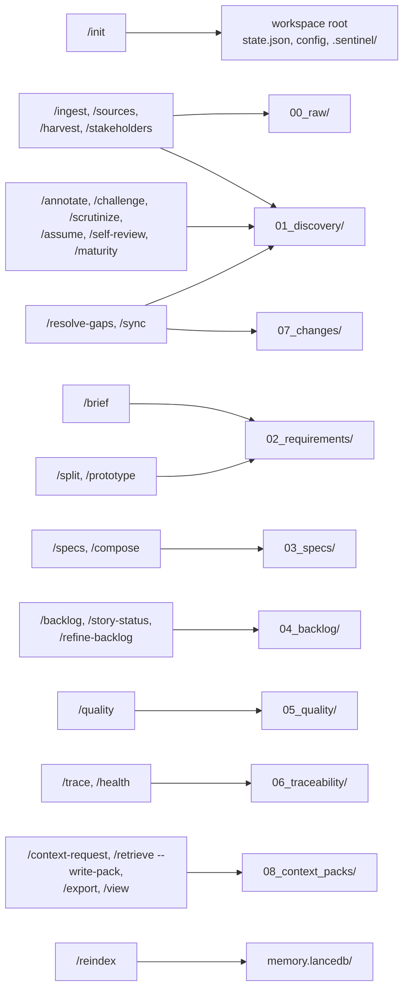

# Artifact reference

This page lists every file and folder Sentinel creates inside a project workspace: what it is for, who reads it, whether you may edit it, and which command writes it. Read it when you open a workspace and wonder "what is this file, and can I touch it?". Business analysts and product managers need the lifecycle map and the edit rules; developers will also want the [developer appendix](#developer-appendix) at the end.

Terms such as gap, brief, spec unit, governed artifact or release series are defined in the [glossary](00-user-guide.md). Commands are described in the [command reference](01-command-reference.md).

## Lifecycle map

Every project lives in `workspaces/<PROJECT_ID>/`. The numbered folders follow the order of the work, so the folder you are in tells you the stage.



A new project passes through the folders in this order: raw evidence (`00_raw`), discovery (`01_discovery`), the brief (`02_requirements`), specs (`03_specs`), backlog (`04_backlog`), quality (`05_quality`). Traceability (`06_traceability`), changes (`07_changes`) and context packs (`08_context_packs`) are filled all along the way.

## Edit rules at a glance

Every artifact falls into one of three groups.

| Group | Meaning | What to do instead of editing |
|---|---|---|
| **Never edit by hand** | A governed or generated artifact. Sentinel rebuilds it from evidence; a hand edit is flagged, and copied to `.sentinel/hand_edits/` before a command overwrites it. | Change the evidence and re-run the owning command. |
| **Edit freely** | You own it: configuration, local themes, and the evidence files you drop into `00_raw/`. | Edit it, then run `/sync` so Sentinel notices new evidence. |
| **Disposable and regenerable** | A view, a cache or an index. Safe to delete. | Re-run the command that builds it. |

> [!IMPORTANT]
> Three kinds of file are protected by the editor hook on Claude Code, Codex and Kilo Code: `02_requirements/project-brief.md`, the top-level `03_specs/*.md` and the top-level `04_backlog/*.md`. A hand write to one of them is denied. Files in sub-folders (for example `03_specs/units/`) and in release folders (`<rN>/`) are not covered by the hook but are still generated: do not edit them.
>
> `01_discovery/gaps.md` and `02_requirements/requirements.md` are not blocked by the hook, but `/health` records a hash of them and of the brief, specs and backlog, and reports any hand edit. So five paths are watched even though three are blocked.
>
> A hand edit of a watched file is never absorbed silently. The warning stays until the file is reverted or regenerated, and before a command may overwrite the edit Sentinel copies the file to `.sentinel/hand_edits/<timestamp>-<command>/`. The command prints a `sentinel warning:` line when it changed the file, and `/health` keeps reporting the copy until you carry the change through the owning command or `/sync` and delete the copy.

How answers get in without hand-editing: client answers go through `/resolve-gaps`, changes and new meeting notes go through `/sync`, the first request goes through `/ingest` and every later evidence file through `/sync --source` (the registry through `/sources`). See the [workflows](03-workflows.md).

## Workspace root

```text
workspaces/<PROJECT_ID>/
  state.json
  sentinel.config.yaml
  .gitignore
  .sentinel/
  .series_work/        (only when you use release series)
  memory.lancedb/
  00_raw/ ... 08_context_packs/
```

| Path | Purpose | Read by | Edit rule | Written by |
|---|---|---|---|---|
| `state.json` | Where the project is: phase, health, language, story status, gate results, file hashes. | Every command, `/status`, the dashboard | Never edit by hand | Every mutating command (read-only commands still record `last_command`, and `/health` records the health); created by `/init` |
| `sentinel.config.yaml` | Project settings: language, privacy mode, gate thresholds, theme. | Every command | **Edit freely** | Created by `/init`; edited by you |
| `.gitignore` | Keeps regenerable paths out of git when you version the workspace. | git | Edit freely | Created by `/init` |
| `.sentinel/derived/state.json` | Counts and metrics Sentinel recomputes (gap counts, maturity metrics, backlog roll-up). | `/status`, the dashboard | Disposable | Every mutating command |
| `.sentinel/command_log.jsonl` | One line per command that ran, append-only. | `/health`, admins, audits | Never edit by hand | Every command |
| `.sentinel/themes/<name>.json` | A look-and-feel theme for this workspace only. | `/view` | Edit freely | You; see [themes](17-themes.md) |
| `.sentinel/state.json.bak` | The previous `state.json`, copied before every state update. | You, to recover a deleted or damaged `state.json` | Leave alone; copy it over `state.json` to restore | Every command that updates the state |
| `.sentinel/hand_edits/<timestamp>-<command>/` | A copy of each hand-edited governed file, made before a mutating command may change it. | You, to carry the edit through the owning command | Delete the copy once the change is carried through; `/health` warns until then | Every mutating command that finds a hand edit |
| `.sentinel/state.json.bak-0.9.0` | One-time backup made when an old workspace is upgraded. | Nobody, unless you roll back | Leave alone | The first command that opens an old workspace |
| `.sentinel/lock` | The lock that makes a second command wait (exit code 6). | Sentinel | Never touch | Every project command, read-only ones included |
| `.series_work/<rN>/` | The mirror a command runs in when you pass `--release rN`. | Sentinel | Never edit by hand | Release commands |
| `memory.lancedb/` | The retrieval index. See [below](#memorylancedb) and [Traceability and memory](05-traceability-and-memory.md). | `/retrieve` | Disposable | `/ingest`, `/sync`, `/reindex` |

### What the workspace `.gitignore` ignores

When you version a workspace in your own repository (see [repository and branching strategy](10-repo-and-branching-strategy.md)), the generated `.gitignore` keeps out what can be rebuilt: `memory.lancedb/`, `08_context_packs/views/*.html`, `08_context_packs/synthetic/` and `.sentinel/`. Everything else, the matured artifacts, stays tracked. `.series_work/` is not in that list. If you use release series and do not want the mirrors in git, add it yourself.

### Configuration keys

`/init` writes this file; the keys below are the ones it creates.

```yaml
project_id: ACME_PORTAL
version: 0.1.0
project_language: auto        # auto | es | en
privacy_mode: local-only
domains: [product, business, functional, technical, design, quality, delivery, compliance]
maturity:
  blocking_gap_severities: [critical, high]
  required_domains: [product, functional, quality]
gap_resolution:
  auto_close_rule: confirmed_structured
backlog_gate:
  threshold: 1.0
  strict: false
privacy_scan:
  mode: warn
memory:
  provider: lancedb-hybrid
  lancedb_optional: true
  fallback: json-hybrid
  embedding: local-hash
  context_folders: [00_raw/00_client_requirement, ..., 00_raw/05_interactions]
```

You may add these optional keys. All gates only warn by default; `strict: true` turns the warning into a refusal.

| Key | Effect |
|---|---|
| `implementability_gate.strict` | Blocks the move to `READY_FOR_SPECS` at `/brief` while a requirement unit has an open gap only the client can answer. |
| `drift_gate.strict` | Blocks `/specs` and `/backlog` when the artifacts they derive from changed since generation. |
| `needs_context_gate.strict` | Turns the `/health` hint "use focused retrieval" into a finding. |
| `specs_gate.threshold`, `specs_gate.strict` | Minimum PRD section readiness (default 0.75); strict blocks `/specs` below it. |
| `theme` | Default theme for `/view` (see [themes](17-themes.md)). |
| `pii_report: true` | Also writes `01_discovery/pii_report.md` when personal data is found. |

`project_language` sets the language of generated artifacts: `auto` detects it from the first ingested requirement, `es` or `en` force it. The detected value is copied into `state.json`.

## `00_raw/`: evidence

Everything the client or the domain teams gave you, as received, in five context sub-folders plus the client requirement.

| Path | Purpose | Edit rule | Written by |
|---|---|---|---|
| `[source].md` (at the top of `00_raw/`) | The redacted copy of the primary client requirement, named after the file you passed to `/ingest` (for example `00_raw/loan-request.md`). | Never edit; replace it only with `/ingest --replace` | `/ingest` |
| `00_client_requirement/` | Extra client requirement material you add by hand. `/ingest` does not copy into it. | Add files; do not rewrite processed ones | You |
| `01_business_context/` | Business rules, policies, process documents. | Add files freely | You, `/ingest`, `/sources` |
| `02_technology_context/` | Architecture notes, API contracts, harvested code summaries (`harvest/`). | Add files freely | You, `/harvest`, `/sources` |
| `03_design_context/` | Prototypes, design notes. | Add files freely | You, `/sources` |
| `04_quality_context/` | Test strategy, quality rules. | Add files freely | You |
| `05_interactions/` | Answered gap documents and meeting notes from the client. | Add files freely | You |
| `source_manifest.json` | Which files were processed (path, hash, status, event id, timestamps). | Never edit by hand | `/ingest`, `/sync`, `/sources` |

Raw input is evidence, not truth. Sentinel scans each ingested file for secrets and stores a **redacted copy**; the type, line and a hash of each redacted secret go to `01_discovery/secret_alerts.md`. A file you modify later is detected through its hash in `source_manifest.json` the next time you run `/sync PROJECT_ID`.

## `01_discovery/`: what is known and what is missing

This folder holds the understanding Sentinel builds from the evidence. Start with `gaps.md`.

### Start here

| File | Purpose | Read by | Edit rule | Written by |
|---|---|---|---|---|
| `gaps.md` | Questions the evidence leaves open, one section per gap, with why it matters, what answering it unblocks, the expected answer format and blank response fields. | You, then the client and domain owners | Never edit by hand (watched by `/health`); answers go through `/resolve-gaps` | `/ingest`, `/annotate`, `/challenge`, `/scrutinize`, `/harvest`, `/resolve-gaps`, `/gaps` |
| `requirement_maturity_report.md` | Verdict: `READY_FOR_SPECS` or `BLOCKED`, and why. | BA, PM | Never edit | `/maturity` |
| `assumptions.md` | Register of assumptions a BA took on knowingly, with owner, risk and the quote that justifies them. | BA, PM, reviewers | Never edit | `/assume` |
| `stakeholders.md` | Who answers for which lens. Used to route gaps to people. | BA | Never edit by hand; use `/stakeholders --add` | `/stakeholders` |

`gaps.md` is meant to be shared. Each gap has a lens, a severity (`critical`, `high`, `medium`, `low`) and a status: `OPEN`, `ANSWERED`, `PARTIALLY_CLOSED`, `CLOSED`, `SUPERSEDED`, `NEW_REQUIREMENT` or `NEW_GAP`. The `Origin` column says who raised it (`checklist`, `agent`, `challenge`, `scrutiny`, `implementability-probe`, `harvest`), and `Unit` names the requirement unit (`RU-*`) it belongs to. Send the answered file back into `00_raw/05_interactions/` or `input/interactions/` and run `/resolve-gaps`.

### Supporting records

| File | Purpose | Edit rule | Written by |
|---|---|---|---|
| `raw_input_digest.md` | Short summary of each ingested source. | Never edit | `/ingest` |
| `source_synthesis.md` | Per-source synthesis with verbatim citations, before cross-source review. Not indexed in memory. | Never edit | `/ingest` |
| `requirement_units.md` | Index of cited requirement units (`RU-*`), the anchors discovery works on. | Never edit | `/ingest` |
| `requirement_unit_deltas.md` | What was added, modified or removed when the primary requirement is replaced. Only after `/ingest --replace`. A signal, it never changes gaps. | Never edit | `/ingest` |
| `identity_seeds.md` | Atomic project truths and pending truths with origin and lens. | Never edit | `/ingest` |
| `decisions.md` | Decisions taken or pending. | Never edit | `/ingest`, `/sync` |
| `knowledge_state.md` and `.json` | The ledger of what is `CONFIRMED`, `ASSUMED`, `OPEN` or `INFERRED`, by lens. | Never edit | `/ingest`, `/resolve-gaps`, `/sync` |
| `development_readiness.json` | Development-certainty matrix: 16 areas by lens, plus per-unit implementability. | Never edit | `/maturity` |
| `discovery_log.md`, `lens_review.md` | Multi-lens review of the evidence and the coverage checklist. | Never edit | `/ingest` |
| `gap_resolution_log.md` | Append-only history of `/resolve-gaps` runs. | Never edit | `/resolve-gaps` |
| `glossary.json` | The domain glossary that feeds the brief's glossary section. | Never edit | The brief compiler |
| `statement_ledger.json`, `contradictions.md` | Claims per source and the contradictions between sources. | Never edit | `/sources`, brief compiler |
| `harvest.json` | What `/harvest` read from an existing system. | Never edit | `/harvest` |
| `split_assessment.md` and `.json` | Whether the brief should be split into releases. | Never edit | `/split --assess` |
| `secret_alerts.md`, `pii_report.md` | Redacted secrets (type, line, hash) and, if enabled, personal data findings. | Never edit | `/ingest`, `/sync`; secret alerts also `/resolve-gaps`, `/harvest` |
| `injection_signals.md` | Text in a source that looks like an instruction to an agent, for BA review. | Never edit | `/ingest`, `/sync` |

### Records of the agent passes

Each pass writes one report, plus an archive of the JSON the agent submitted.

| Report | Archive folder | Written by |
|---|---|---|
| `agent_annotation_log.md` | `annotations/` | `/annotate` |
| `challenge_report.md` | `challenges/` | `/challenge` |
| `scrutiny_report.md` | `scrutiny/` | `/scrutinize` |
| `implementability_probe_report.md` | `implementability_probe/` | `/scrutinize --mode implementability-probe` |
| `anchor_review_log.md` | | `/scrutinize --mode anchors` |
| `sufficiency_log.md` | | `/self-review --sufficiency` |
| `agent_sweep_log.md` | | Every agent pass: `/annotate`, `/challenge`, `/scrutinize` (all modes), `/self-review` (all modes) |
| `agent_dispositions.json` | | `/gaps --id GAP-X --disposition` |

All of them are append-only records of what the runtime accepted and rejected. Gaps raised this way carry the matching `Origin` in `gaps.md`. Never edit them.

## `02_requirements/`: the brief and what hangs from it

| Path | Purpose | Read by | Edit rule | Written by |
|---|---|---|---|---|
| `project-brief.md` | The crystallised handoff from discovery to specs. | Everyone: BA, PM, design, tech, quality, the agents | **Never edit by hand** (blocked by the hook) | `/brief`; `/maturity` rewrites it when the verdict allows |
| `brief_compile_report.json` | What the compiler placed where and what it left pending. | BA, developers | Never edit | `/brief` |
| `requirements.md` | Requirement statements extracted from raw input, plus normalised `REQ-EARS-*` rows. | Specs, `/validate` | Never edit by hand (watched by `/health`) | `/ingest`, `/resolve-gaps` |

### The brief

New projects get **brief v2**. It needs one confirmation from you after `/init`:

```bash
/brief ACME_PORTAL --profile UI,API --genesis greenfield
python -m sentinel /brief ACME_PORTAL --profile UI,API --genesis greenfield
```

`--profile` takes a comma-separated list of `UI`, `API`, `BAT`, `INT`, `MIG`, `REG`, `MT`. `--genesis` takes `greenfield`, `brownfield-integration`, `brownfield-extension` or `brownfield-replacement` (comma-separated when mixed). `--validation-direction` takes `to-build` or `built`. Until you confirm profile and genesis, `GAP-BRIEF-PROFILE` blocks the brief and `/specs` refuses.

The brief v2 sections:

| Section | Content |
|---|---|
| 0. Header | How to read the document; status, validity and sources. |
| 1. Overview | Identity and value, the core pain, success metrics and scope, starting and end point, release acceptance criteria. |
| 2. Business lens | Actors and goals by role, critical business rules, main use case, business need, business calendar. |
| 3. Product lens | As-is, to-be process, sequence and flow, state machine, transition logic, edge cases. |
| 4. Design lens | Screen flow, UX considerations, prototype and precedents, accessibility, help and training. |
| 5. Technical lens | Architecture and integrations, stack, data sources and model, API contracts, field mapping, batch and caching, governance and constraints, services, events, observability, security, and other numbered subsections (5.0 to 5.25). |
| 6. Release agreements | In scope, out of scope, propagation to other documents. |
| 7. Dependencies and open questions | The open-items table and the items seeded in the body. |
| 8. Assumptions | The assumption list. |
| 9. Things to build | Build list or phases. |
| A. Glossary, A. Provenance | Domain glossary; provenance and reference data. |

Sections that have no evidence show `[PENDING INPUT]` with the `GAP-*` that tracks them. Sentinel never fills a section with invented text. Citations use the structured `[[document § section # ID]]` form.

**Brief v1** (`/init --brief-version 1`, or a workspace created before v2) has eleven sections: identity and value, business lens, product lens (with a Non-Goals block), design lens, technical lens, governance and constraints, decisions and seeds, the uncertainty radar of gaps, readiness for PRD, specs and backlog, PRD coverage readiness, and domain context requests. Its headings follow the project language.

> [!NOTE]
> To add a non-goal, close the relevant gap as "not applicable" with `/resolve-gaps`. Do not write it into the brief.

### Release series: `series/` and `<rN>/`

Created when you split a large brief into releases with `/split`. See the [release split workflow](03-workflows.md).

| Path | Purpose | Edit rule | Written by |
|---|---|---|---|
| `series/proposal.json` | The proposed partition of the brief into releases. | Never edit | `/split --propose` |
| `series/partition.json` | The confirmed partition, including which releases are closed. | Never edit | `/split --confirm`, `--move`, `--close` |
| `series/index.md` | Index of the series. | Never edit | `/split` |
| `series/scope_changes.md` (and `.json`) | Dated record of units moved between releases. | Never edit | `/split --move` |
| `series/release-guide.md` | Status of each release, its waves and what it waits for. View it with `/view --artifact release-guide`. | Never edit | `/split` |
| `<rN>/project-brief.md` | The brief of one release. Not covered by the editor hook, but never edit it. | Never edit | `/split --confirm`; recompiled when the project brief changes |

Commands that accept `--release rN` write their outputs into `<rN>/` sub-folders next to the project-wide ones: `03_specs/<rN>/`, `04_backlog/<rN>/`, `05_quality/<rN>/`, `06_traceability/<rN>/` and `08_context_packs/<rN>/`. Each release keeps its own lifecycle; the project `state.json` is not touched by a release run. Without `--release` nothing changes.

### Prototype: `prototype/`

Created when a prototype is among your sources. See the [prototype workflow](03-workflows.md).

| Path | Purpose | Edit rule | Written by |
|---|---|---|---|
| `prototype/inventory.md` and `.json` | Visible elements and texts per screen of an ingested HTML prototype. | Never edit | `/prototype --inventory` |
| `prototype/trace/F-NN-SN.json`, `prototype/trace.md` | Element to data to contract to rule, one screen at a time. | Never edit | `/prototype --trace` |
| `prototype/manual.md` | The printable user manual of the prototype. | Never edit | `/prototype --manual` |

## `03_specs/`: PRD and specs

| Path | Purpose | Read by | Edit rule | Written by |
|---|---|---|---|---|
| `prd.md` | The business-facing product requirements document: scope, personas, functional requirements with acceptance criteria, NFRs, KPIs, risks, roadmap, glossary. Every line cites evidence or shows the gap that blocks it. | BA, PM, stakeholders | Never edit (hook) | `/specs` |
| `specs.md` | The compact agent-facing specification: contract, spec-unit index, context map, retrieval plan, backlog seeds. | Tech lead, design, quality, coding agents | Never edit (hook) | `/specs` |
| `units/SPEC-U-NNN.md` | One bounded execution unit per confirmed requirement statement, with frontmatter and source anchors. | Backlog generation, coding agents | Never edit | `/specs` |
| `compositions/` | Audit trail of agent-written PRD paragraphs: the submitted JSON, `accepted_blocks.json`, `composition_report.md`, `regeneration_report.md`. | BA | Never edit | `/compose`, `/specs` |
| `<rN>/` | The same files derived for one release. | | Never edit | `/specs --release rN` |

Agent paragraphs accepted through `/compose` appear in the PRD under "Agent Composition" with `Origin: agent`; they are re-applied when `/specs` regenerates, or dropped with a reason if their citation disappeared.

## `04_backlog/`: epics and stories

| Path | Purpose | Read by | Edit rule | Written by |
|---|---|---|---|---|
| `BACKLOG.md` | The board: totals, roll-up by epic, stories grouped by status. | BA, PM | Never edit (hook) | `/backlog`, `/story-status`, `/backlog-status` |
| `EPIC-001.md` | The main epic with its story map and embedded stories (narrative, Given/When/Then criteria, Definition of Ready and Done, retrieval plan). | BA, reviewers | Never edit (hook) | `/backlog` |
| `EPIC-002-cross-cutting-enablers.md` | Optional epic for concrete cross-cutting foundations (shared UI structure, authentication, persistence, integration contracts). Only created when evidence names such work. | Tech lead | Never edit (hook) | `/backlog` |
| `US-NNN.md` | One file per story, with lifecycle `status` and `owner` in the frontmatter. | Coding and test agents | Never edit (hook); change status with `/story-status` | `/backlog`, `/story-status` |
| `SLICE-PLAN.md` | Implementation order: enabler phase, waves, checkpoints. | Delivery, planning agents | Never edit (hook) | `/backlog` |
| `status_log.md` | Append-only log of story status changes. | PM | Never edit | `/story-status` |
| `acceptance_criteria_deltas.md` | Differences between the criteria frozen at `Ready` and the regenerated ones. | BA | Never edit | `/backlog` |
| `acceptance_evidence/` | Evidence files attached to support a `Done` transition. | QA | Never edit | `/story-status --evidence` |
| `refinements/` | Audit trail of agent backlog refinements: submitted JSON, `accepted_refinements.json`, `refinement_report.md`. | BA | Never edit | `/refine-backlog` |
| `<rN>/` | The same files derived for one release. | | Never edit | `/backlog --release rN` |

Valid story statuses are `Draft`, `Ready`, `In Progress`, `In Review`, `Done`, `Blocked` and `Stale`. Only `/story-status` changes them.

## `05_quality/`

| Path | Purpose | Edit rule | Written by |
|---|---|---|---|
| `TC-NNN.md` | A generated test-case set linked to a story. | Never edit | `/quality` |
| `backlog_readiness_audit.md` | Per-story INVEST and SPIDR checks with a non-blocking verdict. | Never edit | `/quality` |
| `<rN>/` | The same for one release. | Never edit | `/quality --release rN` |

## `06_traceability/`

| Path | Purpose | Read by | Edit rule | Written by |
|---|---|---|---|---|
| `traceability_matrix.md` | Table of source-to-target links. | BA, auditors | Never edit | `/trace`, and after every mutating command |
| `traceability_graph.md` | The graph as a Mermaid diagram. | BA, auditors | Never edit | `/trace` |
| `traceability_graph.json` | The graph itself: nodes and edges. | Tools, `/health` | Never edit | Every mutating command |
| `health_report.md` and `.json` | The health verdict and findings: stale artifacts, hand edits, missing evidence. | Everyone | Never edit | `/health` |
| `command_protocol_log.md` | The last 25 commands in plain text. | Humans | Never edit | Every command |
| `retired_ids.json` | Ids that were retired and must not be reused. | Sentinel | Never edit | ID allocation |
| `<rN>/` | The same for one release. | | Never edit | `/trace --release rN` |

See [Traceability and memory](05-traceability-and-memory.md) for how the graph is used.

## `07_changes/`: controlled change

| Path | Purpose | Edit rule | Written by |
|---|---|---|---|
| `[source].md` | The copied source of a change (a meeting note, an email, a domain update). | Never edit | `/sync` |
| `[source]_impact_report.md` | What the change touches: impacted nodes, reopened gaps, impacted knowledge units, stale downstream artifacts. Read it before regenerating anything. | Never edit | `/sync` |
| `metabolism_log.md` | Append-only log of sync events and follow-up actions. | Never edit | `/sync` |
| `00_client_responses/` | Answered gap documents, with one `[source]_gap_resolution_report.md` each (closed, answered, partial, still open). | Never edit | `/resolve-gaps` |
| `01_meetings/`, `02_mail_slack/`, `03_domain_updates/` | Drop folders for change sources. | Add files freely | You |
| `04_regeneration/regen-NNN-*.md` | What changed when `/specs` or `/backlog` regenerated an artifact. Each change is marked `ADDED`, `MODIFIED` or `REMOVED`. | Never edit | `/specs`, `/backlog` |
| `05_implementation_feedback/feedback_report.md` | Accepted and rejected findings from implementation, plus the archived JSON. | Never edit | `/implementation-feedback` |
| `source_log.md` | The source registry: one `F-NN` row per source with authority, supersession and impact matrix. | Never edit; use `/sources` | `/sources` |
| `closing_report.md` | The closing report of the source registry. | Never edit | `/sources --report` |

## `08_context_packs/`: derived packs, requests, exports, views

Most of this folder is regenerable. Packs are retrieval snapshots for agents and are described in [Traceability and memory](05-traceability-and-memory.md).

| Path | Purpose | Edit rule | Written by |
|---|---|---|---|
| `specs_generation.json`, `backlog_generation.json` | The focused retrieval used to draft the PRD and the backlog. | Disposable | `/specs`, `/backlog` |
| `implementation_readiness.json` | Per-story handoff for coding agents: readiness, required domains, execution contract. | Disposable | `/backlog` |
| `slice_plan.json` | Machine-readable mirror of `SLICE-PLAN.md`. | Disposable | `/backlog` |
| `assumptions_projection.json` | The unresolved assumptions as JSON. | Disposable | `/assume` |
| `discovery_focus.json`, `sync_focus.json` | Pointer-only packs for discovery and sync. | Disposable | `/ingest`, `/sync` |
| `<workflow>.json` | A pack you asked for with `/retrieve --write-pack`. | Disposable | `/retrieve` |
| `requests/*_context_request.md` | Requests for technology, design, quality, frontend and backend context, with cited candidate options. | Never edit | `/context-request` |
| `requests/ctx_lifecycle.json` | State of each request (`active`, `answered`, `closed`, `obsolete`). | Never edit | `/context-request --id --status` |
| `exports/` | Shareable copies made by `/export`, stamped as draft until `--final`. Formats: `md`, `mdx`, `interview`, `faq`. | Disposable | `/export` |
| `views/*.html` | The HTML views of `/view`. See [Artifact views](15-artifact-views.md). | Disposable | `/view` |
| `<rN>/` (including `<rN>/views/`) | Packs and views of one release. | Disposable | Commands with `--release rN` |
| `synthetic/` | Synthetic datasets for testing. Git-ignored. | Disposable | The handoff-datasets skill |

> [!NOTE]
> `/export` copies a source artifact into `exports/`. `--final` refuses while pending marks remain. `--format mdx` writes a local folder (`prd-mdx/index.mdx`, `blocks.json`, `README.md`) for teams that already run an offline MDX renderer; regenerate it, never edit it. See `/export` in the [command reference](01-command-reference.md).

## `memory.lancedb/`

The local retrieval index: `lance/` (table `ba_memory`), `memory.json` (the JSON fallback and audit copy) and `artifact_manifest.json`. It is a search aid and never the source of truth. It is git-ignored; after a clone or a pull, run `/reindex PROJECT_ID`. Details in [Traceability and memory](05-traceability-and-memory.md).

## Outside the workspace

| Path | Purpose | Edit rule | Written by |
|---|---|---|---|
| `dashboard.html` (the folder you run `/dashboard` from) | The portfolio dashboard across all workspaces. Git-ignored in a clone. | Disposable | `/dashboard`; see [Dashboard](14-dashboard.md) |
| `input/` | Optional drop folder for evidence and answered gap documents. | Edit freely | You |

## Next

- [Traceability and memory](05-traceability-and-memory.md): how the graph, the index and the packs fit together.
- [Artifact views](15-artifact-views.md) and [Dashboard](14-dashboard.md): read artifacts in the browser.
- [Workflows](03-workflows.md): what to do in each situation.

---

## Developer appendix

For people who consume Sentinel output from code or from a coding agent. Nothing here is needed to use Sentinel.

### `state.json`

`schema_version` is `1`. A `state.json` with a newer schema is refused (exit code 3) and left untouched. A workspace from 0.9.0 (no `schema_version`) is migrated once by the first command that opens it, after a backup to `.sentinel/state.json.bak-0.9.0`; the old in-file command log moves to `.sentinel/command_log.jsonl`.

Before each update the previous `state.json` is copied to `.sentinel/state.json.bak` (one copy, replaced each time). A missing `state.json` is never rebuilt on a workspace that has a backup or artifacts, and a `state.json` that does not parse is never overwritten: both stop the command with exit code 3, naming the file and the restore step.

Durable fields (cannot be rebuilt):

| Field | Meaning |
|---|---|
| `project_id`, `phase`, `health`, `created_at`, `updated_at` | Identity and position. |
| `artifacts` | Pointers to artifacts, stored relative to the workspace. |
| `project_language`, `privacy_mode`, `readiness_stage` | Settings and stage. |
| `brief_settings` | `brief_version`, plus the profile, genesis and validation direction you confirmed with `/brief`. |
| `story_lifecycle`, `story_gates`, `story_quality`, `story_acceptance_evidence` | Story status and owner, latest DoR/DoD evaluation, latest `/quality` score, attached evidence. |
| `acceptance_criteria_freezes` | Criteria frozen when a story reached `Ready`. |
| `implementation_feedback` | Open downstream findings that may stale stories or block DoD. |
| `artifact_hashes` | sha256 of the governed artifacts, refreshed for each artifact a mutating command writes. `/health` compares it with current bytes to flag hand edits. |
| `derived_source_fingerprints` | For `specs` and `backlog`, the hash of the sources they were generated from. `/health` uses it to flag drift. |
| `last_gap_resolution_id`, `last_knowledge_metabolism`, `last_*_source` | Pointers to the latest runs. |
| `migrated_from` | Set when a 0.9.0 workspace was migrated. |

Derived fields live in `.sentinel/derived/state.json` and are merged on read: `gap_counts`, `maturity_metrics`, `prd_section_readiness`, `backlog_rollup`. Deleting that file loses nothing a command does not rebuild.

`.sentinel/command_log.jsonl` has one JSON object per line.

### JSON contracts

| File | Shape, in short |
|---|---|
| `knowledge_state.json` | `units[]` with `status`, `evidence`, `links`, `valid_at`, `invalid_at`; append-only `invalidated_units` (with `superseded_by`) and `promotion_events`. The ledger is rebuilt from source tables; `as_of` and `lineage` queries are derived from it. |
| `development_readiness.json` | `cells` per area and lens (`status`, `evidence`, `links`, `score`), `summary` with scores and the Crystallization Gate verdict, and `unit_implementability` per `RU-*` and lens (`OPEN`, `DEFERRED_TO_CONTEXT`, `CONFIRMED`). |
| `specs_generation.json` | Per-section retrieval with plan metadata (`query`, `filters`, `limit`, `budget_chars`, `lenses`, `source_sections`), results with `read_plan` anchors, `coverage_map` and `coverage_score`. |
| `backlog_generation.json` | Aggregate `sections`, `domain_context_coverage`, and `per_story.US-NNN` mini-contexts. |
| `implementation_readiness.json` | Per story: verdict `ready` or `needs-context`, dependencies, required domains, `execution_contract` with `anchor` pointers, retrieval plan, validation contract (fail-to-pass, pass-to-pass, evidence), blast radius; a domain-context snapshot hash; `stale_spec_units` after a `/specs` regeneration; optional `task_seed_contract`. |
| `slice_plan.json` | `phases.enabler_phase`, `phases.implementation_waves`, `phases.positions`, `checkpoints`, `handoff_packs.US-NNN`. |
| `assumptions_projection.json` | Rows with status `ASSUMED`: `id`, `statement`, `risk`, `owner`, `closes_gap`, `basis_quote`, plus counts. |
| `source_manifest.json` | `sources` keyed by path: `hash`, `status`, `event_id`, `last_seen_at`, `last_processed_at`. |

Every generated file cites paths as `workspaces/<PROJECT_ID>/...` from the repository root; stored graph and memory paths are relative to the workspace. See [Traceability and memory](05-traceability-and-memory.md).

### Delta vocabulary

Regeneration and delta reports use a closed set of markers: `ADDED`, `MODIFIED`, `REMOVED` (and `UNCHANGED` in full snapshots). The spec-unit delta (`regen-NNN-spec-units-delta.md`), the requirement-unit delta and the acceptance-criteria delta all use it.

### Memory internals

Chunk fields, embedders, ranking and the retrieval eval harness are described in the developer section of [Traceability and memory](05-traceability-and-memory.md#developer-notes-memory-internals).
