# Workflows

This page tells you what to do in each situation you meet on a real project, from the first request to the handoff and after it. It is written for business analysts and product managers. If you have not run Sentinel yet, start with [Start here](00-user-guide.md); for longer worked examples, see [Scenarios](12-scenarios.md).

**How to read a situation.** Each one has the same parts: *When this happens*, *What to do*, *How you know it worked* and *If something goes wrong*. Some end with a collapsed block for the technical reader; you can skip it.

**How to type a command.** Commands are shown in chat form, for example `/next ACME_PORTAL`. In a terminal, put `python -m sentinel` in front (`python -m sentinel /next ACME_PORTAL`). In Codex and with the Claude Code plugin, put `sentinel ` in front (`sentinel /next ACME_PORTAL`). See [Driving Sentinel from chat](11-chat-commands.md). The example project is `ACME_PORTAL`; use your own project id. Words such as *gap*, *brief* or *health* are defined in the [glossary](00-user-guide.md#glossary).

**What you see.** Every command answers with a block of text. When a command stops, it prints a line that starts with `sentinel error:` (what is wrong) and often a line that starts with `next step:` (what to do). Those two lines are what this page quotes.

| Situation | Go to |
|---|---|
| A new request arrives | [A new request arrives](#a-new-request-arrives) |
| The request is only a few lines long | [The request is only a few lines long](#the-request-is-only-a-few-lines-long) |
| You prepare a meeting with stakeholders, then process the minutes | [Preparing a meeting and processing the minutes](#preparing-a-meeting-and-processing-the-minutes) |
| The client sent answers | [The client sent answers](#the-client-sent-answers) |
| The client does not answer and you need to move on | [The client does not answer and you need to move on](#the-client-does-not-answer-and-you-need-to-move-on) |
| You want the agent to find what you missed | [You want the agent to find what you missed](#you-want-the-agent-to-find-what-you-missed) |
| A domain team must provide context | [A domain team must provide context](#a-domain-team-must-provide-context) |
| Something changed after a meeting or an email | [Something changed after a meeting or an email](#something-changed-after-a-meeting-or-an-email) |
| Two sources say different things | [Two sources contradict each other](#two-sources-contradict-each-other) |
| A source was wrong or is outdated | [A source was wrong or is outdated](#a-source-was-wrong-or-is-outdated) |
| The scope changes after the backlog exists | [The scope changes after the backlog exists](#the-scope-changes-after-the-backlog-exists) |
| You need what was said about a topic | [Finding what was said about a topic](#finding-what-was-said-about-a-topic) |
| A command refused | [A command refused](#a-command-refused) |
| The scope is too big for one release | [The scope is too big for one release](#the-scope-is-too-big-for-one-release) |
| You have an HTML prototype | [You have an HTML prototype](#you-have-an-html-prototype) |
| The system already exists | [The system already exists](#the-system-already-exists) |
| Stories need reshaping, assigning or moving | [Stories need reshaping or moving](#stories-need-reshaping-or-moving) |
| The development team asks a question or finds a problem | [The development team asks a question or finds a problem](#the-development-team-asks-a-question-or-finds-a-problem) |
| You want to check quality before handing off | [Checking quality before handing off](#checking-quality-before-handing-off) |
| You show progress to the sponsor or the client | [Showing progress to the sponsor or the client](#showing-progress-to-the-sponsor-or-the-client) |
| Time to hand off | [Handing off to the delivery team](#handing-off-to-the-delivery-team) |
| You pick up a project after weeks, or take over from another BA | [Picking up a project after weeks](#picking-up-a-project-after-weeks) |
| You edited a generated file by hand | [You edited a file by hand](#you-edited-a-file-by-hand) |
| Something broke | [Something broke](#something-broke) |
| You run several projects for the same client | [Several projects for the same client](#several-projects-for-the-same-client) |

<a id="new-project"></a>

## A new request arrives

**When this happens.** The first real input arrives: a request, a brief, a guide or a set of notes.

**What to do.**

1. Create the project and load the request. `/init` creates the project folder (the *workspace*). `/ingest` reads the request, keeps a copy with secrets masked, and writes the list of open questions (the *gaps*, in `01_discovery/gaps.md`).

   ```text
   /init ACME_PORTAL
   /ingest ACME_PORTAL --source input/acme-request.md
   ```

   In a Claude Code clone, if `/init` starts Claude Code's own project setup (it writes a `CLAUDE.md`), send `/sentinel /init ACME_PORTAL` instead.

2. Say what kind of system this is, once. The *profile* says what the brief must cover (here a user interface); the *genesis* says whether you build from scratch or change an existing system. Sentinel then writes the project brief, with a pending mark wherever an answer is missing.

   ```text
   /brief ACME_PORTAL --profile UI --genesis greenfield
   ```

   If you are not sure of the values, run `/next ACME_PORTAL` first: until you confirm them it answers *Confirm the brief settings* and proposes values taken from the request.

3. Ask what to do next.

   ```text
   /next ACME_PORTAL
   ```

   You see *Waiting for client answers* and the text "Send the client the interview script (/export --artifact gaps --format interview) and run /resolve-gaps when answers return." That means Sentinel has done what it can until the client replies. Go to [The request is only a few lines long](#the-request-is-only-a-few-lines-long) to plan the first round of questions.

4. Load every later file (a guide, meeting notes, a prototype) with `/sync`, never with a second `/ingest`:

   ```text
   /sync ACME_PORTAL --source input/billing-guide.md
   ```

**How you know it worked.** `workspaces/ACME_PORTAL/01_discovery/gaps.md` exists and lists questions. `/next` no longer asks for the brief settings. `02_requirements/project-brief.md` exists, with pending marks such as `⏳ PENDING (GAP-SCOPE)`.

**If something goes wrong.**

- `--source file not found`: the path is read from the folder you run Sentinel from. Check it.
- A second `/ingest` is refused, because it would replace the first request and reopen every answered question. Use `/sync` for later files. To replace the first request on purpose, add `--replace` (see [When something went wrong](21-recovery.md#a-wrong-file-was-ingested)).
- `/brief` with an unknown profile or genesis stops and lists the valid values. Several profiles go together as `--profile UI,REG`.
- If you skip step 2, `/next` and `/status` keep asking for it, and `/specs` and `/backlog` refuse.

<details><summary>For the technical reader</summary>

A binary file that is not `.docx` (a PDF, a corrupt Word file) is refused with exit 3; convert it to Markdown. Other UTF-8 text files are stored as Markdown with a warning. A `MIG` profile needs `--genesis brownfield-replacement`; a contradictory pair keeps `GAP-BRIEF-PROFILE` open. Older projects can keep the earlier brief format with `/init ACME_PORTAL --brief-version 1` (11 sections, no pending-mark places).

</details>

<a id="thin-intake"></a>

## The request is only a few lines long

**When this happens.** The request is a paragraph or a vague idea, and the list of open questions comes back long (thirty or more is normal).

**What to do.**

1. Do not try to answer everything at once. Ask for the few questions that matter most now:

   ```text
   /gaps ACME_PORTAL --top 5
   ```

   You see the next five questions, scope first, with the options Sentinel can cite for each (always including *Leave pending*). They are also written to `01_discovery/gap_round.md`, so you can read them before the meeting.

2. Prepare the questions for the client. If you know who answers what, register those people first ([Preparing a meeting](#preparing-a-meeting-and-processing-the-minutes) shows how). Then write the interview script:

   ```text
   /export ACME_PORTAL --artifact gaps --format interview
   ```

   It is written to `08_context_packs/exports/gaps-interview.md`. It holds **every** open question, blocking ones first, not only the five of the round. Each question starts with a reference code such as `GAP-SCOPE` and has four lines to fill: `Answer`, `Owner / source`, `Evidence or reference`, `Decision status`. Send this file, not `gaps.md`, which is your working list.

3. When the answers come back, go to [The client sent answers](#the-client-sent-answers). Then plan the next round with `/gaps --top 5` again.

If you received many unrelated requests at once and are not sure how many projects they are, ask the agent to use the `sentinel-intake-triage` skill before `/init`. It groups the requests by theme, with a citation per source.

**How you know it worked.** `gap_round.md` lists at most the number of questions you asked for and says how many remain. The interview script opens with "These are the questions we need answered to complete the requirement, the most urgent first."

**If something goes wrong.** "Cannot plan a round before /ingest creates 01_discovery/gaps.md.": load the request first.

<a id="preparing-a-meeting-and-processing-the-minutes"></a>

## Preparing a meeting and processing the minutes

**When this happens.** You will meet stakeholders (the sponsor, the billing team, the tech lead) and want each one to get their own questions. After the meeting you have the minutes.

**What to do.**

1. Register who answers for each area. The `--domain` must be one of the gap lenses: `business`, `product`, `technical`, `design`, `quality`, `compliance` or `delivery`. `technology`, `frontend` and `backend` also work and are saved as `technical`.

   ```text
   /stakeholders ACME_PORTAL --add --name "Head of Billing" --domain business --topic invoices
   /stakeholders ACME_PORTAL --add --name "Product Owner" --domain product
   /stakeholders ACME_PORTAL --add --name "Tech Lead" --domain technical
   ```

   Run `/stakeholders ACME_PORTAL` alone to list them.

2. Pick the questions for this meeting and write the script:

   ```text
   /gaps ACME_PORTAL --top 5
   /export ACME_PORTAL --artifact gaps --format interview
   ```

   With people registered, the script groups the questions by person: "Questions for Head of Billing", "Questions for Product Owner", and "Questions with no contact named yet" for areas nobody covers. Sentinel never invents an owner.

3. After the meeting, choose how to bring the result in:

   | What you have | Command | What it does |
   |---|---|---|
   | The answered interview script, or any file with `### GAP-...` blocks filled in | `/resolve-gaps ACME_PORTAL --source input/answers.md` | Closes, partially closes or keeps open each question it answers. |
   | Minutes, an email or a call note in free text | `/sync ACME_PORTAL --source input/minutes.md --note "workshop 2026-11-14"` | Records the change, checks it against the other sources and reports its impact. |

   You can put `### GAP-...` blocks inside the minutes too: `/sync` closes those questions as well, with the same rules. The rest of the minutes is stored and indexed, not interpreted. `/sync` says so: "Prose is stored and indexed, not interpreted: 2 line(s) changed nothing. Rewrite them as gap answers (### GAP-...) or pass a cited analysis with /sync --source NOTE --analysis FILE."

   For a long, raw transcript, add `--digest`: Sentinel writes a digest next to the change with the answers and decisions it could cite, and applies nothing.

**How you know it worked.** The script groups questions under each person's name. After `/sync`, the questions answered with `Decision status: confirmed` show `CLOSED` in `gaps.md`; a `pending` answer is recorded but does not close its question.

**If something goes wrong.**

- "Unknown --domain 'operations': it must name a lens, or no gap would ever be routed to this owner. Use one of: business, product, quality, technical, compliance, delivery, design (also accepted: backend = technical, frontend = technical, technology = technical).": pick the lens closest to what the person answers for, and use `--topic` for the detail (`--domain business --topic operations`).
- "/stakeholders --add requires --domain: the lens this owner answers for. Use one of: ...": add `--domain`.
- "/stakeholders --id/--name/--domain/--topic/--profile/--notes go with --add": you forgot `--add`.

<a id="client-answers-arrive"></a>

## The client sent answers

**When this happens.** The client or a domain owner returned the answered interview script.

**What to do.**

1. Save the file in `input/`. Under each `### GAP-...` heading the client filled `Answer`, `Owner / source`, `Evidence or reference` and `Decision status` (`confirmed`, `pending` or `not applicable`). If the answers came in another shape, the `sentinel-gap-response` skill helps the agent put them in this one.

2. Load the answers, then see where the project stands:

   ```text
   /resolve-gaps ACME_PORTAL --source input/acme-answers.md
   /next ACME_PORTAL
   ```

   The result lists the questions closed, partially closed and not recognised. Sentinel rewrites the brief in place with the new facts.

3. Repeat the round until `/next` stops saying *Waiting for client answers*. When no blocking question is left it says "No blocking gap is open. Close the remaining ones if you can, or move on: run /brief, then /specs."

**How you know it worked.** The answered questions show `CLOSED` in `gaps.md`, and the matching pending marks in the brief are replaced by the answer.

**If something goes wrong.**

- An answer did not close its question:
  - It is not under a `### GAP-...` heading with a code that exists in `gaps.md`. Unknown codes are listed in the result.
  - Its `Decision status` is not `confirmed` (or `not applicable`). Unconfirmed answers never close a question, by design.
  - It is vague ("TBD", "later"). The question stays partially closed, with a note.
- An answer closed its question but the report flags it: it has no `Evidence or reference` line. Add one next time.
- A question that asks for rules or acceptance criteria closed with the note "EARS-eligible, not normalized". Only answers written as testable sentences, such as "When an account holder opens the invoice screen, the system shall list every open invoice", become stories later. Propose that wording to the client. One answer can hold several such sentences, on one line or one per bullet under `- Answer:`; each becomes its own testable requirement.
- The same question appears twice in the file: Sentinel merges the two answers and says so ("GAP-USERS: answered in 2 sections; the answers were merged into one."). If one section says `confirmed` and the other `pending`, the question does not close; send it again with one decision status.
- The answers came as a meeting note or an email: use `/sync` instead (see [Preparing a meeting](#preparing-a-meeting-and-processing-the-minutes)).
- A question is irrelevant: answer it with `Decision status: not applicable` and say why in `Answer`. `/gaps --disposition` is only for questions an agent raised (see [You want the agent to find what you missed](#you-want-the-agent-to-find-what-you-missed)).

<a id="the-client-does-not-answer-and-you-need-to-move-on"></a>

## The client does not answer and you need to move on

**When this happens.** A question is blocking the project, the client is silent, and the team decides to go ahead on a reasonable guess.

**What to do.**

1. Register the guess as an *assumption*: a statement you proceed on without confirmation, with a human owner, a *risk* (how bad it is if wrong) and an *uncertainty* (how likely it is to be wrong), each `low`, `med` or `high`. Ask the agent to write it with the `sentinel-assume` skill; it must quote, word for word, the evidence it rests on. Then register it:

   ```text
   /assume ACME_PORTAL --source assumptions.json
   ```

   The assumption is listed in `01_discovery/assumptions.md` with status `ASSUMED`. High risk and high uncertainty together are flagged "test before advancing", with cheap ways to test it (for example "Confirm the cited basis directly with the owner or source before advancing").

2. Understand what an assumption does and does not do. It keeps the guess visible in the brief, the PRD and the readiness report. It **never** unblocks a blocking question. `/next` says so:

   > An assumption is registered for GAP-SCOPE: it keeps the work visible but never unblocks. To move on without the client, confirm the answer in your own name with /resolve-gaps (Decision status: confirmed, Owner / source: you).

3. To move on, take the decision in your own name. Write an answer file for the question, with your name and role as the owner:

   ```markdown
   ### GAP-SCOPE
   - Answer: The first version covers open invoices and PDF download; payments stay out.
   - Owner / source: Maria Lopez, BA (decision taken without client answer)
   - Evidence or reference: request of 2026-11-02, line 4
   - Decision status: confirmed
   ```

   ```text
   /resolve-gaps ACME_PORTAL --source input/ba-decision.md
   ```

   The question closes, and an assumption linked to it is marked `VALIDATED`.

4. Later, the assumption is confirmed or proven wrong through the normal channels:
   - **Confirmed**: the client answers the linked question with `confirmed` (`/resolve-gaps`), and the assumption becomes `VALIDATED`.
   - **Proven wrong**: a note that names the assumption as invalid (for example "ASM-001 is invalidated: ...") loaded with `/sync`. The assumption becomes `INVALIDATED`, a question it was holding up opens again, and the brief, PRD, specs and backlog are marked stale. See [The scope changes after the backlog exists](#the-scope-changes-after-the-backlog-exists).

**How you know it worked.** `/status ACME_PORTAL` lists the assumption under its warnings ("Test before advancing (high risk, high uncertainty): ASM-001."). After your decision, `/next` no longer waits for that question.

**If something goes wrong.**

- "justification quote is not found verbatim in local evidence. Assumptions need a cited basis; otherwise keep the gap open.": the agent paraphrased. The quote must appear word for word in a loaded file.
- "owner is required and must be human-owned.": an assumption needs a person.
- "risk must be low, med, or high.": fix the value.

<details><summary>For the technical reader</summary>

The JSON holds an `assumptions` array; each item has `id` (`ASM-...`), `lens`, `statement`, `owner`, `risk`, `uncertainty`, `justification` (the verbatim quote), optional `closes_gap` and `risk_category`. `/maturity` may report `READY_WITH_GOVERNED_ASSUMPTIONS` in `development_readiness.json` once no cell is open: ready, with the assumptions visible. Full options: [`assume`](01-command-reference.md#assume).

</details>

<a id="deepen-discovery-with-the-agent"></a>

## You want the agent to find what you missed

**When this happens.** The checklist questions are answered, but you want a deeper look: hidden assumptions, risks, what one lens says against another.

**What to do.** In each case the agent writes a file with the matching skill, and the command checks and merges it. Every finding must quote a loaded file word for word, or it is refused.

| You want | Skill | Command |
|---|---|---|
| Gaps a reassuring word hid | `sentinel-annotate` | `/annotate ACME_PORTAL --source analysis.json` |
| A pre-mortem, role-play by lens, assumptions turned around | `sentinel-challenge` | `/challenge ACME_PORTAL --source findings.json` |
| Lens-by-lens scrutiny against the request and domain context | `sentinel-scrutiny` | `/scrutinize ACME_PORTAL --source scrutiny.json` |

Then see the effect:

```text
/maturity ACME_PORTAL
```

New questions appear in `gaps.md` marked with where they came from (`agent`, `challenge`, `scrutiny`). For each one, record your call:

```text
/gaps ACME_PORTAL --id GAP-X --disposition accepted
/gaps ACME_PORTAL --id GAP-X --disposition irrelevant --reason "out of scope for this release"
```

A disposition records your judgement on the agent's work. It does not close the question: an accepted or irrelevant question stays open until it is answered (with `Decision status: not applicable` for one that does not apply).

**How you know it worked.** The command lists each accepted finding. `/status` counts the questions by origin.

**If something goes wrong.**

- The command lists every refused finding and why, usually a quote that is not word for word in the source. Nothing was merged; have the agent fix the file and run it again.
- "Cannot challenge before /ingest creates 01_discovery/gaps.md.": load the request first. The same holds for `/annotate`, `/scrutinize` and `/assume`.
- "GAP-SCOPE has origin 'checklist'; a disposition applies only to gaps an agentic channel raised (...)": the question came from the checklist, not from an agent. Answer it instead.
- `--disposition rejected` and `irrelevant` need `--reason`.

Checks that run on the brief, the PRD and the specs (`/self-review`, `/compose`) are in [Checking quality before handing off](#checking-quality-before-handing-off).

<a id="domain-context-and-context-requests"></a>

## A domain team must provide context

**When this happens.** Technology, Design, Quality, Frontend or Backend must supply what the client cannot: contracts, screen states, a test strategy.

**What to do.**

1. Write a request for that team. It gets an id such as `CTX-001`.

   ```text
   /context-request ACME_PORTAL --domain technology
   ```

   It is written to `08_context_packs/requests/technology_context_request.md`. Send it.

2. When the answer arrives, make sure the answer file names the request (for example a first line `Answer to CTX-001`), then load it:

   ```text
   /sync ACME_PORTAL --source input/tech-answer.md --note "technology answer"
   ```

   The request is marked answered, and the result lists it under answered context requests. Only the file's text is read for the id, not the `--note`. If the answer arrived some other way, mark it yourself:

   ```text
   /context-request ACME_PORTAL --id CTX-001 --status answered
   ```

3. Close the request:

   ```text
   /context-request ACME_PORTAL --id CTX-001 --status closed --reason "contract confirmed"
   ```

4. Material the team keeps up to date (a design system, an architecture note) can live in the workspace as *domain context*. Put the file in the matching folder, `workspaces/ACME_PORTAL/00_raw/02_technology_context/` (or `01_business_context`, `03_design_context`, `04_quality_context`), and run `/sync ACME_PORTAL` with no `--source`: it picks up new or changed files there. A file loaded with `/sync --source` is recorded as a change, not as domain context.

**How you know it worked.** `/context-request` shows the request as `closed`. `⏳ PENDING DOMAIN (GAP-X)` marks in the brief disappear as the context arrives.

**If something goes wrong.**

- "--status closed needs --reason.": `closed` and `obsolete` are final and need a reason.
- "CTX-001 is active; it can move to: answered, obsolete.": an `active` request cannot be closed directly. Mark it `answered` first, or retire it as `obsolete`.
- `/context-request` with both `--id` and `--domain`, or with neither, is refused.
- A sync after the backlog exists can turn health `DIRTY`: see [The scope changes after the backlog exists](#the-scope-changes-after-the-backlog-exists).

<a id="requirement-changes"></a>

## Something changed after a meeting or an email

**When this happens.** New information arrives that is not an answered interview script: meeting notes, an email, a chat thread, a late blocker, a new version of a document.

**What to do.**

1. Load it as a traced change:

   ```text
   /sync ACME_PORTAL --source input/meeting-notes.md --note "steering meeting"
   ```

   The result lists what the change may affect, the questions it closed (from `### GAP-...` blocks), new questions it opened, and any contradiction with other sources. Read the new questions: Sentinel's checklist runs on the note too.

2. **A late change to something already confirmed** (a note that reverses scope, a decision that replaces an assumption) does not reopen anything by itself. Have the agent read the note and write a cited analysis with the `sentinel-sync` skill, then pass it with the note:

   ```text
   /sync ACME_PORTAL --source input/board-note.md --analysis change-analysis.json
   ```

   Each change the analysis proves opens one blocking question `GAP-CHG-...`, and `/next` answers *Confirm a late change*. Decide each one:

   ```text
   /gaps ACME_PORTAL --id GAP-CHG-3F9A1C --disposition accepted
   /gaps ACME_PORTAL --id GAP-CHG-3F9A1C --disposition rejected --reason "restates the old draft"
   ```

   `accepted` applies the change: it reopens the confirmed question (its old answer stays on record) or invalidates the assumption, and marks the brief and PRD stale. Answer the reopened question with `/resolve-gaps`. `rejected` closes the `GAP-CHG` as a false alarm.

3. If the file is a new version of an existing document, say which version governs. Sentinel never assumes the newest wins. See [Two sources contradict each other](#two-sources-contradict-each-other).

4. Regenerate what the change touched, in the order `/next` or the refusal message gives, then check:

   ```text
   /health ACME_PORTAL
   ```

**How you know it worked.** The change is stored under `07_changes/` with an impact report. `/health` is `CLEAN` again once the stale documents are regenerated.

**If something goes wrong.**

- "--source must be a file, not a folder": pass one file at a time, or run `/sync ACME_PORTAL` with no `--source` to pick up every new or changed file in the input folders.
- A `/sync --analysis` whose quotes are not found in the note or the target is refused as a whole; nothing is written.
- Do not fix the brief, specs or backlog by hand. See [You edited a file by hand](#you-edited-a-file-by-hand).
- After the backlog exists, a change usually turns health `DIRTY`: see [The scope changes after the backlog exists](#the-scope-changes-after-the-backlog-exists).

<a id="two-sources-contradict-each-other"></a>

## Two sources contradict each other

**When this happens.** The request says one thing and a later document says another: "The invoice history is 12 months." against "The invoice history is 24 months."

**What to do.**

1. Load the later document as usual. Sentinel reads short statements in every source and compares them by subject:

   ```text
   /sync ACME_PORTAL --source input/steering-minutes.md --note "steering meeting"
   ```

   When two sources give different values for the same subject, it opens a blocking question `GAP-CTR-...` that quotes both lines with their source (`F-01 line 7`, `F-04 line 5`). Its question reads "Which value governs for 'the invoice history'? Both sources stay anchored until someone decides." A subject only one source mentions is not a contradiction. `01_discovery/contradictions.md` lists every contradiction.

2. Ask which source governs in this kind of topic. Each loaded file is a numbered *source* (`F-01`, `F-02`, ...); `/sources` lists them. Sentinel applies fixed precedence rules, for example "Minutes govern business." and "A spec governs over an example; an example never closes a rule.". Precedence depends on the kind of source. `/sync` takes the kind from the file's path: a path that says `meeting`, `minutes` or `minuta` is meeting minutes, `mail` or `slack` is a mail or chat note, and `client`, `response` or `interaction` is a client document. Here the file is `steering-minutes.md`, so it already counts as minutes. Ask:

   ```text
   /sources ACME_PORTAL
   /sources ACME_PORTAL --precedence business --between F-01,F-04
   ```

   The answer names the winner (here `F-04`, the minutes) or says `unresolved`: no rule settles it, and a person decides. Asking changes nothing.

   For a file whose path says none of this (`input/notes/update.md`), the kind stays unset, and the `/sync` result says so: "F-04 has no source kind (authority `unclassified`), so no precedence rule can settle a contradiction it takes part in. Set it: /sources ACME_PORTAL --id F-04 --authority KIND (minutes, decision_record, client_document, interaction, tech_lead, spec, ...)." Set the kind, then ask again:

   ```text
   /sources ACME_PORTAL --id F-04 --authority minutes
   ```

3. Settle it. The contradiction is a question like any other: answer it with the value that governs and who decided.

   ```markdown
   ### GAP-CTR-4BA12C
   - Answer: The invoice history is 24 months; the steering meeting of 2026-11-12 replaced the 12 months of the request.
   - Owner / source: Head of Billing
   - Evidence or reference: steering minutes 2026-11-12
   - Decision status: confirmed
   ```

   ```text
   /resolve-gaps ACME_PORTAL --source input/history-decision.md
   ```

4. If the old document is now obsolete as a whole, mark it so: `/sources ACME_PORTAL --id F-01 --superseded-by F-04`, or retire it (see [A source was wrong or is outdated](#a-source-was-wrong-or-is-outdated)).

**How you know it worked.** The `GAP-CTR-...` question shows `CLOSED` in `gaps.md`, and `/next` no longer waits for it.

**If something goes wrong.**

- The precedence answer is `unresolved` even though one document is clearly the minutes: its kind is unset or wrong. Check it in `/sources ACME_PORTAL` and fix it with `--authority`. The contradiction question says the same in its note when one of its sources has no kind.
- `--precedence` takes one of nine scopes: `business`, `scope`, `stack_to_be`, `behavior`, `api`, `compliance`, `legacy`, `design`, `rule`. Any other value is refused with the list. `--precedence` needs `--between` and takes no other option.

<details><summary>For the technical reader</summary>

Authorities: `minutes`, `decision_record`, `tech_lead`, `built`, `prototype`, `prototype_signoff`, `api_contract`, `norm`, `external_review`, `legacy_artifact`, `reconstruction`, `spec`, `example`, `own_artifact`, `client_document`, `interaction`, `unclassified`. While a contradiction is open, a resolved precedence gives an interim value marked `⏳` in the brief; an unresolved one gives none. A source that declares itself a draft only adds proposals, never facts. A source that cites a document never delivered opens a `GAP-CND-...` question. Rules: `sentinel/templates/source_routing.json`; command options: [`sources`](01-command-reference.md#sources).

</details>

<a id="a-source-was-wrong-or-is-outdated"></a>

## A source was wrong or is outdated

**When this happens.** A loaded document turns out to be wrong, loaded by mistake, or replaced by a newer agreement, and it must stop counting.

**What to do.**

1. Find its number:

   ```text
   /sources ACME_PORTAL
   ```

2. Retire it, with the reason:

   ```text
   /sources ACME_PORTAL --id F-06 --retire --reason "outdated deck, replaced by the commercial agreement"
   ```

   Add `--replacement F-07` when another source takes its place.

3. What retiring does:
   - The file stays on disk for audit, but its text leaves Sentinel's search memory. `/retrieve` and context packs stop returning it, and `/reindex` skips it. The result lists what was removed from memory.
   - Every document gets a pending review cell for it ("Content that relied on F-06"). Review each one and mark it, for example `/sources ACME_PORTAL --id F-06 --cell brief/business --mark reviewed --reason "nothing relied on it"`.
   - Questions the file opened stay in `gaps.md`. Answer them (`not applicable` if they no longer apply).
   - Facts already confirmed from it are not undone. If something confirmed was wrong, reopen it as described in [When something went wrong](21-recovery.md#a-wrong-answer-was-applied).

4. If you retired the wrong row, bring it back with `/sources ACME_PORTAL --id F-06 --current`, then run `/reindex ACME_PORTAL`.

**How you know it worked.** `/sources` shows the row as `retired`, with your reason. A `/retrieve` on a phrase from that file no longer returns it.

**If something goes wrong.**

- "--retire needs --reason: say why the source is dead.": add `--reason`.
- "Pass only one of --superseded-by, --retire, --expire or --current.": one change of validity at a time.
- For a wrong first request, use `/ingest --replace` instead: see [When something went wrong](21-recovery.md#a-wrong-file-was-ingested).

<a id="the-scope-changes-after-the-backlog-exists"></a>

## The scope changes after the backlog exists

**When this happens.** The backlog is written, and a decision changes what the project knows: an assumption proven wrong, a new data source, a changed rule.

**What to do.**

1. Load the decision:

   ```text
   /sync ACME_PORTAL --source input/sponsor-note.md --note "sponsor note"
   ```

   Sentinel marks the brief, PRD, specs and backlog stale, and project *health* turns `DIRTY` (health is Sentinel's structural check; `CLEAN` means nothing is stale or broken).

2. Try the backlog. It refuses and lists the steps, in order:

   ```text
   /backlog ACME_PORTAL
   ```

   > sentinel error: Cannot run /backlog while project health is DIRTY: knowledge changed after project-brief.md, prd.md, specs.md, BACKLOG.md, implementation_readiness.json were generated. Run /brief, then /specs, then /backlog.

3. Run the steps it names:

   ```text
   /brief ACME_PORTAL
   /specs ACME_PORTAL
   /backlog ACME_PORTAL
   ```

   After each step the refusal gets shorter ("Run /specs, then /backlog."). Once the brief and specs are regenerated, `/backlog` runs, and regenerating the backlog is what clears the last finding.

4. Check quality again: `/quality ACME_PORTAL`. It refuses until `/backlog` has run ("Run /backlog, then /quality."), and so does `/refine-backlog`.

5. **Stale stories.** When the change names a spec unit (`SPEC-U-...`), the stories built from it are marked `Stale`, and `/backlog` refuses with "Backlog contains Stale stories after source changes: US-001." Regenerating does not clear them: review each story and move it back yourself, then run the steps the next refusal names:

   ```text
   /story-status ACME_PORTAL --story US-001 --set Draft
   ```

   A `Stale` story can go to `Draft`, `Ready` or `Blocked`, never straight to `Done`.

**How you know it worked.** `/health ACME_PORTAL` answers `CLEAN` and `/quality` runs. `/next` returns to the backlog steps.

**If something goes wrong.**

- `/backlog` still refuses with "Semantic change may invalidate downstream trace links for CHG-005; BA review required before implementation handoff." This happens when the note uses words that signal a change of meaning ("now", "instead", "must not", "replaces", "out of scope", and similar). Regenerating does not clear it, and no command records the review. Today it clears when the next `/sync` carries none of those words: after you have checked the links, load a short review note (for example "BA review of the steering decision: the trace links of the brief and specs were checked with the Product Owner on 2026-11-18.") with `/sync`, then run `/backlog`.
- `/backlog` refuses naming another finding (an open blocking question, open implementation feedback): fix that first. "(1 more finding(s))" means `/health` has more; run it to see them all.
- While health is `DIRTY`, `/next` answers *Fix what makes the project unhealthy* without naming the step. The refusal message of `/backlog` is the precise guide.

<a id="finding-what-was-said-about-a-topic"></a>

## Finding what was said about a topic

**When this happens.** You need to know what the sources and the decisions say about a topic ("invoice history", "login") without reading every file.

**What to do.**

1. Search the project's memory. `--workflow` names what you need the context for (for example `discovery`, `sync`, `specs`, `implementation`); it is free text.

   ```text
   /retrieve ACME_PORTAL --query "invoice history months" --workflow discovery --limit 3
   ```

   You get the best-matching passages, each with its file, section and line numbers, so you can open the place it came from.

2. To give an agent a focused bundle instead of whole files, add `--write-pack`; the bundle is written under `08_context_packs/` (for example `discovery.json`):

   ```text
   /retrieve ACME_PORTAL --query "invoice API contract" --workflow implementation --write-pack
   ```

3. To see what happened recently, in order, use the timeline:

   ```text
   /retrieve ACME_PORTAL --timeline --limit 10
   ```

**How you know it worked.** The passages quote the text you were looking for, with the file they come from.

**If something goes wrong.**

- "/retrieve requires --workflow unless --timeline is used": add `--workflow`.
- A retired source is never returned, by design.
- Results look out of date after many changes: run `/reindex ACME_PORTAL`.

The files are the source of truth; memory only helps find them. If a passage and the file disagree, the file wins.

<a id="a-gate-refused"></a>

## A command refused

**When this happens.** A command stopped and printed `sentinel error:`.

**What to do.** Read the `sentinel error:` line, then the `next step:` line if there is one. Most refusals name the command to run. If not, run `/next ACME_PORTAL`: it prints the one step that unblocks the project. The chart and the table below group refusals by their exit code, the number a terminal or a script sees.

<!-- Diagram source: user_guide/images/gate-refused.mmd (re-render with tools/render_doc_diagrams.py) -->


| Code | What it means | Common causes | What to do |
|---|---|---|---|
| 2 | The command line is wrong. | A required option is missing (`--source` on most commands, `--artifact`, `--story`, `--set`); a value outside the list; two `/split` or `/prototype` modes at once. | Fix the command; see the [command reference](01-command-reference.md). |
| 3 | The input is wrong. Nothing was written. | A `--source` file that does not exist, or a folder; a file that is not UTF-8 or not a supported format; an invalid project id; an unknown profile or genesis; an agent file with a quote that is not word for word; options that go together used alone (`/gaps --disposition` without `--id`, `/stakeholders` fields without `--add`, `/split --propose` or `/prototype --trace`/`--manual` without `--source`); a disposition on a checklist question; an illegal story move; a damaged `state.json`. | Fix what the message names and run again. A path is read from the folder you run Sentinel from. For `state.json`, see [When something went wrong](21-recovery.md#a-file-was-deleted-or-is-corrupted). |
| 4 | A step is missing first. | No workspace yet; anything before `/ingest`; `/compose` or `/self-review` before `/specs`; `/refine-backlog` or `/implementation-feedback` before `/backlog`; `/self-review --sufficiency`/`--crosses`, `/split` or `/prototype --trace` without a brief; `/view` of a document not generated yet; maturity `BLOCKED` (often the brief settings: see [A new request arrives](#a-new-request-arrives)); health `DIRTY` for `/backlog`, `/quality` or `/refine-backlog`; `/quality` with no stories; `/export --final` with pending marks; a strict gate in `sentinel.config.yaml`. | Do the step the message or `/next` names. For health `DIRTY` after a change, see [The scope changes after the backlog exists](#the-scope-changes-after-the-backlog-exists). |
| 5 | A check gave an unfavourable verdict. | `/validate` is not `VALID`; `/doctor` is not `PASS`. | Read the findings. To go ahead on purpose, record a cited decision with `/validate ACME_PORTAL --override decisions.json`: your reason is kept, the verdict is not faked. |
| 6 | Another command is working on the same project. | A second chat or terminal runs a command on the same workspace. | Wait and run again. Sentinel waits 10 seconds before giving up; see [the workspace lock](20-admin-guide.md#the-workspace-lock). |
| 1 | An unexpected error. | A genuine bug. | Keep the text it printed and report it. |

**How you know it worked.** The command you retried runs, and `/next` moves to the next step.

**If something goes wrong.** If the same refusal comes back after you did the step, run `/status ACME_PORTAL --full` and read the gap counts: a question you thought closed may only be answered, not confirmed. More cases in plain words: [When something went wrong](21-recovery.md#a-command-refused).

<a id="release-split"></a>

## The scope is too big for one release

**When this happens.** The brief describes more than one release can carry, or the client wants staged delivery.

**What to do.**

1. Ask whether to split. Nothing is split yet; you get a recommendation (`split`, `no_split` or `cannot_decide`) with its reasons:

   ```text
   /split ACME_PORTAL --assess
   ```

2. Ask the agent to write a proposal with the `sentinel-release-split` skill, then submit it:

   ```text
   /split ACME_PORTAL --propose --source proposal.json
   ```

3. When the BA and the technical team agree, confirm with their names. They give the names, not the agent.

   ```text
   /split ACME_PORTAL --confirm --ba "BA NAME" --tech "TEAM NAME"
   ```

   Sentinel writes the series overview (`02_requirements/series/index.md`) and one brief per release (`02_requirements/r1/project-brief.md`, ...). It opens the question `GAP-SPLIT-CLIENT` for the client's confirmation.

4. Work each release on its own by adding `--release`:

   ```text
   /specs ACME_PORTAL --release r1
   /backlog ACME_PORTAL --release r1
   /quality ACME_PORTAL --release r1
   /status ACME_PORTAL --release r1
   ```

5. Follow the series in its guide: `/view ACME_PORTAL --artifact release-guide`.

6. Move scope between releases with a reason and both names, never by editing:

   ```text
   /split ACME_PORTAL --move --unit C-03 --from r1 --to r2 --reason "depends on the new ledger" --ba "BA NAME" --tech "TEAM NAME"
   ```

7. Close a release when every story is `Done` and its closing check ran:

   ```text
   /split ACME_PORTAL --close r1 --evidence input/r1-closing-check.md --ba "BA NAME" --tech "TEAM NAME"
   ```

**How you know it worked.** The proposal result shows what `--confirm` would still refuse. Moves are dated in `02_requirements/series/scope_changes.md`. `/validate --release r1` checks each release.

**If something goes wrong.**

- A brief in the older format cannot be split; `--assess` and `--propose` need the current brief (confirm the settings with `/brief --profile ... --genesis ...`).
- A refused proposal, partition or move lists every finding; fix them and run again.
- A missing step refuses with a next step: `--confirm` without a stored proposal or after the brief changed, `--move` or `--release` without a confirmed series, `--close` while a story is not `Done`.
- Moving a unit back where it came from (r1 → r2 → r1) is refused and opens `GAP-SPLIT-CRITERION` until you pass `--criterion` naming the written cut criterion.

<a id="prototype-available"></a>

## You have an HTML prototype

**When this happens.** Design delivered an HTML prototype and you want to know what each screen element stands on.

**What to do.**

1. Load it like any later file: `/sync ACME_PORTAL --source input/acme-prototype.html` (or `/ingest` if it is the project's first material).

2. List its screens and visible elements:

   ```text
   /prototype ACME_PORTAL --inventory
   ```

3. For each screen, the agent writes a trace with the `sentinel-prototype-trace` skill (element → data → contract → rule). Submit it:

   ```text
   /prototype ACME_PORTAL --trace --source trace-s1.json
   ```

4. Optionally, the agent writes a user manual with the `sentinel-prototype-manual` skill:

   ```text
   /prototype ACME_PORTAL --manual --source manual.json
   ```

5. Review: `/view ACME_PORTAL --artifact prototype-trace` (also `prototype` and `prototype-manual`).

**How you know it worked.** `02_requirements/prototype/inventory.md` lists screens with element ids such as `S1-E01`. Each trace gets a verdict per screen and at most four questions.

**If something goes wrong.** "no HTML prototype among the ingested sources": load the `.html` file first. `--trace` needs the brief, and `--trace` and `--manual` need the inventory first. A refused trace or manual stores nothing and lists every finding.

<a id="existing-system"></a>

## The system already exists

**When this happens.** The project extends, integrates with or replaces a system whose code you have on your machine (*brownfield*).

**What to do.**

1. Confirm a brownfield genesis, for example:

   ```text
   /brief ACME_PORTAL --profile API --genesis brownfield-extension
   ```

   Add `--validation-direction built` if the brief should document what exists rather than what will be built.

2. Ask the agent to read the code with the `sentinel-brownfield-harvest` skill. It writes a harvest in blocks B0 to B5, each line tagged as a fact with its file, an inference, not found, out of code, or a divergence.

3. Load it:

   ```text
   /harvest ACME_PORTAL --source harvest.md
   ```

**How you know it worked.** Facts feed the technology section of the brief, and the brief shows the coverage per tag. Topics outside the code become non-blocking domain questions. Each difference between a README and the code opens a high-severity question.

**If something goes wrong.** "Harvest rejected" lists each bad line, for example a fact without its file, or a repository not declared in B0. One bad line rejects the whole file. You may deliver one block at a time: the first file needs B0, and a block delivered again replaces that block only.

<a id="backlog-refinement-and-story-status"></a>

## Stories need reshaping or moving

**When this happens.** The backlog exists, and stories need an owner, a new status, a split or a merge.

**What to do.**

1. Refresh the board, `04_backlog/BACKLOG.md`:

   ```text
   /backlog-status ACME_PORTAL
   ```

2. Move a story through delivery:

   ```text
   /story-status ACME_PORTAL --story US-001 --set Ready --owner "Delivery Lead"
   /story-status ACME_PORTAL --story US-001 --set "In Progress"
   /story-status ACME_PORTAL --story US-001 --set "In Review"
   /story-status ACME_PORTAL --story US-001 --set Done --evidence input/us-001-evidence.md
   ```

   The allowed moves:

   | From | To |
   |---|---|
   | Draft | Ready, Blocked, Stale |
   | Ready | Draft, In Progress, Blocked, Stale |
   | In Progress | In Review, Blocked, Stale |
   | In Review | In Progress, Done, Blocked, Stale |
   | Done | Stale |
   | Blocked | Draft, Ready, In Progress, Stale |
   | Stale | Draft, Ready, Blocked |

   Setting `Ready` freezes the story's acceptance criteria: a later `/backlog` records any change in `04_backlog/acceptance_criteria_deltas.md` instead of replacing them silently.

3. Reshape with the agent (split, merge, missing stories, technical enablers) using the `sentinel-backlog-refine` skill:

   ```text
   /refine-backlog ACME_PORTAL --source refinement.json
   ```

   Accepted proposals are added as an "Agent Backlog Refinements" section to the epic and to the stories they target, with a report under `04_backlog/refinements/`. They are proposals for your review; the story text above that section is not rewritten.

4. Check again: `/quality ACME_PORTAL`, then `/trace ACME_PORTAL`.

**How you know it worked.** `BACKLOG.md` shows the status and owner of each story. `/status ACME_PORTAL --full` lists what each story still misses to be Ready or Done.

**If something goes wrong.**

- "Illegal story transition: Stale -> Done.": the move is not in the table above.
- A failed Definition of Ready or Done (the checks a story must pass to start or to close) warns by default, and refuses in strict mode. Add what it lists (an owner, evidence) and retry.
- `/refine-backlog` refuses while health is `DIRTY`, and before `/backlog` has run.
- Every backlog command scans for credentials, private addresses and e-mail addresses in `04_backlog/`. In `block` mode, a finding refuses the command until you remove it at its source.

<a id="the-development-team-asks-a-question-or-finds-a-problem"></a>

## The development team asks a question or finds a problem

**When this happens.** Developers start a story and need context, or they find something the backlog did not foresee: a missing dependency, an acceptance criterion that cannot work, a surface nobody covered.

**What to do.**

1. **A question for a domain team** (contracts, design states): use a context request. See [A domain team must provide context](#a-domain-team-must-provide-context).

2. **A problem found while building**: the team (or its agent, with the `sentinel-implementation-feedback` skill) writes the finding, naming the story and the evidence. Load it:

   ```text
   /implementation-feedback ACME_PORTAL --source feedback.json
   ```

   Each finding gets an id (`IFB-001`, then `IFB-002` in a later file; ids never restart). A finding of type `gap` opens a question `GAP-FEEDBACK-001`, listed in `01_discovery/implementation_feedback_gaps.md`.

3. Understand the block. While a finding is open, health is `DIRTY` and `/health` says "Open implementation feedback blocks DoD for US-001 (1).". `/backlog`, `/quality` and `/refine-backlog` refuse, by design: the backlog should not move while the team says a story is wrong.

4. Decide with the product owner, then close the finding with a new feedback file that repeats its id and says `resolved`:

   ```json
   {"findings": [{"id": "IFB-001", "type": "gap", "story": "US-001", "status": "resolved",
                  "summary": "Older PDFs are out of scope; the story keeps 12 months.",
                  "evidence": "Product Owner mail of 2026-11-17"}]}
   ```

   ```text
   /implementation-feedback ACME_PORTAL --source feedback-resolved.json
   ```

   The finding id is enough: its question `GAP-FEEDBACK-001` shows `RESOLVED`, and no new question opens. When no finding is open any more, Sentinel recomputes health by itself.

**How you know it worked.** `/health ACME_PORTAL` no longer lists the feedback. If nothing else is stale, it answers `CLEAN`, and `/quality` runs.

**If something goes wrong.**

- `/resolve-gaps` does not close a `GAP-FEEDBACK-...` question: it reports it as unknown. Close it with a feedback file, as in step 4.
- "Cannot process implementation feedback before /backlog creates 04_backlog/EPIC-001.md.": there is no backlog yet.
- "No implementation feedback findings were accepted": the report in `07_changes/05_implementation_feedback/feedback_report.md` says why for each finding (a story that does not exist, no evidence, an unknown type).
- If the decision changes the scope, load it with `/sync` too, and follow [The scope changes after the backlog exists](#the-scope-changes-after-the-backlog-exists).

<details><summary>For the technical reader</summary>

Finding types: `new-dependency`, `gap`, `ac-challenge`, `surface-not-covered`. Each finding needs `type`, `story`, `summary` and `evidence`; optional `acceptance_criteria` (an AC of that story), `status` (`open` or `resolved`), `blocks_dod` (default true) and `mark_stale` with `source_units` (marks the stories built from those spec units `Stale`). Full options: [`implementation-feedback`](01-command-reference.md#implementation-feedback).

</details>

<a id="checking-quality-before-handing-off"></a>

## Checking quality before handing off

**When this happens.** You are about to hand the brief, PRD or backlog to someone, and you want to catch problems first.

**What to do.** Each check fits a stage. Run them in this order:

| Order | Command | What it checks | Available from |
|---|---|---|---|
| 1 | `/challenge`, `/scrutinize` | The discovery: what is not said, risks, lenses that disagree with the domain context. The agent writes the findings. | After `/ingest` |
| 2 | `/self-review --sufficiency`, `/self-review --crosses`, `/scrutinize --mode anchors` | The brief: is it enough to start building, do its sections agree, does each quoted passage say what the brief claims. | After `/brief` |
| 3 | `/self-review` | The PRD and specs, read skeptically by the agent. | After `/specs` |
| 4 | `/quality` | Each story against INVEST and its acceptance criteria; writes test cases. | After `/backlog` |
| 5 | `/trace`, `/validate` | The whole chain: every story traces to its source, the structure is sound. | Any time; most useful at the end |

The agent-written checks (1 to 3) follow the same pattern as in [You want the agent to find what you missed](#you-want-the-agent-to-find-what-you-missed): the agent writes a file with the skill (`sentinel-challenge`, `sentinel-scrutiny`, `sentinel-self-review`), and the command merges what is cited. To polish PRD prose with citations after `/specs`, use `/compose` with the `sentinel-compose` skill.

The deterministic checks (4 and 5) need nothing from the agent:

```text
/quality ACME_PORTAL
/trace ACME_PORTAL
/validate ACME_PORTAL
/status ACME_PORTAL
```

**How you know it worked.** `/validate` answers `VALID` (its warnings are worth reading: for example "assumption ASM-001 is not used anywhere in the body"). `/quality` answers `PASS` when every story passes, `ATTENTION` when at least one fails (its audit in `05_quality/` names the stories to fix), or `PARTIAL`. `/status` gives the overall verdict: `READY`, `READY_WITH_WARNINGS` or `NOT_READY` with its blockers.

**If something goes wrong.**

- "Cannot self-review before /specs creates PRD/spec artifacts.": plain `/self-review` reads the PRD; run `/specs` first. `--sufficiency` and `--crosses` only need the brief.
- "Cannot compose PRD before /specs creates 03_specs/prd.md.": same.
- `/quality` refuses while health is `DIRTY`, and without stories ("Cannot generate quality artifacts without backlog user stories.").
- `/status` says `NOT_READY` with "The project brief says: Ready to build: no. 8 pending marks block (§7).": questions are still open in the brief. Answer them, or hand off a draft knowingly.

<a id="showing-progress-to-the-sponsor-or-the-client"></a>

## Showing progress to the sponsor or the client

**When this happens.** You have a steering meeting, or the client asks where things stand.

**What to do.**

1. For an overview of every project in your folder, build the dashboard:

   ```text
   /dashboard --open
   ```

   It writes `dashboard.html` in the folder you run it from: one card per project with its health, open questions, backlog and next step. See [Dashboard](14-dashboard.md).

2. For one document, build its page:

   ```text
   /view ACME_PORTAL --artifact readiness --open
   ```

   `readiness` answers "what is missing, and from whom". Other pages: `gaps`, `brief`, `prd`, `specs`, `backlog`, `diagrams`, `release-guide` and the prototype pages. See [Artifact views](15-artifact-views.md).

3. For something to send, export it. A brief, PRD or context request with pending marks is stamped **draft**:

   ```text
   /export ACME_PORTAL --artifact brief --format md
   /export ACME_PORTAL --artifact gaps --format faq
   ```

   The `faq` export lists only questions closed with a confirmed answer, quoted; open questions never appear as answered.

**What is safe to share.**

| File | Share with the client? |
|---|---|
| Exports under `08_context_packs/exports/` (interview script, FAQ, brief, PRD) | Yes. They are written for readers outside the team. Check a draft's pending marks first. |
| A `/view` page | With care. It shows one document of one project, including question text and pending marks. It loads nothing from the internet and has no full paths. |
| `dashboard.html` | Rarely. It covers **every** project under the folder and can embed their documents. Share it only if the folder holds one client's projects, and keep it out of commits. |
| `gaps.md`, `state.json`, `.sentinel/`, memory files | No. They are working files. |

Loaded files are stored with secrets masked, but client names, figures and decisions are kept as written: everything you share is client material.

**How you know it worked.** The page opens offline in your browser. Its provenance block shows the date of the data and the command that rebuilds it.

**If something goes wrong.**

- "Artifact not generated yet for /view: workspaces/ACME_PORTAL/03_specs/prd.md": the document does not exist yet. The next step says to run `/next ACME_PORTAL`.
- "/view diagrams needs the brief: ... does not exist." with "Run /brief ACME_PORTAL first.": diagrams are drawn from the brief.
- The dashboard looks old: it is a snapshot. Run `/dashboard` again.
- `/export --final` refuses: "/export --final refused: 8 pending marks remain in the brief (36 deferred domain marks do not block). Close them (or export without --final to get a marked draft)."

<a id="handoff-and-export"></a>

## Handing off to the delivery team

**When this happens.** The backlog is checked and you hand the documents to a delivery team, an agent or a stakeholder.

**What to do.**

1. Run the final checks (see [Checking quality before handing off](#checking-quality-before-handing-off)):

   ```text
   /trace ACME_PORTAL
   /health ACME_PORTAL
   /validate ACME_PORTAL
   /status ACME_PORTAL
   ```

   When the backlog and its quality check are done, `/next` answers *Validate and hand off*: "The backlog and its quality check are done. Run /validate, export what you hand off with /export, and track each story with /story-status."

2. Show what is still missing per item and from whom: `/view ACME_PORTAL --artifact readiness`.

3. Export what you hand over:

   ```text
   /export ACME_PORTAL --artifact brief --format md
   /export ACME_PORTAL --artifact prd --format mdx
   /export ACME_PORTAL --artifact context-request --domain design --format md
   ```

   Add `--final` when the deliverable must have no pending mark: it refuses until they are gone.

4. Developers who need sample data can ask the agent for synthetic datasets with the `sentinel-handoff-datasets` skill. They land in `08_context_packs/synthetic/`, are kept out of git and are never evidence.

5. From now on, track each story with `/story-status`, and bring the team's findings back with `/implementation-feedback` (see [The development team asks a question or finds a problem](#the-development-team-asks-a-question-or-finds-a-problem)).

**How you know it worked.** Health `CLEAN`, validation `VALID`, verdict `READY` (or `READY_WITH_WARNINGS` with every warning understood), and every known uncertainty visible as a question or an assumption. For a release series, run `/validate --release r1` and `/status --release r1` per release.

**If something goes wrong.**

- `/validate` lists structural findings; quality and consistency findings are warnings only.
- `interview` and `faq` work only with `--artifact gaps`, `mdx` only with `--artifact prd`, and `context-request` needs `--domain`.

<a id="picking-up-a-project-after-weeks"></a>

## Picking up a project after weeks

**When this happens.** You come back to a project after a break, or another BA hands it to you.

**What to do.**

1. Ask where it stands, in this order:

   ```text
   /next ACME_PORTAL
   /status ACME_PORTAL
   /health ACME_PORTAL
   ```

   `/next` gives the one next step. `/status` gives the verdict, its blockers and warnings, and the open question counts; it always succeeds, even when the verdict is `NOT_READY`. `/health` says whether anything is stale or was changed by hand.

2. For the picture across projects, build the dashboard: `/dashboard --open`.

3. Read, in this order:
   1. `02_requirements/project-brief.md`: what the project is and what is still pending.
   2. `01_discovery/gaps.md`: the open questions, with who should answer.
   3. `01_discovery/assumptions.md`: what the team proceeds on without confirmation.
   4. `07_changes/source_log.md`: every file loaded, in order, with its status (current, superseded, retired).
   5. `06_traceability/command_protocol_log.md`: the last commands run, with the health after each.

4. For what was said about a topic, search instead of reading everything: see [Finding what was said about a topic](#finding-what-was-said-about-a-topic). `/retrieve ACME_PORTAL --timeline` lists recent events in order.

**How you know it worked.** You can say in one sentence what the project waits for, and `/next` agrees.

**If something goes wrong.**

- Commands refuse on the new machine with a message about `state.json`: the project state did not come along. See [When something went wrong](21-recovery.md#a-file-was-deleted-or-is-corrupted).
- `/health` warns about hand edits: see [You edited a file by hand](#you-edited-a-file-by-hand).
- Another chat is working on the same project: commands wait 10 seconds, then refuse. Wait for it to finish.

<a id="you-edited-a-file-by-hand"></a>

## You edited a file by hand

**When this happens.** You (or a colleague, or a script) changed a file that Sentinel writes, such as `gaps.md`, the brief, the specs or a story. These are *governed artifacts*: only the command that owns each one should change it.

**What to do.**

1. See what Sentinel noticed:

   ```text
   /health ACME_PORTAL
   ```

   It warns: "Governed artifact edited outside the CLI: 01_discovery/gaps.md. Its bytes differ from the last command-produced version; revert the edit, or carry the change through the owning Sentinel command or /sync instead of hand-editing."

2. Know what happens next. Before the next command that writes files runs, Sentinel copies every hand-edited file to `.sentinel/hand_edits/` in the workspace. If that command then rewrites the file, it says so:

   > sentinel warning: /gaps changed hand-edited 01_discovery/gaps.md; the edited text is kept in .sentinel/hand_edits/2026-11-18T012830Z-gaps/. Carry the change through the owning command or /sync, then delete the copy.

   Your text is never lost: it is in the copy.

3. Carry the change through the proper channel. Take the text from the file, or from its kept copy, and put it where it belongs:

   | Your edit was | Carry it with |
   |---|---|
   | A client answer | `/resolve-gaps` |
   | New information or a decision | `/sync --source` |
   | Better PRD wording | `/compose` |
   | A backlog change | `/refine-backlog` or `/story-status` |

   Then delete the kept copy. Or, if the edit was a mistake, undo it (from git or your editor's history).

**How you know it worked.** `/health` no longer reports the hand edit or a kept copy.

**If something goes wrong.**

- `/health` keeps saying "Hand edit of 01_discovery/gaps.md was changed by a later command; the edited text is kept at ...": delete that copy once you carried the change.
- In Claude Code, an agent that tries to edit a governed file is stopped by a hook that names the owning command. That is expected.
- The kept copies live in `.sentinel/`, which is not in git: they exist only on the machine that ran the command.

More detail: [When something went wrong](21-recovery.md#someone-edited-a-generated-file-by-hand).

<a id="something-broke"></a>

## Something broke

**When this happens.** A wrong file went in, a wrong answer was applied, or a file is missing or damaged.

**What to do.** [When something went wrong](21-recovery.md) covers each case. The three most common:

- **You loaded the wrong file.** If it was the first request, load the right one with `/ingest ACME_PORTAL --source input/the-right-request.md --replace`; answered questions open again, and the result lists the saved answer files so you can apply them again. If it came later, retire it with `/sources --retire` (see [A source was wrong or is outdated](#a-source-was-wrong-or-is-outdated)). [Details](21-recovery.md#a-wrong-file-was-ingested).
- **A wrong answer closed a question.** Do not edit `gaps.md`. Send an answer file for that question with `Decision status: pending` and `Closure reason: reopened_false_premise`; the question opens again and the old closure stays on record. [Details](21-recovery.md#a-wrong-answer-was-applied).
- **A file is missing or damaged.** Run the command that writes it again (`/brief` for the brief, `/specs` for the PRD). The original sources under `00_raw/` and `07_changes/`, and `state.json`, cannot be regenerated: restore them from git or a backup. [Details](21-recovery.md#a-file-was-deleted-or-is-corrupted).

Then run `/health ACME_PORTAL` and `/validate ACME_PORTAL`.

**How you know it worked.** `/health` and `/validate` no longer report the problem, and `/next` gives a normal step.

**If something goes wrong.** If a command prints a traceback, that is a bug: keep the text and report it.

<a id="several-projects-for-the-same-client"></a>

## Several projects for the same client

**When this happens.** One client has several projects: a portal, a mobile app, a report.

**What to do.**

1. Keep one folder per client and create one project per piece of work inside it. Run the commands from the client folder:

   ```text
   /init ACME_PORTAL
   /init ACME_MOBILE
   ```

   Each project gets its own folder under `workspaces/`, with its own questions, brief, backlog and traceability. A document that serves two projects is loaded in each.

2. See them side by side:

   ```text
   /dashboard --open
   ```

   The dashboard covers every project under the folder you run it from. Use `--root PATH` to build it for another folder.

3. Name projects by the work, not the client (the folder already says who the client is), and keep each client's folder apart from the others. See [Organizing folders](00-user-guide.md#organizing-folders-one-per-client-one-workspace-per-project).

**How you know it worked.** The dashboard shows one card per project. Each `/next` answers for its own project only.

**If something goes wrong.**

- "differs only in letter case from the existing workspace": project ids are case-sensitive, Windows folders are not. Use the existing name.
- In a clone of the framework, the clone is the folder, so every client would share one dashboard. Keep one clone per client, or use the plugin or the wheel, which run in any folder.

## Next

- [Scenarios: worked examples](12-scenarios.md)
- [When something went wrong](21-recovery.md)
- [Command reference](01-command-reference.md)
- [Artifact reference](02-artifact-reference.md)
- [Driving Sentinel from chat](11-chat-commands.md)
