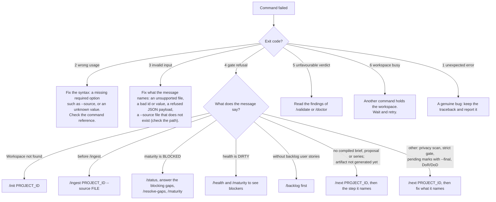

# Workflows

This page tells you what to do in each situation you will meet on a Sentinel project, from a brand-new request to the handoff, including what to do when a command refuses. It is for business analysts, product managers and developers who already know the basic flow from [Start here](00-user-guide.md); for worked examples with sample outputs, see [Scenarios](12-scenarios.md).

Each workflow has the same four parts: **When**, **Steps**, **Check** and **If it fails**. Commands are shown in chat form; in a terminal put `python -m sentinel` in front, and in Codex or with the Claude Code plugin put `sentinel ` in front ([chat commands](11-chat-commands.md)). The example project is `ACME_PORTAL`; replace it with yours. Terms are defined in the [glossary](00-user-guide.md#glossary).

| Situation | Go to |
|---|---|
| A new request arrives | [New project](#new-project) |
| The request is a few lines long | [Thin intake](#thin-intake) |
| The client sent answers | [Client answers arrive](#client-answers-arrive) |
| You want the agent to find what you missed | [Deepen discovery with the agent](#deepen-discovery-with-the-agent) |
| A domain team must provide context | [Domain context and context requests](#domain-context-and-context-requests) |
| Something changed after a meeting or an email | [Requirement changes](#requirement-changes) |
| A command refused | [A gate refused](#a-gate-refused) |
| The scope is too big for one release | [Release split](#release-split) |
| You have an HTML prototype | [Prototype available](#prototype-available) |
| The system already exists | [Existing system](#existing-system) |
| Stories need reshaping or moving | [Backlog refinement and story status](#backlog-refinement-and-story-status) |
| Time to hand off or share | [Handoff and export](#handoff-and-export) |

## New project

**When:** the first meaningful input arrives: a request, a guide, references, sketches.

**Steps:**

1. Create the workspace and load the request:

   ```text
   /init ACME_PORTAL
   /ingest ACME_PORTAL --source input/acme-request.md
   ```

   In a Claude Code clone, if `/init` starts Claude Code's own built-in project setup (it writes a `CLAUDE.md`), send `/sentinel /init ACME_PORTAL` instead. Load each further file (business, technology, design, quality context, a prototype, meeting notes) with `/sync ACME_PORTAL --source PATH`, not with a second `/ingest`: `/ingest` builds the primary requirement once, and a second one is refused because it would replace that requirement and reopen every answered gap. To replace the primary requirement on purpose, use `/ingest ... --replace`.
2. Right after the first `/ingest`, confirm the brief settings ([profile and genesis](00-user-guide.md#glossary)). `/next` asks for this step and suggests values from the request. If you are unsure of the values, run `/brief` without flags first to see the proposal (this opens `GAP-BRIEF-PROFILE` and writes a provisional v1-layout brief until you confirm), then confirm:

   ```text
   /brief ACME_PORTAL
   /brief ACME_PORTAL --profile UI --genesis greenfield
   ```

   Several profiles: `--profile UI,REG`. Mixed genesis: `--genesis brownfield-integration,brownfield-extension` (the most demanding wins). `MIG` requires `--genesis brownfield-replacement`.
3. Ask for the next step: `/next ACME_PORTAL`. Once the settings are confirmed it says *Waiting for client answers*: plan the first round with [Thin intake](#thin-intake) and share `gaps.md`.

> [!WARNING]
> **If you skip step 2**, `/next` and `/status` keep asking for it, and `/maturity` opens the critical gap `GAP-BRIEF-PROFILE` and reports `BLOCKED`, so `/specs` and `/backlog` refuse (exit 4). Confirm the settings and go on; the brief compiles from everything answered so far.

**Check:** `workspaces/ACME_PORTAL/01_discovery/gaps.md` exists; `/brief` output shows `brief_settings.confirmed: true`; `02_requirements/project-brief.md` has §0–§9 with `⏳ PENDING (GAP-X)` marks where evidence is missing.

**If it fails:**

- `/ingest` exit 3 on a file: it is binary and not `.docx` (for example a PDF or a corrupt Word file). Convert it to Markdown. Other UTF-8 text files are accepted and stored as Markdown with a warning.
- `/brief` with an unknown profile or genesis: exit 3 with the list of valid values.
- `/brief` reports a contradiction (for example `MIG` with `greenfield`): fix the pair; the gap `GAP-BRIEF-PROFILE` stays open until it is consistent.
- You need the old six-section brief: create the project with `/init ACME_PORTAL --brief-version 1`.

## Thin intake

**When:** the request is a paragraph or a vague idea, and `gaps.md` comes back long.

**Steps:**

1. Do not try to answer everything at once. Plan a round of the most useful questions:

   ```text
   /gaps ACME_PORTAL --top 5
   ```

2. Register who can answer what, so questions go to a person:

   ```text
   /stakeholders ACME_PORTAL --add --name "Head of Billing" --domain business --topic invoices
   ```

3. Produce a meeting script grouped by owner:

   ```text
   /export ACME_PORTAL --artifact gaps --format interview
   ```

4. Hold the conversation, then go to [Client answers arrive](#client-answers-arrive). Repeat the round with `/gaps --top 5`.

If you received many unrelated requests at once and are not sure how many projects they are, ask the agent to use the `sentinel-intake-triage` skill before `/init`: it groups the requests by theme with a citation per source.

**Check:** `01_discovery/gap_round.md` lists at most five questions; `08_context_packs/exports/gaps-interview.md` groups them by owner.

**If it fails:** `/gaps --top` before `/ingest` exits 4 ("Cannot plan a round before /ingest"); run `/ingest` first. `/stakeholders --add` without `--name` or `--domain`, or with a duplicate id, exits 3.

## Client answers arrive

**When:** the client or a domain owner returned the answered gaps document.

**Steps:**

1. Save the answered copy of `gaps.md` as an input file. Under each `### GAP-...` heading the client fills `Answer`, `Owner / source`, `Evidence or reference` and `Decision status` (`confirmed`, `pending` or `not applicable`). The `sentinel-gap-response` skill can help shape answers that arrived in another form.
2. Process it, then check maturity:

   ```text
   /resolve-gaps ACME_PORTAL --source input/acme-answers.md
   /maturity ACME_PORTAL
   /status ACME_PORTAL
   ```

3. If an agent raised a gap that you judge irrelevant, record your call instead of answering it:

   ```text
   /gaps ACME_PORTAL --id GAP-X --disposition irrelevant --reason "out of scope for this release"
   ```

**Check:**

- The output lists closed, answered and partially closed gaps; a vague answer ("TBD", "later") stays `PARTIALLY_CLOSED` with a note.
- The v2 brief recompiled: `brief_v2.rewritten_places` names the places that changed.
- Functional answers in EARS form became `REQ-EARS-*` in `02_requirements/requirements.md`. Confirmed prose that could be EARS is counted as "EARS-eligible, not normalized" in `/status`; propose an EARS rewrite to the client.

**If it fails:**

- Answers were ignored: they must sit under the `### GAP-...` heading with `Decision status: confirmed` (or `not applicable`) and an `Evidence or reference` line. Unconfirmed answers do not close gaps by design.
- Answers came as a meeting note or an email, not as the gaps document: use [Requirement changes](#requirement-changes) (`/sync`) instead.
- `/gaps --disposition` without `--id` exits 3; `rejected` and `irrelevant` need a `--reason`.

## Deepen discovery with the agent

**When:** you want more than the deterministic checklist: hidden assumptions, risks, cross-checks against domain context, or you must proceed on an assumption.

**Steps:** the agent writes a JSON file with the matching skill, then the command validates and merges it. Every finding must quote local evidence word for word, or it is rejected.

| Goal | Skill | Command |
|---|---|---|
| Gaps a reassuring keyword hid | `sentinel-annotate` | `/annotate ACME_PORTAL --source analysis.json` |
| Pre-mortem, role-play, assumption inversion | `sentinel-challenge` | `/challenge ACME_PORTAL --source findings.json` |
| Lens-by-lens scrutiny against raw input and domain context | `sentinel-scrutiny` | `/scrutinize ACME_PORTAL --source scrutiny.json` (`--mode implementability-probe` or `--mode anchors` for the other passes) |
| Proceed on a stated assumption | `sentinel-assume` | `/assume ACME_PORTAL --source assumptions.json` |
| Skeptical pass over the PRD and specs | `sentinel-self-review` | `/self-review ACME_PORTAL --source review.json` |
| Is the brief enough to start building? | `sentinel-self-review` | `/self-review ACME_PORTAL --sufficiency --source sufficiency.json` |
| Do the brief's lenses agree with each other? | `sentinel-self-review` | `/self-review ACME_PORTAL --crosses --source crosses.json` |
| Polish PRD prose with citations (after `/specs`) | `sentinel-compose` | `/compose ACME_PORTAL --source composition.json` |

Then run `/maturity ACME_PORTAL` to see the effect.

**Check:** new gaps carry `origin: agent`, `challenge`, `scrutiny` or `self-review` in `gaps.md`; `/status` counts them by origin. Assumptions appear in `01_discovery/assumptions.md` and the brief shows `(inferred) ... (ASM-X)` lines. `/maturity` may report `READY_WITH_GOVERNED_ASSUMPTIONS` in `development_readiness.json`: a visible BA decision, not a confirmation.

**If it fails:** exit 3 lists every rejected finding and why (usually a quote that is not verbatim in the source). Nothing is merged; fix the JSON and run it again. Run before `/ingest`, `/annotate`, `/challenge`, `/scrutinize` and `/assume` exit 4: load the request first. `/compose` before `/specs` exits 4. A `--source` file that does not exist exits 3 on any command; check the path, it is read relative to the folder you run Sentinel from.

## Domain context and context requests

**When:** Technology, Design, Quality, Frontend or Backend must supply context the client cannot (contracts, states, test strategy).

**Steps:**

1. Generate a request per domain:

   ```text
   /context-request ACME_PORTAL --domain technology
   ```

   It is written to `08_context_packs/requests/technology_context_request.md` with an id `CTX-NNN`.
2. Send it. When the answer comes back, load it as a change that cites the request:

   ```text
   /sync ACME_PORTAL --source input/tech-answer.md --note "answer to CTX-001"
   ```

   A change that cites an active request marks it `answered`.
3. Close or retire the request:

   ```text
   /context-request ACME_PORTAL --id CTX-001 --status closed --reason "contract confirmed"
   ```

4. Before an agent works on a story, pull only the context it needs:

   ```text
   /reindex ACME_PORTAL
   /retrieve ACME_PORTAL --query "invoice API contract" --workflow implementation --write-pack
   ```

**Check:** `⏳ PENDING DOMAIN (GAP-X)` marks in the brief disappear as context arrives; `/health` warns when domain context changed after the backlog was generated, naming the domain.

**If it fails:** `/context-request` with `--id` and `--domain` together, or with no flag at all, exits 3. `closed` and `obsolete` are final and need a `--reason`. `/retrieve` without `--query` and `--workflow` exits 3 (except with `--timeline`).

## Requirement changes

**When:** new information arrives that is not an answered gaps document: meeting notes, an email, a chat thread, a late blocker, a new version of a source.

**Steps:**

1. Load it as a traced change:

   ```text
   /sync ACME_PORTAL --source input/meeting-notes.md --note "steering meeting"
   ```

   Raw, unstructured material (a mail thread, a call transcript): add `--digest` so Sentinel proposes cited impacts without applying them. Without `--source`, `/sync` scans the input and context folders for new or modified files.
2. If the new file is a new version of an existing source, say which one governs. Ask the BA; never assume the newest wins:

   ```text
   /sources ACME_PORTAL
   /sources ACME_PORTAL --id F-02 --superseded-by F-05
   /sources ACME_PORTAL --precedence "payment rules" --between F-02,F-05
   ```

3. Rerun the commands that own the affected artifacts (`/maturity`, `/specs`, `/backlog`) only where the change matters, then audit:

   ```text
   /health ACME_PORTAL
   /validate ACME_PORTAL
   ```

4. After a confirmed release series, move scope between releases with `/split --move` (see [Release split](#release-split)), never by editing.

**Check:** the change is under `07_changes/`; a contradiction between sources opened a blocking gap with `origin: contradiction`; an invalidated assumption is marked `INVALIDATED`; `/health` names the stale downstream artifacts. Stories derived from a changed spec unit are marked `Stale`.

**If it fails:** do not patch the brief, specs or backlog by hand: the hook denies it and `/health` flags it. Regenerate with the owning command, or route the content through `/resolve-gaps`, `/compose` or `/refine-backlog`. `/sources` with a change but no `--id` exits 3; `--precedence` needs `--between`.

## A gate refused

**When:** a command stopped with a non-zero exit code.

**Steps:** read the `sentinel error:` line, then the `next step:` line if there is one, then follow the exit code:



| Code | Common causes | What to do |
|---|---|---|
| 2 | A required option is missing (`--source`, `--artifact`, `--story`, `--set`); a value outside the list; two `/split` or `/prototype` modes at once | Fix the syntax; see the [command reference](01-command-reference.md). |
| 3 | A `--source` file that does not exist (on every command); an unsupported file (binary, not `.docx`); an invalid project id; an unknown profile or genesis; an agent JSON with a non-verbatim quote; options that are missing or conflict (`/gaps --id` with `--disposition`, `/split` without `--ba`/`--tech`); an invalid release id; a `/split` or `/prototype` payload with findings; an illegal story transition | Fix the input the message names and run again; for a missing file, check the path (it is read relative to the folder you run Sentinel from). Nothing was written. |
| 4 | Workspace missing; `/specs`, `/backlog`, `/assume` or `/gaps --top` before `/ingest`; `/compose` before `/specs`; `/refine-backlog` or `/implementation-feedback` before `/backlog` wrote an epic; `/self-review --sufficiency` or `--crosses`, `/split` or `/prototype --trace` without a compiled brief; `/split --confirm` without a stored proposal or after the brief changed; `/split --move` or `--release` without a confirmed series; `/split --close` on a closed release or with stories not Done; `/prototype` before an inventory or with no HTML prototype ingested; `/view` of an artifact not generated yet; maturity `BLOCKED` (often `GAP-BRIEF-PROFILE`: see [New project](#new-project)); health `DIRTY` for `/backlog`, `/quality`, `/refine-backlog`; `/quality` with no stories; the backlog privacy scan in `block` mode; a strict gate in `sentinel.config.yaml`; `/export --final` with pending marks; a strict Definition of Ready or Done | Do the step the message or `/next` names. |
| 5 | `/validate` verdict is not `VALID`; `/doctor` verdict is not `PASS` | Read the findings. To proceed on purpose, record a cited decision with `/validate ACME_PORTAL --override decisions.json`: the rationale is kept, the verdict is not faked. |
| 6 | Another command (or another chat) is working on the same workspace | Wait for it to finish. A command waits 10 seconds before giving up; set `SENTINEL_LOCK_TIMEOUT` to wait longer. See [the workspace lock](20-admin-guide.md#the-workspace-lock). |
| 1 | An unexpected error: a genuine bug | Keep the traceback and report it. |

**Check:** `/next ACME_PORTAL` prints the one step that unblocks the project. `/status` always exits 0, even when the verdict is `NOT_READY`.

**If it fails:** if the same refusal returns after you did the step, run `/status ACME_PORTAL --full` and read `gap_counts` and the gate matrix; a gap you thought closed may be `ANSWERED` rather than `CLOSED`.

## Release split

**When:** the brief v2 describes more than one release can carry, or the client wants staged delivery.

**Steps:**

1. Assess. Nothing is split; you get a recommendation (`split`, `no_split` or `cannot_decide`) with its signals:

   ```text
   /split ACME_PORTAL --assess
   ```

2. Ask the agent to write a proposal with the `sentinel-release-split` skill, then submit it:

   ```text
   /split ACME_PORTAL --propose --source proposal.json
   ```

3. When the BA and the technical team agree, confirm with their names (they give them, not the agent):

   ```text
   /split ACME_PORTAL --confirm --ba "BA NAME" --tech "TEAM NAME"
   ```

   This compiles `02_requirements/series/index.md` and one brief per release in `02_requirements/r<N>/project-brief.md`, and opens `GAP-SPLIT-CLIENT` for the client's confirmation.
4. Derive each release:

   ```text
   /specs ACME_PORTAL --release r1
   /backlog ACME_PORTAL --release r1
   /quality ACME_PORTAL --release r1
   /status ACME_PORTAL --release r1
   ```

   Outputs go to `03_specs/r1/`, `04_backlog/r1/`, `05_quality/r1/`, `06_traceability/r1/` and `08_context_packs/r1/`.
5. Follow the series in the guide: `/view ACME_PORTAL --artifact release-guide`.
6. Move scope when needed:

   ```text
   /split ACME_PORTAL --move --unit C-03 --from r1 --to r2 --reason "depends on the new ledger" --ba "BA NAME" --tech "TEAM NAME"
   ```

7. Close a release when every story is Done and its closing check ran:

   ```text
   /split ACME_PORTAL --close r1 --evidence input/r1-closing-check.md --ba "BA NAME" --tech "TEAM NAME"
   ```

**Check:** the stored proposal returns `partition_preview` (what `--confirm` would still refuse); moves are dated in `02_requirements/series/scope_changes.md`; `/validate` reports the series' integrity.

**If it fails:** a v1 brief cannot be split. `--assess` needs a compiled v2 brief (confirm the settings with `/brief --profile ... --genesis ...`, which compiles it). A refused proposal, partition or move payload exits 3 and lists every finding by code; fix them and run again. A missing prerequisite exits 4 with a next step: `--assess` or `--propose` without a compiled brief v2, `--confirm` without a stored proposal or after the brief changed, `--move` or `--release` without a confirmed series, `--close` on a closed release or with no stories. A round trip of a unit (r1 → r2 → r1) is refused and opens `GAP-SPLIT-CRITERION` until you pass `--criterion` naming the written cut criterion. `--close` refuses while any story of the release is not Done.

## Prototype available

**When:** Design delivered an HTML prototype and you want to know what each screen element stands on.

**Steps:**

1. Load the prototype like any later source: `/sync ACME_PORTAL --source input/acme-prototype.html` (or `/ingest` if it is the project's first material).
2. Inventory its screens and visible elements:

   ```text
   /prototype ACME_PORTAL --inventory
   ```

3. For each screen, the agent writes a trace with the `sentinel-prototype-trace` skill (element → data → contract → rule), then submit it:

   ```text
   /prototype ACME_PORTAL --trace --source trace-s1.json
   ```

4. Optionally, the agent writes a user manual with the `sentinel-prototype-manual` skill:

   ```text
   /prototype ACME_PORTAL --manual --source manual.json
   ```

5. Review: `/view ACME_PORTAL --artifact prototype-trace` (also `prototype` and `prototype-manual`).

**Check:** `02_requirements/prototype/inventory.md` lists screens with ids such as `S1-E01`; each trace gets a screen verdict and at most four questions; a screen with no manual entry shows as a hole.

**If it fails:** "no HTML prototype among the ingested sources": `/ingest` the `.html` file first. `--trace` needs a compiled v2 brief, and `--manual` and `--trace` need an inventory first: all of these exit 4. A refused trace or manual exits 3, stores nothing and lists every finding.

## Existing system

**When:** the project extends, integrates with or replaces a system whose code is on your machine (brownfield).

**Steps:**

1. Confirm a brownfield genesis: `/brief ACME_PORTAL --profile API --genesis brownfield-extension`. Add `--validation-direction built` if the brief should document what exists rather than what will be built.
2. Ask the agent to read the code with the `sentinel-brownfield-harvest` skill. It writes a tagged harvest by blocks B0 to B5, each line tagged `[HECHO repo:file]` / `[FACT repo:file]`, `[INFERIDO]` / `[INFERRED]`, `[NO ENCONTRADO]` / `[NOT FOUND]`, `[FUERA DEL CÓDIGO]` / `[OUT OF CODE]` or `[DIVERGENCIA]` / `[DIVERGENCE]`.
3. Load it:

   ```text
   /harvest ACME_PORTAL --source harvest.md
   ```

**Check:** the harvest is stored under `00_raw/02_technology_context/harvest/` as a source row marked `built`; facts feed §5 of the brief and §0.2 shows the coverage per tag; out-of-code topics became non-blocking domain gaps; each README/code divergence opened a high gap.

**If it fails:** exit 3 "Harvest rejected" lists each bad line (for example a fact without `repo:file`, or a repo not declared in B0). You may deliver one block at a time; each `/harvest` registers that harvest.

## Backlog refinement and story status

**When:** the backlog exists and stories need reshaping, assigning, moving through delivery, or implementation found a problem.

**Steps:**

1. Refresh the board: `/backlog-status ACME_PORTAL` writes `04_backlog/BACKLOG.md`.
2. Move a story through its lifecycle:

   ```text
   /story-status ACME_PORTAL --story US-001 --set Ready --owner "Delivery Lead"
   /story-status ACME_PORTAL --story US-001 --set "In Progress"
   /story-status ACME_PORTAL --story US-001 --set "In Review"
   /story-status ACME_PORTAL --story US-001 --set Done --evidence input/us-001-evidence.md
   ```

   Legal moves: Draft → Ready → In Progress → In Review → Done, plus Blocked and Stale from most states. Done can only go to Stale. Setting Ready freezes the story's acceptance criteria; a later `/backlog` records any change in `04_backlog/acceptance_criteria_deltas.md` instead of replacing them silently.
3. Reshape with the agent (split, merge, missing stories, enabler candidates) using the `sentinel-backlog-refine` skill:

   ```text
   /refine-backlog ACME_PORTAL --source refinement.json
   ```

   Accepted proposals land under `04_backlog/refinements/` for your review; stories are not rewritten.
4. Bring implementation findings back (a missing dependency, an invalid criterion):

   ```text
   /implementation-feedback ACME_PORTAL --source feedback.json
   ```

5. Re-score: `/quality ACME_PORTAL`, then `/trace ACME_PORTAL`.

**Check:** `BACKLOG.md` shows status and owner per story; `/status --full` lists Definition of Ready and Done warnings under `story_gates`; feedback is archived in `07_changes/05_implementation_feedback/` and may open `GAP-FEEDBACK-*` or mark a story `Stale`.

**If it fails:** an illegal transition exits 3 with the allowed states. A failed Definition of Ready or Done warns by default and exits 4 in strict mode: add what it lists (owner, evidence) and retry. All backlog-family commands run the privacy scan; in `block` mode a credential, private endpoint or e-mail in `04_backlog/` exits 4 until removed at its source.

## Handoff and export

**When:** you hand artifacts to a delivery team, an agent or a stakeholder.

**Steps:**

1. Audit:

   ```text
   /trace ACME_PORTAL
   /health ACME_PORTAL
   /validate ACME_PORTAL
   /status ACME_PORTAL
   ```

2. Show what is still missing per item and from whom: `/view ACME_PORTAL --artifact readiness`. Other views: `gaps`, `brief`, `prd`, `specs`, `backlog`, `diagrams` (see [artifact views](15-artifact-views.md)).
3. Export what you share:

   ```text
   /export ACME_PORTAL --artifact brief --format md
   /export ACME_PORTAL --artifact prd --format mdx
   /export ACME_PORTAL --artifact gaps --format faq
   /export ACME_PORTAL --artifact context-request --domain design --format md
   ```

   A brief, PRD or context request with pending marks is stamped **draft**. Add `--final` when the deliverable must have none: it refuses until they are gone.
4. Developers who need sample data can ask for synthetic datasets with the `sentinel-handoff-datasets` skill; they land in `08_context_packs/synthetic/`, git-ignored, marked as not evidence.

**Check:** health `CLEAN`, validation `VALID`, verdict `READY` (or `READY_WITH_WARNINGS` with every warning understood), and every known uncertainty visible as a gap. For a release series, run `/validate --release rN` and `/status --release rN` per release.

**If it fails:** `/validate` exit 5 lists structural findings; quality and consistency findings are warnings only. `/export --final` exit 4 means pending marks remain: answer the gaps or export as draft. `interview` and `faq` work only for `--artifact gaps`, and `mdx` only for `--artifact prd` (exit 3 otherwise).

## Next

- [Scenarios: worked examples](12-scenarios.md)
- [Command reference](01-command-reference.md)
- [Artifact reference](02-artifact-reference.md)
- [Driving Sentinel from chat](11-chat-commands.md)
