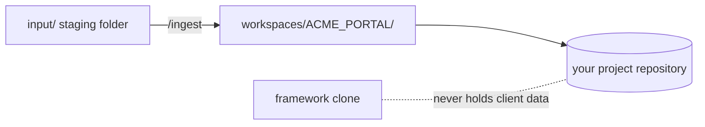

# Versioning your workspaces in git

This page explains how to keep a Sentinel project under version control: what is worth committing, what is left out on purpose, and two simple ways to set it up so that client data never reaches a public copy of the framework. Read it if you want a history of every artifact, or if several people share one project.

You do not need git to use Sentinel. Git adds a history you can review and a way to share the workspace. Terms: a *repository* is a folder tracked by git; a *commit* is a saved snapshot; a *branch* is a named line of commits.

## What lives where



| Place | What | Versioned? |
|-------|------|------------|
| The framework (clone of Sentinel) | Runtime, skills, adapters, guides | Yes, in the framework repository. It must never contain client data. |
| `input/` | A staging area for raw files before `/ingest` | No: the framework ignores everything in it except empty folders |
| `workspaces/<PROJECT_ID>/` | Your project: sources, gaps, brief, specs, backlog, traceability, `state.json` | **Yours.** The framework ignores `workspaces/*` so a project is never published by accident. |

The staging folders under `input/` are only a convention: `client_requirement/`, `business_context/`, `technology_context/`, `design_context/`, `quality_context/` and `interactions/`. After `/ingest` the workspace holds the source of truth.

## What to commit and what not

Every workspace is created with its own `.gitignore`. It keeps the evidence and the matured artifacts in git, and leaves out what can be rebuilt:

| Tracked | Left out (rebuildable) |
|---------|------------------------|
| `00_raw/`, discovery files, requirements, brief, specs, backlog, quality, traceability | `memory.lancedb/` (rebuild with `/reindex PROJECT_ID`) |
| `state.json` (the durable state) | `08_context_packs/views/*.html` (rebuild with `/view` or `/dashboard`) |
| `07_changes/` (the change history) | `08_context_packs/synthetic/` |
| | `.sentinel/` (the derived state, the command log, local themes, the lock) |

Artifact paths are stored relative to the workspace, so a workspace can be moved or cloned to another machine and gives the same results.

> [!WARNING]
> Commit only into a **private** repository, and only if your data classification allows it. Workspaces hold client material. Never commit a workspace to the public framework repository or to a fork you publish.

## Option 1: one folder inside the clone, its own repository

The simplest way to give a project its own history, with no change to the framework:

```powershell
cd workspaces/ACME_PORTAL
git init
git add .
git commit -m "ACME_PORTAL: first ingest"
git remote add origin <PRIVATE_REPO_URL>
git push -u origin main
```

The framework repository ignores `workspaces/*`, so the two histories do not mix, and you can update the framework (`git pull` in the clone) without touching your project. On another machine, clone the private repository into `workspaces/ACME_PORTAL`.

## Option 2: a project repository that contains the framework

Use this when the team wants one private repository holding the framework and the projects, for example a fork that stays private.

1. Work on a branch, not on `main`: `git switch -c project/ACME_PORTAL`.
2. Un-ignore the project by adding this line to the root `.gitignore`, below the `workspaces/*` rule:

   ```text
   !workspaces/ACME_PORTAL/
   ```
3. Commit the workspace. Its own `.gitignore` still keeps the rebuildable files out.

Do not delete the blanket `workspaces/*` rule in a copy you push publicly. Do not merge a project branch that holds client artifacts into a public `main`.

## A working rhythm

1. Run a command (`/ingest`, `/resolve-gaps`, `/sync`, `/specs`, ...).
2. Check `git status`: only workspace files should change.
3. Commit with a message that names the command and the reason: `ACME_PORTAL: /resolve-gaps, client answers of 12 Nov`.
4. After pulling someone else's work, run `/health ACME_PORTAL` and, if retrieval looks stale, `/reindex ACME_PORTAL`.

**One writer at a time.** Two people running commands on the same workspace will produce conflicting `state.json` and artifacts, and Sentinel's workspace lock does not protect files on network drives or synced folders such as OneDrive or Dropbox. Share through git instead.

**Do not hand-edit** the brief, specs, backlog, `gaps.md` or `requirements.md`: `/health` flags the edit, and in an agent the hook denies it. Resolve a gap through `/resolve-gaps` or `/sync`; add evidence through `/ingest` or `/sources` ([Workflows](03-workflows.md)). If a merge conflict lands in one of those files, take one side, then run the owning command again to regenerate it.

## Audit trail

Git history plus the workspace's own logs answer "who decided what and when": `01_discovery/decisions.md`, `01_discovery/gap_resolution_log.md`, `01_discovery/agent_annotation_log.md` and `07_changes/metabolism_log.md`. The [admin guide](20-admin-guide.md#audit-trail) lists them. The command log in `.sentinel/` is local and not committed.

## Next

- [Secure environments](09-secure-environments.md): handling client data
- [Workflows by situation](03-workflows.md)
- [Artifact reference](02-artifact-reference.md)
- [Traceability and memory](05-traceability-and-memory.md)
