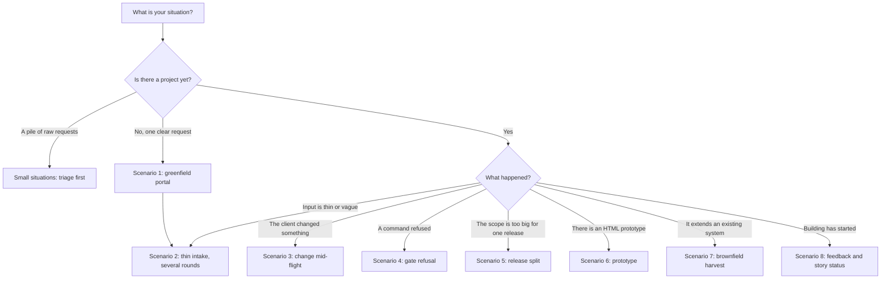

# Scenarios

This page walks through eight realistic projects from start to finish, so you can see what to type, what to look at in the result, and what to decide at each step. Each scenario uses an invented project. Read the one that matches your situation, or read them in order to learn the whole lifecycle. It is written for business analysts and product managers first; developers will find the downstream scenarios (5 and 8) most useful.

> [!NOTE]
> Every name, number and quote below is invented. Nothing here is real client data. When you try a scenario, put the sample text in your own scratch project.

## How to read these scenarios

### Typing a command

Scenarios show the chat form of each command, for example `/ingest ACME_PORTAL --source input/portal-request.md`. The same command exists on every surface; only the way you type it changes.

| Surface | How you type it |
| --- | --- |
| Claude Code, clone | `/ingest ACME_PORTAL --source input/portal-request.md`. If a command name collides with a built-in Claude Code command (`/init` does), use `/sentinel /init ACME_PORTAL`. |
| Claude Code, plugin | `sentinel /ingest ACME_PORTAL --source input/portal-request.md` or plain words; the plugin ships no per-command slash commands. |
| Kilo Code | `/ingest ACME_PORTAL --source input/portal-request.md` |
| Codex | `sentinel /ingest ACME_PORTAL --source input/portal-request.md` |
| Plain terminal | `python -m sentinel /ingest ACME_PORTAL --source input/portal-request.md` |
| Windows, no working `python` | `.\installers\sentinel.ps1 /ingest ACME_PORTAL --source input/portal-request.md` |

You can also just describe what you want ("the client answered the gaps in this file; process them and tell me what is left") and the agent chooses the commands. See [Chat commands](11-chat-commands.md) for the intent map and [Installation](06-installation-vscode.md) for setup.

### Who writes the JSON files

Several commands take a small JSON or Markdown file (`/annotate`, `/challenge`, `/scrutinize`, `/assume`, `/self-review`, `/split --propose`, `/prototype --trace`, `/harvest` and others). You normally do not write them. Ask the agent in plain words; the matching [skill](04-codex-skills-guide.md) writes the file, with verbatim quotes from your evidence, and runs the command. In a plain terminal you write the file yourself, following the skill's format.

### Two rules that hold in every scenario

1. **Governed files are changed only by commands.** The gaps document, requirements, project brief, specs and backlog files are produced and updated by Sentinel. A hand edit of the brief, specs or backlog files is denied by the editor hook; a hand edit of any governed file, including `gaps.md` and `requirements.md`, is flagged by `/health`. To change content, give Sentinel new evidence: answers go through `/resolve-gaps`, new material through `/ingest`, `/sync` or `/sources`.
2. **A refusal is information, not a failure.** A command that stops tells you why, usually with a `next step:` line. The command `/next PROJECT_ID` prints the next step alone, at any time. Scenario 4 covers every kind of refusal.

### Which scenario is yours?



| Role | Start with |
| --- | --- |
| Business analyst | 1, 2, 3, 4, 7 |
| Product manager | 1, 3, 5, 6, and the readiness view in 1 |
| Developer | 4, 5, 8 |

### Command coverage map

Every one of the 37 commands appears in at least one scenario. The scenario numbers below are where it appears in context; "S" is the closing section of smaller situations. For flags, gates and outputs of each command see the [command reference](01-command-reference.md).

| Command | Scenario | Command | Scenario |
| --- | --- | --- | --- |
| `/doctor` | 1, 4 | `/stakeholders` | 2 |
| `/init` | 1, 2, 7 | `/sources` | 3 |
| `/ingest` | 1, 2, 6, 7 | `/context-request` | 7, S |
| `/gaps` | 1, 2 | `/export` | 2, S |
| `/annotate` | 2 | `/specs` | 1, 3, 4, 5 |
| `/challenge` | 2 | `/compose` | S |
| `/scrutinize` | 2, 7 | `/self-review` | 2, S |
| `/assume` | 2 | `/backlog` | 1, 3, 4, 5, 8 |
| `/resolve-gaps` | 1, 2, 3, 7, 8 | `/refine-backlog` | 8 |
| `/maturity` | 1, 2 | `/backlog-status` | 8 |
| `/brief` | 1, 2, 3, 7 | `/story-status` | 4, 5, 8 |
| `/harvest` | 7 | `/implementation-feedback` | 8 |
| `/split` | 5 | `/quality` | 1, 5 |
| `/prototype` | 6 | `/trace` | 1, 5 |
| `/sync` | 3 | `/health` | 1, 3, 4 |
| `/retrieve` | 3, S | `/validate` | 1, 4, 5 |
| `/reindex` | S | `/status` | 1, 4, 5, 8 |
| `/view` | 1, 5, 6 | `/next` | 1, 4, 5 |
| `/dashboard` | 8, S | | |

Modes and flags that matter, and where to find them: `/gaps --top` and `--disposition` (2), `/scrutinize --mode anchors` (7) and `--mode implementability-probe` (2), `/self-review --sufficiency` (2) and `--crosses` (S), `/sync --digest` (3), `/export --format interview` (2) and `--final` (S), `--release rN` (5), `/prototype --inventory|--trace|--manual` (6), `/split --assess|--propose|--confirm|--move|--close` (5), `/context-request --id --status` (S).

---

## Scenario 1: A greenfield web portal with brief v2

**Situation.** A client wants a customer portal where policyholders sign in, submit a claim and follow its status. Nothing exists yet. You are the BA. By the end you will have a brief, a PRD, a backlog and a verified workspace.

**You start with** one file, `input/client_requirement/portal-request.md`. This is the invented text (it is vague on purpose, so discovery finds real gaps):

```text
# ACME Claims Portal: initial request (FICTIONAL SAMPLE)

Policyholders should sign in to a web portal, file a claim with photos and
documents, and follow its status. Claims adjusters review and approve claims.
Large claims need a second approval. The portal must integrate with our policy
system and be secure and compliant. Details to be defined later.
```

**Steps**

1. Check the installation once.

   ```text
   /doctor
   ```

   Look for a `PASS` verdict. A WARN about optional vector memory is fine: retrieval falls back to a built-in mode.

2. Create the project and load the request.

   ```text
   /init ACME_PORTAL
   /ingest ACME_PORTAL --source input/client_requirement/portal-request.md
   /status ACME_PORTAL
   ```

   (In a Claude Code clone, if `/init` starts Claude Code's own built-in setup, send `/sentinel /init ACME_PORTAL`.) `/init` creates `workspaces/ACME_PORTAL/` and records brief v2, the default. `/ingest` stores a redacted copy of the request (secrets are masked, text that reads like an order is flagged and ignored), registers it as source `F-01`, and finds the gaps. In `/status`, look at `verdict.verdict`, `verdict.blockers`, `gap_counts`, `readiness_stage` and `next_step`. **A new project reads `NOT_READY` with the health `DIRTY` by design.** That is the starting point, not an error.

3. Confirm the brief settings, once, right after the first `/ingest` and before any `/maturity` or `/specs`. This is the step first-time users miss: `/next` and `/status` do not prompt for it yet (see [what happens if you skip it](00-user-guide.md#if-you-skip-the-brief-settings)).

   ```text
   /brief ACME_PORTAL
   ```

   Without settings, `/brief` shows a `proposal` guessed from keywords in the request, opens the blocking gap `GAP-BRIEF-PROFILE` and writes a provisional brief in the older v1 layout until you confirm. **Do not accept the proposal blindly; ask the people who own the project.** Then record the answers:

   ```text
   /brief ACME_PORTAL --profile UI,API,REG --genesis greenfield --validation-direction to-build
   ```

   | Setting | Meaning | Values |
   | --- | --- | --- |
   | `--profile` | What kind of thing this is; it decides which brief places apply. Comma-separate several. | `UI` screens, `API`, `BAT` batch jobs, `INT` third-party integration, `MIG` migration, `REG` regulated, `MT` multi-tenant |
   | `--genesis` | Where it starts. `MIG` requires `brownfield-replacement`. | `greenfield`, `brownfield-integration`, `brownfield-extension`, `brownfield-replacement` |
   | `--validation-direction` | Is the brief about something to build, or something already built? | `to-build`, `built` |

   Confirming closes `GAP-BRIEF-PROFILE` and compiles the v2 brief; from now on each `/resolve-gaps` recompiles it. While that gap is open, `/maturity` is `BLOCKED` and `/specs` refuses (scenario 4 shows how that looks). To keep the older brief format on a project, `/init --brief-version 1` does that, but v2 is recommended.

4. Read the gaps document and send it to the client.

   ```text
   /gaps ACME_PORTAL
   ```

   Open `workspaces/ACME_PORTAL/01_discovery/gaps.md`. Each gap is one `### GAP-...` section with a question, cited context and answer fields. For this request expect gaps about the second-approval threshold, the policy-system integration, access roles, the compliance rules and claim states. Send the file as it is. The client answers under each gap.

5. Process the answers when they return.

   ```text
   /resolve-gaps ACME_PORTAL --source input/interactions/answered-gaps.md
   /maturity ACME_PORTAL
   /status ACME_PORTAL
   ```

   A gap closes only when the answer is substantive **and** the decision status is confirmed or not applicable. "TBD" or "depends" keeps it partially closed. In the output look at `closure_findings` (closures missing a citation) and `knowledge_metabolism` (assumptions validated, artifacts now stale). In a v2 project the brief is recompiled in place: each answer replaces its pending mark in its own place, and `brief_v2.rewritten_places` lists what moved. `/maturity` returns `BLOCKED` while critical or high gaps stay open and `READY_FOR_SPECS` when they are resolved.

   > [!TIP]
   > Repeat step 5 as often as answers arrive. Scenario 2 shows how to run it as organised rounds.

6. Generate the PRD and specs.

   ```text
   /specs ACME_PORTAL
   ```

   Read `03_specs/prd.md` (the human PRD), `03_specs/specs.md` (the compact index) and `03_specs/units/SPEC-U-*.md` (one bounded execution unit each). If the output carries `foundation_warnings`, a source changed after the brief was compiled; regenerate the upstream artifact first.

7. Generate the backlog and the quality artifacts.

   ```text
   /backlog ACME_PORTAL
   /quality ACME_PORTAL
   ```

   `/backlog` writes one epic file and one story per confirmed spec unit, a slice plan, and readiness packs for implementation agents. `/quality` writes test cases and `05_quality/backlog_readiness_audit.md`; read its Definition-of-Ready warnings.

8. Verify before anyone builds.

   ```text
   /trace ACME_PORTAL
   /health ACME_PORTAL
   /validate ACME_PORTAL
   /status ACME_PORTAL
   /next ACME_PORTAL
   ```

   You want health `CLEAN`, validation `VALID` and a `READY` verdict. `/validate` also prints advisory warnings (content maturity, consistency); they are not failures. `/next` prints the one step to take next.

9. Show it to a manager or a client.

   ```text
   /view ACME_PORTAL --artifact readiness
   /view ACME_PORTAL --artifact prd --open
   ```

   The readiness view answers "what is still missing, and from whom?". A recipient shown as unassigned means no stakeholder is registered for that area (scenario 2 adds one). Views are read-only pages in `08_context_packs/views/`.

**Decision points**

- *Step 3:* the profile and genesis are a business decision. If the project integrates with an existing system and extends it, the genesis is `brownfield-integration` or `brownfield-extension`, and scenario 7 applies.
- *Step 5:* when the client cannot answer a gap, you can leave it open, ask a domain team (`/context-request`, scenario 7), or proceed on a stated assumption (scenario 2).
- *Step 6:* if the output says the maturity is `BLOCKED`, do not look for a way around it; go back to step 5.

**Done when** health is `CLEAN`, `/validate` says `VALID`, and `/status` says `READY` or `READY_WITH_WARNINGS` with warnings you accept. Then continue with scenario 8.

---

## Scenario 2: Thin intake that needs several answer rounds

**Situation.** The client's note is one page and mostly adjectives. A first `/status` shows many blocking gaps. You will deepen the analysis, route questions to the right people, and run answer rounds until a builder could start. The project is `ACME_EXPENSES`.

**You start with** a note like this (invented):

```text
We need an internal tool where employees submit expenses and a manager approves
them. Big expenses need an extra approval. Finance exports everything. It has to
integrate with our HR system. Obviously it must be secure and compliant.
```

**Steps**

1. Create the project, load the note and confirm the brief settings.

   ```text
   /init ACME_EXPENSES
   /ingest ACME_EXPENSES --source input/client_requirement/expenses-note.md
   /brief ACME_EXPENSES --profile UI,INT --genesis greenfield --validation-direction to-build
   /status ACME_EXPENSES
   ```

   Expect many gaps: "big" names no threshold, "extra approval" names no role, the HR integration names no system or direction, "secure and compliant" names no rule.

2. Ask the agent to read for what the checklist missed. In chat:

   > Read the raw requirement for ACME_EXPENSES and add the gaps you find that the checklist missed, quoting the exact text for each. Then run a pre-mortem and capture what nobody said.

   The agent writes the analysis files and runs:

   ```text
   /annotate ACME_EXPENSES --source input/interactions/analysis.json
   /challenge ACME_EXPENSES --source input/interactions/findings.json
   ```

   Each finding must quote the input verbatim or it is rejected. Merged gaps are tagged `origin: agent` or `origin: challenge`. If the project has domain context folders with content, also ask for a scrutiny pass (`/scrutinize ... --source ...`, optionally `--lens technical`, and `--mode implementability-probe` for a per-requirement "what is missing to implement this" check). These commands propose gaps; none of them closes a gap.

3. Record what you think of each agent-raised gap.

   ```text
   /gaps ACME_EXPENSES --id GAP-TECH-NFR --disposition accepted
   /gaps ACME_EXPENSES --id GAP-DESIGN-STATES --disposition irrelevant --reason "out of MVP"
   ```

   Dispositions are `accepted`, `rejected` or `irrelevant`. They are for gaps raised by an agent, so your decision is on record.

4. Register who answers what, so questions reach the right person.

   ```text
   /stakeholders ACME_EXPENSES --add --name "Finance Controller" --domain business --topic "approval thresholds"
   /stakeholders ACME_EXPENSES --add --name "HR Systems Lead" --domain technical --topic "HR integration"
   /stakeholders ACME_EXPENSES
   ```

   `--add` needs `--name` and `--domain`. The registry is changed only through this command. A gap whose area has no owner shows under an explicit "unassigned" heading in the interview script; Sentinel never invents an owner.

5. Plan round 1: ask the few questions that matter most.

   ```text
   /gaps ACME_EXPENSES --top 5
   ```

   Read `01_discovery/gap_round.md`. It lists the next five questions, ordered scope first, then security and privacy, then UX, then technical, one decision per question, with the recommended option first and "leave pending" last. The recommendation is an inference; only the client closes the gap. Ask exactly these questions, not the whole list. For a live meeting, produce a script instead:

   ```text
   /export ACME_EXPENSES --artifact gaps --format interview
   ```

   The script is written to `08_context_packs/exports/gaps-interview.md`, blocking gaps first, grouped by owner when a registry exists.

6. Process the answers.

   ```text
   /resolve-gaps ACME_EXPENSES --source input/interactions/round1-answers.md
   ```

   Every closure needs an `Evidence or reference` line. Template gaps ([umbrella gaps](00-user-guide.md#glossary) of the brief v2, such as `GAP-BRIEF-S3`) are answered one line per place (`3.1: ... 3.2: ...`) so each line fills its own place. Read `closure_findings`.

7. When the client cannot answer yet but the team must move, record a governed assumption. In chat:

   > We will proceed assuming approvals are single-manager for now. Register it for ACME_EXPENSES as a BA-owned assumption, high risk, citing the input.

   ```text
   /assume ACME_EXPENSES --source input/interactions/assumptions.json
   ```

   An assumption needs a lens, a human owner, a risk and a verbatim quote; "AI" is not an owner. It stays visible in `/status` and `/maturity` as an assumption, never as a confirmed fact. High risk with high uncertainty shows "test before advancing", which is a signal, not a block.

8. Round 2 and check: could someone start tomorrow?

   ```text
   /gaps ACME_EXPENSES --top 5
   /resolve-gaps ACME_EXPENSES --source input/interactions/round2-answers.md
   /self-review ACME_EXPENSES --sufficiency --source input/interactions/sufficiency.json
   /maturity ACME_EXPENSES
   ```

   `--sufficiency` is an independent read of the brief alone: for every applicable place it says covered, missing, ambiguous or contradictory, and opens `GAP-SUF-*` gaps with one question each. Run another round after those answers arrive, until a round reports only covered places.

**Decision points**

- *After step 2:* do not deepen forever. One `/annotate` pass is the floor; add `/challenge` when the request looks complete but untested; add `/scrutinize` when domain context exists.
- *Step 5:* ask in rounds of about five. A wall of questions gets shallow answers.
- *Step 7:* assume only when you decide to, and write down who owns the risk.

**Done when** `/maturity` says `READY_FOR_SPECS` and a sufficiency round reports no missing, ambiguous or contradictory place. Continue with scenario 1, step 6.

---

## Scenario 3: A requirement changes mid-flight

**Situation.** `ACME_PORTAL` already has a brief, specs and a backlog. The client now sends a change request: single sign-on through their identity provider, and a newer version of the compliance document. You must absorb it without silent scope creep.

**Steps**

1. Register the change as evidence.

   ```text
   /sync ACME_PORTAL --source input/interactions/change-sso.md --note "client adds SSO"
   ```

   `/sync` records a change event and writes an impact report in `07_changes/`. Look at three things: the artifacts it lists as affected, any new gaps (tagged `origin: sync`), and a section named `Reopened Closed Gaps` if the change contradicts something already closed. You decide whether to reopen a gap, answer it again, or reject the change as out of scope. Assumptions the change contradicts are invalidated and reported as `invalidated_assumptions`; nothing is deleted.

2. If the source is a meeting transcript or a long mail, digest it first.

   ```text
   /sync ACME_PORTAL --source input/interactions/steering-meeting.md --digest
   ```

   The digest lists, each with a verbatim quote, candidate answers to open gaps, decision candidates, new gaps and assumption contradictions. It **proposes and routes; it applies nothing**. Candidate answers are written as a response file with status `PROPOSED`, which closes no gap. Before you confirm an answer, check who said it: a detected line can be a passing remark, not the gap owner's answer.

3. If a document arrived in a new version, say which one governs.

   ```text
   /sources ACME_PORTAL
   /sources ACME_PORTAL --id F-02 --superseded-by F-05
   ```

   Every source is a numbered row (`F-NN`). A known file with new content opens a new row marked as a candidate new version. **Sentinel never assumes the newest version governs**; you decide, then record it. When two sources disagree, ask `/sources ACME_PORTAL --precedence compliance --between F-02,F-05`; if the answer is `unresolved`, take it back to the client. Open contradictions between sources appear as blocking gaps (`origin: contradiction`) in `01_discovery/contradictions.md`.

4. Find out what is now stale.

   ```text
   /health ACME_PORTAL
   ```

   The findings are your to-do list: briefs, specs or backlog files built from a source that changed. Health shows `DIRTY` until they are regenerated.

5. Regenerate through the owning commands, upstream first. Never patch a file by hand.

   ```text
   /resolve-gaps ACME_PORTAL --source input/interactions/sso-answers.md
   /brief ACME_PORTAL
   /specs ACME_PORTAL
   /backlog ACME_PORTAL
   ```

   After a regeneration read the difference records in `07_changes/04_regeneration/`: which spec units were added, removed or changed. If stories were already Ready, read `04_backlog/acceptance_criteria_deltas.md` before anyone builds: acceptance criteria that changed after they were frozen are listed there with an `ADDED`, `MODIFIED` or `REMOVED` marker.

6. Pull focused context when a domain question comes up.

   ```text
   /retrieve ACME_PORTAL --query "single sign-on identity provider" --workflow sync --write-pack
   ```

   This builds a small context pack instead of loading the whole workspace.

**Decision points**

- *Step 1:* is it new scope or an answer to an existing gap? Answers to existing gaps go through `/resolve-gaps`. New or unmapped information goes through `/sync`. Often you use both: `/resolve-gaps` first, then `/sync` for what exceeds the gaps.
- *Step 3:* which version governs is always a person's call.
- *Step 5:* regenerate only what the change affects. If it only changes domain context, `/health` plus a focused `/retrieve` may be enough; re-run `/backlog` only when stories, order, acceptance criteria or dependencies change.
- A release series (scenario 5) adds one more tool: `/split --move` re-scopes a unit between releases.

---

## Scenario 4: A gate refuses, and how to recover

**Situation.** You typed a command and it stopped. This scenario shows what each refusal looks like and the single next action. The project is `ACME_PORTAL`.

First, the tools you always have:

```text
/next ACME_PORTAL
/status ACME_PORTAL
/status ACME_PORTAL --full
```

`/next` prints the one next step with its command. `/status` leads with the verdict and what blocks it; `--full` adds the detailed dump.

In a terminal, check the exit code right after the command (`echo $?` in a Unix shell, `$LASTEXITCODE` in PowerShell). In chat, the agent reports it.

| Exit | Meaning | What to do |
| --- | --- | --- |
| 0 | Success | Carry on. |
| 1 | Unexpected error, with a traceback | Check the `--source` path first: a file that does not exist currently ends this way. Otherwise it is a bug; report it with the command and the output. |
| 2 | Wrong usage | The command or a flag is mistyped, or a required option is missing. Check the syntax in the [command reference](01-command-reference.md). |
| 3 | Invalid input | A file is malformed or unsupported, a value or project id is invalid, or a proposal was rejected. Read the listed reasons and fix the input. |
| 4 | Gate refusal | A prerequisite, the phase or the health stops the command (a project that does not exist yet is one: run `/init`). Do the step it names. |
| 5 | Unfavourable verdict | `/validate` is not `VALID`, or `/doctor` is not `PASS`. Read the findings. |
| 6 | Workspace busy | Another command is running on this workspace. Wait, then retry. |

### 4a. `/specs` refuses because the brief settings were never confirmed

```text
/specs ACME_PORTAL
```

```text
sentinel error: Cannot generate specs while requirement maturity is BLOCKED.
```

This is exit 4. The cause is an open blocking gap. On a brief v2 project where the settings step was skipped, it is `GAP-BRIEF-PROFILE`, opened the first time a brief was compiled ([what happens if you skip it](00-user-guide.md#if-you-skip-the-brief-settings)). `/next` does not point to the brief step yet, so look at the blockers yourself. Recover:

```text
/status ACME_PORTAL
/brief ACME_PORTAL --profile UI,API --genesis greenfield
/status ACME_PORTAL
/specs ACME_PORTAL
```

`/status` lists what blocks the verdict in `verdict.blockers`; if `GAP-BRIEF-PROFILE` is there, `/brief` with settings closes it and compiles the v2 brief; `/status` then shows the new verdict. If blocking client gaps remain, `/next` says to share `gaps.md` and run `/resolve-gaps` (scenarios 1 and 2).

### 4b. `/backlog` refuses because health is `DIRTY`

```text
sentinel error: Cannot run /backlog while project health is DIRTY. Run /maturity, /sync, or /health to inspect blockers.
next step: Run /maturity, /sync, or /health to inspect blockers.
```

`/backlog`, `/quality` and `/refine-backlog` refuse while health is `DIRTY`. Run `/health ACME_PORTAL`, read the findings in `06_traceability/health_report.md`, and fix each one with the command that owns the artifact. Do not edit the file to silence it. Then run the command again. Two sibling refusals: `/specs` or `/backlog` before any `/ingest` (the phase is still `initialized`), and `/quality` with no stories yet (run `/backlog` first).

### 4c. `/story-status` refuses Ready in strict mode

```text
/story-status ACME_PORTAL --story US-004 --set Ready
```

With `backlog_gate.strict: true` in `sentinel.config.yaml`, a story that fails its Definition of Ready is refused:

```text
sentinel error: DoR gate blocks Ready: <the missing items>
```

Exit 4. By default (not strict) the move succeeds and `/status ACME_PORTAL --full` lists the missing items as warnings under `story_gates`; Done and the Definition of Done work the same way. The message lists the missing Definition-of-Ready items. Fix them upstream (usually a gap or missing domain context), regenerate the backlog if needed, then set the status again. Legal moves are Draft to Ready, Ready to In Progress, In Progress to In Review, In Review to Done; a Done story can only go to Stale. You cannot jump from Ready to Done.

### 4d. The workspace is busy

```text
sentinel error: ... (names the command that holds the workspace and since when)
```

Exit 6. Only one command runs at a time per workspace. Sentinel waits 10 seconds by default (change it with the `SENTINEL_LOCK_TIMEOUT` environment variable) and then stops. Wait for the other command, or find out who started it, and retry. Nothing was changed.

### 4e. `/validate` or `/doctor` is not green

```text
/validate ACME_PORTAL
/doctor
```

Exit 5. For `/validate`, `INVALID` means a structural problem: read the findings, fix them by regenerating through the owning command, and rerun. The advisory warnings (content maturity, consistency) do not change the structural verdict. If you decide to go ahead despite a finding, `--override PATH` takes a file of cited `DEC-*` decisions and records your rationale in `06_traceability/gate_overrides/`; it does not turn the verdict green. For `/doctor`, fix what it lists (often a missing repository file, or `/doctor` run outside a clone). A missing optional extra is only a `WARN` and keeps `PASS`.

### 4f. A proposal was rejected (exit 3)

When an `/annotate`, `/challenge`, `/harvest` or `/split --propose` file is rejected, every reason is listed: a quote that is not verbatim, an undeclared lens, a place that does not exist. Fix all reasons and submit again. Never paraphrase a quote to get past the check; shorten it to the exact words in the source or drop the finding.

**Decision point.** Do not retry a command hoping for a different answer. Every refusal names a missing step; do that step.

---

## Scenario 5: Splitting a release into r1 and r2

**Situation.** A claims-handling programme (`ACME_CLAIMS`) has a confirmed brief v2 with about forty units of scope. The team agrees it is too big for one release. You will assess, propose, confirm, derive per release, re-scope once, and close a release.

**You start with** a compiled brief v2 and, ideally, the open gaps answered.

**Steps**

1. Assess whether to split.

   ```text
   /split ACME_CLAIMS --assess
   ```

   Read `01_discovery/split_assessment.md`. The recommendation is `split`, `no_split` or `cannot_decide`, with each signal and the brief place it comes from. The assessment never splits anything; it informs your decision. On `no_split`, stop unless you have a reason to go on. On `cannot_decide`, resolve the conflicting signals with the team first.

2. Have the agent write the proposal. In chat:

   > Propose a release series for ACME_CLAIMS. Write the cut criteria first, then the releases, contracts and what stays in the shared base, quoting the brief for every anchor.

   The `sentinel-release-split` skill writes the proposal and runs:

   ```text
   /split ACME_CLAIMS --propose --source input/interactions/series-proposal.json
   ```

   A refused proposal lists every finding with a code (for example `layer_cut`, `empty_release`, `criterion_not_written`); fix them all and submit again. A stored proposal is still only a proposal, nothing is compiled, and it comes back with `partition_preview`: the findings `--confirm` would still refuse.

3. Confirm with the people who own the cut. These names are theirs, not the agent's.

   ```text
   /split ACME_CLAIMS --confirm --ba "Ana Ruiz" --tech "Platform Team"
   ```

   It refuses unless the partition is green, and refuses if the brief changed since the proposal (propose again). When it succeeds it freezes each shared contract by hash, opens `GAP-SPLIT-CLIENT` for the client's own confirmation, and compiles the series: `02_requirements/series/index.md` and one `02_requirements/r1/project-brief.md` per release. Read the index and its sync findings. A release brief is never edited by hand; the series recompiles whenever the whole brief changes.

4. Derive each release. The flag `--release rN` makes a command run for one release.

   ```text
   /specs ACME_CLAIMS --release r1
   /backlog ACME_CLAIMS --release r1
   /quality ACME_CLAIMS --release r1
   /trace ACME_CLAIMS --release r1
   /validate ACME_CLAIMS --release r1
   /status ACME_CLAIMS --release r1
   /next ACME_CLAIMS --release r1
   ```

   Results land under `03_specs/r1/`, `04_backlog/r1/`, `05_quality/r1/`, `06_traceability/r1/` and `08_context_packs/r1/`. The verdict from `/status --release r1` covers that release's brief and backlog. A release that depends hard on one not yet closed reads `NOT_READY` by inheritance, with a `series_dependencies` gate in the gate matrix. Without a confirmed series, `--release` fails with exit 3 and tells you to run `/split --confirm` first.

5. Build r1. Stories move with `/story-status ACME_CLAIMS --release r1 --story US-001 --set ...` (scenario 8 shows the lifecycle).

6. The cut changes: move one unit.

   ```text
   /split ACME_CLAIMS --move --unit C-07 --from r1 --to r2 --reason "payments need the vendor contract first" --finding F-04 --ba "Ana Ruiz" --tech "Platform Team"
   ```

   `--unit` is a brief item (`C-NN`, a screen `P-N`) or a verbatim quote; `--to sketch:<name>` sends it outside the horizon. The partition must stay green and the two confirmers confirm again. Read `releases_changed` and `stale_derivations` in the result, then re-run the `--release` derivations it names. Each move is dated in `02_requirements/series/scope_changes.md`. Moving a unit back where it came from is refused and opens `GAP-SPLIT-CRITERION`: write the cut criterion that decides it and name it with `--criterion C3`. Moving to a sketch closes no gap; excluded is not resolved.

7. Close r1 when it is done.

   ```text
   /split ACME_CLAIMS --close r1 --evidence input/interactions/r1-closing-check.md --ba "Ana Ruiz" --tech "Platform Team"
   /view ACME_CLAIMS --artifact release-guide
   ```

   `--evidence` is a local file with the result of the release's closing check (the outcome someone external verifies). Closing is refused until every story of the release is Done. The release guide shows the state of the whole series, and releases that were waiting on r1 become unblocked.

**Decision points**

- *Step 1:* the signals suggest; the team decides. Do not cut a release that already fits.
- *Step 2:* a release is a complete variation of the product (entry, exit, something visible), never a technical layer such as "backend" or "database".
- *Step 3:* the client's confirmation stays an open gap on purpose.
- *Step 6:* prefer `--move` over any manual change of a release brief, which would be overwritten.

**Done when** every release is closed, `/view --artifact release-guide` shows the series complete, and each release's `/validate --release rN` is `VALID`.

---

## Scenario 6: A prototype-driven project

**Situation.** Design delivered a clickable HTML prototype for a quote-and-buy flow (`ACME_QUOTES`). You want to know what each screen element stands on, and to produce a user manual from it, without treating a demo as a requirement.

**Steps**

1. Ingest the prototype like any source.

   ```text
   /ingest ACME_QUOTES --source input/design/quote-flow.html
   ```

   The prototype's own text is data, never instructions. It is registered as a source (say `F-02`) with its copy kept in the workspace.

2. Inventory it.

   ```text
   /prototype ACME_QUOTES --inventory
   ```

   Read `02_requirements/prototype/inventory.md`. Every screen and every visible element has an id (`S2-E06`), with its literal text; text that JavaScript injects has ids like `JS-01`. Only elements in this inventory can be cited from now on. With several prototypes, `--source F-02` limits it to one.

3. Trace one screen at a time. In chat:

   > Audit screen S2 of the ACME_QUOTES prototype against the brief: what supports each element, which states are built, and what defects you see.

   The `sentinel-prototype-trace` skill opens the screen in the surface's browser when there is one, and writes the trace. If it cannot open the screen it says so, and traces only what the inventory and the brief state. Then:

   ```text
   /prototype ACME_QUOTES --trace --source input/interactions/trace-S2.json
   ```

   Each element is graded `established` (the brief says it, quoted), `inferred`, `unsupported` (names the open gap that would support it) or `demo` (shown but not to be built, with a source that says so). The four states (ideal, empty, loading, error) are marked shown, unreachable or not built. A refused trace lists every finding with its code and stores nothing; fix them all and submit again. Read the questions the screen produced (at most four per pass) and take them to the client. Repeat for each screen.

4. Write the user manual. In chat: "Write the user manual for the ACME_QUOTES prototype, screen by screen."

   ```text
   /prototype ACME_QUOTES --manual --source input/interactions/manual.json
   ```

   The manual cites elements as placeholders such as `{{S2-E06}}`, and the runtime injects the interface's real words, so the manual cannot drift from the screen. You can submit a few screens at a time; each submission replaces the screens it brings and keeps the rest.

5. Read the results.

   ```text
   /view ACME_QUOTES --artifact prototype
   /view ACME_QUOTES --artifact prototype-trace
   /view ACME_QUOTES --artifact prototype-manual
   ```

   The manual view marks every screen without a manual as a hole. A hole is the honest result for a screen nobody could describe from the inventory; do not fill it with generic prose.

**Decision points**

- *Step 3:* an `unsupported` element is a question for the client or Design, not a defect to hide. A `demo` element needs a source that says it will not be built; otherwise it counts as unsupported.
- A prototype is evidence of intent, not of requirements. The brief and its gaps still decide what is built.

**Done when** every screen has a trace and a manual (or an acknowledged hole), and the open questions are in the gaps list.

---

## Scenario 7: An existing system (brownfield harvest)

**Situation.** `ACME_BILLING` extends a billing system that already exists in code. The repository is on your machine. You need what the code actually does, as cited evidence rather than recollection, before the brief says anything about the current architecture.

**Steps**

1. Start the project and tell the brief it is brownfield.

   ```text
   /init ACME_BILLING
   /ingest ACME_BILLING --source input/client_requirement/billing-extension.md
   /brief ACME_BILLING --profile INT,UI --genesis brownfield-extension --validation-direction to-build
   ```

   For a replacement project use `--genesis brownfield-replacement` (the `MIG` profile requires it; a `MIG` + `greenfield` pair keeps `GAP-BRIEF-PROFILE` open). For several kinds at once, comma-separate the genesis values. Use `--validation-direction built` when the brief documents something already built; then divergences between code and brief are reported instead of being treated as to-do items.

2. Have the agent harvest the code. In chat:

   > Harvest the billing system at ../billing-api for ACME_BILLING. Read the code block by block and tag every claim.

   The `sentinel-brownfield-harvest` skill reads the repository locally and writes a Markdown file in blocks B0 (inventory), B1 (architecture), B2 (data), B3 (integrations), B4 (security and constraints), B5 (operations). Every line has a tag:

   | Tag | Meaning |
   | --- | --- |
   | `[HECHO repo:file]` | Read in that file |
   | `[INFERIDO]` | A deduction the code does not state |
   | `[NO ENCONTRADO where]` | Looked for and not there |
   | `[FUERA DEL CÓDIGO topic]` | Only a person can say (owners, SLA, retention purpose...) |
   | `[DIVERGENCIA repo:file]` | The documentation and the code disagree |

   English equivalents (`[FACT]`, `[INFERRED]`, `[NOT FOUND]`, `[OUT OF CODE]`, `[DIVERGENCE]`) are accepted. An untagged line is dropped. The code never leaves your machine, and only structure and behaviour are recorded, not copies of source or credentials.

3. Register the harvest.

   ```text
   /harvest ACME_BILLING --source input/harvest/billing-harvest.md
   ```

   Look at the coverage per tag, the gaps it opened (out-of-code topics are non-blocking gaps for a person to answer; divergences go to the BA) and any rejected line with its reason. The harvest is stored as a governed source under `00_raw/02_technology_context/harvest/` and feeds the brief's technical sections. You can deliver one block at a time; each run registers that harvest.

4. Recompile the brief and read what moved.

   ```text
   /brief ACME_BILLING
   ```

   Technical places that were pending now cite the harvest. Places that still say pending are waiting on a gap.

5. Take the out-of-code questions to the owners.

   ```text
   /context-request ACME_BILLING --domain technology
   ```

   This writes `08_context_packs/requests/technology_context_request.md`, a cited request that tells the technology team what to document: owners, SLAs, volumes. It does not do their analysis. When they answer, bring the answer in through `/sync` or `/resolve-gaps`.

6. Optionally check that the brief's own sentences hold against their sources. In chat: "Review the anchors of the ACME_BILLING brief." The agent runs:

   ```text
   /scrutinize ACME_BILLING --mode anchors --source input/interactions/anchors.json
   ```

   Each fact line is graded holds, says less or says the opposite against its cited source. Failures open `GAP-ANC-*` gaps; the brief is never edited.

**Decision points**

- *Divergence:* when the documentation says one thing and the code another, the BA decides which governs and records it by answering the gap.
- *Out of code:* never ask the code what only a person knows. Route it to an owner (scenario 2, step 4, shows how to register one).
- Use this scenario only when code exists. For a greenfield project there is nothing to harvest.

---

## Scenario 8: Downstream feedback and story status

**Situation.** `ACME_PORTAL` has a backlog and the team is building. Stories move through a governed lifecycle, and an implementation agent finds that an acceptance criterion cannot hold. You will move stories, record the blocker, decide what to change, and keep the record honest.

**Steps**

1. See the board and move a story to Ready.

   ```text
   /backlog-status ACME_PORTAL
   /story-status ACME_PORTAL --story US-002 --set Ready --owner "Delivery Lead"
   ```

   `/backlog-status` rebuilds `04_backlog/BACKLOG.md`, the board by epic and status (it changes no status). Setting a story `Ready` evaluates the Definition of Ready and **freezes a versioned snapshot of its acceptance criteria**; if the gate fails, the move goes through with warnings in `/status --full`, or is refused in strict mode (scenario 4c). Only `/story-status` changes status or owner; never edit `US-NNN.md` or `BACKLOG.md`.

2. Progress it through the lifecycle.

   ```text
   /story-status ACME_PORTAL --story US-002 --set "In Progress"
   /story-status ACME_PORTAL --story US-002 --set "In Review"
   /story-status ACME_PORTAL --story US-002 --set Done --evidence input/interactions/us-002-acceptance.md
   ```

   `Done` evaluates the Definition of Done and needs traced acceptance evidence; the file is copied to `04_backlog/acceptance_evidence/`. Allowed states are Draft, Ready, In Progress, In Review, Done, Blocked and Stale.

3. An implementation agent hits a blocker. In chat:

   > While implementing US-003 we found that its acceptance criterion needs the policy system to return claim status, and no story covers that integration. Register it as governed feedback.

   The `sentinel-implementation-feedback` skill writes a finding with evidence (a file, contract or error, never a guess) and runs:

   ```text
   /implementation-feedback ACME_PORTAL --source input/interactions/feedback-us003.json
   ```

   A finding has a type (`new-dependency`, `gap`, `ac-challenge` or `surface-not-covered`), a story, a summary and evidence. Accepted findings are recorded in `07_changes/05_implementation_feedback/feedback_report.md`. A `gap` finding opens a `GAP-FEEDBACK-*` gap. A finding that marks the story stale moves only the affected stories to `Stale`. Open findings can block the story's Done through the `implementation_feedback_resolved` gate. The backlog itself is untouched: reporting is not rewriting.

4. Decide what to do with the finding. This is the BA's call.

   - **It needs a client or domain answer.** Route the new gap: `/resolve-gaps ACME_PORTAL --source ...` when the answer arrives. Mark the finding resolved in a new feedback file with `"status": "resolved"`.
   - **The story is the wrong shape.** In chat: "US-003 is too big; propose a vertical reslice, citing the spec units." The agent runs:

     ```text
     /refine-backlog ACME_PORTAL --source input/interactions/backlog-refinement.json
     ```

     Proposals (`reslice`, `split-story`, `merge-stories`, `missing-story`, `enabler-candidate`) must cite the specs verbatim. They land as an agent overlay for your review, and they rewrite nothing.
   - **The scope really changed.** Treat it as a change (scenario 3), regenerate with `/specs` and `/backlog`, and read `acceptance_criteria_deltas.md`, which lists every criterion that changed after the freeze.

5. Reconcile and report.

   ```text
   /story-status ACME_PORTAL --story US-003 --set Ready
   /backlog-status ACME_PORTAL
   /status ACME_PORTAL
   /dashboard
   ```

   `/status --full` shows the story gates and the backlog rollup. `/dashboard` writes `dashboard.html` in the folder you run it from (the repository root in a clone, where it is git-ignored): a read-only portfolio page over every workspace. It is rebuildable.

**Decision points**

- *Step 3:* if the agent cannot cite evidence for a finding, it should raise it conversationally with you instead; guesses and preferences are not findings.
- *Step 4:* the agent reports, the BA decides. Neither feedback nor refinement changes scope on its own.
- If a warning in `/backlog-status` or a quality verdict below pass is accepted on purpose, `--override PATH` records the cited decision.

---

## S. Smaller situations

Short recipes for situations that do not need a full walk-through.

**A pile of unstructured requests before any project exists.** Ask the agent to triage them ("group these requests by theme with a quote for each, and tell me whether this is one project or several"). The `sentinel-intake-triage` skill numbers the items (`R1`, `R2`...), proposes themes, candidates and a one-or-several recommendation, and lists noise and out-of-scope asks with the reason. It creates nothing. After you confirm the split, run `/init` and `/ingest` per project, routing each source to its project.

**Technology or Design must deepen the analysis.**

```text
/context-request ACME_PORTAL --domain design
/context-request ACME_PORTAL --id CTX-001 --status answered
/context-request ACME_PORTAL --id CTX-001 --status closed --reason "design pack delivered and ingested"
```

Domains are `technology`, `design`, `quality`, `frontend` and `backend`. A request moves from `active` to `answered` to `closed`, or to `obsolete`; closing needs a reason. Bring the domain team's delivery in through `/ingest` or `/sync --source`, so it is registered, redacted and checked for contradictions.

**You cloned or moved a workspace and retrieval looks empty.** The local memory index is not versioned. Rebuild it:

```text
/reindex ACME_PORTAL
/health ACME_PORTAL
```

`/reindex` refreshes only the retrieval index. It never changes the source of truth.

**You need focused context for one topic.**

```text
/retrieve ACME_PORTAL --query "claim rejection rules" --workflow discovery --write-pack
```

Without `--write-pack` the result prints to the screen; with it, a context pack is saved in `08_context_packs/`.

**The PRD is accurate but thin.** In chat: "Improve the wording of the PRD overview with paragraphs that each cite local evidence." The agent writes the blocks and runs `/compose ACME_PORTAL --source input/interactions/composition.json`. Citations must be verbatim; blocks aimed at a still-pending section are rejected. A narrative change never goes into `prd.md` by hand.

**Check that the brief's lenses agree.** `/self-review ACME_PORTAL --crosses --source input/interactions/crosses.json` looks for two places of the brief that cannot both be true, or a need with no counterpart. Findings open `GAP-XRV-*` gaps.

**An adversarial pass over the PRD before handoff.** `/self-review ACME_PORTAL --source input/interactions/self-review.json` registers cited skeptical findings and hard-to-reverse decisions (`DEC-*`) for your review, and rewrites nothing.

**Hand a draft to a stakeholder.**

```text
/export ACME_PORTAL --artifact brief --format md
/export ACME_PORTAL --artifact prd --format md --final
```

An export that still has pending marks is stamped as a draft. `--final` refuses until none remain, so a draft is never passed off as final. The other artifacts are `gaps` and `context-request`; the formats are `md`, `mdx`, `interview` and `faq`. `--format faq` on `gaps` writes the confirmed answers as an FAQ.

**See every project at once.** `/dashboard` (optionally `--open` and `--theme NAME_OR_PATH`) builds the portfolio page described in [Dashboard](14-dashboard.md). Themes are in [Themes](17-themes.md).

**Developers need sample data.** Ask for synthetic data from the specs. The `sentinel-handoff-datasets` skill writes disposable CSV, JSON or SQL under `08_context_packs/synthetic/`, marked as synthetic and git-ignored. It is never evidence, never cited and never traced; `/validate` flags any citation to it. There is no command for it.

---

## Choosing between `/resolve-gaps` and `/sync`

Use `/resolve-gaps` when the file has `### GAP-ID` sections that someone answered: the goal is to close, partially close or keep open known gaps.

Use `/sync` when the information is new or not mapped to a gap: a meeting note, a mail, a design update, a late blocker. The goal is change traceability and impact analysis.

Often you use both: `/resolve-gaps` first for structured closure, then `/sync` for what exceeds the existing gaps.

## Next

- The concepts behind these scenarios, and the glossary: [User guide](00-user-guide.md).
- One procedure per situation: [Workflows](03-workflows.md).
- Every command, flag and gate: [Command reference](01-command-reference.md).
- What each file is and who may edit it: [Artifact reference](02-artifact-reference.md).
- What the agent does behind a request: [Skills catalog](04-codex-skills-guide.md).
- Setup per surface: [Claude Code](13-claude-adapter.md), [Codex](08-codex-adapter.md), [Kilo Code](07-kilo-code-adapter.md).
