# Scenarios

This page tells eleven short stories. Each one follows an invented project from the moment something arrives (a request, an answer, a change, a bug report) to the moment you have what you need. You see what to tell the assistant, what it comes back with, and what it means. Read the one that matches your situation, or read them in order to learn the whole lifecycle.

> [!NOTE]
> Every company, person, number and quote below is invented and marked FICTIONAL SAMPLE. Nothing here is real client data. The answers are shortened from real runs of the current version of Sentinel on that sample.

## How to read these scenarios

Each scenario has the same shape:

- **The situation:** who you are, what arrived, and what you want.
- **Steps:** each step has what you tell the assistant, what you will see, and what it means. A collapsed "In a terminal" block under it holds the exact commands and messages, for people who work in a terminal; you can skip it.
- **What you have now:** what you end with.

A few terms come back often. A **gap** is an open question Sentinel found in your material. The **brief** is the project brief, the document Sentinel compiles from your evidence. **Health** is clean when every generated file still matches what it was built from, and dirty when something needs regenerating. The [glossary](00-user-guide.md#glossary) has the rest.

**Talking to the assistant.** You say what you want in plain words ("the client answered the questions in this file; process them") and the assistant does the work. Where a request names a file, it is a file you saved in the project's input folder. How commands are typed in a terminal, in Codex and with the Claude Code plugin is in [Chat commands](11-chat-commands.md).

**Who writes the analysis files.** Several steps need a small file that an agent writes for you: extra gaps, a pre-mortem, an assumption, a release proposal, a prototype trace, a harvest, implementation feedback, a backlog refinement, a change analysis. You ask in plain words; the assistant writes the file with exact quotes from your evidence and checks it. In a plain terminal you write the file yourself.

**Two rules hold everywhere.**

1. **Generated files change only through Sentinel.** The questions list, requirements, brief, specs and backlog are written by Sentinel. To change them, give Sentinel new evidence: answers, or new material. A hand edit is flagged by the health check.
2. **A refusal is information.** When the assistant stops, it says why and what to do. Asking "what should I do next?" gives the next step at any time. Scenario 4 shows every kind of refusal.

### Which scenario is yours?

<!-- Diagram source: user_guide/images/scenario-picker.mmd (re-render with tools/render_doc_diagrams.py) -->


| Your situation | Scenario |
| --- | --- |
| One clear request, nothing exists yet | [1. A new customer portal](#scenario-1-a-new-customer-portal) |
| The request is one page of adjectives | [2. Thin intake, several answer rounds](#scenario-2-thin-intake-several-answer-rounds) |
| New material arrives while you work (a change request, meeting notes, a new version of a document) | [3. A requirement changes mid-flight](#scenario-3-a-requirement-changes-mid-flight) |
| A command refused | [4. A command refuses, and how to recover](#scenario-4-a-command-refuses-and-how-to-recover) |
| The scope is too big for one release | [5. Splitting a release into r1, r2 and r3](#scenario-5-splitting-a-release-into-r1-r2-and-r3) |
| Design sent a clickable HTML prototype | [6. A prototype arrives](#scenario-6-a-prototype-arrives) |
| The project extends a system that already exists in code | [7. An existing system](#scenario-7-an-existing-system) |
| The team starts building | [8. Building starts](#scenario-8-building-starts) |
| The client changes a rule after the backlog is ready | [9. The client changes scope after the backlog is ready](#scenario-9-the-client-changes-scope-after-the-backlog-is-ready) |
| A developer finds something the backlog does not cover | [10. Development finds a hole](#scenario-10-development-finds-a-hole) |
| A change or new feature on something that already exists (no new project) | [11. A change on something that already exists](#scenario-11-a-change-on-something-that-already-exists) |
| Something small: triage, domain teams, exports, the portfolio page | [Smaller situations](#smaller-situations) |

| Role | Start with |
| --- | --- |
| Business analyst | 1, 2, 3, 9, 4 |
| Product manager | 1, 5, 6, 9, and the readiness view in 1 |
| Developer | 8, 10, 4 |

For one procedure per situation, without the story, see [Workflows](03-workflows.md).

---

## Scenario 1: A new customer portal

### The situation

You are the business analyst for ACME, an insurer. ACME wants a portal where policyholders sign in, file a claim and follow it. Nothing exists yet. You received one short email. You want a brief, a PRD, a backlog and a checked project that a team can build from.

Save this as input/client_requirement/portal-request.md:

```markdown
# ACME Claims Portal: initial request (FICTIONAL SAMPLE)

Policyholders should sign in to a web portal, file a claim with photos and
documents, and follow its status. Claims adjusters review and approve claims.
Large claims need a second approval. The portal must integrate with our policy
system and be secure and compliant. Details to be defined later.
```

The text is vague on purpose. That is normal for a first request, and finding what is missing is Sentinel's first job.

### Steps

1. **Check the installation once.**

   **Tell the assistant:** "Check that Sentinel is installed correctly."

   **You'll see:** A pass. A warning about the optional vector memory may appear.

   **What it means:** The warning is fine: Sentinel falls back to a built-in search.

   <details><summary>In a terminal</summary>

   ```text
   /doctor
   ```

   `verdict: PASS`. In a Claude Code clone, `/doctor` is also Claude Code's own command; if the wrong one starts, send `/sentinel /doctor`.
   </details>

2. **Create the project and load the request.**

   **Tell the assistant:** "Start a project called ACME_PORTAL and read the request in input/client_requirement/portal-request.md. Then tell me where it stands."

   **You'll see:** The project is created and the email stored. The assistant says it is not ready, that 28 questions are open and three are blocking (acceptance, scope, users), and that the next step is confirming the brief settings.

   **What it means:** A new project always starts not ready with health dirty. That is the starting point, not an error. A redacted copy of the email is kept: anything that looks like a password or key is masked, and text that reads like an order to the agent is flagged and ignored.

   <details><summary>In a terminal</summary>

   ```text
   /init ACME_PORTAL
   /ingest ACME_PORTAL --source input/client_requirement/portal-request.md
   /status ACME_PORTAL
   ```

   ```text
   health: DIRTY
   readiness_stage: CLIENT_RESPONSE_NEEDED
   verdict: NOT_READY
   blockers: 3 blocking gap(s) open: GAP-ACCEPTANCE, GAP-SCOPE, GAP-USERS.
   gap_counts: open 28, blocking_open 3
   next_step: This project compiles the brief v2. Confirm its profile and genesis once with /brief; the suggested values come from the raw input, so check them first.
   ```

   In a Claude Code clone, `/init` is also Claude Code's own command; if the wrong one starts, send `/sentinel /init ACME_PORTAL`.
   </details>

3. **Confirm the brief settings.** The *profile* says what kind of thing you are building; the *genesis* says whether it starts from nothing or from an existing system.

   **Tell the assistant:** "Write the project brief for ACME_PORTAL."

   **You'll see:** The assistant proposes settings guessed from keywords in the email (screens, from scratch) and says a question about them is open and blocking. Do not accept the proposal blindly. Here the portal has screens, talks to the policy system and handles regulated data, so you answer:

   **Tell the assistant:** "It's a new build with a user interface, an API to the policy system, and regulated data. It's something to build, not something already built."

   **You'll see:** The settings confirmed.

   **What it means:** From now on the brief is recompiled every time an answer arrives. Until you confirm, the maturity stays blocked and the specs refuse (scenario 4 shows that refusal).

   <details><summary>In a terminal</summary>

   ```text
   /brief ACME_PORTAL
   ```

   ```text
   confirmed: false
   proposal: profiles UI, genesis greenfield, validation_direction to-build
   gap: GAP-BRIEF-PROFILE (critical, blocking) - Confirm the brief profile(s) and genesis
   ```

   ```text
   /brief ACME_PORTAL --profile UI,API,REG --genesis greenfield --validation-direction to-build
   ```

   Result `confirmed: true`.

   | Setting | Meaning | Values |
   | --- | --- | --- |
   | `--profile` | What kind of thing this is; it decides which places of the brief apply. Comma-separate several. | `UI` screens, `API`, `BAT` batch jobs, `INT` third-party integration, `MIG` migration, `REG` regulated, `MT` multi-tenant |
   | `--genesis` | Where it starts. `MIG` requires `brownfield-replacement`. | `greenfield`, `brownfield-integration`, `brownfield-extension`, `brownfield-replacement` |
   | `--validation-direction` | Is the brief about something to build, or something already built? | `to-build`, `built` |

   A project created with `/init --brief-version 1` keeps the older brief layout and skips this step.
   </details>

4. **Send the client the questions.**

   **Tell the assistant:** "Write the interview script with all the open questions for the client."

   **You'll see:** A document with every open question, blocking ones first, in plain words with empty answer fields. It asks the client to keep each reference code with the answer.

   **What it means:** Read it before sending and drop any question that does not fit. This is the file you send; your working list is separate.

   <details><summary>In a terminal</summary>

   ```text
   /gaps ACME_PORTAL
   /export ACME_PORTAL --artifact gaps --format interview
   ```

   `/gaps` rebuilds `01_discovery/gaps.md` (your working file). The export is `08_context_packs/exports/gaps-interview.md`:

   ```text
   ## Blocking questions

   ### GAP-USERS
   **1.** Which users, personas, or roles are in scope?
   - Answer:
   - Owner / source:
   - Evidence or reference:
   - Decision status:
   ```
   </details>

5. **Process the answers.** The client fills in the file. For the question about how to prove the portal works, the claims director confirms four behaviours, each written as "When ..., the system shall ...". Save this as input/interactions/answered-gaps.md:

   ```markdown
   ### GAP-ACCEPTANCE
   - Answer:
     - When a policyholder submits a claim with photos, the system shall register the claim and show its reference number.
     - When an adjuster approves a large claim, the system shall route it to a senior adjuster for the second approval.
     - While a claim is under review, the system shall show its current status to the policyholder.
     - If the policy system is unavailable, then the system shall keep the claim as received and retry the policy lookup.
   - Owner / source: Claims director, workshop
   - Evidence or reference: workshop minutes, 12 March
   - Decision status: confirmed
   ```

   **Tell the assistant:** "The client answered in input/interactions/answered-gaps.md. Process it and check how mature the project is."

   **You'll see:** Each question it closed, then "ready for specs". Each behaviour became one testable requirement and, later, one story.

   **What it means:** A question closes only when the answer is substantive **and** its decision status is confirmed (or not applicable). "TBD" or "depends" keeps it open. Every closure needs an evidence line; one without it is listed as a finding. Each "When ..., the system shall ..." sentence in a confirmed answer becomes its own requirement, so one answer can carry several behaviours. Answer each question once: if a file has two sections for the same question, Sentinel merges them and says so.

   <details><summary>In a terminal</summary>

   ```text
   /resolve-gaps ACME_PORTAL --source input/interactions/answered-gaps.md
   /maturity ACME_PORTAL
   ```

   `readiness: READY_FOR_SPECS`; requirements `REQ-EARS-001` to `REQ-EARS-004`. The result lists `closed`, `partially_closed`, `open`, `closure_findings` and `knowledge_metabolism` (assumptions validated, artifacts now stale). In a brief v2 project `brief_v2.rewritten_places` lists the places each answer filled. The behaviours are normalized into the EARS table of `02_requirements/requirements.md`.
   </details>

6. **Close what is left, then generate the PRD, specs and backlog.** The assistant now says no blocking question is open. Two small brief questions are left; you answer them in a second round, then generate.

   **Tell the assistant:** "Process the second round of answers in input/interactions/answered-gaps-2.md. Then write the specs, the backlog and run the quality check."

   **You'll see:** The PRD, a compact specs index with one unit per behaviour, an epic with four stories, and a quality report that says partial.

   **What it means:** The backlog also has a slice plan and the packs an implementation agent reads. The quality check writes one test case per story; partial means some stories still miss Definition-of-Ready items, listed in its audit.

   <details><summary>In a terminal</summary>

   ```text
   /resolve-gaps ACME_PORTAL --source input/interactions/answered-gaps-2.md
   /specs ACME_PORTAL
   /backlog ACME_PORTAL
   /quality ACME_PORTAL
   ```

   ```text
   /backlog   story_count: 4, epic_count: 1
   /quality   count: 4, verdict: PARTIAL
   ```

   Files: `03_specs/prd.md`, `03_specs/specs.md`, `03_specs/units/SPEC-U-001.md` ..., `04_backlog/US-001.md` ..., audit in `05_quality/backlog_readiness_audit.md`. Open questions left: `GAP-BRIEF-S7`, `GAP-BRIEF-S9`.
   </details>

7. **Check everything before anyone builds.**

   **Tell the assistant:** "Trace everything, check health, validate, and tell me the status and what's next."

   **You'll see:** Health clean, validation valid, an overall verdict of ready with warnings, and "Validate and hand off: the backlog and its quality check are done".

   **What it means:** The validation may print advisory warnings about thin content; they do not change the verdict. The two brief questions from step 6 can show as open again after the recompile; they are not blocking.

   <details><summary>In a terminal</summary>

   ```text
   /trace ACME_PORTAL
   /health ACME_PORTAL
   /validate ACME_PORTAL
   /status ACME_PORTAL
   /next ACME_PORTAL
   ```

   ```text
   /health    verdict: CLEAN
   /validate  verdict: VALID
   /status    verdict: READY_WITH_WARNINGS
   /next      Validate and hand off: The backlog and its quality check are done. Run /validate, export what you hand off with /export, and track each story with /story-status.
   ```
   </details>

8. **Show it to a manager or the client.**

   **Tell the assistant:** "Show me the readiness page and the PRD page, and open them."

   **You'll see:** Two read-only pages in your browser.

   **What it means:** The readiness page answers "what is still missing, and from whom?". A recipient shown as unassigned means no stakeholder is registered for that area (scenario 2 adds them).

   <details><summary>In a terminal</summary>

   ```text
   /view ACME_PORTAL --artifact readiness
   /view ACME_PORTAL --artifact prd
   ```

   Pages go under `08_context_packs/views/`; add `--open` to open them.
   </details>

### What you have now

A confirmed brief, a PRD with four spec units, a backlog of four stories with test cases, health clean, validation valid and a ready-with-warnings verdict. Next: scenario 8 when the team starts building.

**Decision points.** The profile and genesis are a business decision: if the portal extended an existing system, the genesis would be a brownfield extension and scenario 7 would apply. When the client cannot answer a gap, you can leave it open, ask a domain team (scenario 7), or proceed on a recorded assumption (scenario 2). If the specs refuse because the maturity is blocked, go back to step 5; there is no way around it.

---

## Scenario 2: Thin intake, several answer rounds

### The situation

ACME's finance team wants an internal expenses tool (`ACME_EXPENSES`). Their note is one paragraph of adjectives. You want to find what is missing, send each question to the right person, and run short answer rounds until a team could start.

Save this as input/client_requirement/expenses-note.md:

```markdown
# Expenses tool (FICTIONAL SAMPLE)

We need an internal tool where employees submit expenses and a manager approves
them. Big expenses need an extra approval. Finance exports everything. It has to
integrate with our HR system. Obviously it must be secure and compliant.
```

### Steps

1. **Create the project and confirm the settings.**

   **Tell the assistant:** "Start ACME_EXPENSES from input/client_requirement/expenses-note.md. It's a new build with a user interface and an integration with HR. Then show me the status."

   **You'll see:** Not ready; four blocking questions (acceptance, objective, scope, users) among 33 open; and a next step: send the client the interview script and process the answers when they return.

   **What it means:** Sentinel has done what it can until people answer.

   <details><summary>In a terminal</summary>

   ```text
   /init ACME_EXPENSES
   /ingest ACME_EXPENSES --source input/client_requirement/expenses-note.md
   /brief ACME_EXPENSES --profile UI,INT --genesis greenfield --validation-direction to-build
   /status ACME_EXPENSES
   ```

   ```text
   verdict: NOT_READY
   blockers: 4 blocking gap(s) open: GAP-ACCEPTANCE, GAP-OBJECTIVE, GAP-SCOPE, GAP-USERS.
   gap_counts: open 33, blocking_open 4
   next_step: Send the client the interview script (/export --artifact gaps --format interview) and run /resolve-gaps when answers return.
   ```
   </details>

2. **Ask the agent to read for what the checklist missed.**

   **Tell the assistant:** "Read the raw requirement for ACME_EXPENSES and add the gaps the checklist missed, quoting the exact text for each. Then run a pre-mortem."

   **You'll see:** Three new questions (expense threshold, HR integration direction, finance export format) and one from the pre-mortem (audit trail).

   **What it means:** Each new question quotes the note word for word ("Big expenses need an extra approval"); a quote that is not in the note is refused. These only add questions; none closes one.

   <details><summary>In a terminal</summary>

   The agent writes two small files and runs:

   ```text
   /annotate ACME_EXPENSES --source input/interactions/analysis.json
   /challenge ACME_EXPENSES --source input/interactions/findings.json
   ```

   ```text
   /annotate   merged: GAP-EXPENSE-THRESHOLD, GAP-HR-DIRECTION, GAP-FINANCE-EXPORT-FORMAT
   /challenge  merged: GAP-AUDIT-TRAIL
   ```
   </details>

3. **Record your decision on each question the agent raised.**

   **Tell the assistant:** "Accept the threshold question. Mark the export format as irrelevant: Finance confirmed the export is out of the MVP."

   **You'll see:** Both judgements recorded.

   **What it means:** Accepted, rejected or irrelevant records what you think of an agent's question, so the false-alarm rate stays visible. Rejecting or calling one irrelevant needs a reason ("--disposition irrelevant needs --reason: say why it was a false alarm."). It does not close the question; only an answer does. And it works only on questions an agent raised: on a checklist question the assistant refuses.

   <details><summary>In a terminal</summary>

   ```text
   /gaps ACME_EXPENSES --id GAP-EXPENSE-THRESHOLD --disposition accepted
   /gaps ACME_EXPENSES --id GAP-FINANCE-EXPORT-FORMAT --disposition irrelevant --reason "Finance confirmed the export is out of the MVP"
   ```

   On a checklist gap such as `GAP-TECH-NFR`: "GAP-TECH-NFR has origin 'checklist'; a disposition applies only to gaps an agentic channel raised (agent, challenge, scrutiny, ...)."
   </details>

4. **Register who answers what.**

   **Tell the assistant:** "The Finance Controller answers business questions about approval thresholds, and the HR Systems Lead answers technical questions about the HR integration. Register them and list them."

   **You'll see:** Two people, each with an id.

   **What it means:** From now on the interview script groups questions by person. Sentinel never invents an owner: a question with no matching person stays under "no contact named yet".

   <details><summary>In a terminal</summary>

   ```text
   /stakeholders ACME_EXPENSES --add --name "Finance Controller" --domain business --topic "approval thresholds"
   /stakeholders ACME_EXPENSES --add --name "HR Systems Lead" --domain technical --topic "HR integration"
   /stakeholders ACME_EXPENSES
   ```

   Ids `STK-001`, `STK-002`.
   </details>

5. **Plan round 1: the five questions that matter most.**

   **Tell the assistant:** "Give me the five questions to ask first, and write the interview script."

   **You'll see:** Five questions (5 of 37 open), each with options and a recommended one, always including "Leave pending". The script then groups every open question by person: for the Finance Controller, for the HR Systems Lead, and a group with no contact named yet (scope).

   **What it means:** The recommended option is an inference and never applies by itself. Ask these five in the meeting; for a written round, send the script, which holds **every** open question, not only the five.

   <details><summary>In a terminal</summary>

   ```text
   /gaps ACME_EXPENSES --top 5
   /export ACME_EXPENSES --artifact gaps --format interview
   ```

   The round is written to `01_discovery/gap_round.md`:

   ```text
   5 of 37 open gaps. One decision per question; the recommended option is an inference and never applies by itself.

   ## 1. GAP-SCOPE (client, critical)
   ## 2. GAP-EXPENSE-THRESHOLD (synthesis, high)
      - A. Confirm `Big expenses need an extra approval` is in scope and answer the missing detail. (recommended, inferred)
      - B. Confirm it is context-only, out of scope, or pending, and state the boundary.
      - Leave pending
   ## 3. GAP-OBJECTIVE (client, high)
   ...
   ```

   ```text
   ## Blocking questions
   **Questions for Finance Controller**
   ### GAP-EXPENSE-THRESHOLD
   **Questions for HR Systems Lead**
   ### GAP-HR-DIRECTION
   **Questions with no contact named yet**
   ### GAP-SCOPE
   ```
   </details>

6. **Process round 1.**

   **Tell the assistant:** "Process the round 1 answers: input/interactions/round1-answers.md."

   **You'll see:** The five questions closed; 32 open, 3 blocking.

   **What it means:** Each closure needs an evidence line. Brief questions are answered one line per place, starting with its number ("3.1: ... 3.2: ...").

   <details><summary>In a terminal</summary>

   ```text
   /resolve-gaps ACME_EXPENSES --source input/interactions/round1-answers.md
   ```

   `gap_counts: open 32, closed 5, blocking_open 3`; brief questions such as `GAP-BRIEF-S3`.
   </details>

7. **Record an assumption when the team must move on.** The threshold for the extra approval is still unknown, but the team wants to start.

   **Tell the assistant:** "We proceed assuming one manager approves every expense for now. Register it for ACME_EXPENSES as a BA-owned assumption, high risk, citing the note."

   **You'll see:** The assumption accepted, with a warning: test before advancing (high risk, high uncertainty).

   **What it means:** An assumption needs a human owner ("AI" is not one), a risk and an exact quote. It stays visible as an assumption, never as a fact. The warning is a signal, not a block. Scenario 9 shows what happens when the client later contradicts an assumption.

   <details><summary>In a terminal</summary>

   ```text
   /assume ACME_EXPENSES --source input/interactions/assumptions.json
   ```

   ```text
   accepted: ASM-SINGLE-APPROVER
   test_before_advancing_ids: ASM-SINGLE-APPROVER
   ```

   `/status` warns "Test before advancing (high risk, high uncertainty): ASM-SINGLE-APPROVER."
   </details>

8. **Round 2, then check whether a team could start.**

   **Tell the assistant:** "Plan the next five questions, process input/interactions/round2-answers.md, then read the brief alone and tell me whether a team could start. Then check maturity."

   **You'll see:** Per place of the brief: covered, missing, ambiguous or contradictory, with one new question per problem. Here: one covered, one missing, not sufficient. Maturity is blocked by three questions: acceptance, HR direction, audit trail.

   **What it means:** The sufficiency check is an independent read of the brief alone. Three blocking questions are still open: run another round with the people they belong to.

   <details><summary>In a terminal</summary>

   ```text
   /gaps ACME_EXPENSES --top 5
   /resolve-gaps ACME_EXPENSES --source input/interactions/round2-answers.md
   /self-review ACME_EXPENSES --sufficiency --source input/interactions/sufficiency.json
   /maturity ACME_EXPENSES
   ```

   ```text
   /self-review  counts: covered 1, missing 1; sufficient: false; gaps_opened: GAP-SUF-C41CF46B
   /maturity     readiness: BLOCKED; blocking_gaps: GAP-ACCEPTANCE, GAP-HR-DIRECTION, GAP-AUDIT-TRAIL
   ```
   </details>

### What you have now

A project whose questions are routed to named people, two answer rounds on record, one visible assumption, and a clear list of the three blocking questions left. When maturity says ready for specs and a sufficiency round reports nothing missing, continue with scenario 1, step 6.

**Decision points.** One pass for missed gaps is the floor; add the pre-mortem when the request looks complete but untested; add a scrutiny when the project has domain context (scenario 7). Ask in rounds of about five: a wall of questions gets shallow answers. Assume only when you decide to, and write down who owns the risk.

---

## Scenario 3: A requirement changes mid-flight

### The situation

`ACME_PORTAL` from scenario 1 has a brief, specs and a backlog. Now three things arrive in one week: a change request (policyholders must sign in through ACME's identity provider), the notes of a steering meeting, and a new version of ACME's data-handling rules. You want to absorb all of it without silent scope creep.

### Steps

1. **Register the change request.**

   **Tell the assistant:** "The client adds single sign-on: input/interactions/change-sso.md. Add it to ACME_PORTAL."

   **You'll see:** The note registered as a numbered source (F-04), with an impact report saved next to the stored copy. No new question opened. The assistant says the prose is stored and indexed, not interpreted, and that two lines changed nothing.

   **What it means:** Every file Sentinel has read has its own number. It did **not** rewrite the brief from the prose: Sentinel never guesses what a sentence changes. A question that quotes a word from the file (such as "auth") opens only when the new file itself says the word without its detail, and this note does not. The report says nothing is reopened here; a change reopens a gap only through a cited analysis. To change something already confirmed, the agent writes a cited analysis and you confirm it; scenario 9 shows that path.

   <details><summary>In a terminal</summary>

   ```text
   /sync ACME_PORTAL --source input/interactions/change-sso.md --note "client adds SSO"
   ```

   ```text
   source_id: F-04
   merged_gaps: []
   Prose is stored and indexed, not interpreted: 2 line(s) changed nothing. Rewrite them as gap answers (### GAP-...) or pass a cited analysis with /sync --source NOTE --analysis FILE.
   ```

   Report: `07_changes/00_client_responses/change-sso_impact_report.md`, section *Closed Gaps Detected Again*: "Nothing is reopened here; a change reopens a gap only through a cited analysis."
   </details>

2. **See what is now out of date.**

   **Tell the assistant:** "Is ACME_PORTAL still healthy? Update the backlog."

   **You'll see:** Health is dirty: knowledge changed after the downstream documents were generated. The backlog update is refused and lists the out-of-date files and the steps, in order: the brief, then the specs, then the backlog.

   **What it means:** The backlog was built before the change. You will do that in step 5, after the open questions are answered.

   <details><summary>In a terminal</summary>

   ```text
   /health ACME_PORTAL
   /backlog ACME_PORTAL
   ```

   ```text
   /health   verdict: DIRTY
             Knowledge changed after downstream artifacts were generated; refresh affected brief/PRD/spec/backlog before implementation handoff.
   /backlog  sentinel error: Cannot run /backlog while project health is DIRTY: knowledge changed after project-brief.md, prd.md, specs.md, BACKLOG.md, implementation_readiness.json were generated. Run /brief, then /specs, then /backlog.
             next step: Run /brief, then /specs, then /backlog.
   ```
   </details>

3. **Digest the meeting notes.** A transcript or a long mail mixes answers, decisions and small talk. The digest sorts it.

   **Tell the assistant:** "Digest the steering meeting notes without applying anything: input/interactions/steering-meeting.md."

   **You'll see:** A digest with six sections: candidate answers to open gaps, decision candidates, new gaps, assumption contradictions, an impact matrix, and possible changes to what was confirmed. It says it proposes and routes, and never applies. For these notes every section says none.

   **What it means:** The scan found no line shaped like an answer. You (or the agent) turn what matters into gap answers. Before you confirm an answer, check who said it: a detected line can be a passing remark, not the owner's answer.

   <details><summary>In a terminal</summary>

   ```text
   /sync ACME_PORTAL --source input/interactions/steering-meeting.md --digest
   ```

   Written to `07_changes/01_meetings/steering-meeting_interaction_digest.md`; its first line: "This digest proposes and routes; it never applies."
   </details>

4. **Say which version of a document governs.** The data-handling rules arrived as v1 and then v2 under the same file name.

   **Tell the assistant:** "Add the compliance policy as rules v1, and later add the new content as rules v2: input/client_requirement/compliance-policy.md. Then list the sources."

   **You'll see:** A candidate new version of the first source, not confirmed. Then you say: "The second one replaces the first." The assistant shows one source replaced and no unconfirmed versions. If you ask which of the two governs on compliance, the answer is unresolved: no recorded rule decides between two client documents, so you take the question back to the client.

   **What it means:** Sentinel noticed a known file with new content and opened a new row, but **it never assumes the newest version governs**. You decide.

   <details><summary>In a terminal</summary>

   ```text
   /sync ACME_PORTAL --source input/client_requirement/compliance-policy.md --note "compliance rules v1"
   /sync ACME_PORTAL --source input/client_requirement/compliance-policy.md --note "compliance rules v2"
   /sources ACME_PORTAL
   /sources ACME_PORTAL --id F-06 --superseded-by F-07
   /sources ACME_PORTAL --precedence compliance --between F-06,F-07
   ```

   ```text
   unconfirmed_versions: F-07 version_of F-06
   F-07 ... candidate new version of F-06, not confirmed
   ```

   After the decision: `superseded: 1`; the precedence answer: `status: unresolved`.
   </details>

5. **Answer the open questions, then regenerate upstream first.**

   **Tell the assistant:** "Process the single sign-on answers in input/interactions/sso-answers.md, then rebuild the brief, specs, backlog and quality check, and check health."

   **You'll see:** Each step reported; the list of what was left got shorter along the way. Health is clean at the end.

   **What it means:** After the answers, the backlog would have said "run the specs, then the backlog": the answers had already recompiled the brief. Read the change records for the regenerated files (here the spec units, the specs index and the epic). If stories were already Ready, read the list of acceptance-criteria changes before anyone builds: criteria that changed after they were frozen are marked added, modified or removed.

   <details><summary>In a terminal</summary>

   ```text
   /resolve-gaps ACME_PORTAL --source input/interactions/sso-answers.md
   /brief ACME_PORTAL
   /specs ACME_PORTAL
   /backlog ACME_PORTAL
   /quality ACME_PORTAL
   /health ACME_PORTAL
   ```

   Change records are in `07_changes/04_regeneration/`; the criteria differences in `04_backlog/acceptance_criteria_deltas.md` (`ADDED`, `MODIFIED`, `REMOVED`). `/specs` and `/backlog` print `foundation_warnings`, checked after the command has run, so they list only what is still out of date (*Foundation for /backlog may be STALE: `specs` was generated before its source(s) changed ...*), never the file the command just rewrote. In this order the list is empty.
   </details>

6. **Pull focused context when a question comes up.**

   **Tell the assistant:** "Save a context bundle about single sign-on and the identity provider for the sync work."

   **You'll see:** A small bundle with the passages that match, instead of the whole project loaded. Without asking to save it, the matches are just shown.

   **What it means:** Agents read less and cite more.

   <details><summary>In a terminal</summary>

   ```text
   /retrieve ACME_PORTAL --query "single sign-on identity provider" --workflow sync --write-pack
   ```

   Saved as `08_context_packs/sync.json`.
   </details>

### What you have now

Every new document registered as a numbered source, the governing version recorded, the new questions answered, and the brief, specs and backlog regenerated with health clean.

**Decision points.** Answers to existing questions go through the answers channel; new or unmapped information goes through a change. Which version governs is always a person's call. Regenerate only what the refusal or the health check names. In a release series (scenario 5), a unit can be moved between releases.

---

## Scenario 4: A command refuses, and how to recover

### The situation

You asked for something and the assistant stopped. This scenario shows each kind of refusal, what it means, and the one thing to do. The project is `ACME_PORTAL`.

Three questions always help: "What should I do next?", "What's the status?" and "Give me the full status." The first gives the one next step; the second leads with the verdict and what blocks it; the third adds the details.

<details><summary>In a terminal</summary>

```text
/next ACME_PORTAL
/status ACME_PORTAL
/status ACME_PORTAL --full
```
</details>

### 4a. The project or its first source is missing

**Tell the assistant:** "Show me the status of ACME_PORTAL." (before creating it) or "Write the specs." (before loading a request)

**You'll see:** The assistant says the project does not exist and offers to create it, or that no request is loaded yet and asks for the first file.

**What it means:** Do what it says: create the project, then load the first file.

<details><summary>In a terminal</summary>

```text
sentinel error: Workspace not found: ACME_PORTAL. Run /init ACME_PORTAL first.
```

```text
sentinel error: Cannot generate downstream artifacts before /ingest creates discovery artifacts.
next step: Run /ingest first.
```
</details>

### 4b. The specs refuse because questions are still blocking

**Tell the assistant:** "Write the specs for ACME_PORTAL."

**You'll see:** A refusal: the requirement maturity is blocked. A blocking question is open. If the brief settings were never confirmed, the assistant says so and suggests settings guessed from the request; check them, then confirm. If the specs still refuse, it says it is waiting for client answers and tells you to send the interview script and process the answers (scenario 1, steps 4 and 5).

**What it means:** There is no way around a blocking question.

<details><summary>In a terminal</summary>

```text
/specs ACME_PORTAL
```

```text
sentinel error: Cannot generate specs while requirement maturity is BLOCKED.
```

`/next` says *Confirm the brief settings* with a suggested command:

```text
/brief ACME_PORTAL --profile UI,API --genesis greenfield
```

Then: *Waiting for client answers: Send the client the interview script (/export --artifact gaps --format interview) and run /resolve-gaps when answers return.*
</details>

### 4c. The backlog, the quality check or the refinement refuses because health is dirty

**Tell the assistant:** "Update the backlog."

**You'll see:** A refusal that says why and what to do, with the first step to run. Four forms:

- **Something changed upstream.** It names the out-of-date files and the steps that rebuild them, in order. Do exactly those. The quality check and the refinement wait until the backlog has run.
- **The note changed the meaning of something.** A note with words such as "now", "instead" or "out of scope" asks you to check the links of that change. It lists what the change may touch. If the documents have to change, rebuild them in order; that clears it. If nothing has to change, record your review with a short reason.

  **Tell the assistant:** "I checked with the Product Owner: no story covers document upload; nothing downstream changes. Record the review."

  **You'll see:** The change, how many links you marked as reviewed (29), and health clean.
- **Something else keeps health dirty.** The refusal lists each finding with its fix, in the order to do them, and ends by telling you to run the backlog again. With one finding it is a single line (for example: decide the late change as accepted or rejected, then run the backlog again). The fixes, by finding:

  | Finding | Fix |
  | --- | --- |
  | Blocking questions remain open | Answer them, or decide a late change (scenario 9). |
  | The backlog contains stale stories after source changes | Review each story and move it back to ready (or draft). Regenerating the backlog does not clear it. |
  | Open implementation feedback blocks the Definition of Done | Resolve the findings with a new feedback file (scenario 10). This blocks the backlog, the quality check and the refinement on purpose. |
  | A change is not indexed in memory | Ask the assistant to rebuild the search memory. Commands index the records they add, so this usually means the local memory was lost (a moved or cloned workspace). |
- **Health was set dirty and nothing explains it any more.** The assistant tells you to recompute health, then run the backlog again.

Never edit a file to silence a finding.

<details><summary>In a terminal</summary>

```text
sentinel error: Cannot run /backlog while project health is DIRTY: knowledge changed after project-brief.md, prd.md, specs.md, BACKLOG.md, implementation_readiness.json were generated. Run /brief, then /specs, then /backlog.
```

`/quality` and `/refine-backlog` wait until `/backlog` has run (their list ends `... then /backlog, then /quality.`). `/next` gives the same steps.

Change of meaning:

```text
sentinel error: Cannot run /backlog while project health is DIRTY: Semantic change CHG-007 may invalidate downstream trace links (targets: GAP-001, DEC-001, REQ-002, PRD-001, DISC-003, SPEC-001, SPEC-U-001, SPEC-U-002). Review the targets, then run /brief, then /specs, then /backlog. If nothing downstream has to change, record the review instead with /trace ACME_PORTAL --reviewed CHG-007.
```

```text
/trace ACME_PORTAL --reviewed CHG-007 --reason "Checked with the Product Owner: no story covers document upload; nothing downstream changes."
```

```text
change_id: CHG-007
reviewed_links: 29
health: CLEAN
```

Several findings:

```text
sentinel error: Cannot run /backlog while project health is DIRTY. Do these in order:
1. Open implementation feedback blocks DoD for US-003 (2). Record the decision on each finding with /implementation-feedback ACME_PORTAL --source FILE (same id, status resolved).
2. Backlog contains Stale stories after source changes: US-001. Review each story against the change, then move it back: run /story-status ACME_PORTAL --story US-001 --set Draft.
3. Run /backlog again.
next step: Run /implementation-feedback ACME_PORTAL --source FILE, then /story-status ACME_PORTAL --story US-001 --set Draft, then /backlog.
```

Single finding: *Blocking gaps remain open. Decide the late change: run /gaps ACME_PORTAL --id GAP-CHG-FDC2C6 --disposition accepted|rejected. Then run /backlog again.*

| Finding | Fix |
| --- | --- |
| `Blocking gaps remain open.` | `/resolve-gaps`, or `/gaps --id GAP-CHG-... --disposition` (scenario 9). |
| `Backlog contains Stale stories after source changes: US-001.` | `/story-status ... --set Ready` (or `Draft`). |
| `Open implementation feedback blocks DoD for US-003 (2).` | A new `/implementation-feedback` file (scenario 10). |
| `CHG-007 is not indexed in memory.` | `/reindex ACME_PORTAL`. |

Last form: *Run /health to recompute project health, then run /backlog again.*
</details>

### 4d. The quality check before any story

**Tell the assistant:** "Run the quality check."

**You'll see:** It cannot run without stories in the backlog.

**What it means:** Write the backlog first.

<details><summary>In a terminal</summary>

```text
sentinel error: Cannot generate quality artifacts without backlog user stories.
```
</details>

### 4e. A story move is refused

**Tell the assistant:** "Mark US-001 as done."

**You'll see:** The move from draft to done is not allowed.

**What it means:** Stories move one step at a time:

| From | Allowed next |
| --- | --- |
| Draft | Ready, Blocked, Stale |
| Ready | Draft, In Progress, Blocked, Stale |
| In Progress | In Review, Blocked, Stale |
| In Review | In Progress, Done, Blocked, Stale |
| Done | Stale |
| Blocked | Draft, Ready, In Progress, Stale |
| Stale | Draft, Ready, Blocked |

By default a move to Ready or Done that misses Definition-of-Ready or Definition-of-Done items goes through with warnings. If the project is set to a strict gate, the move is refused and lists the missing items (acceptance classifications, implementation readiness score, a human owner). Fix them upstream (usually a gap or missing domain context), regenerate the backlog if needed, then move the story again.

<details><summary>In a terminal</summary>

```text
sentinel error: Illegal story transition: Draft -> Done.
```

Warnings read `DoR missing: ...`. With `backlog_gate: strict: true` in `sentinel.config.yaml`:

```text
sentinel error: DoR gate blocks Ready: Acceptance criteria must include fail-to-pass, pass-to-pass, and evidence classifications.; Implementation readiness must be Ready With Domain Evidence and score >= 1.00; current score is 0.40.; Assign a human owner with /story-status --owner before treating the story as Ready.
```
</details>

### 4f. A file the agent wrote was rejected

**Tell the assistant:** "Add the gap about photo size, quoting the request."

**You'll see:** A refusal: the quote is not found word for word in the raw input. An agent must cite real text, never invent it. Or, for a prototype trace, the refusal names the element and the exact text it must quote. Every reason is listed and nothing was stored.

**What it means:** Fix all of them and submit again. Never paraphrase a quote to get past the check: shorten it to the exact words in the source, or drop the finding.

<details><summary>In a terminal</summary>

```text
sentinel error: GAP-PHOTO-SIZE: the evidence quote is not found verbatim in the raw input. An agent must cite real text, never invent it.
```

```text
sentinel error: the trace was refused (1 finding(s)); nothing was stored: [quote_mismatch] elements[1] S2-E07: element_quote must be the literal text of S2-E07: 'The email or the password is not right.'
```
</details>

### 4g. A prerequisite is missing

**Tell the assistant:** "Confirm the release split." (no proposal yet) / "Trace the prototype." (no trace file) / "Draw the diagrams." (no brief yet) / "Add everything in the input folder." (a folder)

**You'll see:** Each time, a plain statement of what is missing (a stored proposal, a trace file, the brief) and the step to run; for a folder, it asks for one file at a time, or to scan the input and context folders for new or modified files.

**What it means:** Run the step the assistant names.

<details><summary>In a terminal</summary>

```text
sentinel error: /split --confirm needs a stored proposal; run /split --propose first
sentinel error: /prototype --trace needs --source TRACE.json (written with the sentinel-prototype-trace skill)
sentinel error: /view diagrams needs the brief: workspaces/ACME_PORTAL/02_requirements/project-brief.md does not exist.
next step: Run /brief ACME_PORTAL first.
sentinel error: --source must be a file, not a folder: input
next step: Pass one file at a time, or run /sync without --source to scan the input and context folders for new or modified files.
```
</details>

### 4h. The validation or the installation check is not green

**Tell the assistant:** "Validate ACME_PORTAL."

**You'll see:** Invalid, with a finding: here the backlog exists without its quality audit, because the quality check was never run.

**What it means:** Invalid is a structural problem. Fix each finding with the step that owns it and validate again. Advisory warnings about thin content do not change the verdict. If you decide to go ahead despite a finding, record your reasons as cited decisions; that does not turn the verdict green. For the installation check, fix what it lists; a missing optional extra is only a warning and still passes.

<details><summary>In a terminal</summary>

```text
/validate ACME_PORTAL
```

```text
verdict: INVALID
findings: Backlog exists without backlog_readiness_audit.
```

`--override PATH` takes a file of cited `DEC-*` decisions. For `/doctor`: a missing optional extra is only a `WARN` and keeps `PASS`.
</details>

### 4i. The workspace is busy

Only one command runs at a time per project. A second one waits (10 seconds by default) and then stops with a message naming the command that holds the project. Nothing was changed. Wait and try again.

<details><summary>In a terminal: exit codes</summary>

| Exit | Meaning |
| --- | --- |
| 0 | Success |
| 1 | Unexpected error with a traceback: a bug, report it |
| 2 | Wrong usage: a mistyped command or flag (`unrecognized arguments: ...`) |
| 3 | Invalid input: a malformed or missing file, an illegal story move, a rejected proposal, a missing `--reason` or `--source` |
| 4 | Gate refusal: a missing prerequisite or the project's state (phase, health, maturity) |
| 5 | Unfavourable verdict: `/validate` not `VALID`, `/doctor` not `PASS` |
| 6 | Workspace busy (the wait is set by `SENTINEL_LOCK_TIMEOUT`) |

Read it with `echo $?` (Unix shells) or `$LASTEXITCODE` (PowerShell).
</details>

**Decision point.** Do not retry hoping for a different answer. Every refusal names a missing step; do that step.

---

## Scenario 5: Splitting a release into r1, r2 and r3

### The situation

A claims programme (`ACME_CLAIMS`) has a confirmed brief: file a claim, approve it, pay it. The payment provider's contract will arrive months after the rest. You want to deliver in releases, each one usable on its own.

### Steps

1. **Ask whether to split.**

   **Tell the assistant:** "Should ACME_CLAIMS be split into releases?"

   **You'll see:** Recommendation: do not split; no split signal lit, and the three build items fit one session. Each signal is written down with the brief place it comes from.

   **What it means:** The assessment never splits anything; it informs your decision. Here the team knows something the brief does not yet say: payment depends on a contract that comes later. You decide to propose a series anyway. (On "cannot decide", settle the conflicting signals with the team first.)

   <details><summary>In a terminal</summary>

   ```text
   /split ACME_CLAIMS --assess
   ```

   ```text
   recommendation: no_split
   why: no split signal lit; 3 build items in 9.1 fit one session
   ```

   Written to `01_discovery/split_assessment.md`.
   </details>

2. **Have the agent write the proposal.**

   **Tell the assistant:** "Propose a release series for ACME_CLAIMS. Write the cut criteria first, then the releases, contracts and what stays in the shared base, quoting the brief for every anchor."

   **You'll see:** The proposal stored, and a preview of what confirming would still refuse (here, nothing). A refused proposal lists every finding (for example a layer cut, an empty release, a criterion not written).

   **What it means:** A stored proposal is still only a proposal.

   <details><summary>In a terminal</summary>

   The `sentinel-release-split` skill writes the file and runs:

   ```text
   /split ACME_CLAIMS --propose --source input/series/proposal.json
   ```

   ```text
   status: proposal
   partition_preview: valid: true, codes: []
   ```

   Refusal codes: `layer_cut`, `empty_release`, `criterion_not_written`.
   </details>

3. **Confirm with the people who own the cut.** These names are theirs, not the agent's.

   **Tell the assistant:** "Confirm the split. The BA is Ana Ruiz; the technical team is Platform Team."

   **You'll see:** Three releases (r1, r2, r3) in waves, a series overview, and one brief per release. The client's own confirmation stays open as a question on purpose.

   **What it means:** A release brief is never edited by hand; the series recompiles whenever the whole brief changes.

   <details><summary>In a terminal</summary>

   ```text
   /split ACME_CLAIMS --confirm --ba "Ana Ruiz" --tech "Platform Team"
   ```

   ```text
   status: confirmed
   client_confirmation_gap: GAP-SPLIT-CLIENT
   releases: r1, r2, r3
   waves: 0: r1, 1: r2, 2: r3
   ```

   Index: `02_requirements/series/index.md`; briefs `02_requirements/r1/project-brief.md` ...
   </details>

4. **Build each release's documents.**

   **Tell the assistant:** "For release r1, write the specs, the backlog and the quality check, then trace and validate it. Then show me the status of r2."

   **You'll see:** r1's documents under their own folders, and a valid validation. For r2: not ready, by inheritance: r2 depends hard on r1, which is not closed.

   **What it means:** Working on one release at a time makes each command work on that release only. Before the split is confirmed, any request about a release says it needs a confirmed series; a release that is not in the series is refused ("r9 is not a release of the confirmed series").

   <details><summary>In a terminal</summary>

   ```text
   /specs ACME_CLAIMS --release r1
   /backlog ACME_CLAIMS --release r1
   /quality ACME_CLAIMS --release r1
   /trace ACME_CLAIMS --release r1
   /validate ACME_CLAIMS --release r1
   /status ACME_CLAIMS --release r2
   ```

   Documents land under `03_specs/r1/`, `04_backlog/r1/`, `05_quality/r1/`; `/validate --release r1` says `VALID`.

   ```text
   verdict: NOT_READY
   blockers: NOT READY by inheritance: r2 depends hard on r1, which is not closed (/split --close r1).
   ```

   Before `--confirm`: *--release needs a confirmed release series; run /split --confirm first*.
   </details>

5. **The cut changes: move one unit.**

   **Tell the assistant:** "Move payment (item C-02) from r3 to r2: payments need the vendor contract first. Ana Ruiz and Platform Team agree."

   **You'll see:** The move done, three releases changed, and releases r1 and r2 to rebuild (specs, backlog, quality).

   **What it means:** Every move is dated on record. Moving the unit straight back is refused until a written criterion decides it: the assistant names the round trip and the open question, and asks which written cut criterion decides it. You can also move a unit by screen id or exact quote, or send it outside the plan to a sketch; moving to a sketch closes no gap.

   <details><summary>In a terminal</summary>

   ```text
   /split ACME_CLAIMS --move --unit C-02 --from r3 --to r2 --reason "payments need the vendor contract first" --ba "Ana Ruiz" --tech "Platform Team"
   ```

   ```text
   status: moved
   releases_changed: r1, r2, r3
   stale_derivations: r1, r2
   next: run /specs, /backlog and /quality with --release for each release in stale_derivations
   ```

   Dated in `02_requirements/series/scope_changes.md`. Moving it straight back:

   ```text
   sentinel error: round trip: C-02 already went r3 → r2; a cut criterion is not written [A42]. GAP-SPLIT-CRITERION is open: name the written criterion that decides it with --criterion Cn (written in the proposal and used by r3)
   ```

   `--criterion C1` lets it through. `--unit` also takes a screen id or an exact quote; `--to sketch:<name>` sends a unit outside the plan.
   </details>

6. **Close r1 when it is done.**

   **Tell the assistant:** "Close r1. The closing check is in input/interactions/r1-closing-check.md. Ana Ruiz and Platform Team confirm."

   **You'll see:** With a story still open, the assistant refuses: r1 cannot close while US-001 is not done. After US-001 moves through ready, in progress, in review and done, the close goes through and r2 is unblocked. Ask for the release guide to see the whole series.

   **What it means:** The evidence is a local file with the result of the release's closing check.

   <details><summary>In a terminal</summary>

   ```text
   /split ACME_CLAIMS --close r1 --evidence input/interactions/r1-closing-check.md --ba "Ana Ruiz" --tech "Platform Team"
   /view ACME_CLAIMS --artifact release-guide
   ```

   Refusal: *r1 cannot close: stories not Done: US-001 (/story-status --release r1)*. Moves: `/story-status ACME_CLAIMS --release r1 --story US-001 --set ...`.

   ```text
   status: closed
   unblocked: r2
   ```
   </details>

### What you have now

A confirmed series of three releases with frozen contracts, r1 closed with evidence, r2 unblocked, and a dated record of every change of scope.

**Decision points.** The signals suggest; the team decides. A release is a complete variation of the product (something a user can do from start to end), never a technical layer such as "backend". Prefer moving a unit over any change to a release brief, which would be overwritten.

<details><summary>How this run was set up</summary>

This scenario uses the synthetic series that ships with the repository tests (three sources: filing, approval, payment). Its three sources were loaded with `/ingest`, the later two with `--replace`, which replaces the primary requirement and says how many answered gaps it reopened. In your own project, load the first file with `/ingest` and each later one with `/sync`.
</details>

---

## Scenario 6: A prototype arrives

### The situation

ACME's design team sent a clickable HTML prototype of the claims portal (`claims-portal.html`). You want to know what each element on each screen stands on, and to write a user manual from it, without treating a demo as a requirement.

### Steps

1. **Register the prototype as a source.** The project already has its request, so the prototype is added as a new source. Loading it as a second request would be refused, to protect the first one and its answered questions.

   **Tell the assistant:** "Add the prototype from Design to ACME_PORTAL: input/design/claims-portal.html."

   **You'll see:** The prototype registered as source F-02.

   **What it means:** The prototype's text is data, never instructions to the agent.

   <details><summary>In a terminal</summary>

   ```text
   /sync ACME_PORTAL --source input/design/claims-portal.html --note "prototype from Design"
   ```

   A second `/ingest` is refused:

   ```text
   sentinel error: ACME_PORTAL already has its primary requirement (portal-request.md); a second /ingest would replace it and reopen every answered gap.
   next step: To add this file, run /sync ACME_PORTAL --source input/design/claims-portal.html. ...
   ```
   </details>

2. **Inventory it.**

   **Tell the assistant:** "List the screens and elements of the prototype."

   **You'll see:** Four screens, 28 elements and 6 pieces of text injected by scripts. Every visible element has an id and its literal text, for example, on the sign-in screen: the email field, the Continue button, and an error message that starts hidden.

   **What it means:** Only elements in this inventory can be cited from now on. Text that scripts inject gets its own ids.

   <details><summary>In a terminal</summary>

   ```text
   /prototype ACME_PORTAL --inventory
   ```

   ```text
   status: inventoried
   prototypes: F-02 - 4 screens, 28 elements, 6 js_literals
   ```

   `02_requirements/prototype/inventory.md`:

   ```text
   ### S2 Sign in
   | Id | Kind | Text | Line | Starts hidden |
   | S2-E03 | field | you@example.com | 15 | no |
   | S2-E06 | button | Continue | 18 | no |
   | S2-E07 | message | The email or the password is not right. | 19 | yes |
   ```

   Script text gets ids like `JS-01`.
   </details>

3. **Trace one screen at a time.**

   **Tell the assistant:** "Audit screen S2 of the ACME_PORTAL prototype against the brief: what supports each element, which states are built, and what questions it raises."

   **You'll see:** For the sign-in screen: no established element, one inferred, one unsupported, none demo; the ideal and error states shown, the empty and loading states not built; and two questions ("Which message does a locked account see?", "Is there a password recovery path?").

   **What it means:** Each element gets a level. *Established*: the brief says it, quoted. *Inferred*: a reasonable reading the brief does not state. *Unsupported*: nothing supports it yet, and the trace names the open question that would. *Demo*: shown but not to be built, with a source that says so. Here the error message is inferred and the email field is unsupported (it points to a question about design states). Send the two questions to the client or Design. A trace with a wrong quote is refused whole (scenario 4f). When the surface has a browser, the assistant opens the screen; otherwise it says so and traces only what the inventory and brief state.

   <details><summary>In a terminal</summary>

   The `sentinel-prototype-trace` skill writes the file and runs:

   ```text
   /prototype ACME_PORTAL --trace --source input/interactions/trace-S2.json
   ```

   ```text
   status: traced
   levels: established 0, inferred 1, unsupported 1, demo 0
   states: ideal shown, empty not_built, loading not_built, error shown
   questions: 2
   ```

   The unsupported field points to `GAP-DESIGN-STATES`.
   </details>

4. **Write the user manual.**

   **Tell the assistant:** "Write the user manual for the ACME_PORTAL prototype, screen by screen."

   **You'll see:** A manual for one screen; three screens marked as holes ("this screen has no manual yet"). For example, for sign-in: type your email in the field, type your password and press Continue.

   **What it means:** The manual cites elements as placeholders and Sentinel fills in the interface's real words, so it cannot drift from the screen. Each submission replaces the screens it brings and keeps the rest.

   <details><summary>In a terminal</summary>

   ```text
   /prototype ACME_PORTAL --manual --source input/interactions/manual.json
   ```

   ```text
   screens_with_manual: 1
   screens_without_manual: 3
   ```

   ```text
   ### S2 Sign in
   1. Type your email in **"you@example.com"**.
   2. Type your password in **"Password"** and press **"Continue"**.

   ### S3 My claims
   > **Hole:** this screen has no manual yet.
   ```

   Placeholders look like `{{S2-E06}}`.
   </details>

5. **Read the results.**

   **Tell the assistant:** "Show me the prototype page, the trace page and the manual page."

   **You'll see:** Three read-only pages.

   **What it means:** A hole is the honest result for a screen nobody has described yet; do not fill it with generic prose.

   <details><summary>In a terminal</summary>

   ```text
   /view ACME_PORTAL --artifact prototype
   /view ACME_PORTAL --artifact prototype-trace
   /view ACME_PORTAL --artifact prototype-manual
   ```
   </details>

### What you have now

An inventory of every screen element, a trace of screen S2 with two questions for the client, and a manual for S2 with three screens marked as holes.

**Decision points.** An unsupported element is a question for the client or Design, not a defect to hide. A prototype is evidence of intent, not of requirements: the brief and its questions still decide what is built.

---

## Scenario 7: An existing system

### The situation

ACME wants customers to pay invoices in instalments (`ACME_BILLING`). The billing system already exists in code, on your machine. Before the brief says anything about the current architecture, you want what the code actually does, as cited evidence rather than recollection.

### Steps

1. **Start the project and tell the brief it extends an existing system.**

   **Tell the assistant:** "Start ACME_BILLING from input/client_requirement/billing-extension.md. It integrates with an existing billing system and has a user interface; it extends what exists. It's something to build."

   **You'll see:** The project created, the request loaded, and the brief settings confirmed.

   **What it means:** Settings that contradict each other are not confirmed: a migration on a greenfield build shows "profile MIG implies genesis brownfield-replacement, declared greenfield". If the brief documents something already built, say so; then differences between code and brief are reported, not treated as work to do.

   <details><summary>In a terminal</summary>

   ```text
   /init ACME_BILLING
   /ingest ACME_BILLING --source input/client_requirement/billing-extension.md
   /brief ACME_BILLING --profile INT,UI --genesis brownfield-extension --validation-direction to-build
   ```

   `confirmed: true`. `--profile MIG --genesis greenfield` shows `confirmed: false` and *contradiction: profile MIG implies genesis brownfield-replacement, declared greenfield*. Use `--validation-direction built` for a brief of something already built.
   </details>

2. **Have the agent harvest the code.**

   **Tell the assistant:** "Harvest the billing system at ../billing-api for ACME_BILLING. Read the code block by block and tag every claim."

   **You'll see:** A harvest in six blocks (inventory, architecture, data, integrations, security and constraints, operations). Every claim carries a tag: a *fact* read in a named file, an *inference* the code does not state, *not found* (looked for and not there), *out of code* (only a person can say, such as owners or SLAs), or a *divergence* (the documentation and the code disagree). For example: the billing API is a Flask app (fact, with its file); no client for the bank is present (not found); the README documents partial payments but the code rejects any amount below the invoice total (divergence).

   **What it means:** The code never leaves your machine; only structure and behaviour are recorded.

   <details><summary>In a terminal</summary>

   The `sentinel-brownfield-harvest` skill writes a Markdown file:

   ```text
   ## B0 Inventory
   - repo: billing-api - services/billing-api

   ## B1 Architecture and components
   - [FACT billing-api:src/app.py] The billing API is a Flask app with an invoices blueprint.
   - [INFERRED] Invoices are issued by a nightly job, because its scheduler entry is named nightly-invoices.

   ## B3 Integrations
   - [NOT FOUND billing-api:src/clients/] No client for the bank is present.
   - [OUT OF CODE owners] Who owns the payment reconciliation process.
   - [DIVERGENCE billing-api:README.md] The README documents partial payments; the code rejects any amount below the invoice total.
   ```

   | Tag | Meaning |
   | --- | --- |
   | `[FACT repo:file]` | Read in that file |
   | `[INFERRED]` | A deduction the code does not state |
   | `[NOT FOUND where]` | Looked for and not there |
   | `[OUT OF CODE topic]` | Only a person can say. The topic is one of `owners`, `sla`, `volume`, `purpose_and_retention`, `regulation`, `negotiability`, `role_administration`, `flag_removal_date`, `latency_targets`, `why_without_adr`. |
   | `[DIVERGENCE repo:file]` | The documentation and the code disagree |

   The Spanish tags (`[HECHO]`, `[INFERIDO]`, `[NO ENCONTRADO]`, `[FUERA DEL CÓDIGO]`, `[DIVERGENCIA]`) work too.
   </details>

3. **Register the harvest.**

   **Tell the assistant:** "Register the harvest: input/harvest/billing-harvest.md."

   **You'll see:** The harvest stored as source F-02, with the coverage (2 facts, 1 inference, 1 not found, 1 out of code, 1 divergence) and two new questions.

   **What it means:** The out-of-code topic became a low-severity question for a person; the divergence became a high-severity question for you ("Which governs: what is documented or what is built?"). A line without a tag is skipped. One badly tagged line rejects the whole file, with every reason. You can deliver one block at a time; each run adds its blocks, and a block delivered again replaces only that block. The first file must list the repositories.

   <details><summary>In a terminal</summary>

   ```text
   /harvest ACME_BILLING --source input/harvest/billing-harvest.md
   ```

   ```text
   source_id: F-02
   repos: billing-api
   coverage: fact 2, inferred 1, not_found 1, out_of_code 1, divergence 1
   gaps_opened: GAP-HRV-18FF4AD1, GAP-HRV-A337BA02
   ```

   ```text
   sentinel error: Harvest rejected:
   - line 8: [fact] needs `repo:file`
   ```

   The repositories are listed in B0.
   </details>

4. **Recompile the brief.**

   **Tell the assistant:** "Update the brief for ACME_BILLING."

   **You'll see:** The technical places of the brief now cite the harvest: the facts with their files, the inference marked as inferred, and a coverage line.

   **What it means:** The brief now rests on the code, not on recollection.

   <details><summary>In a terminal</summary>

   ```text
   /brief ACME_BILLING
   ```

   ```text
   - The billing API is a Flask app with an invoices blueprint. (billing-api:src/app.py) [[sources § ... # F-02 ...]]
   - (inferred) Invoices are issued by a nightly job, because its scheduler entry is named nightly-invoices. (harvest B1)
   - Harvest coverage: facts 2 · inferred 1 · not found 1 · out of code 1 · divergences 1
   ```
   </details>

5. **Check the request against the code.** Instalments are partial payments, and the code rejects them.

   **Tell the assistant:** "Do a technical scrutiny of ACME_BILLING against the harvest. Then check that the brief's own sentences hold against their sources."

   **You'll see:** A new question about partial payments. The anchor review grades each line: holds, says less, or says the opposite; failures open questions.

   **What it means:** Scrutiny reads the project's domain context (the harvest is part of it) and proposes questions; it never closes one.

   <details><summary>In a terminal</summary>

   ```text
   /scrutinize ACME_BILLING --lens technical --source input/interactions/scrutiny.json
   /scrutinize ACME_BILLING --mode anchors --source ...
   ```

   `merged: GAP-SCRUTINY-PARTIAL-PAYMENT`; anchor failures open `GAP-ANC-...`.
   </details>

6. **Ask the technology team for what only they know.**

   **Tell the assistant:** "Write a context request for the technology team. When their pack arrives, mark it answered, then close it: technology pack delivered and synced."

   **You'll see:** A cited request that tells the team what to document (owners, SLAs, volumes). It does not do their analysis. The request moves from active to answered to closed; closing without a reason is refused.

   **What it means:** Bring their delivery in as a new source.

   <details><summary>In a terminal</summary>

   ```text
   /context-request ACME_BILLING --domain technology
   /context-request ACME_BILLING --id CTX-001 --status answered
   /context-request ACME_BILLING --id CTX-001 --status closed --reason "technology pack delivered and synced"
   ```

   Written to `08_context_packs/requests/technology_context_request.md`. Closing without `--reason`: *--status closed needs --reason.* Delivery: `/sync --source FILE`.
   </details>

### What you have now

A brief whose technical places cite the code, two questions from the harvest (one for a person, one for you), a scrutiny question about partial payments, and a tracked request to the technology team.

**Decision points.** When the documentation and the code disagree, you decide which governs and record it by answering the question. Never ask the code what only a person knows; route it to an owner (scenario 2, step 4). For a greenfield project there is nothing to harvest.

---

## Scenario 8: Building starts

### The situation

`ACME_PORTAL` has four stories (`US-001` to `US-004`) and the team starts its first sprint. You are the product owner. You want to refine one story before it starts, move stories through their lifecycle, and keep the board honest.

### Steps

1. **Look at the board.**

   **Tell the assistant:** "Refresh the backlog board for ACME_PORTAL."

   **You'll see:** Four stories, all draft; 0% ready; average readiness score 0.6.

   **What it means:** The board shows stories by epic and status. It changes no status.

   <details><summary>In a terminal</summary>

   ```text
   /backlog-status ACME_PORTAL
   ```

   ```text
   stories_total: 4; Draft: 4; ready_percent: 0.0; avg_readiness_score: 0.6
   ```

   Rebuilds `04_backlog/BACKLOG.md`.
   </details>

2. **Refine a story that is too big.** US-002 mixes routing a large claim and the senior adjuster's decision.

   **Tell the assistant:** "US-002 is too big; propose a split, citing the spec unit."

   **You'll see:** The proposal accepted and added to a refinements section in the epic and in US-002, for your review.

   **What it means:** A proposal can be a split, a reslice, a merge, a missing story or an enabler candidate; it must quote the specs word for word. It rewrites no story: if you agree, the change reaches the backlog through the specs and a backlog run. A story still marked as pending input cannot be refined.

   <details><summary>In a terminal</summary>

   The `sentinel-backlog-refine` skill writes the file and runs:

   ```text
   /refine-backlog ACME_PORTAL --source input/interactions/backlog-refinement.json
   ```

   ```text
   accepted: BREF-001
   rejected: []
   ```

   Proposal kinds: `split-story`, `reslice`, `merge-stories`, `missing-story`, `enabler-candidate`; section "Agent Backlog Refinements" in `EPIC-001.md` and `US-002.md`.
   </details>

3. **Move the sprint's stories to Ready.**

   **Tell the assistant:** "Mark US-001 as ready; the Delivery Lead owns it. Do the same for US-002, US-003 and US-004."

   **You'll see:** The status ready and the owner, with a warning that the readiness score is 0.60 and must reach 1.00. A jump straight to done is refused.

   **What it means:** Moving to ready checks the Definition of Ready and **freezes a dated copy of the story's acceptance criteria**, so later changes show up as differences. Missing items are warnings by default; with a strict gate the move is refused (scenario 4e). Only the status command changes a story's status or owner; never edit the story files or the board.

   <details><summary>In a terminal</summary>

   ```text
   /story-status ACME_PORTAL --story US-001 --set Ready --owner "Delivery Lead"
   ```

   ```text
   status: Ready
   owner: Delivery Lead
   warnings: DoR missing: Implementation readiness must be Ready With Domain Evidence and score >= 1.00; current score is 0.60.
   ```

   Draft to Done: *Illegal story transition: Draft -> Done.*
   </details>

4. **Start work.**

   **Tell the assistant:** "US-001 is in progress. Is the project still healthy?"

   **You'll see:** In progress; health clean.

   **What it means:** Each move is recorded and added to the search memory at once, so health stays clean through the sprint. Moving US-001 does not touch the other stories: they stay ready. A story is marked stale only when something it was built from changes (scenario 9).

   <details><summary>In a terminal</summary>

   ```text
   /story-status ACME_PORTAL --story US-001 --set "In Progress"
   /health ACME_PORTAL
   ```
   </details>

5. **Finish the story with its acceptance evidence.**

   **Tell the assistant:** "US-001 is in review. Then mark it done with the demo notes as evidence: input/interactions/us-001-acceptance.md."

   **You'll see:** Done, with the evidence stored with the story and a warning that the Definition of Ready must pass before the Definition of Done can.

   **What it means:** The evidence file (here the notes of a demo) is copied into the project and traced to the story. Done is checked against the Definition of Done; by default a missing item is a warning, with a strict gate the move is refused. Open implementation feedback on the story is one of those items (scenario 10).

   <details><summary>In a terminal</summary>

   ```text
   /story-status ACME_PORTAL --story US-001 --set "In Review"
   /story-status ACME_PORTAL --story US-001 --set Done --evidence input/interactions/us-001-acceptance.md
   ```

   ```text
   status: Done
   evidence: 04_backlog/acceptance_evidence/US-001-us-001-acceptance.md
   warnings: DoD missing: DoR must pass before DoD can pass.
   ```
   </details>

6. **Report.**

   **Tell the assistant:** "Check health, refresh the board and build the dashboard."

   **You'll see:** Health clean; three stories ready, one done (25%); and a dashboard page over every project.

   **What it means:** The dashboard is a read-only page over every project in the folder you work in (in a clone, the repository root, where it is git-ignored).

   <details><summary>In a terminal</summary>

   ```text
   /health ACME_PORTAL
   /backlog-status ACME_PORTAL
   /dashboard
   ```

   ```text
   /health          verdict: CLEAN
   /backlog-status  Ready: 3; Done: 1; done_percent: 0.25
   ```

   Writes `dashboard.html`.
   </details>

### What you have now

One story done with traced evidence, three stories ready with frozen acceptance criteria, a refinement proposal on record, and health clean.

**Decision points.** The agent proposes refinements; you decide. If a story turns out to be the wrong shape because the scope changed, treat it as a change (scenario 9). When a developer finds something the backlog does not cover, register it as feedback (scenario 10).

---

## Scenario 9: The client changes scope after the backlog is ready

### The situation

`ACME_PORTAL` is ready to build: four stories, health clean. The client never said where "large claims" start, so early on you recorded an assumption to keep the team moving: *Only claims above 5,000 euros need a second approval; smaller claims need one* (`ASM-SECOND-APPROVAL-LARGE-ONLY`, owner BA, high risk). It stands in for the open question about business rules (`GAP-BUSINESS-RULES`).

Then the claims director writes. Save this as input/interactions/email-approvals.md:

```markdown
From: Ana (ACME claims director)
Subject: Approvals (FICTIONAL SAMPLE)

After the audit last week, every claim needs a second approval from a senior adjuster,
whatever the amount. Please update the plan.
```

You want the plan to follow the new rule, with a record of what changed and why.

### Steps

1. **Register the email with a cited analysis.**

   **Tell the assistant:** "The client sent this email; it contradicts our approval assumption. Register it for ACME_PORTAL: input/interactions/email-approvals.md."

   **You'll see:** The email registered as source F-08, and a blocking question for you that quotes both sides: the email ("every claim needs a second approval from a senior adjuster, whatever the amount") and the assumption ("Only claims above 5,000 euros need a second approval"). It asks whether the change replaces the assumption; accepting invalidates the assumption and reopens the gap it holds; reject it if it does not.

   **What it means:** Sentinel does not decide on its own that the email overrides the assumption. Without the analysis, the email would only be stored ("Prose is stored and indexed, not interpreted"). A quote that is not word for word in the email or the assumption makes the whole analysis refused, with nothing written.

   <details><summary>In a terminal</summary>

   The `sentinel-sync` skill reads the email and the assumption, writes a small analysis that quotes both, and runs:

   ```text
   /sync ACME_PORTAL --source input/interactions/email-approvals.md --note "approval rule changed" --analysis input/interactions/change-analysis.json
   ```

   ```text
   source_id: F-08
   change_analysis: opened GAP-CHG-FDC2C6
   next: Ask the BA to confirm each one: /gaps ACME_PORTAL --id GAP-CHG-x --disposition accepted|rejected
   ```

   ```text
   Late change on ASM-SECOND-APPROVAL-LARGE-ONLY (invalidate_assumption): CHG-007: "every claim needs a second approval from a senior adjuster, whatever the amount"; ASM-SECOND-APPROVAL-LARGE-ONLY: "Only claims above 5,000 euros need a second approval"
   Does the change in CHG-007 replace what ASM-SECOND-APPROVAL-LARGE-ONLY says? (accepting invalidates ASM-SECOND-APPROVAL-LARGE-ONLY and reopens the gap it holds; reject it if it does not.)
   ```
   </details>

2. **Sentinel holds the backlog until you decide.**

   **Tell the assistant:** "Update the backlog. And what's next?"

   **You'll see:** A refusal: blocking questions remain open; decide the late change as accepted or rejected, then run the backlog again. "What's next" says: *Confirm a late change*: read the question (the note and the item it changes are both quoted), then accept it to apply the change or reject it as a false alarm.

   **What it means:** Nobody builds a backlog on a decision still in doubt.

   <details><summary>In a terminal</summary>

   ```text
   /backlog ACME_PORTAL
   /next ACME_PORTAL
   ```

   ```text
   /backlog  sentinel error: Cannot run /backlog while project health is DIRTY: Blocking gaps remain open. Decide the late change: run /gaps ACME_PORTAL --id GAP-CHG-FDC2C6 --disposition accepted|rejected. Then run /backlog again.
   /next     Confirm a late change: A late change waits for your decision: GAP-CHG-FDC2C6. Read each one in gaps.md (the note and the item it changes are both quoted), then accept it to apply the change or reject it as a false alarm.
   ```
   </details>

3. **Accept the change.** You agree the email replaces the assumption.

   **Tell the assistant:** "Accept the late change: the email replaces the assumption."

   **You'll see:** The change applied; the assumption invalidated.

   **What it means:** The assumption is marked invalidated in the assumptions list (it is kept, not deleted), and the brief, PRD, specs and backlog built on it are out of date. Had you rejected the change, with a reason, nothing else would move.

   <details><summary>In a terminal</summary>

   ```text
   /gaps ACME_PORTAL --id GAP-CHG-FDC2C6 --disposition accepted
   ```

   ```text
   applied: kind invalidate_assumption, target ASM-SECOND-APPROVAL-LARGE-ONLY
   invalidated_assumptions: ASM-SECOND-APPROVAL-LARGE-ONLY
   ```

   Status `INVALIDATED` in `01_discovery/assumptions.md`. Rejecting: `--disposition rejected --reason "..."`.
   </details>

4. **Sentinel tells you what to rebuild.**

   **Tell the assistant:** "Update the backlog."

   **You'll see:** A refusal that names the out-of-date files and the steps: the brief, then the specs, then the backlog. "What's next" says: regenerate what the change made stale, starting with the brief.

   **What it means:** Rebuild in that order.

   <details><summary>In a terminal</summary>

   ```text
   /backlog ACME_PORTAL
   ```

   ```text
   sentinel error: Cannot run /backlog while project health is DIRTY: knowledge changed after project-brief.md, prd.md, specs.md, BACKLOG.md, implementation_readiness.json were generated. Run /brief, then /specs, then /backlog.
   next step: Run /brief, then /specs, then /backlog.
   ```

   `/next` says *Regenerate what the change made stale*, with `/brief ACME_PORTAL`.
   </details>

5. **Record the new rule as the answer, then rebuild in order.** The question the assumption stood in for is still open. Answer it with the client's words. Save this as input/interactions/approval-answer.md:

   ```markdown
   ### GAP-BUSINESS-RULES
   - Answer: Every claim needs a second approval from a senior adjuster, whatever the amount (email of 14 March).
   - Owner / source: Ana, ACME claims director
   - Evidence or reference: workshop minutes, 12 March
   - Decision status: confirmed
   ```

   **Tell the assistant:** "Process the answer in input/interactions/approval-answer.md, then rebuild the brief, specs, backlog and quality check, and check health and status."

   **You'll see:** The business-rules question closed; four stories; health clean; verdict ready with warnings. The brief now says every claim needs a second approval from a senior adjuster, whatever the amount, cited to the answer file.

   **What it means:** A change record is kept for each regenerated file (spec units, PRD, specs, epic).

   <details><summary>In a terminal</summary>

   ```text
   /resolve-gaps ACME_PORTAL --source input/interactions/approval-answer.md
   /brief ACME_PORTAL
   /specs ACME_PORTAL
   /backlog ACME_PORTAL
   /quality ACME_PORTAL
   /health ACME_PORTAL
   /status ACME_PORTAL
   ```

   ```text
   /resolve-gaps  closed: GAP-BUSINESS-RULES
   /backlog       story_count: 4
   /health        verdict: CLEAN
   /status        verdict: READY_WITH_WARNINGS
   ```

   Change records: `07_changes/04_regeneration/`.
   </details>

### What you have now

The new rule in the brief, specs and backlog; the old assumption kept and marked invalidated; the email registered as a source; your decision on record as a closed late-change question; and health clean. If stories had already been ready, the list of acceptance-criteria changes would show each criterion that changed after it was frozen.

**Decision points.** The agent proposes the change; you decide. If the email only answered an open question, you would not need the analysis: answer the question (scenario 3). If it contradicted a confirmed answer instead of an assumption, accepting it would reopen that question with its previous answer kept on record.

<details><summary>In a terminal</summary>

A late change on a confirmed answer uses `reopen_gap` in the analysis; the criteria differences are in `04_backlog/acceptance_criteria_deltas.md`.
</details>

---

## Scenario 10: Development finds a hole

### The situation

`ACME_PORTAL`'s four stories are ready. A developer picks up US-003 (*While a claim is under review, the system shall show its current status to the policyholder*) and finds two problems: the policy system has no call that returns a claim's status, and the upload gateway rejects photos larger than 10 MB. You want both on record, the backlog held until they are settled, and a clean state once they are.

### Steps

1. **Register the findings.**

   **Tell the assistant:** "While preparing US-003 we found two problems: the policy system has no claim-status call, and the upload gateway rejects photos over 10 MB. Register them as implementation feedback with their evidence."

   **You'll see:** Two findings accepted (IFB-001, IFB-002) and one new question for the missing status call, open, tied to US-003. A report is written.

   **What it means:** Each finding has a type: a question someone must answer, an acceptance criterion that cannot hold, a new dependency, or a surface not covered. Reporting is not rewriting: the backlog is untouched. A finding without evidence is rejected ("evidence is required; implementation feedback cannot be anonymous"); evidence is a file, a contract, an error; never a guess.

   <details><summary>In a terminal</summary>

   The `sentinel-implementation-feedback` skill writes each finding and runs:

   ```text
   /implementation-feedback ACME_PORTAL --source input/interactions/feedback-us003.json
   ```

   ```text
   accepted: IFB-001, IFB-002
   rejected: []
   ```

   Types: `gap`, `ac-challenge`, `new-dependency`, `surface-not-covered`. The `gap` finding opened `GAP-FEEDBACK-001` in `01_discovery/implementation_feedback_gaps.md`:

   ```text
   | `GAP-FEEDBACK-001` | `US-003` | gap | OPEN | The claim status shown to the policyholder must come from somewhere; the policy system has no claim-status call. |
   ```

   Report: `07_changes/05_implementation_feedback/feedback_report.md`.
   </details>

2. **Sentinel holds the backlog on purpose.**

   **Tell the assistant:** "Check health, update the backlog and refine it with the proposal in input/interactions/backlog-refinement.json."

   **You'll see:** Health dirty: open implementation feedback blocks the Definition of Done for US-003 (2). The backlog and the refinement both refuse and tell you to record the decision on each finding (same id, status resolved), then run again.

   **What it means:** While feedback is open, the backlog, the quality check and the refinement refuse by design, so nobody rebuilds or reshapes the backlog on top of an unsettled problem. US-003 can still move, but done reports "Resolve open implementation feedback before treating the story as Done."

   <details><summary>In a terminal</summary>

   ```text
   /health ACME_PORTAL
   /backlog ACME_PORTAL
   /refine-backlog ACME_PORTAL --source input/interactions/backlog-refinement.json
   ```

   ```text
   /health          verdict: DIRTY
                    findings: Open implementation feedback blocks DoD for US-003 (2).
   /backlog         sentinel error: Cannot run /backlog while project health is DIRTY: Open implementation feedback blocks DoD for US-003 (2). Record the decision on each finding with /implementation-feedback ACME_PORTAL --source FILE (same id, status resolved). Then run /backlog again.
   /refine-backlog  sentinel error: Cannot run /refine-backlog while project health is DIRTY: Open implementation feedback blocks DoD for US-003 (2). ...
   ```

   Done reports *DoD missing: Resolve open implementation feedback before treating the story as Done.*
   </details>

3. **Settle each finding.** This is the BA's call. The status question needs the client: you ask, and on 20 March ACME agrees the status comes from the claims database. The upload limit is a platform fix: the infrastructure team raises it to 25 MB.

   **Tell the assistant:** "Both are settled. IFB-001: the claim status comes from the claims database, agreed with the client on 20 March (meeting minutes). IFB-002: the gateway limit is raised to 25 MB (infra ticket INF-12). Mark both resolved."

   **You'll see:** Both accepted; the feedback question shown as resolved with the agreed text.

   **What it means:** The new file repeats each finding's id, and for the question its gap id. The feedback question is not in the usual gaps document, so the answers channel does not know it; it closes through feedback.

   <details><summary>In a terminal</summary>

   ```json
   {"findings": [
     {"id": "IFB-001", "gap_id": "GAP-FEEDBACK-001", "type": "gap", "story": "US-003", "status": "resolved",
      "summary": "Claim status comes from the claims database, not the policy system; agreed with the client on 20 March.",
      "evidence": "meeting minutes, 20 March (FICTIONAL SAMPLE)"},
     {"id": "IFB-002", "type": "ac-challenge", "story": "US-003", "status": "resolved",
      "summary": "The upload limit is raised to 25 MB at the gateway.",
      "evidence": "infra change ticket INF-12 (FICTIONAL SAMPLE)"}
   ]}
   ```

   ```text
   /implementation-feedback ACME_PORTAL --source input/interactions/feedback-us003-resolved.json
   ```

   ```text
   accepted: IFB-001, IFB-002
   | `GAP-FEEDBACK-001` | `US-003` | gap | RESOLVED | Claim status comes from the claims database, not the policy system; agreed with the client on 20 March. |
   ```

   `/resolve-gaps` does not know `GAP-FEEDBACK-001`.
   </details>

4. **Health comes back by itself.**

   **Tell the assistant:** "What's the status of ACME_PORTAL?"

   **You'll see:** Health clean.

   **What it means:** Once no feedback is open, Sentinel recomputes health; you do not need to ask for a health check. If something else were still wrong, health would stay dirty and the health check would name it.

   <details><summary>In a terminal</summary>

   ```text
   /status ACME_PORTAL
   ```

   `health: CLEAN`.
   </details>

5. **Act on what you learned.** The status needs a story that reads it from the claims database. Now that health is clean, the agent's proposal is accepted.

   **Tell the assistant:** "Apply the backlog refinement proposal, then rebuild the backlog and run the quality check."

   **You'll see:** The proposal accepted, four stories, quality partial.

   **What it means:** The proposal for the missing story is on record for review. If the client's answer changes the scope, carry it in as a change: answer or add it, then regenerate (scenarios 3 and 9).

   <details><summary>In a terminal</summary>

   ```text
   /refine-backlog ACME_PORTAL --source input/interactions/backlog-refinement.json
   /backlog ACME_PORTAL
   /quality ACME_PORTAL
   ```

   ```text
   /refine-backlog  accepted: BREF-001
   /backlog         story_count: 4
   /quality         verdict: PARTIAL
   ```

   The proposal kind is `missing-story`.
   </details>

6. **Later findings add up.** A week later, US-004 hits a missing message queue.

   **Tell the assistant:** "US-004 needs a message queue the platform does not have yet, to retry the policy lookup. Register it as feedback: input/interactions/feedback-us004.json."

   **You'll see:** Accepted as IFB-003, with a new open question; earlier rows are kept. Health is dirty again (open implementation feedback blocks the Definition of Done for US-004) until this one is settled.

   **What it means:** Numbering continues and history is kept.

   <details><summary>In a terminal</summary>

   ```text
   /implementation-feedback ACME_PORTAL --source input/interactions/feedback-us004.json
   ```

   ```text
   accepted: IFB-003
   | `GAP-FEEDBACK-001` | `US-003` | gap | RESOLVED | ... |
   | `GAP-FEEDBACK-002` | `US-004` | gap | OPEN | Retrying the policy lookup needs a message queue the platform does not have yet. |
   ```

   *Open implementation feedback blocks DoD for US-004 (1).*
   </details>

### What you have now

Both problems from US-003 on record with their evidence and resolution, the backlog rebuilt once they were settled, a proposal for the missing story, and a running history of findings in which a new one picks up the next number.

**Decision points.** The developer reports; the BA decides. If the developer cannot point to evidence, it is a conversation, not a finding. A finding can also ask Sentinel to send the stories of the spec units it affects back for review; Sentinel then marks only those stories stale.

---

## Scenario 11: A change on something that already exists

### The situation

Purchasing runs a supplier backoffice that is already in production. The registration form is long, and analysts lose what they typed when a piece of data is missing or the session closes. The head of Purchasing asks for a "Save draft" button. This is not a new project: the system exists, and one piece of it changes. You want the change matured on its own, with its own questions and a clear border around what it touches, without a PRD. The project is `COMPRAS_PORTAL`.

Save the request as input/change-draft.md:

```markdown
# Request: save a draft in the supplier registration form (FICTIONAL SAMPLE)

The supplier registration form in the Purchasing backoffice is long (tax, bank and contact data, attached documents) and today it can only be submitted complete. Analysts lose what they typed when a piece of data is missing or the session closes.

We need a "Save draft" button on that form so the analyst can save what is typed even if incomplete, and later list their drafts and resume them to finish the registration.

The normal submit has to keep working as today. The existing system is already in production.
```

### Steps

1. **Open the change.**

   **Tell the assistant:** "This is a change on something that already exists, not a new project. Open it for COMPRAS_PORTAL: input/change-draft.md."

   **You'll see:** A change, `CHG-001`, with four open questions, three of them blocking: the objective, the users, the scope, and what the product does today against what it should do. Nothing else yet.

   **What it means:** A change matures apart from the project. It gets a short scope round first; the longer review questions come later, once you know what the change touches. The project's own requirement and questions are not touched.

   <details><summary>In a terminal</summary>

   ```text
   /ingest COMPRAS_PORTAL --source input/change-draft.md --change
   ```

   ```text
   change_id: CHG-001
   gaps_path: workspaces/COMPRAS_PORTAL/01_discovery/CHG-001/gaps.md
   round: scope
   ```

   The questions are in `01_discovery/CHG-001/gaps.md`: `GAP-OBJECTIVE`, `GAP-USERS`, `GAP-SCOPE` and `GAP-PRODUCT-ASIS-TOBE`.
   </details>

2. **Get the questions to send.**

   **Tell the assistant:** "Regenerate the questions of CHG-001 for COMPRAS_PORTAL."

   **You'll see:** The change's questions file, rewritten.

   **What it means:** Send the head of Purchasing the open questions, as in scenario 2.

   <details><summary>In a terminal</summary>

   ```text
   /gaps COMPRAS_PORTAL --change CHG-001
   ```
   </details>

3. **Record the scope as a border.** The answer to the scope question lists every surface the change touches, one per line: the zone (`nuevo`, `adyacente` or `preservado`), the type of surface and its name. Save this as input/scope.md:

   ```markdown
   ### GAP-SCOPE
   - Answer: Only the supplier registration form in the Purchasing backoffice.
   - Borde:
     - nuevo | pantalla | Save draft button on the supplier registration form
     - nuevo | pantalla | My drafts list
     - adyacente | endpoint | Current submit of the supplier registration
     - adyacente | dato | Suppliers table
     - preservado | proceso | Full submit of the registration
   - Owner / source: Head of Purchasing
   - Evidence or reference: purchasing workshop notes, 2026-11-18
   - Decision status: confirmed
   ```

   **Tell the assistant:** "Process the answers in input/scope.md for change CHG-001 of COMPRAS_PORTAL."

   **You'll see:** The scope question closed, the border confirmed with its five surfaces, and a new round of review questions opened for the change. Because the border has screens, those include the design and frontend questions. A border with no screen (for example only a process and a data table) opens none of them.

   **What it means:** The border is what scopes the review. Zones say how much of the system the change reaches: `nuevo` is built, `adyacente` is touched, `preservado` must keep working as it does. The types are `pantalla`, `proceso`, `endpoint`, `dato`, `rol`, `integracion` and `regla`. One line that does not follow the format rejects the whole file and nothing is written: fix the line and process the file again.

   <details><summary>In a terminal</summary>

   ```text
   /resolve-gaps COMPRAS_PORTAL --source input/scope.md --change CHG-001
   ```

   ```text
   change_id: CHG-001
   round: lenses
   closed: GAP-SCOPE
   open: GAP-OBJECTIVE, GAP-USERS, GAP-PRODUCT-ASIS-TOBE
   ```

   The answer is stored under `07_changes/00_client_responses/`, and each border line cites it.
   </details>

4. **Answer the rest.** Keep going as in scenario 2: regenerate the change's questions, send them, process the answers with the same `--change CHG-001`.

5. **Let what the system already says answer.** In the sample, right after the scope round, some review questions are answered by the documentation of the system that is already in production: its architecture document, its operations manual. Put those files in the project's context folders (the architecture document in `00_raw/02_technology_context/`, the manual in `00_raw/01_business_context/`). Then the answer to a question can close it by pointing at the exact sentence. Save this as input/baseline.md (one block per question; here it shows two of the seven):

   ```markdown
   ### GAP-TECH-NFR
   - Answer: The service keeps the performance requirement already in force.
   - Owner / source: Architecture
   - Evidence or reference: `00_raw/02_technology_context/sad-compras.md` "responde en menos de dos segundos al percentil 95 en horario pico"
   - Decision status: confirmed
   - Closure reason: by_baseline

   ### GAP-QUALITY
   - Answer: The existing regression practice applies to this change.
   - Owner / source: Head of Purchasing
   - Evidence or reference: `00_raw/01_business_context/manual-compras.md` "pruebas de regresión del alta completa antes de salir a producción"
   - Decision status: confirmed
   - Closure reason: by_baseline
   ```

   **Tell the assistant:** "The architecture document and the operations manual of the current system are already in the context folders. Close the review questions of CHG-001 that they answer, quoting them, and show me each quote before processing."

   **You'll see:** The questions the documents answer, closed with the reason `by_baseline`. In the sample, seven of the 18 open review questions close (technical performance, governance constraints, glossary, delivery readiness, rollout environments, technical input and quality), leaving 11 open, 3 of them blocking. The three blocking questions left open are the objective, the users and acceptance, which no document answers.

   **What it means:** A question closes by the baseline only inside a change, only when you confirmed the answer, and only when the quote is a literal piece of the cited file, at least 20 characters long. Copy the sentence; do not paraphrase it. The note of the change itself never counts: it is the request, not the system. If the quote is not found, the question stays answered but open, with a message saying why; nothing closes by itself. When the assistant is not sure a document really answers a question, it should ask you instead of closing it.

   <details><summary>In a terminal</summary>

   ```text
   /resolve-gaps COMPRAS_PORTAL --source input/baseline.md --change CHG-001
   ```

   ```text
   closed: GAP-QUALITY, GAP-TECH-NFR, GAP-TECH-DEEP-DIVE-INPUT, GAP-GOVERNANCE-CONSTRAINTS, GAP-PRD-GLOSSARY-GOVERNANCE, GAP-DELIVERY-READINESS, GAP-PRD-ROLLOUT-ENVIRONMENTS
   gap_counts: open 11, closed 8, blocking_open 3, total 19
   ```

   The format is `` `path under 00_raw/` "literal quote" ``, with `- Closure reason: by_baseline` (in Spanish files, `Motivo de cierre`). Without `--change`, `by_baseline` never closes a question.
   </details>

6. **Optionally, read the documents for functional detail.** If the manual describes screens, flows and rules, you can have the assistant read it into a harvest and send its questions to the change.

   **Tell the assistant:** "Read the operations manual as a harvest for COMPRAS_PORTAL and put its questions in CHG-001."

   **You'll see:** The harvest registered as a source, with the count of claims per tag and the questions it opened (one per topic the document cannot say, such as who owns the glossary), all inside the change.

   **What it means:** A harvest can list documents next to repositories, and has blocks for screens (B6), flows (B7) and rules and roles (B8). On a workspace that only has changes, the harvest needs the change: without it the command refuses and names the one to use.

   <details><summary>In a terminal</summary>

   ```text
   /harvest COMPRAS_PORTAL --source input/harvest.md --change CHG-001
   ```

   ```text
   blocks_delivered: B6, B8
   coverage: fact 1, out_of_code 1
   gaps_opened: GAP-HRV-3763E999
   change_id: CHG-001
   ```

   The file starts with `## B0 Inventory` and a line `- doc: manual-compras — 00_raw/01_business_context/manual-compras.md`; each claim cites `[HECHO manual-compras:manual-compras.md]`. Without `--change`: `COMPRAS_PORTAL only has changes: the harvest gaps need a change` (in Spanish, `COMPRAS_PORTAL sólo tiene cambios: los gaps del harvest necesitan un cambio`), exit 4.
   </details>

7. **Compile the brief of the change.** With the border confirmed and the baseline read, the change has enough to be written down as one document.

   **Tell the assistant:** "Compile the brief of CHG-001 for COMPRAS_PORTAL and tell me what is still open."

   **You'll see:** A brief of the change with nine sections: context and baseline, problem and result, border, as-is to to-be process, per lens, preserved behavior, rules and acceptance, blast radius and impact, and what is pending. In the sample, the border lists the two new screens and the two adjacent surfaces, the preserved behavior is the full submit, and the baseline section names the two documents the closed questions quoted. Three places say `⏳ PENDING` because a blocking question is still open: the objective, the users and acceptance. Section 9 lists all 11 open questions and says which of them block. If you ran the optional harvest of step 6, its question (`GAP-HRV-…`) is also there: one more deferred mark and one more row in section 9.

   **What it means:** Every line cites where it comes from (the request, the answer that confirmed the border, the quoted baseline file); nothing is invented, so a question nobody answered is a visible mark and never a guess. A mark `⏳ PENDING (GAP-X)` blocks. A mark `⏳ PENDING DOMAIN (GAP-X)` is deferred to the domain review and does not block. A change written in Spanish shows the same marks as `⏳ PENDIENTE` and `⏳ PENDIENTE DOMINIO`: a change speaks the language of its request. This is not the product's brief and not a PRD, and the project is untouched. The brief is rebuilt from the answers each time you run it; do not edit it by hand.

   <details><summary>In a terminal</summary>

   ```text
   /brief COMPRAS_PORTAL --change CHG-001
   ```

   ```text
   change_id: CHG-001
   path: workspaces/COMPRAS_PORTAL/02_requirements/CHG-001/project-brief.md
   summary: pending 11, blocking_open 3
   ```

   The sections are in `02_requirements/CHG-001/project-brief.md` and the counts per section in `change_brief_report.json` next to it. Without `--change`, a workspace that only has changes refuses `/brief` and names the change to use. `--change` takes no `--profile`, `--genesis`, `--validation-direction` or `--brief-version`.
   </details>

8. **Read it and send it.** To review it with someone, open it as a page. To send it, export it.

   **Tell the assistant:** "Show me the brief of CHG-001 as a page, then export it so I can send it."

   **You'll see:** A read-only page, `08_context_packs/views/CHG-001-brief.html`, and a Markdown copy, `08_context_packs/exports/CHG-001-project-brief.md`. The copy starts with a banner that says it is a draft, because three blocking marks remain.

   **What it means:** A draft is a working document, not a deliverable. When the three blocking questions are answered (as in scenario 2, with `--change CHG-001`), compile the brief again and ask for the final export. While a blocking mark remains the final export refuses and says how many; the deferred domain marks do not stop it.

   <details><summary>In a terminal</summary>

   ```text
   /view COMPRAS_PORTAL --artifact brief --change CHG-001
   /export COMPRAS_PORTAL --artifact brief --change CHG-001
   /export COMPRAS_PORTAL --artifact brief --change CHG-001 --final
   ```

   ```text
   path: workspaces/COMPRAS_PORTAL/08_context_packs/exports/CHG-001-project-brief.md
   deliverable: draft
   pending_marks: 3
   deferred_marks: 8
   ```

   The last command is refused (exit 4): `/export --final refused: 3 pending marks remain in the brief (8 deferred domain marks do not block)`. `--artifact gaps --change CHG-001 --format interview` exports the open questions of the change to send to the client. Both commands accept only `brief` and `gaps` with `--change`.
   </details>

9. **Answer the blocking questions with requirements, and say what each one does to the system and where.** The functional questions (acceptance, business rules, as-is to to-be) are best answered with EARS sentences ("When ..., the system shall ..."; "If ..., the system shall ..."). In a change, each one of those answers also carries a `Delta` line: `ADDED` (new behavior), `MODIFIED` (existing behavior that changes), `REMOVED` (existing behavior that goes away) or `UNCHANGED` (existing behavior that must stay as it is), and a `Superficie` line: the surface or surfaces of the border it touches, by the names you gave in step 3, separated by `;`. Save this as input/ears.md (the objective and the users are plain prose and need no Delta):

   ```markdown
   ### GAP-OBJECTIVE
   - Answer: Let the Purchasing analyst save what is typed in the supplier registration even if incomplete, and resume it later without losing data.
   - Owner / source: Head of Purchasing
   - Evidence or reference: purchasing workshop notes, 2026-11-18
   - Decision status: confirmed

   ### GAP-USERS
   - Answer: The Purchasing analysts who load supplier registrations in the backoffice; the Head of Purchasing reviews the pending ones of the team.
   - Owner / source: Head of Purchasing
   - Evidence or reference: purchasing workshop notes, 2026-11-18
   - Decision status: confirmed

   ### GAP-ACCEPTANCE
   - Answer: When the analyst saves an incomplete registration, the system shall keep the data typed. When the analyst opens the list of incomplete registrations, the system shall list their saved registrations.
   - Owner / source: Head of Purchasing
   - Evidence or reference: purchasing workshop notes, 2026-11-18
   - Delta: ADDED
   - Superficie: Save draft button on the supplier registration form; My drafts list
   - Decision status: confirmed

   ### GAP-BUSINESS-RULES
   - Answer: If a draft is older than 30 days, the system shall delete it.
   - Owner / source: Head of Purchasing
   - Evidence or reference: purchasing workshop notes, 2026-11-18
   - Delta: ADDED
   - Superficie: Suppliers table
   - Decision status: confirmed

   ### GAP-PRODUCT-ASIS-TOBE
   - Answer: When the user submits a complete registration, the system shall keep validating all the mandatory fields.
   - Owner / source: Head of Purchasing
   - Evidence or reference: purchasing workshop notes, 2026-11-18
   - Delta: UNCHANGED
   - Superficie: Current submit of the supplier registration
   - Decision status: confirmed
   ```

   **Tell the assistant:** "Process the answers in input/ears.md for change CHG-001 of COMPRAS_PORTAL. The Delta of each requirement is the one I wrote; do not change it."

   **You'll see:** The objective, the users, acceptance, business rules and the as-is to to-be question closed, no blocking question left, and four requirements written down for the change, each with its Delta: three `ADDED` and one `UNCHANGED`. The brief of the change, compiled again, shows 6 pending questions and none of them blocking.

   **What it means:** The Delta and the surfaces are yours: Sentinel can propose a value from the wording but never fixes it, and it checks each surface name against the border (a name outside the border keeps the answer open, with `surface_findings` and the candidates). The surfaces travel into the requirements, the units and the stories. An EARS answer of a change with no Delta, or with a value outside the four, does not close the question; it stays answered with a message saying why. Any answer phrased as EARS ("el sistema debe" or "the system shall") needs a Delta and a `Superficie`, except the scope question (`GAP-SCOPE`); plain prose (objective, users) needs none. If you answer a question again, the same sentence keeps its requirement and takes the new Delta; a reworded sentence replaces the old requirement, which moves to a "Superseded requirements" table. One answer with several sentences becomes one requirement per sentence.

   <details><summary>In a terminal</summary>

   ```text
   /resolve-gaps COMPRAS_PORTAL --source input/ears.md --change CHG-001
   /brief COMPRAS_PORTAL --change CHG-001
   ```

   ```text
   closed: GAP-OBJECTIVE, GAP-USERS, GAP-PRODUCT-ASIS-TOBE, GAP-BUSINESS-RULES, GAP-ACCEPTANCE
   gap_counts: open 6, closed 13, blocking_open 0, total 19
   ears_rows: REQ-EARS-001, REQ-EARS-002, REQ-EARS-003, REQ-EARS-004
   summary: pending 6, blocking_open 0
   ```

   The requirements are in `02_requirements/CHG-001/requirements.md`, a table with pattern, Delta, statement, the question each came from, `Afecta` and `Superficie`. Spanish answers use "Cuando ..., el sistema debe ..." and "Si ..., el sistema debe ...". The counts above include the baseline closures of step 5.
   </details>

10. **Write the specs of the change.** With the brief written and no blocking question left, the change can be turned into execution units.

    **Tell the assistant:** "Generate the specs of CHG-001 for COMPRAS_PORTAL."

    **You'll see:** Three units, `SPEC-U-001` to `SPEC-U-003`, one per `ADDED` requirement, in `03_specs/CHG-001/specs.md`. The requirement marked `UNCHANGED` is not a unit: it is listed apart, under preserved behavior, as what must keep working. There is no PRD.

    **What it means:** A change gets the units of what it adds, modifies or removes, and a list of what it must not break. It does not get a PRD, which describes a whole product. Sentinel refuses if the brief of the change is missing, if a blocking question is open, or if the change has no `ADDED`, `MODIFIED` or `REMOVED` requirement. The unit numbers are reserved per project, so a later change never reuses one.

    <details><summary>In a terminal</summary>

    ```text
    /specs COMPRAS_PORTAL --change CHG-001
    ```

    ```text
    path: 03_specs/CHG-001/specs.md
    units: SPEC-U-001, SPEC-U-002, SPEC-U-003
    preserved: REQ-EARS-001
    by_delta: ADDED 3
    next_step: Review 03_specs/CHG-001/specs.md; then /backlog --change derives the stories.
    ```

    The units are in `03_specs/CHG-001/units/` and the report in `change_specs_report.json` next to `specs.md`. Without `--change`, `/specs` keeps writing the PRD and specs of the project.
    </details>

11. **Derive the stories of the change.** With the specs written and the units current, the change can become backlog.

    **Tell the assistant:** "Generate the backlog of CHG-001 for COMPRAS_PORTAL."

    **You'll see:** An epic of its own, `EPIC-CHG-001`, and three stories, `US-001` to `US-003`, one per unit. Each story traces to the change, its unit and its requirement, and carries one extra acceptance criterion, `AC-NNN-06`, classified pass-to-pass: the `UNCHANGED` requirement (the full submit keeps validating all the mandatory fields), as behavior the story must not break. In the sample the project has no stories yet, so the change affects none: no change request and nothing marked stale.

    **What it means:** A change gets its own epic and stories, next to the project's and apart from them: the project's epic and phase are not touched, and its stories are not rewritten (only a `Stale` status or the `modificada_por` key can appear on them). Each story says in its frontmatter which change, which unit and which Delta it comes from. Sentinel refuses if the change has no specs, if a blocking question is open, or if the requirements changed after `/specs --change` (run it again). The story numbers come from the same registry as the project's, so they are never reused. `/backlog` without `--change` is refused in a workspace that only has changes, and names the change to use.

    <details><summary>In a terminal</summary>

    ```text
    /backlog COMPRAS_PORTAL --change CHG-001
    ```

    ```text
    change_id: CHG-001
    epic: EPIC-CHG-001
    path: 04_backlog/EPIC-CHG-001.md
    stories: US-001, US-002, US-003
    change_requests: []
    stale: []
    warnings: []
    pass_to_pass: REQ-EARS-001
    next_step: Review the board 04_backlog/BACKLOG.md and the stories of CHG-001 in 04_backlog/EPIC-CHG-001.md.
    ```

    The stories are in `04_backlog/US-NNN.md`, the readiness items in `08_context_packs/implementation_readiness.json`, and the report in `08_context_packs/CHG-001/backlog_report.json` next to `backlog_generation.json`. `--change` does not combine with `--release` (exit 3).
    </details>

12. **Validate the change and ask what is next.** With the stories derived, check that everything the change wrote stays inside its border.

    **Tell the assistant:** "Validate CHG-001 for COMPRAS_PORTAL and tell me what is next."

    **You'll see:** The verdict `VALID` with four checks, all `PASS`, and no warnings. The next step of the change is `done`, with no command: nothing is pending. If an artifact did not exist yet, its check would say `SKIP` and the next step would be the command that makes it.

    **What it means:** The checks are: every unit cites the change brief and points at a current requirement (`unit_citations`); every `UNCHANGED` requirement is a pass-to-pass criterion in the stories (`preserved_pass_to_pass`); every requirement names surfaces of the border (`rows_have_surfaces`); and every story stays inside the border (`stories_inside_border`). A finding makes the verdict `INVALID` and the command exits 5, with each finding naming what to fix. `/validate` does not rewrite anything.

    <details><summary>In a terminal</summary>

    ```text
    /validate COMPRAS_PORTAL --change CHG-001
    /next COMPRAS_PORTAL --change CHG-001
    ```

    ```text
    change_id: CHG-001
    verdict: VALID
    checks: unit_citations PASS, preserved_pass_to_pass PASS, rows_have_surfaces PASS, stories_inside_border PASS
    warnings: []
    ```

    ```text
    change_id: CHG-001
    key: done
    title: Change up to date
    text: CHG-001 has no pending step: review the board 04_backlog/BACKLOG.md and the stories of EPIC-CHG-001.
    command:
    warnings: []
    ```

    `/status COMPRAS_PORTAL --change CHG-001` shows the same step under `next_action`, with the round and the gap counts. The sequence of a change is scope, lenses, brief, requirements, specs, backlog, validate, done; it never asks for a PRD. Without `--change`, `/next` and `/status` list each change under `changes` and, in a workspace that only has changes, show the first pending one. `/validate` without `--change` in a workspace that only has changes is refused (exit 4) and names the change to use. `--change` does not combine with `--release` (exit 3).
    </details>

### Escalation warnings: when the change looks too big

Some borders say the change is bigger than a change. Sentinel warns, but never blocks and never decides: you do. The warnings are computed from the confirmed border and the requirements, and shown by `/next`, `/status` and `/validate --change`. They are:

| Warning | When |
|---|---|
| `several_processes` | The border has two or more processes, or a new or adjacent integration. |
| `new_actors` | The border adds a role in the `nuevo` zone. |
| `third_party_contract` | A `MODIFIED` or `REMOVED` requirement touches an adjacent endpoint or integration, a contract others rely on. |

In the sample, say the head of Purchasing also wants a new role who approves the drafts, so the scope answer has `- nuevo | rol | Draft approver` instead of the drafts list (the other border surfaces stay).

**Tell the assistant:** "What is next for CHG-001?"

**You'll see:** The usual next step (the blocking questions), and with it one warning that names the new role.

<details><summary>In a terminal</summary>

```text
/next COMPRAS_PORTAL --change CHG-001
```

```text
change_id: CHG-001
key: lenses
title: Close the change's blocking questions
text: CHG-001 has 3 blocking gap(s) open: answer them in 01_discovery/CHG-001/gaps.md and run /resolve-gaps.
command: /resolve-gaps COMPRAS_PORTAL --source PATH --change CHG-001
warnings: new_actors: The change border adds new roles: Draft approver. The BA decides: split the change or move to the project path
```

The warning does not stop any command. Splitting the change (one for the base flow, another for the approval) or moving to the project path (scenario 1) is your call; the warning stays visible while the border says it.
</details>

### Variant: the project already has stories

Say the supplier backoffice was itself built with Sentinel, and its backlog exists. The change then touches stories that are already there, and the answer to a `MODIFIED` or `REMOVED` requirement has to say which. In this variant the project's `US-001` ("when the analyst submits a complete registration, the system shall create the supplier") is `Done`, and the change modifies that submit so that it also deletes the draft it came from. The ids differ from the walkthrough above, because the project's own answers took the first numbers: here the change is `CHG-003`.

1. **Answer a modified requirement without saying what it affects.**

   **Tell the assistant:** "Process the answers in input/change-answers.md for change CHG-003 of COMPRAS_PORTAL." The answer to `GAP-BUSINESS-RULES` has `- Delta: MODIFIED` and no `Afecta` line.

   **You'll see:** The other four answers close; this one stays answered, with a message: `Affects is missing (US-nnn stories or `none`) for a MODIFIED Delta; candidates: none`. When the evidence of the answer mentions an existing story, it is listed as a candidate.

   **What it means:** Once a workspace has stories, a `MODIFIED` or `REMOVED` requirement must say which stories it affects, with `- Afecta: US-001, US-007` (`- Affects:` works too in English files) or `- Afecta: ninguna` when it affects none. Sentinel proposes candidates but never fills the line in: you decide. On `ADDED` and `UNCHANGED` the line is ignored.

2. **Say what it affects.** Answer again, same sentence, with `- Affects: US-001`.

   **You'll see:** `GAP-BUSINESS-RULES` closed, and the requirement `REQ-EARS-005` written with its `Afecta` column.

   <details><summary>In a terminal</summary>

   ```text
   /resolve-gaps COMPRAS_PORTAL --source input/change-answers.md --change CHG-003
   /resolve-gaps COMPRAS_PORTAL --source input/affects.md --change CHG-003
   ```

   ```text
   closed: GAP-OBJECTIVE, GAP-USERS, GAP-PRODUCT-ASIS-TOBE, GAP-ACCEPTANCE
   answered: GAP-BUSINESS-RULES
   affects_findings: GAP-BUSINESS-RULES: Affects is missing (US-nnn stories or `none`) for a MODIFIED Delta; candidates: none
   ```

   ```text
   closed: GAP-BUSINESS-RULES
   ears_rows: REQ-EARS-005
   gap_counts: open 13, closed 6, blocking_open 0, total 19
   ```
   </details>

3. **Compile the brief, write the specs and the backlog of the change.**

   **Tell the assistant:** "Compile the brief of CHG-003, generate its specs and then its backlog."

   **You'll see:** Two units (`SPEC-U-003` added, `SPEC-U-004` modified) and two stories: `US-003` (new behavior) and `US-004`, which is a *change request* on `US-001`. `US-001` stays `Done`; it only gains `modificada_por: US-004`, so whoever reads it knows it has a pending change. `stale` is empty, because the story the change affects was already implemented.

   **What it means:** What happens to an affected story depends on how far it got. `Draft`, `Ready` and `Blocked` stories become `Stale`: nothing was built. They stay `Stale` (project health turns `DIRTY`) until you move them with `/story-status`, for example back to `Draft`. `In Progress` and `In Review` stories stay as they are, the new story is a change request, and the output carries a warning to coordinate with whoever is implementing it. `Done` stories stay `Done`, and the new story is a change request. A change request has `type: change_request` and `modifica: [US-001]` in its frontmatter, and the traceability graph has a `modifies` edge from it to the original. A `REMOVED` requirement whose stories are all not implemented makes no story: the stories are marked `Stale` and nothing else. The project's `/backlog` keeps these stories when it runs again, and keeps `modificada_por`.

   <details><summary>In a terminal</summary>

   ```text
   /brief COMPRAS_PORTAL --change CHG-003
   /specs COMPRAS_PORTAL --change CHG-003
   /backlog COMPRAS_PORTAL --change CHG-003
   ```

   ```text
   units: SPEC-U-003, SPEC-U-004
   preserved: REQ-EARS-003
   by_delta: ADDED 1, MODIFIED 1
   ```

   ```text
   change_id: CHG-003
   epic: EPIC-CHG-003
   path: 04_backlog/EPIC-CHG-003.md
   stories: US-003, US-004
   change_requests: US-004
   stale: []
   warnings: []
   pass_to_pass: REQ-EARS-003
   ```

   `04_backlog/US-004.md` has `type: change_request`, `change: CHG-003`, `delta: MODIFIED` and `modifica: US-001`.
   </details>

### What you have now

A change, `CHG-001`, with its own questions, a confirmed border (and a warning if it looks too big), a review round scoped to what the change touches, the questions the existing documentation answers already closed with its own quotes, and a brief of the change that cites every line and marks what is still open, its requirements with the Delta you declared, and the specification units of what it adds, with the preserved behavior listed apart, and an epic with one story per unit, each with the preserved behavior as a pass-to-pass criterion, a `VALID` verdict from `/validate --change` and `done` as the next step. Every requirement, unit and story names the border surfaces it touches. The project's own epic and stories are exactly as they were.

**What this does not do yet.** The stories of a change are derived and traced, but nothing marks them as built: their status moves with `/story-status`, like any other story. Seven checks that only make sense for a whole project (the PRD ones and the one about backlog enablers) never apply to a change.

**Decision points.** If the request is a new product, or the existing system is not involved, it is a project: scenario 1. If the client changes a rule of a project whose backlog is already built, it is scenario 9.

<details><summary>In a terminal</summary>

Use `--change` only on `/ingest`, `/gaps`, `/resolve-gaps`, `/harvest`, `/brief`, `/specs`, `/backlog`, `/validate`, `/next`, `/status`, `/view` and `/export`. The id (`CHG-001`) comes from the `/ingest` output.
</details>

---

## Smaller situations

Short recipes that do not need a full story.

### A pile of unstructured requests before any project exists

**Tell the assistant:** "Group these requests by theme with a quote for each, and tell me whether this is one project or several."

**You'll see:** Numbered items (R1, R2, ...), proposed themes, a one-or-several recommendation, and the noise and out-of-scope asks with the reason.

**What it means:** It creates nothing. After you confirm, create each project and load its first file; later files are added as new sources.

<details><summary>In a terminal</summary>

Skill `sentinel-intake-triage`; then `/init` and `/ingest` per project, `/sync --source` for each further file.
</details>

### Design or Technology must deepen the analysis

**Tell the assistant:** "Write a context request for Design on ACME_PORTAL. When the pack arrives, mark it answered; then close it: design pack delivered and synced."

**You'll see:** A request for the team; it then moves from active to answered to closed (or to obsolete). Closing needs a reason.

**What it means:** Domains are technology, design, quality, frontend and backend. Bring the team's delivery in as a new source, so it is registered, redacted and checked for contradictions.

<details><summary>In a terminal</summary>

```text
/context-request ACME_PORTAL --domain design
/context-request ACME_PORTAL --id CTX-001 --status answered
/context-request ACME_PORTAL --id CTX-001 --status closed --reason "design pack delivered and synced"
```

Delivery: `/sync --source FILE`.
</details>

### You cloned or moved a project and search looks empty, or health says something "is not indexed in memory"

**Tell the assistant:** "Rebuild the search memory for ACME_PORTAL, then check health."

**You'll see:** The search memory rebuilt and a health check.

**What it means:** The local search index is not versioned. Rebuilding refreshes only the index; it never changes a governed file.

<details><summary>In a terminal</summary>

```text
/reindex ACME_PORTAL
/health ACME_PORTAL
```
</details>

### You need focused context for one topic

**Tell the assistant:** "Save a context bundle about claim rejection rules."

**You'll see:** A saved bundle; without asking to save it, the matches are shown on screen.

**What it means:** Agents read a small bundle instead of the whole project.

<details><summary>In a terminal</summary>

```text
/retrieve ACME_PORTAL --query "claim rejection rules" --workflow discovery --write-pack
```

Saved as `08_context_packs/discovery.json`.
</details>

### The PRD is accurate but thin

**Tell the assistant:** "Improve the wording of the PRD overview with paragraphs that each cite local evidence."

**You'll see:** Composed paragraphs. A block aimed at a section that still has pending input is refused: "section 1 still contains pending input; resolve the feeding gap before composing narrative."

**What it means:** Citations must be exact. Never change the PRD by hand.

<details><summary>In a terminal</summary>

```text
/compose ACME_PORTAL --source input/interactions/composition.json
```

*COMP-001: section 1 still contains pending input; resolve the feeding gap before composing narrative.*
</details>

### Check that the brief's parts agree

**Tell the assistant:** "Check whether any two parts of the ACME_PORTAL brief contradict each other, or a need has no counterpart."

**You'll see:** Findings such as an in-scope item with no screen; each opens a question.

**What it means:** It looks for two places that cannot both be true.

<details><summary>In a terminal</summary>

```text
/self-review ACME_PORTAL --crosses --source input/interactions/crosses.json
```

Findings open `GAP-XRV-...` questions.
</details>

### A skeptical pass over the PRD before handoff

**Tell the assistant:** "Do a skeptical review of the PRD before we hand off."

**You'll see:** Cited skeptical findings registered as questions, and hard-to-reverse decisions listed in a decision register.

**What it means:** It rewrites nothing.

<details><summary>In a terminal</summary>

```text
/self-review ACME_PORTAL --source input/interactions/self-review.json
```

Decisions are `DEC-...` entries in `03_specs/self_review/decision_register.md`.
</details>

### Hand a draft to a stakeholder

**Tell the assistant:** "Export the brief for the stakeholder. Then export the PRD as a final version."

**You'll see:** The brief exported; an export with pending marks is stamped as a draft. The final PRD refuses until no pending marks remain: "17 pending marks remain in the prd. Close them (or export without final to get a marked draft)."

**What it means:** You can export the brief, the PRD, the questions list or a context request (which needs a domain), as plain Markdown; the PRD also as MDX; the questions list also as an interview script or an FAQ with the confirmed answers.

<details><summary>In a terminal</summary>

```text
/export ACME_PORTAL --artifact brief --format md
/export ACME_PORTAL --artifact prd --format md --final
```

*/export --final refused: 17 pending marks remain in the prd. Close them (or export without --final to get a marked draft).* Artifacts: `brief`, `prd`, `gaps`, `context-request` (needs `--domain`). Formats: `md`; `mdx` (PRD only); `interview` and `faq` (gaps only).
</details>

### See every project at once

**Tell the assistant:** "Build the dashboard of all my projects and open it."

**You'll see:** A read-only page over every project. See [Dashboard](14-dashboard.md) and [Themes](17-themes.md).

**What it means:** It is written in the folder you work in.

<details><summary>In a terminal</summary>

```text
/dashboard --open
```

Optionally `--theme NAME_OR_PATH`; writes `dashboard.html`.
</details>

### Developers need sample data

**Tell the assistant:** "Generate synthetic sample data from the specs for the developers."

**You'll see:** Disposable CSV, JSON or SQL files, marked as synthetic.

**What it means:** They are kept out of git, never evidence and never cited; validation flags any citation to them.

<details><summary>In a terminal</summary>

There is no command; skill `sentinel-handoff-datasets` writes under `08_context_packs/synthetic/`.
</details>

---

## Choosing between answering questions and adding a change

Use the answers channel when the file has answered question sections: the goal is to close known questions.

Use a change (adding a source) when the information is new or not tied to a question: a meeting note, an email, a new document version, a prototype. The goal is to register it and see its impact. Prose is stored, not interpreted; to change something already confirmed, add a cited analysis (scenario 9).

Often you use both: the answers first, then a change for what goes beyond them.

<details><summary>In a terminal</summary>

Use `/resolve-gaps` for `### GAP-...` sections that someone answered. Use `/sync` for new information; add `--analysis` for a cited analysis.
</details>

<details><summary>Command coverage map</summary>

Where each of the 37 commands appears. "S" is the smaller situations. For flags, gates and outputs see the [command reference](01-command-reference.md).

| Command | Scenario | Command | Scenario |
| --- | --- | --- | --- |
| `/doctor` | 1, 4 | `/stakeholders` | 2 |
| `/init` | 1, 2, 4, 7 | `/sources` | 3 |
| `/ingest` | 1, 2, 6, 7 | `/context-request` | 7, S |
| `/gaps` | 1, 2, 9 | `/export` | 1, 2, S |
| `/annotate` | 2, 4 | `/specs` | 1, 3, 4, 5, 9 |
| `/challenge` | 2 | `/compose` | S |
| `/scrutinize` | 7 | `/self-review` | 2, S |
| `/assume` | 2 | `/backlog` | 1, 3, 4, 5, 9, 10 |
| `/resolve-gaps` | 1, 2, 3, 9 | `/refine-backlog` | 8, 10 |
| `/maturity` | 1, 2 | `/backlog-status` | 8 |
| `/brief` | 1, 2, 3, 4, 7, 9 | `/story-status` | 4, 5, 8, 10 |
| `/harvest` | 7 | `/implementation-feedback` | 10 |
| `/split` | 5 | `/quality` | 1, 3, 5, 9 |
| `/prototype` | 6 | `/trace` | 1, 4, 5 |
| `/sync` | 3, 6, 9 | `/health` | 1, 3, 4, 8, 9, 10 |
| `/retrieve` | 3, S | `/validate` | 1, 4, 5 |
| `/reindex` | 4, S | `/status` | 1, 2, 4, 5, 9 |
| `/view` | 1, 5, 6 | `/next` | 1, 4, 9, 10 |
| `/dashboard` | 8, S | | |

Modes and flags, and where they appear: `/gaps --top` and `--disposition` (2, 9); `/scrutinize --lens` and `--mode anchors` (7); `/self-review --sufficiency` (2) and `--crosses` (S); `/sync --digest` (3) and `--analysis` (9); `/export --format interview` (1, 2) and `--final` (S); `--release rN` (5); `/prototype --inventory|--trace|--manual` (6); `/split --assess|--propose|--confirm|--move|--close` (5); `/context-request --id --status` (7, S); `/ingest --replace` (5); `/trace --reviewed` (4).

</details>

## Next

- The concepts behind these scenarios, and the glossary: [Start here](00-user-guide.md).
- One procedure per situation: [Workflows](03-workflows.md).
- When something went wrong: [Recovery](21-recovery.md).
- Every command, flag and gate: [Command reference](01-command-reference.md).
- What each file is and who may edit it: [Artifact reference](02-artifact-reference.md).
- What the agent does behind a request: [Skills catalog](04-codex-skills-guide.md).
- Setup per surface: [Claude Code](13-claude-adapter.md), [Codex](08-codex-adapter.md), [Kilo Code](07-kilo-code-adapter.md).
